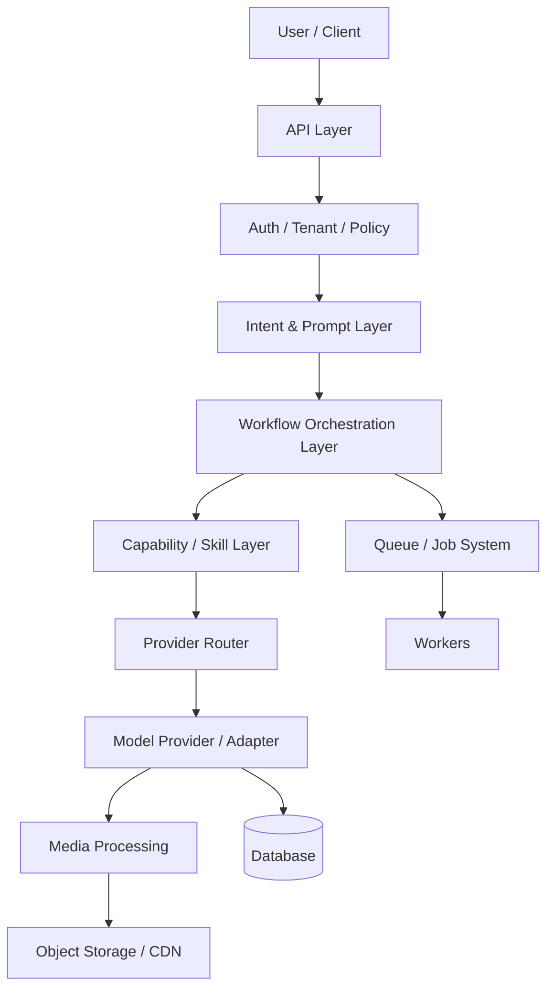
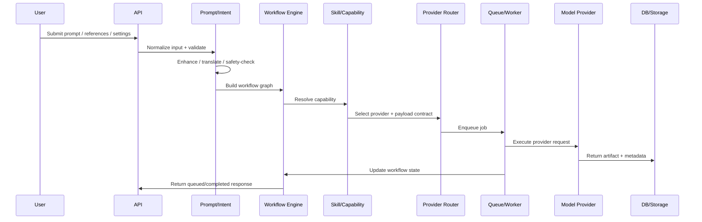
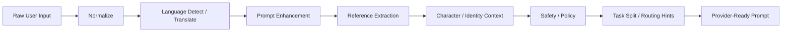
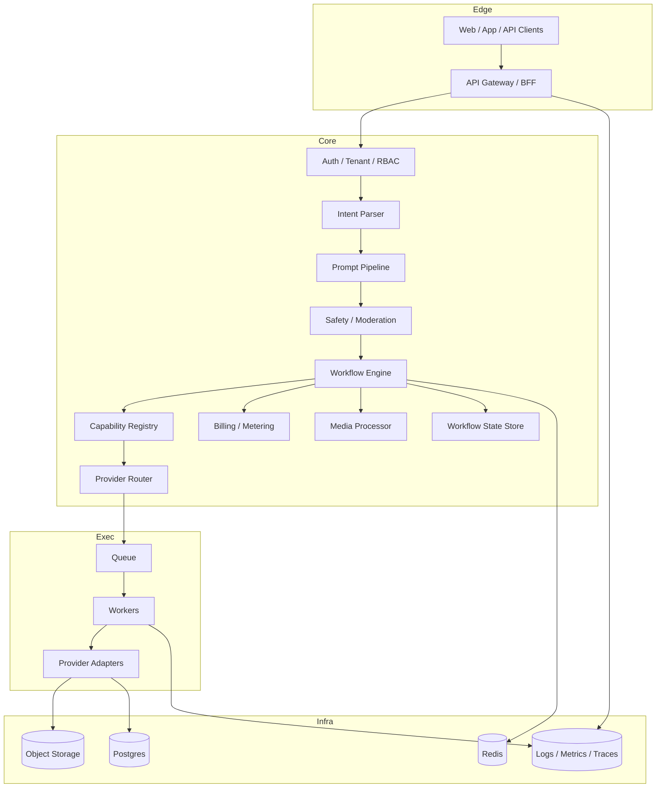
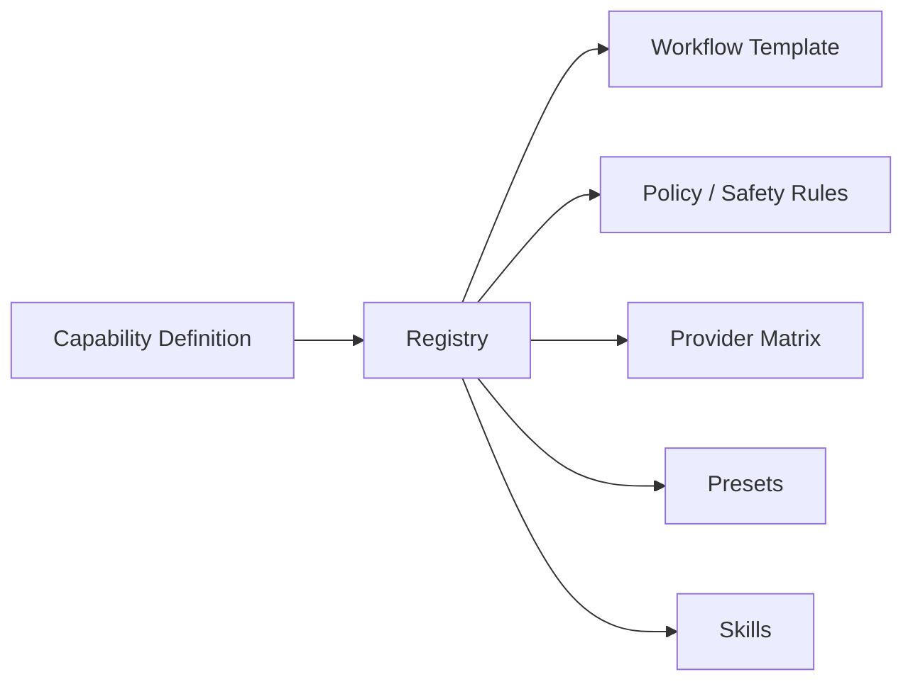
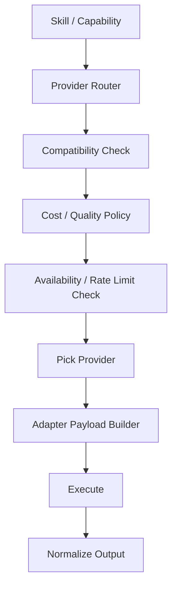

# AI SaaS Architecture Overview

Absolutely. I’ll treat this as a platform-architecture memo, not a code review.

The short version is: modern AI SaaS platforms stay sane by separating **intent interpretation**, **workflow orchestration**, **capability execution**, **provider routing**, **media handling**, **safety**, and **persistence** into distinct layers. The trick is not to make every feature a service. The trick is to make every feature a **configuration of the same few primitives**.

## 1) Main architectural layers



A production platform usually has these layers:

- **API layer**: receives requests, authenticates users, validates payloads, applies rate limits.
- **Intent layer**: turns user input into a normalized task shape.
- **Prompt layer**: assembles prompt, system instructions, references, style rules, safety rewriting, translations.
- **Workflow layer**: decides the sequence of steps for the job.
- **Capability / skill layer**: the domain logic for a feature family, like image generation or video edit.
- **Provider routing layer**: picks which model/provider should handle the task.
- **Execution layer**: calls the provider and handles retries, fallbacks, timeouts.
- **Media layer**: downloads, transforms, stores, and versions assets.
- **State layer**: persists workflow state, usage, billing, artifacts, and audit trails.

## 2) What happens between user input and model execution



Typical steps:

1. **Validate** the request shape.
2. **Resolve tenant and policy**: user, org, plan, limits, model access.
3. **Normalize intent**: what the user really wants.
4. **Process prompt**: rewrite, translate, enrich, constrain, or split into subprompts.
5. **Assemble workflow**: one-shot or multi-step graph.
6. **Resolve capability**: choose the feature module.
7. **Select provider**: choose model, version, mode, fallback route.
8. **Enqueue or execute**: sync for trivial tasks, async for heavy workloads.
9. **Track state**: queued, running, retrying, completed, failed, canceled.
10. **Persist outputs**: media, prompt transcript, safety decisions, billing events.

## 3) How prompt processing is typically organized

Prompt processing is rarely a single function. It’s usually a pipeline.



Common sub-stages:

- **Normalization**
  - trim, parse, remove invalid fields, coerce types
- **Language handling**
  - detect language, translate to preferred execution language, preserve named entities
- **Enhancement**
  - expand vague prompts, improve specificity, add cinematic or technical detail
- **Reference handling**
  - turn uploaded images into structured reference objects
- **Character consistency injection**
  - add identity anchors, appearance constraints, clothing, style, and “must preserve” rules
- **Safety rewriting**
  - remove disallowed content, soften unsafe requests, block if necessary
- **Provider adaptation**
  - convert the same semantic prompt into the specific model’s prompt format

A mature platform keeps prompt processing **provider-agnostic** until the last stage.

## 4) Components that should be shared across all features

These should almost always be platform-wide:

- **Auth / tenant / RBAC**
- **Request validation**
- **Usage metering**
- **Billing and quota enforcement**
- **Safety and moderation**
- **Prompt normalization**
- **Reference asset ingestion**
- **Storage abstraction**
- **Job queueing**
- **Workflow state machine**
- **Provider routing**
- **Retry / timeout / fallback policy**
- **Audit logging**
- **Telemetry / tracing**
- **Model registry**
- **Feature flagging**
- **Template / preset engine**

These are horizontal concerns. If duplicated in every feature, the platform becomes fragile fast.

## 5) Components that should be feature-specific

These belong in a feature or capability module:

- **Feature-specific prompt schema**
  - image prompt vs video prompt vs character sheet prompt
- **Feature-specific context assembly**
  - edit references, keyframes, motion drivers, product shots
- **Feature-specific post-processing**
  - face restoration, upscaling, frame interpolation, mask cleanup
- **Feature-specific provider mapping**
  - some models support only a subset of modes
- **Feature-specific validations**
  - aspect ratio rules, frame duration, mask constraints
- **Feature-specific state transitions**
  - example: “awaiting reference frames” for video editing
- **Feature-specific result interpretation**
  - image URL, frame sequence, subtitle track, mask overlay, etc.

The rule is: **shared infrastructure, specialized semantics**.

## 6) How common feature families are usually implemented

### Image generation
Purpose: generate one or many images from text and optional references.

Responsibilities:
- prompt enhancement
- style preset application
- provider selection
- batch or variation orchestration
- output normalization

Inputs:
- text prompt
- style preset
- aspect ratio
- seed
- reference images

Outputs:
- image artifact(s)
- generation metadata
- usage/billing record

Dependencies:
- prompt pipeline
- reference processor
- provider router
- storage
- billing

### Image editing
Purpose: modify an existing image while preserving identity or composition.

Responsibilities:
- base image selection
- mask or region handling
- edit intent interpretation
- preservation constraints
- provider-specific edit payload

Inputs:
- source image
- edit prompt
- optional mask / brush / bounding region
- reference images
- preservation rules

Outputs:
- edited image
- before/after metadata
- mask trace and prompt transcript

Dependencies:
- reference processor
- prompt enhancer
- provider router
- storage
- moderation

### Character consistency
Purpose: preserve identity across multiple generations.

Responsibilities:
- extract identity anchors
- store character profile
- inject consistent attributes into downstream prompts
- compare output against identity constraints

Inputs:
- character images
- trait descriptions
- previous generations
- style constraints

Outputs:
- character sheet
- identity embedding or structured profile
- consistency-guided prompts

Dependencies:
- vision extraction
- prompt assembly
- vector or structured profile store
- generation modules

### Avatars / character sheets
Usually a higher-level workflow built on top of image generation plus structured metadata.

Responsibilities:
- generate multiple canonical views
- enforce identity consistency
- organize shots by pose/view/style
- store structured character profile

Inputs:
- source portrait(s)
- desired categories: face, full body, expression, outfit, side view

Outputs:
- sheet of assets
- identity record
- reusable prompt template

Dependencies:
- generation skill
- reference processor
- storage
- registry / template system

### Video generation
Purpose: create video from text, keyframes, or references.

Responsibilities:
- mode selection
- keyframe or start-frame assembly
- prompt processing with temporal context
- duration/fps/resolution validation
- motion constraints
- frame-level artifact handling

Inputs:
- text
- images
- keyframes
- style and duration constraints

Outputs:
- video asset
- frame metadata
- timeline state
- retry/failure state

Dependencies:
- prompt pipeline
- media ingestion
- provider router
- storage
- queue/worker system

### Video editing
Purpose: modify an existing video while preserving selected parts.

Responsibilities:
- source clip selection
- edit semantics
- temporal masking or segment targeting
- audio preservation rules
- provider adaptation

Inputs:
- source video
- edit prompt
- edit regions or segment instructions

Outputs:
- edited video
- segment metadata
- edit history

Dependencies:
- workflow engine
- provider router
- storage
- media processing tools

### Reference-image workflows
Purpose: use one or more images as anchors.

Responsibilities:
- classify references by role
- extract structured tags
- compute identity/style/product anchors
- inject references into prompts and provider payloads

Inputs:
- uploaded references
- role labels
- target task type

Outputs:
- normalized reference bundle
- structured context block

Dependencies:
- reference processor
- image understanding service
- storage

## 7) How large platforms avoid hundreds of services

They do not create “one service per feature” unless the organization is enormous. Instead they use:

- **Capability modules**
- **Skill modules**
- **Handler plugins**
- **Registry-driven routing**
- **Shared orchestration**
- **Declarative workflow definitions**

A single service can host many capabilities if the boundaries are clean.

Good pattern:

- `image-generation`
- `image-editing`
- `video-generation`
- `video-editing`
- `character-consistency`
- `reference-processing`

Each module owns its own:
- schema
- prompt builder
- validation
- provider mappings
- post-processing hooks

But they all share:
- queue
- auth
- storage
- moderation
- billing
- telemetry

That keeps the total service count low while the internal module count can grow.

## 8) How capabilities, workflows, presets, and skills are separated

These are often confused, so here’s the clean split:

- **Capability**: what the platform can do
  - example: image generation, video edit
- **Workflow**: how a task runs step by step
  - example: upload refs -> enhance prompt -> generate -> post-process -> store
- **Preset**: a reusable parameter bundle
  - example: cinematic portrait, anime style, product shot
- **Skill**: a reusable execution unit with domain logic
  - example: “make character sheet”, “generate motion prompt”, “relight image”

A good mental model:

- capability = product feature
- workflow = execution graph
- preset = preconfigured input
- skill = implementation unit

## 9) How new features are added without modifying existing code

This is where registry-driven, config-driven architecture shines.

You add a new feature by registering metadata, not by rewriting old code.

Typical flow:
1. Define a new capability manifest.
2. Add schema and validation rules.
3. Add a skill module.
4. Register provider support in a registry.
5. Add workflow templates if needed.
6. Expose it through the API via config discovery.

The important pattern is:

- **Open for extension**
- **Closed for modification**

That means core routing code should not know the details of every feature. It should load capability definitions from a registry.

A good registry might contain:
- feature key
- supported modes
- required inputs
- prompt template id
- provider compatibility
- pricing policy
- safety policy
- post-processing chain

## 10) How workflows stay scalable at hundreds of features

The biggest scalability tricks are:

- **Normalize everything into a task envelope**
  - same envelope for image, video, text, and future features
- **Use declarative workflow graphs**
  - not hand-written imperative flows for every feature
- **Keep provider logic behind adapters**
  - provider API differences stay hidden
- **Use shared infrastructure services**
  - queue, storage, billing, moderation, telemetry
- **Make feature modules autonomous**
  - they own their schema and logic
- **Avoid shared mutable state**
  - especially in prompt processing and provider selection
- **Split queue classes by workload**
  - image, video, async transforms, batch jobs
- **Use state machines for workflow status**
  - queued, running, blocked, failed, complete
- **Make observability first-class**
  - tracing, cost per feature, provider latency, failure rates

If the platform grows to 50+ capabilities, the architecture should look like a **platform kernel plus capability plugins**, not a monolith of one-off services.

---

## Proposed production-grade architecture



### Folder structure

A scalable structure would usually look like this:

```text
src/
  app/
  api/
  core/
    auth/
    billing/
    moderation/
    telemetry/
    storage/
    queue/
    registry/
    routing/
    workflow/
  capabilities/
    text-generation/
    image-generation/
    image-editing/
    video-generation/
    video-editing/
    character-consistency/
    reference-processing/
    templates/
  skills/
    prompt-enhancement/
    translation/
    identity-extraction/
    scene-planning/
    mask-building/
    frame-planning/
  providers/
    openai/
    runway/
    midjourney/
    leonardo/
    krea/
    ideogram/
    fal/
    replicate/
  workflows/
    definitions/
    runners/
  contracts/
  shared/
```

### Dependency rules

- `api` can call `core` and `capabilities`
- `capabilities` can call `skills`, `core`, and `providers` only through adapters
- `skills` should not know HTTP or queue internals
- `providers` should not know business workflows
- `workflow runners` orchestrate capability execution
- `core` owns policy and infrastructure abstractions
- no capability should import another capability directly unless through a shared contract

### Provider abstraction

Use:
- `ProviderResolver`
- `ProviderAdapter`
- `ProviderCapabilityMatrix`
- `ProviderCostPolicy`

The provider adapter contract should normalize:
- inputs
- auth
- retries
- output extraction
- error translation
- latency reporting

### Queue flow

- API creates task envelope
- workflow engine stores initial state
- queue receives job with task id
- worker loads workflow state
- skill executes domain logic
- provider adapter performs execution
- result stored in DB/storage
- workflow state advances

### Worker flow

Workers should:
- load task envelope
- hydrate context
- resolve capability
- resolve provider
- execute step chain
- persist outputs
- emit billing events
- mark status transitions

### Billing integration

Billing should be an event-driven concern:
- reserve credits on enqueue or start
- commit on success
- release on failure/cancel
- record cost by provider and feature
- support retries without double charging

### Storage integration

Storage should be abstracted as:
- `putAsset`
- `getSignedUrl`
- `copyAsset`
- `deleteAsset`
- `deriveVariant`
- `storeMetadata`

Never let provider code write directly to storage unless through a storage abstraction.

---

## Registry architecture



A registry usually holds:
- capability key
- display name
- input schema
- workflow template
- allowed providers
- pricing policy
- safety policy
- feature flags
- presets
- post-processing chain

That registry is what lets the platform grow without hardcoding new branches everywhere.

---

## Provider routing architecture



Routing is usually based on:
- capability support
- mode support
- tenant plan
- budget
- quality tier
- latency tier
- fallback availability
- regional constraints
- safety restrictions

---

## Final recommendation

For a platform expected to support text, image, video, editing, character consistency, templates, workflows, and future capabilities, I would build:

- a **shared orchestration core**
- a **config-driven capability registry**
- **thin capability modules**
- a **single provider abstraction layer**
- **specialized skills** for prompt enhancement, translation, identity extraction, and media planning
- **event-driven billing and workflow state**
- **queue/workers split by workload class**
- **strict contracts for references, prompts, and outputs**

That gives you:
- low service count
- high extensibility
- less duplication
- easier provider swaps
- safer scaling
- better observability
- clean feature growth over time

The deeper truth is this: the platforms that feel magical to users usually look boring internally. Not simple, but boring in the best way: a few strong primitives, lots of declarative configuration, and very little special-case code.
