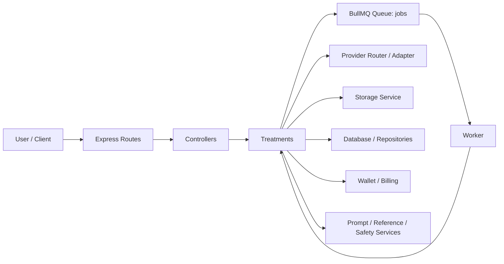
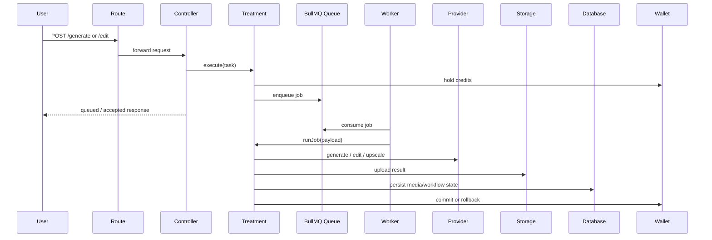
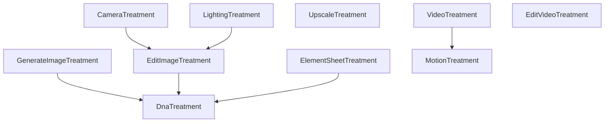
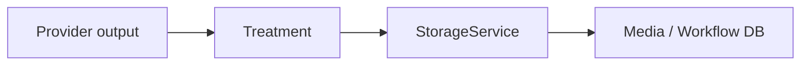
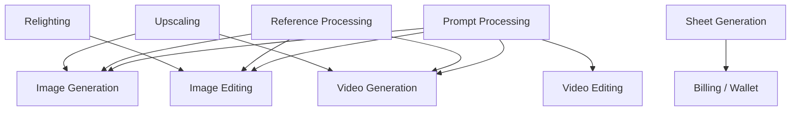
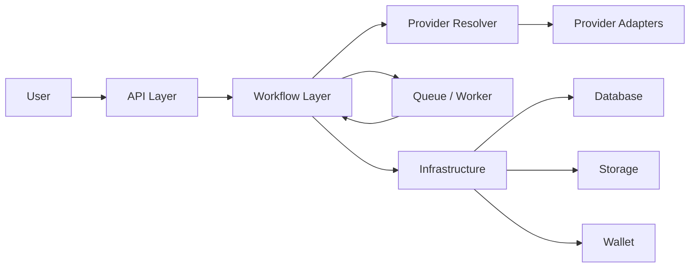

# Full Architecture & Codebase Review

Scope: `C:\Users\jihad\Desktop\open art\apiOpenArt`

This report is based on the actual codebase, not on a generic architecture template.

## Executive Summary

This backend is a **modular monolith with a queue-backed execution layer**, not a microservice architecture.

The system is centered around:

- Express routes and controllers
- A shared composition root in `src/container.js`
- A single BullMQ queue named `jobs`
- A worker that resolves a treatment by type
- Treatments that orchestrate provider execution, storage writes, wallet billing, and workflow state updates
- Provider routers for image and video models
- Shared prompt, reference, storage, wallet, and pricing services

The architecture is functional and already has a strong kernel for AI execution, but it is carrying too much orchestration inside treatment classes. The biggest long-term problems are:

- duplicated provider resolution
- duplicated prompt pipelines
- treatments doing orchestration + billing + queueing + storage + persistence all at once
- a single shared queue for all workloads
- legacy task files that are effectively dead code
- controller leakage into treatment internals

I did not find circular import cycles in the runtime import graph scan. The structural problem here is **coupling by responsibility**, not import loops.

---

## 1. Current Architecture

### 1.1 What exists today

The public API is mounted in `src/api/routes.js`, which wires the major feature routers together: auth, workflows, video, images, element sheets, projects, sessions, models, assets, camera, lighting, media, prompt, and payments.

Evidence:

- `C:\Users\jihad\Desktop\open art\apiOpenArt\src\api\routes.js:1-37`

The image and video entry points are thin HTTP layers that dispatch into controllers and treatments:

- Image routes: `C:\Users\jihad\Desktop\open art\apiOpenArt\routes\images.js:1-12`
- Video routes: `C:\Users\jihad\Desktop\open art\apiOpenArt\routes\video.js:1-21`
- Camera routes: `C:\Users\jihad\Desktop\open art\apiOpenArt\routes\camera.js:1-169`
- Lighting routes: `C:\Users\jihad\Desktop\open art\apiOpenArt\routes\lighting.js:1-73`
- Media routes: `C:\Users\jihad\Desktop\open art\apiOpenArt\routes\media.js:1-10`
- Element sheet route/controller pair: `C:\Users\jihad\Desktop\open art\apiOpenArt\routes\elementSheet.js:1-27` and `C:\Users\jihad\Desktop\open art\apiOpenArt\controllers\elementSheetController.js:1-68`
- Model registry endpoints: `C:\Users\jihad\Desktop\open art\apiOpenArt\routes\modelsRoute.js:1-125`

The composition root is `src/container.js`. It instantiates shared infrastructure services, repositories, and treatments in one place.

Evidence:

- `C:\Users\jihad\Desktop\open art\apiOpenArt\src\container.js:38-112`

The queue system is one BullMQ queue named `jobs`, and the worker resolves the treatment dynamically by type.

Evidence:

- Queue creation and add path: `C:\Users\jihad\Desktop\open art\apiOpenArt\src\queue\queue.js:1-18`
- Job payload wrapper: `C:\Users\jihad\Desktop\open art\apiOpenArt\src\queue\treatmentJob.js:1-45`
- Worker dispatch: `C:\Users\jihad\Desktop\open art\apiOpenArt\src\workers\worker.js:31-50`
- Treatment registry: `C:\Users\jihad\Desktop\open art\apiOpenArt\src\treatments\treatmentRegistry.js:20-50`

### 1.2 Current architecture diagram



### 1.3 What this means in practice

The codebase is organized as a **modular monolith**:

- routes/controllers own HTTP entry points
- treatments own execution orchestration
- providers own model-specific execution
- storage owns uploads and asset persistence
- db repositories own workflow/media/project/session persistence
- wallet service owns credit reservation and settlement

That structure is workable, but the treatment layer is too broad. It is acting as:

- use-case orchestration
- billing orchestrator
- async job producer
- async job consumer
- media lifecycle manager
- provider adapter consumer
- workflow persistence writer

That is the main scalability tension.

---

## 2. Request Lifecycle

### 2.1 Synchronous request path

For generation features, the HTTP request usually enters a route, then a controller, then a treatment `execute(...)` method.

Typical example:

- route mounts controller
- controller validates the request and creates a treatment task
- treatment verifies provider eligibility, checks wallet balance, prepares prompt/reference data, reserves credits, and enqueues work
- controller returns a queued or accepted response

### 2.2 Asynchronous job path

Once the job is queued:

1. BullMQ worker reads the job payload
2. worker resolves the treatment by `type`
3. worker invokes `treatment.runJob(payload)`
4. treatment resolves provider/model selection
5. treatment calls provider execution
6. treatment writes media to storage
7. treatment marks media/workflow status in the database
8. treatment commits or rolls back wallet credits

### 2.3 Request lifecycle diagram



### 2.4 Important concrete deviations

Not every flow is cleanly layered.

Examples:

- `routes/camera.js` directly uses `CameraTask` and prompt helpers instead of staying purely controller-driven.
  - `C:\Users\jihad\Desktop\open art\apiOpenArt\routes\camera.js:1-169`
- `controllers/videoController.js` reaches into treatment internals for some media lookups.
  - `C:\Users\jihad\Desktop\open art\apiOpenArt\controllers\videoController.js:208-414`
- `controllers/paymentsController.js` handles webhook verification and wallet crediting inline.
  - `C:\Users\jihad\Desktop\open art\apiOpenArt\controllers\paymentsController.js:113-215`

These are not style issues. They are boundary leaks.

---

## 3. Treatment Inventory

### 3.1 Current treatments found in the codebase

The treatment registry currently wires these execution classes:

- `GenerateImageTreatment`
- `EditImageTreatment`
- `CameraTreatment`
- `LightingTreatment`
- `UpscaleTreatment`
- `ElementSheetTreatment`
- `VideoTreatment`
- `MotionTreatment`
- `EditVideoTreatment`

Evidence:

- `C:\Users\jihad\Desktop\open art\apiOpenArt\src\treatments\treatmentRegistry.js:20-50`

### 3.2 Treatment responsibilities

#### GenerateImageTreatment

Purpose:

- prepares image generation tasks
- processes prompt and references
- delegates to base generate logic

Evidence:

- `C:\Users\jihad\Desktop\open art\apiOpenArt\src\image\treatments\extendtretment\GenerateImageTreatment.js:16-124`
- `C:\Users\jihad\Desktop\open art\apiOpenArt\src\image\treatments\basetretment\BaseGenerateImageTreatment.js:42-576`

#### EditImageTreatment

Purpose:

- prepares image edit tasks
- normalizes reference inputs
- delegates to shared edit base logic

Evidence:

- `C:\Users\jihad\Desktop\open art\apiOpenArt\src\image\treatments\extendtretment\EditImageTreatment.js:10-51`
- `C:\Users\jihad\Desktop\open art\apiOpenArt\src\image\treatments\basetretment\BaseEditTreatment.js:24-466`

#### CameraTreatment

Purpose:

- specialized image-edit flow for camera-driven workflows

Evidence:

- `C:\Users\jihad\Desktop\open art\apiOpenArt\src\image\treatments\extendtretment\CameraEditTreatment.js:167-278`

#### LightingTreatment

Purpose:

- specialized relighting flow

Evidence:

- `C:\Users\jihad\Desktop\open art\apiOpenArt\src\image\treatments\extendtretment\LightingTreatment.js:234-329`

#### UpscaleTreatment

Purpose:

- handles image/video upscale variants

Evidence:

- `C:\Users\jihad\Desktop\open art\apiOpenArt\src\image\treatments\UpscaleTreatment.js:27-284`

#### ElementSheetTreatment

Purpose:

- produces deterministic element/character/location/product sheet workflows
- enforces validation and safety rules

Evidence:

- `C:\Users\jihad\Desktop\open art\apiOpenArt\src\image\treatments\extendtretment\ElementSheetTreatment.js:845-958`

#### VideoTreatment

Purpose:

- video generation flow
- provider validation
- prompt optimization
- job execution

Evidence:

- `C:\Users\jihad\Desktop\open art\apiOpenArt\src\video\treatments\VideoTreatment.js:154-477`

#### MotionTreatment

Purpose:

- motion control workflow for video

Evidence:

- `C:\Users\jihad\Desktop\open art\apiOpenArt\src\video\treatments\MotionTreatment.js:27-406`

#### EditVideoTreatment

Purpose:

- video editing flow

Evidence:

- `C:\Users\jihad\Desktop\open art\apiOpenArt\src\video\treatments\EditVideoTreatment.js:9-336`

#### DnaTreatment

Purpose:

- stores and extracts DNA-like metadata used by element sheet flows

Evidence:

- `C:\Users\jihad\Desktop\open art\apiOpenArt\src\dna\DnaTreatment.js:50-154`

### 3.3 What the treatments have in common

Most treatments repeat the same pattern:

- validate input
- resolve provider/model
- optimize prompt
- reserve wallet credits
- enqueue or execute
- run provider
- upload result
- update workflow/media records
- commit or roll back credits

That is a strong sign that the orchestration belongs in shared pipeline components, not copied treatment-by-treatment.

### 3.4 Treatment diagram



---

## 4. Dependency Analysis

### 4.1 Core dependency chain

The main production chain is:

`Route -> Controller -> Treatment -> Queue -> Worker -> Treatment.runJob -> Provider -> Storage -> Database`

Concrete evidence:

- route mounts: `C:\Users\jihad\Desktop\open art\apiOpenArt\src\api\routes.js:1-37`
- treatment registry: `C:\Users\jihad\Desktop\open art\apiOpenArt\src\treatments\treatmentRegistry.js:20-50`
- queue: `C:\Users\jihad\Desktop\open art\apiOpenArt\src\queue\queue.js:1-18`
- worker: `C:\Users\jihad\Desktop\open art\apiOpenArt\src\workers\worker.js:31-50`
- storage: `C:\Users\jihad\Desktop\open art\apiOpenArt\src\services\StorageService.js:4-67`
- wallet: `C:\Users\jihad\Desktop\open art\apiOpenArt\src\services\WalletService.js:11-240`

### 4.2 Hidden dependencies

The codebase also has hidden dependencies through:

- treatment internals being accessed directly by controllers
- shared repositories attached to treatments
- shared prompt services used from multiple unrelated paths
- pricing config importing treatment defaults

Examples:

- `controllers/videoController.js` reaching into treatment state: `C:\Users\jihad\Desktop\open art\apiOpenArt\controllers\videoController.js:208-414`
- pricing config depending on treatment defaults: `C:\Users\jihad\Desktop\open art\apiOpenArt\src\config\pricing.js:6-84`
- model registry filtering duplicated between helper and route: `C:\Users\jihad\Desktop\open art\apiOpenArt\lib\modelRegistryKeys.js:5-72` and `C:\Users\jihad\Desktop\open art\apiOpenArt\routes\modelsRoute.js:25-123`

### 4.3 Circular dependencies

Import graph scan result:

- 147 files scanned
- 0 circular import cycles found

That is a positive sign. The current risk is not import recursion. The risk is architecture drift and overlapping responsibilities.

---

## 5. Prompt Processing, Translation, Safety, and Reference Pipelines

### 5.1 Prompt pipeline is split across two systems

There are two prompt systems in the repository:

#### Legacy prompt service

`src/services/PromptService.js` handles:

- prompt safety checking
- translation
- prompt optimization
- negative prompt generation
- DNA generation / expansion

Evidence:

- `C:\Users\jihad\Desktop\open art\apiOpenArt\src\services\PromptService.js:9-140`

#### New structured prompt service

`src/services/promptServiceV2.js` handles:

- DNA header construction
- edit context building
- video context building
- prompt processing
- video prompt processing

Evidence:

- `C:\Users\jihad\Desktop\open art\apiOpenArt\src\services\promptServiceV2.js:64-671`

### 5.2 Actual prompt flow

In practice:

- image generation uses `processPrompt(...)`
- image editing uses `processPrompt(...)` with edit context
- video generation and motion flows use `processVideoPrompt(...)`
- older paths still use `PromptService.generateNegativePrompt(...)` and `optimizePrompt(...)`

This means prompt processing is **not centralized**.

### 5.3 Translation

There is no standalone translation module.

Translation is embedded inside prompt processing:

- `PromptService.checkPrompt(...)`
- `PromptService.optimizePrompt(...)`

Evidence:

- `C:\Users\jihad\Desktop\open art\apiOpenArt\src\services\PromptService.js:9-118`

### 5.4 Safety and moderation

Safety is also embedded in prompt processing and in some deterministic treatments.

Examples:

- prompt safety checks in `PromptService`
- safety gating in `ElementSheetTreatment`

Evidence:

- `C:\Users\jihad\Desktop\open art\apiOpenArt\src\services\PromptService.js:9-43`
- `C:\Users\jihad\Desktop\open art\apiOpenArt\src\image\treatments\extendtretment\ElementSheetTreatment.js:845-958`

### 5.5 Reference image processing

Reference handling is centralized in `ReferenceProcessor`.

It:

- normalizes roles
- resolves workflow references
- rejects base64 reference uploads
- resolves media IDs and URLs
- validates entity references

Evidence:

- `C:\Users\jihad\Desktop\open art\apiOpenArt\src\utils\ReferenceProcessor.js:6-166`

### 5.6 Media state helpers

Workflow/media state transitions are managed by helpers:

- `markMediaStatus`
- `markMediaFailed`
- `createWorkflowWithMedia`
- `appendMediaToWorkflow`

Evidence:

- `C:\Users\jihad\Desktop\open art\apiOpenArt\src\db\workflowMediaOps.js:11-76`
- `C:\Users\jihad\Desktop\open art\apiOpenArt\lib\mediaGuards.js:14-79`

### 5.7 Idempotency helpers

Repeated retry work is guarded by helpers such as `skipIfMediaAlreadyDone(...)`.

Evidence:

- `C:\Users\jihad\Desktop\open art\apiOpenArt\src\utils\skipIfMediaAlreadyDone.js:8-33`

---

## 6. Provider Architecture Review

### 6.1 What exists

The provider architecture is split by media type:

- image routing in `src/image/core/modelRouter.js`
- video routing in `src/video/core/modelRouter.js`

Evidence:

- `C:\Users\jihad\Desktop\open art\apiOpenArt\src\image\core\modelRouter.js:1-376`
- `C:\Users\jihad\Desktop\open art\apiOpenArt\src\video\core\modelRouter.js:1-314`

Shared base abstractions exist:

- `BaseModel`
- `BaseTextProvider`
- `GroqProvider`
- `OpenAITextProvider`

Evidence:

- `C:\Users\jihad\Desktop\open art\apiOpenArt\src\core\BaseModel.js:1-80`
- `C:\Users\jihad\Desktop\open art\apiOpenArt\src\core\providers\BaseTextProvider.js:1-8`
- `C:\Users\jihad\Desktop\open art\apiOpenArt\src\core\providers\GroqProvider.js:1-47`
- `C:\Users\jihad\Desktop\open art\apiOpenArt\src\core\providers\OpenAITextProvider.js:1-33`

### 6.2 Strengths

- provider capability metadata is already modeled
- image and video have explicit routing registries
- `BaseModel` provides a common abstraction for model metadata and generation variants

### 6.3 Weaknesses

Provider resolution is duplicated across the codebase:

- image generation resolves providers through its own strategy
- image editing resolves providers again in base edit logic
- video uses its own `getRunner` / validation logic
- motion and edit-video have more provider-specific branching
- upscale has its own image/video branch logic

Evidence:

- `C:\Users\jihad\Desktop\open art\apiOpenArt\src\image\treatments\basetretment\providerStrategy.js`
- `C:\Users\jihad\Desktop\open art\apiOpenArt\src\image\treatments\basetretment\BaseEditTreatment.js:24-37`
- `C:\Users\jihad\Desktop\open art\apiOpenArt\src\video\core\modelRouter.js:20-314`
- `C:\Users\jihad\Desktop\open art\apiOpenArt\src\video\treatments\VideoTreatment.js:154-477`
- `C:\Users\jihad\Desktop\open art\apiOpenArt\src\video\treatments\MotionTreatment.js:27-406`
- `C:\Users\jihad\Desktop\open art\apiOpenArt\src\image\treatments\UpscaleTreatment.js:27-284`

### 6.4 Recommended provider architecture

The codebase needs one shared provider resolution layer:

- `ProviderResolver`
- typed capability metadata
- one routing contract for image, video, and future modalities
- capability-specific provider adapters underneath that contract

That would reduce duplicated branching and make future provider addition safer.

---

## 7. Billing and Event Handling

### 7.1 Billing architecture today

Billing has two major behaviors:

1. **wallet reservation and settlement** around generation work
2. **payment webhook crediting** for top-ups

Wallet service:

- hold credits
- commit credits
- roll back credits
- enforce idempotency

Evidence:

- `C:\Users\jihad\Desktop\open art\apiOpenArt\src\services\WalletService.js:11-240`

Payment webhook:

- verifies webhook signature
- accepts paid order events
- looks up package credits
- credits wallet with idempotent reference

Evidence:

- `C:\Users\jihad\Desktop\open art\apiOpenArt\controllers\paymentsController.js:113-215`

### 7.2 What is missing

There is no general internal event bus or domain event stream in the codebase.

That means:

- billing state
- workflow state
- media state
- provider state

are all coordinated through inline logic and repository calls.

This works now, but it will get brittle as more workflows are added.

---

## 8. Storage and Media Pipeline

### 8.1 Storage

`StorageService` wraps the storage provider and handles:

- upload
- upload-from-URL
- delete

Evidence:

- `C:\Users\jihad\Desktop\open art\apiOpenArt\src\services\StorageService.js:4-67`

### 8.2 Media lifecycle

Media status updates and workflow associations are managed in DB helper functions and guards.

Evidence:

- `C:\Users\jihad\Desktop\open art\apiOpenArt\src\db\workflowMediaOps.js:11-76`
- `C:\Users\jihad\Desktop\open art\apiOpenArt\lib\mediaGuards.js:14-79`

### 8.3 Media pipeline shape



---

## 9. Capability Mapping

### 9.1 Real capabilities in the codebase

The product surface is broader than the underlying capability set.

The actual reusable capabilities appear to be:

- image generation
- image editing
- video generation
- video editing
- motion control
- relighting
- upscaling
- sheet generation
- DNA extraction / metadata enrichment
- prompt processing
- reference processing
- billing / wallet reservation

### 9.2 What the code treats as features

Feature-level treatments include:

- camera flows
- lighting flows
- element sheets
- image variations
- image edits
- video edits
- motion control
- upscale flows

These are variants of a smaller number of core capabilities.

### 9.3 Capability map



---

## 10. Complexity Audit

### 10.1 Critical

#### Single queue for all workloads

All jobs go through `jobs`, which couples retries, throughput, and operational behavior across all features.

Evidence:

- `C:\Users\jihad\Desktop\open art\apiOpenArt\src\queue\queue.js:1-18`
- `C:\Users\jihad\Desktop\open art\apiOpenArt\src\workers\worker.js:31-50`

#### Treatments own too much orchestration

Treatments handle prompt processing, provider resolution, wallet flow, storage, persistence, and async execution.

Evidence:

- `C:\Users\jihad\Desktop\open art\apiOpenArt\src\image\treatments\basetretment\BaseGenerateImageTreatment.js:146-576`
- `C:\Users\jihad\Desktop\open art\apiOpenArt\src\image\treatments\basetretment\BaseEditTreatment.js:61-466`
- `C:\Users\jihad\Desktop\open art\apiOpenArt\src\video\treatments\VideoTreatment.js:168-477`

#### Provider resolution duplication

Provider routing logic is spread across image, edit, video, motion, and upscale flows.

Evidence:

- `C:\Users\jihad\Desktop\open art\apiOpenArt\src\image\treatments\basetretment\providerStrategy.js`
- `C:\Users\jihad\Desktop\open art\apiOpenArt\src\image\treatments\basetretment\BaseEditTreatment.js:24-37`
- `C:\Users\jihad\Desktop\open art\apiOpenArt\src\video\core\modelRouter.js:20-314`

### 10.2 High

#### Prompt pipeline duplication

Two prompt systems coexist and some route-level logic still constructs prompts directly.

Evidence:

- `C:\Users\jihad\Desktop\open art\apiOpenArt\src\services\PromptService.js:9-140`
- `C:\Users\jihad\Desktop\open art\apiOpenArt\src\services\promptServiceV2.js:64-671`
- `C:\Users\jihad\Desktop\open art\apiOpenArt\routes\camera.js:1-169`

#### Controller leakage into treatment internals

Controllers should not reach into treatment state or repositories directly.

Evidence:

- `C:\Users\jihad\Desktop\open art\apiOpenArt\controllers\videoController.js:208-414`

#### Legacy task files appear dead

These files are present but are not part of the actual runtime flow:

- `src/image/tasks/ImageGenerationTask.js`
- `src/image/tasks/ImageEditTask.js`
- `src/image/tasks/UpscaleTask.js`
- `src/image/tasks/VideoUpscaleTask.js`

Repo-wide search did not find runtime callers outside the files themselves.

### 10.3 Medium

#### Model registry filtering is split

Hidden-model logic exists in both helper and route-level filtering.

Evidence:

- `C:\Users\jihad\Desktop\open art\apiOpenArt\lib\modelRegistryKeys.js:5-72`
- `C:\Users\jihad\Desktop\open art\apiOpenArt\routes\modelsRoute.js:25-123`

#### Pricing config depends on treatment implementations

Pricing config imports treatment defaults directly, tying config to code classes.

Evidence:

- `C:\Users\jihad\Desktop\open art\apiOpenArt\src\config\pricing.js:6-84`

#### No general internal event bus

The system has webhook handling, but not a broader event architecture for workflow and billing events.

Evidence:

- `C:\Users\jihad\Desktop\open art\apiOpenArt\controllers\paymentsController.js:113-215`
- `C:\Users\jihad\Desktop\open art\apiOpenArt\src\db\workflowMediaOps.js:11-76`

### 10.4 Low

#### Some feature routes still mix orchestration helpers with HTTP concerns

This is less severe than the items above, but it reinforces the same boundary drift.

Evidence:

- `C:\Users\jihad\Desktop\open art\apiOpenArt\routes\camera.js:1-169`
- `C:\Users\jihad\Desktop\open art\apiOpenArt\routes\lighting.js:1-73`

---

## 11. Duplication Found

### 11.1 Provider resolution

Repeated in:

- image generation
- image editing
- video generation
- motion control
- video editing
- upscale paths

This should collapse into one `ProviderResolver`.

### 11.2 Prompt processing

Repeated in:

- `PromptService`
- `promptServiceV2`
- treatment-specific `optimizePrompt(...)`
- route-level camera prompt construction

This should be centralized into a shared prompt pipeline with mode-specific stages.

### 11.3 Wallet / billing settlement patterns

The same hold/commit/rollback pattern is repeated around multiple generation flows.

That is correct behavior, but the orchestration should be shared.

### 11.4 Media status handling

Media and workflow state updates are repeated by feature, instead of being managed by a reusable state machine helper.

Evidence:

- `C:\Users\jihad\Desktop\open art\apiOpenArt\src\db\workflowMediaOps.js:11-76`
- `C:\Users\jihad\Desktop\open art\apiOpenArt\lib\mediaGuards.js:14-79`

---

## 12. Workflow Analysis

### 12.1 Existing workflow families

The codebase contains several workflow families that are basically variants of the same root capability:

- image generation
- image edit
- camera edit
- relighting
- element sheet generation
- video generation
- motion control
- video edit
- upscale

### 12.2 Which are unique

Truly distinct workflows:

- payment webhook ingestion
- wallet top-up crediting
- DNA extraction / metadata persistence

### 12.3 Which are variants

Variants of shared root workflows:

- camera and lighting are specialized image-edit flows
- motion and video edit are specialized video workflows
- element sheet flows are specialized generation flows with stronger deterministic post-processing

### 12.4 Workflow consolidation opportunity

The code should not keep creating new treatment classes for every feature variation.

It should move toward:

- capability workflows
- configuration-driven variants
- shared execution stages

---

## 13. Recommended Architecture

### 13.1 What I would build for the next 5 years

Keep the modular monolith.

Do not split into microservices yet.

Introduce four strong internal layers:

1. **API layer**
   - routes, controllers, request validation

2. **Workflow layer**
   - capability workflows, prompt pipeline, reference pipeline, moderation, billing orchestration

3. **Provider layer**
   - unified provider resolver and adapters

4. **Infrastructure layer**
   - queue, worker, storage, db, wallet, config, model registry

### 13.2 Recommended architecture diagram



### 13.3 Dependency rules

Recommended rules:

- controllers can call workflows
- workflows can call shared pipeline services
- workflows can call provider resolver and infrastructure services
- providers must not know about HTTP
- storage must not know about prompt logic
- billing must be a shared service, not feature-local logic
- treatments should become thin workflow wrappers or disappear into capability handlers

### 13.4 Folder structure

```text
src/
  api/
    routes/
    controllers/
    validators/
  application/
    workflows/
    capabilities/
    treatments/
    prompt/
    references/
    moderation/
    billing/
  domain/
    models/
    registry/
    pricing/
    capability-map/
  infrastructure/
    queue/
    worker/
    storage/
    db/
    providers/
    wallets/
  shared/
    utils/
    guards/
    constants/
```

### 13.5 What should be shared globally

- prompt processing
- moderation / safety
- reference processing
- provider resolution
- billing reservation / settlement
- workflow status transitions
- storage upload handling
- retry and idempotency logic

### 13.6 What should remain feature-specific

- workflow templates
- feature-specific prompt presets
- post-processing rules
- output schema
- capability-specific validation
- UI-facing metadata

---

## 14. Simplification Opportunities

### 14.1 Merge

- merge provider routing into one provider resolver
- merge prompt processing into one pipeline
- merge workflow state writes into one helper/service
- merge camera/lighting/edit variants into shared image-edit capability handlers
- merge motion/edit-video variants into shared video capability handlers

### 14.2 Remove

- orphaned task files under `src/image/tasks`
- direct treatment internals leaked into controllers

### 14.3 Centralize

- model visibility filtering
- pricing lookup
- wallet reservation behavior
- reference validation
- DNA enrichment

### 14.4 Convert into configuration

- model routing
- feature flags
- pricing tables
- prompt presets
- capability metadata

---

## 15. Migration Plan

### Phase 1: Stabilize boundaries

Impact:

- low to medium

Risk:

- low

Work:

- stop controller access to treatment internals
- isolate prompt construction into a single shared service
- keep behavior identical

### Phase 2: Unify provider resolution

Impact:

- high

Risk:

- medium

Work:

- introduce one `ProviderResolver`
- move image/video branching behind a unified contract
- keep old APIs as adapters initially

### Phase 3: Split orchestration from execution

Impact:

- high

Risk:

- medium to high

Work:

- move wallet, queue, workflow, and storage orchestration out of individual treatments
- turn treatments into thinner capability handlers

### Phase 4: Consolidate capability workflows

Impact:

- very high

Risk:

- medium

Work:

- group image/video/editor variants into capability families
- use shared workflow templates and configuration-driven variants

### Phase 5: Clean up legacy code

Impact:

- medium

Risk:

- low

Work:

- remove dead task files
- remove duplicated routing/filtering logic
- unify config and registry patterns

---

## 16. Technical Debt Report

### Highest-value debt

1. duplicated provider routing
2. duplicated prompt pipelines
3. treatment orchestration overload
4. single queue coupling
5. dead legacy task files
6. controller boundary leaks

### Why this matters

The current system can keep shipping features, but each new feature is likely to make the same architecture smell worse:

- more branching
- more duplicated code
- more hidden state
- more maintenance cost

The fastest path forward is not a rewrite. It is tightening the internal architecture around a smaller number of shared pipeline services.

---

## 17. Final Answer in One Sentence

This backend is already a capable modular AI monolith, but it needs one shared prompt pipeline, one shared provider resolver, one shared workflow/billing orchestration layer, and fewer feature-specific treatment clones if it is going to scale cleanly for the next five years.

