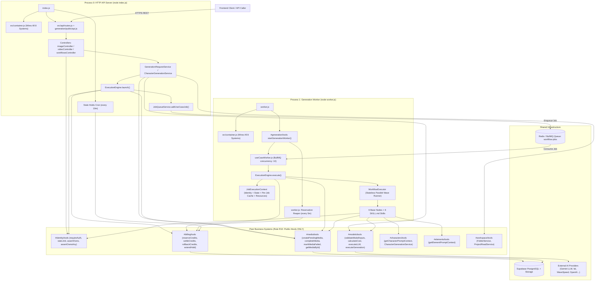
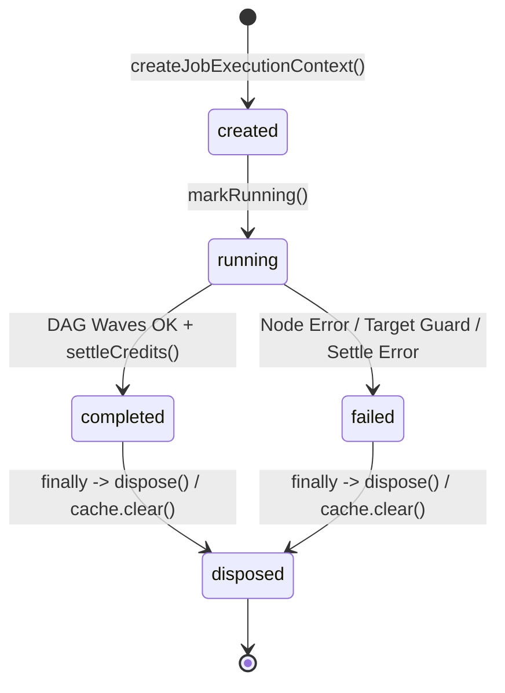
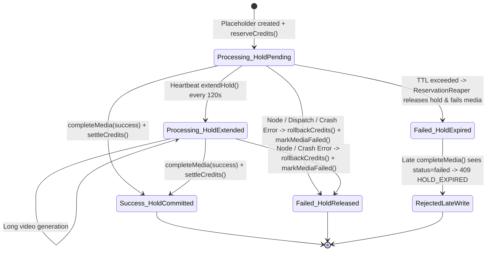
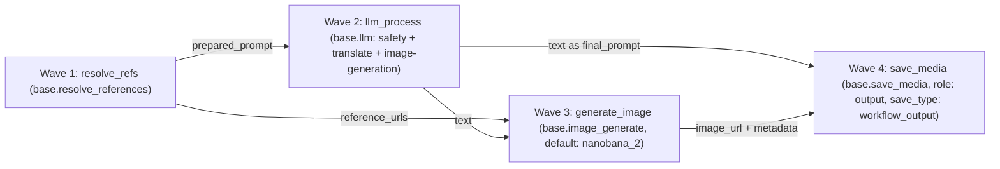
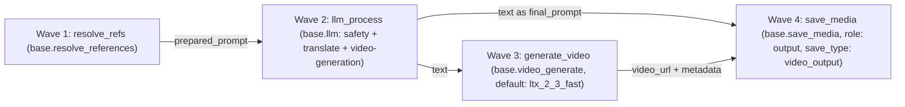
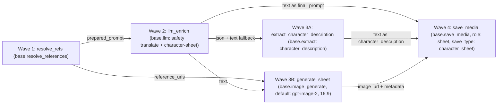

# Generation System — Complete Architecture & Health Blueprint (`apiOpenArt`)

> **Scope:** Complete technical map of **System 1: Generation & Workflows** (`src/systems/generation/`), its two-process runtime (`index.js` + `worker.js`), its V3 Execution Core, its cross-system contracts, and an honest engineering assessment of what is production-ready vs. what remains to reach 10/10.

---

## 1. Executive Verdict: Is the Architecture in Its Best Shape?

**Short answer:** The **core architecture and execution engine are solid (~8.5/10)** — clean modular-monolith boundaries (`R1`–`R17`, `0` violations, `0` cycles), strict per-job execution isolation (`JobExecutionContext`), single-output determinism (`1 generation = 1 job = 1 media`), two-phase credit holds, and proper standalone worker bootstrapping via `worker.js`.

However, to reach **10/10 production perfection**, there are still **4 high-impact runtime seam bugs (`H5`–`H8`)**, **4 medium hardening items (`M1`–`M4`)**, and **2 strategic flow cleanups** documented in [Section 9](#9-honest-health-audit-what-remains-to-reach-1010).

### Architecture Health Scorecard

| Dimension | Score | Current Reality | What Moves It to 10/10 |
|---|---:|---|---|
| **System Boundaries (`R1`–`R17`)** | **10/10** | Zero violations, zero cycles, strict `#<system>/tools` gateways, `arch-baseline.json` = `{}` | Keep enforced via `npm run gate` |
| **Worker Bootstrap & Isolation** | **9.5/10** | Dedicated root `worker.js` wires `src/container.js` first; fail-fast `assertWorkerConfigured()` prevents unconfigured consumption | Stop `#billing/tools` from auto-starting `walletWorker.js` in both API & worker processes |
| **Per-Job Isolation & Cache** | **9.5/10** | Zero process-global cache; `JobExecutionContext` owns per-run `Map` cleared in `finally`; SHA-256 scoped by `{ runId, userId }` | Add `AbortSignal` cancellation when needed |
| **V3 Nodes & `SKILL.md` Design** | **9/10** | 6 small composable base nodes + 6 standalone `SKILL.md` files; fail-closed unknown skills & safety guard | Fix transient LLM error classification (`M2`) |
| **Billing Two-Phase Integrity** | **8.5/10** | Upfront hold, heartbeat extension, settle on success, idempotent rollback on error/crash, reaper fallback | Fix compile-time image/default pricing (`H5`) + reserve credits *before* DB placeholder creation |
| **Media & Reference Resolution** | **6/10** | Single placeholder + `completeMedia` (`status: "success"`) works for text-to-image | Fix ID-to-URL resolution (`H6`), Supabase Storage re-hosting (`H7`), and `is_primary` preservation (`H8`) |
| **Request / UseCase Separation** | **8/10** | Request layer builds UI container; `ExecutionEngine` owns billing/lifecycle; blueprints declare AI DAG | Optionally move `completeMedia` out of blueprints into `ExecutionEngine.execute()` for pure single-output pipelines |

---

## 2. Two-Process Runtime Topology & Cross-System Map

The backend runs as **two independent Node.js processes** sharing the exact same composition root (`src/container.js`), communicating asynchronously through **Upstash Redis / BullMQ** (`v2-workflow-jobs`) and persisting state in **Supabase PostgreSQL / Storage**.



### Why Root `worker.js` Exists (Peer of `index.js`)
- Under **Rule R16** (`scripts/arch-check.cjs`), files inside `src/systems/**` cannot import `src/container.js` directly.
- Previously, starting `src/systems/generation/internal/workers/worker.js` directly bypassed `src/container.js`, leaving `ExecutionEngine`, `WalletService`, `MediaWorkflowLifecycleService`, and `OwnershipService` unwired.
- Root `worker.js` mirrors `index.js`: it boots `src/container.js` first (wiring all 8 systems), then calls `startGenerationWorker()` from `#generation/tools` (lazy dynamic import so `index.js` never starts BullMQ workers).
- `useCaseWorker.js` calls `assertWorkerConfigured()` before instantiating BullMQ `Worker` in non-test environments, failing fast if ever started without `src/container.js`.

---

## 3. Complete End-to-End Request & Execution Flow

### Phase 1 (Sync HTTP) -> Phase 2 (Async Worker) -> Phase 3 (Compensation)

```mermaid
sequenceDiagram
    autonumber
    participant UI as Frontend Client
    participant Ctrl as imageController / videoController
    participant Req as GenerationRequestService
    participant Eng as ExecutionEngine
    participant Bill as "#billing/tools (WalletService)"
    participant Med as "#media/tools (MediaRepo)"
    participant Q as "Redis BullMQ (workflow-jobs)"
    participant W as useCaseWorker
    participant Exec as WorkflowExecutor
    participant AI as "#models/tools (LLM + Provider)"

    Note over UI,Q: PHASE 1 — Synchronous HTTP Launch (Process 0: index.js)
    UI->>Ctrl: POST /api/images/generated (prompt, model, project_id, references, parameters)
    Ctrl->>Ctrl: requireAuth + rateLimit + reject raw URLs
    Ctrl->>Ctrl: assertOwns(project) + assertOwnsAny(references & media params)
    Ctrl->>Req: requestGeneration(...)
    Req->>Req: Validate folder + strip secrets/batch keys + validateModelInputs(model)
    Req->>Med: Create workflow row + 1 media placeholder (status = processing, url = null)
    Req->>Eng: launch(useCaseId, input, userId, executionId, serverContext)
    Eng->>Eng: Verify contract + ownership (including inline character/element tags)
    Eng->>Eng: GraphCompiler.compile() — strict fail-closed DAG + upfront cost estimate
    Eng->>Bill: reserveCredits(userId, totalCredits, referenceId)
    alt Insufficient Credits
        Bill-->>Eng: BillingInsufficientFundsError (402)
        Eng-->>Req: Throw INSUFFICIENT_FUNDS
        Req->>Med: Mark placeholder media failed
        Req-->>UI: HTTP 402 Insufficient Credits
    end
    Eng->>Q: addUseCaseJob(jobId = usecase-executionId, payload + serverContext)
    alt Redis Dispatch Failure
        Q-->>Eng: QueueDispatchError
        Eng->>Bill: rollbackCredits(billingHoldId)
        Eng->>Med: markMediaFailed(targetMediaIds)
        Eng-->>UI: HTTP 503 Queue Dispatch Failed
    end
    Eng-->>UI: HTTP 200 (workflow_id, media_id, task_id, status = processing)

    Note over Q,AI: PHASE 2 — Asynchronous Worker Execution (Process 1: worker.js)
    Q->>W: Deliver job (attempts = 1; retries happen per-node only)
    W->>W: assertWorkerConfigured() + merge serverContext
    W->>Eng: execute(useCaseId, input, userId, billingHoldId, executionId, runId, jobId)
    Eng->>Eng: Create isolated JobExecutionContext + startHoldHeartbeat (every 2m, +5m TTL)
    Eng->>Exec: execute(workflow, input, jobContext)
    Exec->>Exec: Wave 1: base.resolve_references (verify ownership + build Reference Guide)
    Exec->>AI: Wave 2: base.llm (SKILL.md safety + translate + prompt prep)
    Exec->>AI: Wave 3: base.image_generate / base.video_generate (with node retryPolicy)
    Exec->>Med: Wave 4: base.save_media -> completeMedia(mediaId, url, status = success)
    Exec-->>Eng: status = completed + outputs + costBreakdown (finally: cache.clear())
    Eng->>Bill: settleCredits(billingHoldId, metadata)
    Eng->>Eng: stop heartbeat + jobCtx.dispose()

    Note over W,Bill: PHASE 3 — Failure & Crash Compensation
    alt Any Node Fails Inside execute()
        Eng->>Eng: ErrorSystem.process() + sanitizeClientError() -> attach err.errorReport
        Eng->>Bill: rollbackCredits(billingHoldId)
        Eng->>Med: markMediaFailed(ONLY this run's targetMediaIds)
        Eng->>Eng: stop heartbeat + jobCtx.dispose()
    else Unhandled Worker Crash (no err.errorReport)
        W->>Eng: handleUseCaseWorkerFailure -> engine.rollbackHold(billingHoldId)
        W->>Med: markMediaFailed(ONLY job directMediaIds)
    else Process Hard-Killed (SIGKILL / OOM)
        Note over Bill,Med: ReservationReaper sweeps expired PENDING holds (every 5m) -> releases hold + marks orphan media failed
    end
```

---

## 4. State Machines (Context, Media, and Credit Hold)

### 4.1 `JobExecutionContext` Lifecycle



### 4.2 Synchronized Media Placeholder & Credit Hold Lifecycle



---

## 5. Internal Anatomy of System 1 (`src/systems/generation/`)

### 5.1 Directory & File Map

```text
apiOpenArt/
├── index.js                                             # Process 0: API Server bootstrap
├── worker.js                                            # Process 1: Generation Worker bootstrap
└── src/
    ├── container.js                                     # Composition root wiring all 8 systems
    └── systems/generation/
        ├── public/
        │   ├── api.js                                   # Express routers mounted by src/api/routes.js (Rule R13)
        │   └── tools.js                                 # Public gateway (#generation/tools) + startGenerationWorker()
        └── internal/
            ├── errors.js                                # GenerationError subclasses + sanitizeClientError()
            ├── controllers/                             # HTTP request/response handlers ONLY
            │   ├── imageController.js                   # POST /api/images/generated
            │   ├── videoController.js                   # POST /api/video/generated
            │   ├── workflowsController.js               # Prompt optimize, V2 runs, V1 workflow CRUD
            │   ├── generationsQueryController.js        # Library & assets queries
            │   ├── generationsMutationController.js     # Item likes & deletes
            │   └── projectController.js                 # Project aggregated data
            ├── services/                                # Domain orchestration & queue dispatch
            │   ├── GenerationRequestService.js          # Single-output image/video request lifecycle
            │   ├── GenerationService.js                 # Library/generation read & domain operations
            │   ├── WorkflowService.js                   # Workflow CRUD + entity sync handlers
            │   ├── WorkflowAuthorizationService.js      # Ownership verification helpers
            │   ├── WorkflowMediaService.js              # Media attachment & ordering inside workflows
            │   ├── jobQueueService.js                   # BullMQ queue producer (workflow-jobs)
            │   ├── mediaGuards.js                       # Media safety/state guards
            │   └── serviceAccessor.js                   # DI holder configured by src/container.js
            ├── db/                                      # Exclusive table owners (Rule R12)
            │   ├── generationClient.js                  # Supabase client wrapper
            │   ├── BaseRepository.js                    # Shared CRUD helpers
            │   ├── WorkflowRepository.js                # public.workflow owner
            │   └── dbMap.js                             # Repository aggregator helper
            ├── workers/                                 # BullMQ consumers
            │   ├── worker.js                            # Starts useCaseWorker + 5m ReservationReaper
            │   └── useCaseWorker.js                     # processUseCaseJob + assertWorkerConfigured + crash handler
            └── v3/                                      # V3 Execution Engine, Base Nodes, Skills, Blueprints
                ├── index.js                             # Internal V3 barrel
                ├── core/
                │   ├── JobExecutionContext.js           # Isolated per-job runtime context (Identity/State/Cache/Resources)
                │   ├── ExecutionEngine.js               # Phase 1 launch() + Phase 2 execute() + rollbackHold()
                │   ├── GraphCompiler.js                 # Topological wave compiler + strict validation + cost estimator
                │   ├── WorkflowExecutor.js              # Stateless parallel wave executor + scoped per-job cache + retries
                │   └── NodeRegistry.js                  # Stateless node definition registry
                ├── nodes/
                │   ├── index.js                         # Registers the 6 V3_BASE_NODES
                │   └── base/
                │       ├── resolveRefsNode.js           # base.resolve_references
                │       ├── llmNode.js                   # base.llm
                │       ├── extractNode.js               # base.extract
                │       ├── imageGenerateNode.js         # base.image_generate
                │       ├── videoGenerateNode.js         # base.video_generate
                │       ├── saveMediaNode.js             # base.save_media
                │       └── mediaNodeHelpers.js          # Shared cost extraction & #models/tools invocation
                ├── skills/
                │   ├── index.js                         # Loads YAML+Markdown SKILL.md files; fail-closed builder
                │   ├── system-safety/SKILL.md
                │   ├── translate/SKILL.md
                │   ├── image-generation/SKILL.md
                │   ├── video-generation/SKILL.md
                │   ├── character-sheet/SKILL.md
                │   └── json-output/SKILL.md
                └── workflows/
                    ├── index.js                         # Registry + alias resolver
                    ├── imageGenerationV3.js             # image-generation-v3
                    ├── videoGenerationV3.js             # video-generation-v3
                    └── characterSheetV3.js              # character-sheet-v3
```

### 5.2 HTTP Route Surface (`src/systems/generation/public/api.js`)

| Mount Prefix | Method & Path | Middleware | Handler | Purpose |
|---|---|---|---|---|
| `/api/images` | `POST /generated` | `requireAuth`, `rateLimit("imageGeneration")` | `imageController.generateImage` | Enqueue 1 image generation (`image-generation-v3`) |
| `/api/video` | `POST /generated` | `requireAuth`, `rateLimit("videoGeneration")` | `videoController.generateVideo` | Enqueue 1 video generation (`video-generation-v3`) |
| `/api/prompt` | `POST /optimize` | `requireAuth`, `rateLimit("promptOptimization")` | `workflowsController.optimizePrompt` | Synchronous LLM prompt optimization |
| `/api/v2/workflows` | `GET /health` | — | `workflowsController.getWorkflowHealth` | Workflow engine health |
| `/api/v2/workflows` | `POST /run` | `requireAuth` | `workflowsController.runWorkflowDisabled` | Disabled direct arbitrary run endpoint |
| `/api/workflows` | `GET /library`, `GET /library/:workflow_id`, `GET /assets/:project_id`, `GET /project-data/:project_id`, `GET /workflow-by-media/:media_id` | `requireAuth` | Query & project controllers | Read library, assets, and project canvas data |
| `/api/workflows` | `POST /detach-media`, `PATCH /workflows/*`, `PATCH /items/:id/like`, `DELETE /workflows/*`, `DELETE /items/:id`, `DELETE /media/:media_id` | `requireAuth` | Mutation & workflow controllers | Workflow/media mutations, likes, primary media, soft/hard delete |

*(Note: Character sheet generation enters via System 6 `#characters/api` -> `CharacterGenerationService.enqueueSheetGeneration()` -> `ExecutionEngine.launch({ useCaseId: "character-sheet-v3" })`.)*

---

## 6. V3 Core Engine Deep-Dive

### 6.1 `JobExecutionContext` (4-Quadrant Isolation Model)

Every job execution gets its own `JobExecutionContext` instance — **no mutable state is ever shared across concurrent jobs or across runs**:

```text
JobExecutionContext (1 instance per BullMQ job execution)
├── identity  (Object.freeze)   -> executionId, runId, jobId, userId, blueprintId, workflowId
├── state     (mutable)         -> status ("created" | "running" | "completed" | "failed"), startedAt, finishedAt, error
├── cache     (new Map())       -> temporary memoized node outputs ONLY for this job; cleared in dispose()
└── resources (Object.freeze)   -> billingHoldId, mediaId, mediaRole, saveType
```

### 6.2 `GraphCompiler` (Fail-Closed Planning)
- Resolves static literals, `fromInput` bindings (using prototype-safe `getValueByPath`), and `fromNode` dependencies.
- Performs Kahn topological sorting into **parallel execution waves** (`waves: string[][]`). Rejects cycles, unknown node types, unknown upstream nodes, missing upstream output ports, and missing required inputs **before any credit hold is placed**.
- Calls each node's `estimateCost(plannedInputs)` to compute `totalEstimatedCredits` and `costBreakdown` (fail-closed: any pricing error aborts launch).

### 6.3 `WorkflowExecutor` (Stateless Wave Runner)
- Executes each wave concurrently with `Promise.all(...)`.
- **Caching rules:**
  - Only runs for nodes where `!def.OUTPUT_NODE && def.CACHEABLE !== false`.
  - AI/generative nodes (`base.llm`, `base.image_generate`, `base.video_generate`) explicitly declare `CACHEABLE: false`, so identical prompts **always produce fresh outputs**.
  - Cache key uses `computeNodeSignature(type, resolvedInputs, { runId, userId })` (SHA-256 over canonical JSON).
  - Owned per-run `Map` is unconditionally cleared in `finally`.
- **Retry policy (`executeNodeWithRetry`):**
  - BullMQ queue sets `attempts: 1` (never re-runs an entire workflow).
  - Retries happen strictly per node using `def.retryPolicy` (`maxAttempts`, linear `backoffMs * attempt`).
  - Never retries `USER_FAULT`, `CONTENT_SAFETY_VIOLATION`, `HOLD_EXPIRED`, `SERVER_FAULT`, or `err.is_safe === false`.

### 6.4 `ExecutionEngine` (Single-Output Financial & Lifecycle Boundary)
- **Single-output invariant:** Strictly `1 generation request = 1 executionId = 1 credit hold = 1 media placeholder = 1 BullMQ job`. Client `count`/`outputCount`/`output_count` keys are stripped in `GenerationRequestService.js`.
- **Zero raw DB access:** Talks exclusively to `#identity/tools`, `#billing/tools`, and `#media/tools`.
- **Targeted failure isolation:** `collectTargetMediaIds(input)` ensures failure compensation calls `markMediaFailed` **only** on this run's placeholder `mediaId` — never wiping sibling media attached to a shared workflow.

---

## 7. The 6 V3 Base Nodes & 6 `SKILL.md` Skills

### 7.1 Base Node Registry (`src/systems/generation/internal/v3/nodes/index.js`)

| Node Type | Category | Required Inputs | Optional Inputs | Outputs (`RETURN_TYPES`) | Cost | Cacheable | Retry Policy | Cross-System Tools |
|---|---|---|---|---|---:|:---:|---|---|
| `base.resolve_references` | `context` | — | `prompt`, `references`, `characters`, `elements`, `media_id`, `verify_ownership` | `status`, `prepared_prompt`, `reference_urls`, `entities`, `media_url` | `0` | Yes (per-job) | None (1) | `#identity/tools`, `#characters/tools`, `#elements/tools`, `#media/tools` |
| `base.llm` | `llm` | — *(prompt or images required at runtime)* | `model` (`gemini-3.1-flash-lite`), `prompt`, `images`, `skills` | `status`, `text`, `json`, `metadata` | Dynamic (`calculateCost`) | **No** | 2x, 1000ms (`UPSTREAM_FAULT`, `RATE_LIMIT`) | `#models/tools` (`executeLLM`, `calculateCost`) |
| `base.extract` | `data` | `data`, `path` | `default_value` | `value`, `text` | `0` | Yes (per-job) | None (1) | None (pure `getValueByPath`) |
| `base.image_generate` | `image` | `model`, `prompt` | `images`, `parameters` | `status`, `image_url`, `assets`, `metadata` | Dynamic (`calculateCost`) | **No** | 2x, 1500ms (`UPSTREAM_FAULT`, `RATE_LIMIT`) | `#models/tools` (`executeGeneration`, `calculateCost`) |
| `base.video_generate` | `video` | `model`, `prompt` | `start_image_url`, `end_image_url`, `input_video_url`, `parameters` | `status`, `video_url`, `assets`, `metadata` | Dynamic (`calculateCost`) | **No** | 2x, 1500ms (`UPSTREAM_FAULT`, `RATE_LIMIT`) | `#models/tools` (`executeGeneration`, `calculateCost`) |
| `base.save_media` | `output` (`OUTPUT_NODE: true`) | `media_id`, `asset_url` | `final_prompt`, `character_description`, `metadata`, `media_role`, `save_type` | `status`, `saved_media` | `0` | **No** (`OUTPUT_NODE`) | None (1) | `#media/tools` (`completeMedia`, `persistExternalMedia`) |

### 7.2 Composable LLM Skills (`src/systems/generation/internal/v3/skills/`)

Loaded once at module startup from standalone YAML-frontmatter + Markdown `SKILL.md` files and injected into the unified system instruction as XML `<skill name="...">` blocks. Unknown skill names **fail closed** with `GenerationValidationError`.

| Canonical Skill ID | Aliases | Guard / Mode | File | Role |
|---|---|---|---|---|
| `system-safety` | — | `guard: safety`, `json: true` | `skills/system-safety/SKILL.md` | Mandatory content policy gate; fails closed if unsafe or malformed |
| `translate` | `translation` | — | `skills/translate/SKILL.md` | Translates non-English prompts cleanly into English while preserving tags |
| `image-generation` | — | — | `skills/image-generation/SKILL.md` | Crafts structured image-generation prompts preserving `@Name`/`@imageN` bindings |
| `video-generation` | — | — | `skills/video-generation/SKILL.md` | Crafts cinematic motion/camera video prompts |
| `character-sheet` | `character-description` | `json: true` | `skills/character-sheet/SKILL.md` | Produces 3-view character turnaround prompt + structured `character_description` |
| `json-output` | — | `json: true` | `skills/json-output/SKILL.md` | Enforces strict JSON response formatting |

---

## 8. The 3 Canonical V3 Workflow DAGs

### 8.1 `image-generation-v3` (Aliases: `image-generation-v1`, `imageGeneration`)



### 8.2 `video-generation-v3` (Aliases: `video-generation-v1`, `videoGeneration`)



### 8.3 `character-sheet-v3` (Aliases: `character-sheet-v1`, `characterSheet`)



---

## 9. Honest Health Audit: What Remains to Reach 10/10

Everything above reflects the **real verified code today** (`1,408 / 1,408` passing tests, `0` arch violations). Below is the exact prioritized backlog of remaining issues preventing a perfect 10/10 score:

### Priority 0 — High-Impact Functional & Billing Bugs (Fix Next)

| ID | Area | Exact Issue in Current Code | Recommended Fix |
|---|---|---|---|
| **H6** | Reference & Media ID Resolution | `imageController.js` & `videoController.js` enforce workflow/character/element/media IDs, but `resolveRefsNode.js` resolves `references` via `getMediaById` (`media.id` only), `#characters/tools` and `#elements/tools` read dropped columns (`reference_media_urls` / `reference_images`), and `parameters.input_image` / `last_frame` / `input_video` UUIDs are never translated to HTTPS URLs before hitting AI providers. | Add a unified ID-to-URL resolver in `#media/tools` (`resolveReferenceUrls` via `findMediaByIdOrWorkflow`), fix character/element tool queries to join `workflow_media` + `media`, and resolve UUID media parameters before `executeGeneration`. |
| **H7** | External URL Persistence | `persistExternalMedia()` in `src/systems/media/public/tools.js` reads `uploadResults[0]` on `{ uploaded: [...] }` (always `undefined`), AND `saveMediaNode.js` currently saves raw temporary AI provider URLs directly instead of re-hosting them into Supabase Storage. | Fix `uploadResults.uploaded?.[0]` in `persistExternalMedia()` and enable permanent Supabase Storage persistence in `saveMediaNode.js` / `completeMedia()`. |
| **H8** | Character Sheet `is_primary` Reset | `completeMedia()` in `src/systems/media/public/tools.js` calls `wfRepo.linkMedia({ workflowId, mediaId, role, stepId })` without preserving `is_primary`, which can reset a character sheet's `is_primary` from `true` back to `false` on upsert. | Preserve existing `is_primary` (or pass `isPrimary` / skip overwriting `is_primary` when already linked). |
| **H5** | Compile-Time vs. Runtime Cost Drift | During `GraphCompiler.compile()`, `base.image_generate`'s `images` input comes from `{ fromNode: "resolve_refs" }`, so `plannedInputs.images` is `undefined` at compile time, and `estimateCost` does not merge canonical model manifest defaults — risking undercharging image-edit / resolution-tiered models. | Estimate image presence from `input.references`/`characters`/`elements` + `parameters` and merge manifest defaults inside `calculateCost`. |

### Priority 1 — Security, Reliability & Operational Hardening

| ID | Area | Exact Issue | Recommended Fix |
|---|---|---|---|
| **M1** | Controller URL Bypass | `imageController.js` and `videoController.js` only check `typeof val === "string"` inside `parameters`, allowing array entries like `parameters.images: ["https://..."]` to bypass the raw-URL ban. | Recursively validate arrays inside `parameters` in both controllers. |
| **M2** | LLM Transient Error Classification | `llmNode.js` marks upstream 429/502/503 faults with `SAFETY_CHECK_FAILED` + `is_safe: false`, which disables `WorkflowExecutor` retries and surfaces HTTP 422 safety errors for transient outages. | Only set `SAFETY_CHECK_FAILED` / `is_safe: false` on actual safety verdicts; keep transport/429/5xx faults as retryable `UPSTREAM_FAULT` / `RATE_LIMIT`. |
| **M3** | Hold Metadata `mediaId` | In `ExecutionEngine.launch()`, when no `existingMediaId` is supplied, `reserveCredits` runs before `createPendingMedia`, leaving `metadata.mediaId: null` on the hold row (weakening reaper correlation). | Supply `mediaId` consistently or attach hold metadata update when placeholder is minted. |
| **M4** | `completeMedia` Guard Race | `completeMedia()` swallows `findById` errors with `.catch(() => null)` (failing open on DB hiccups) and updates without an atomic `status IN ('processing', 'pending')` guard against concurrent reaping. | Fail closed if `findById` errors and enforce conditional update on in-flight status. |
| **Ops** | Double `walletWorker` Startup | Importing `#billing/tools` statically imports `walletWorker.js`, starting BullMQ `walletWorker` in **both** `index.js` and `worker.js`. | Convert `walletWorker.js` to lazy startup (same pattern used for `startGenerationWorker()` in `#generation/tools`). |

### Priority 2 — Strategic Design Refinements (Optional "Pure Pipeline" Upgrade)

1. **Credits Before DB Writes (Zero Failed DB Clutter):**
   - Today `GenerationRequestService.js` and `CharacterGenerationService.js` insert `workflow` + `media` (`processing`) rows *before* `ExecutionEngine.launch()` checks credits — leaving `failed` rows behind on `402 Insufficient Funds`.
   - Cleaner sequence: validate + compile + `reserveCredits` **first** -> only then create `workflow` + `media` (`processing`) -> enqueue job (rolling back hold if DB/queue fails).
2. **Pure UseCase Blueprints vs. Terminal `base.save_media` Node:**
   - Because the platform enforces **`1 job = 1 media`**, blueprints can optionally become **100% pure AI pipelines** returning `{ assetUrl, finalPrompt, characterDescription, metadata }` with **zero DB knowledge**, while `ExecutionEngine.execute()` handles `completeMedia(...)` + `settleCredits(...)` centrally.
   - Keep `base.save_media` only if multi-output DAGs (saving multiple distinct media records inside one graph) are planned soon.
3. **Future Extensions (Intentionally Deferred):**
   - Job cancellation (`AbortSignal` + cancel HTTP endpoint).
   - Multi-output batching (`count > 1`) via N independent `ExecutionEngine.launch()` jobs once single-output is battle-tested in production.

---

## 10. Verification & Architecture Gate

Every change to System 1 must pass the full repository quality gate:

```bash
npm run gate
```

This enforces:
1. `npm run arch` — `scripts/arch-check.cjs` (`R1`–`R17` + Tarjan cycle detector, `0` violations).
2. `npm run catalog` — `docs/agents/service-catalog.md` freshness.
3. `node scripts/check-doc-paths.cjs` — every file path referenced in docs exists on disk.
4. Secrets scan on staged diff.
5. `npm test` — full hermetic test suite (`1,408` tests).
