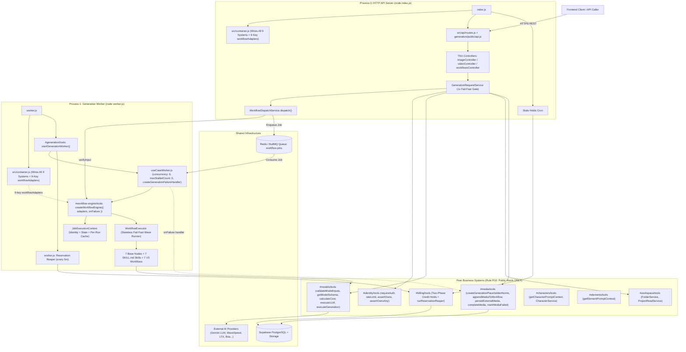

# Generation & Workflow Engine — Complete Architecture Blueprint (`apiOpenArt`)

> **Scope:** Complete technical map of **System 1: Generation & Workflows** (`src/systems/generation/`), **System 9: Standalone Workflow Engine** (`src/systems/workflow-engine/`), the two-process runtime (`index.js` + `worker.js`), and the decoupled queue/worker vs. black-box engine boundaries (`docs/adr/0006-standalone-queue-free-workflow-engine.md`).

---

## 1. Architectural Overview (4-Layer Composable V3 Design)

The Generation & Edit pipeline follows the strict 4-Layer Composable V3 Architecture (`docs/adr/0004-four-layer-composable-v3-architecture.md`, superseded/extended by `docs/adr/0006-standalone-queue-free-workflow-engine.md`):

| Layer | Responsibility | Key Modules |
|---|---|---|
| **Layer 1 — API, Intake Guards & Queue Dispatch (`generation`)** | Thin HTTP adapters + single fail-fast domain gate (validation, raw-URL ban, 1x ownership verification, edit locks, placeholder creation, single-source relight/angles prompt rendering, BullMQ enqueueing) | `src/systems/generation/public/api.js`, `imageController.js`, `videoController.js`, `generationControllerHelpers.js`, `GenerationRequestService.js`, `imageEditContract.js`, `WorkflowDispatchService.js` |
| **Layer 2 — Standalone Pure Workflow Engine (`workflow-engine`)** | 100% queue-free, Redis-free, DB-free DAG engine exposing `#workflow-engine/tools` (`verifyInput`, `calculateCost`, `createWorkflowEngine`, `runWorkflow`, `configureWorkflowAdapters`, + 6 neutral `Workflow*Error` classes) | `src/systems/workflow-engine/internal/core/` (`ExecutionEngine.js`, `GraphCompiler.js`, `WorkflowExecutor.js`, `NodeRegistry.js`, `JobExecutionContext.js`) |
| **Layer 3 — Pure Base Nodes, Skills & Workflows (`workflow-engine`)** | 7 stateless `base.*` DAG nodes + 7 composable `SKILL.md` skills + 7 declarative V3 workflows using injected domain adapters (enforced by `Rule R18`) | `src/systems/workflow-engine/internal/nodes/`, `src/systems/workflow-engine/internal/skills/`, `src/systems/workflow-engine/internal/workflows/`, `src/systems/workflow-engine/internal/adapters.js` |
| **Layer 4 — Storage, Media, Billing & Worker Boundaries** | Permanent Supabase Storage persistence + atomic completion guards via `#media/tools`; Two-Phase Credit Holds & reaper via `#billing/tools`; 9-key adapter wiring in `src/container.js`; BullMQ concurrency & `createGenerationFailureHandler` in `useCaseWorker.js` | `src/container.js`, `src/systems/generation/internal/workers/useCaseWorker.js`, `#media/tools`, `#billing/tools` |

---

## 2. Two-Process Runtime Topology & Cross-System Map

The backend runs as **two independent Node.js processes** sharing the exact same composition root (`src/container.js`), communicating asynchronously through **Redis / BullMQ** (`workflow-jobs`) and persisting state in **Supabase PostgreSQL / Storage**.



### Why Root `worker.js` Exists (Peer of `index.js`)
- Under **Rule R16** (`scripts/arch-check.cjs`), files inside `src/systems/**` cannot import `src/container.js` directly.
- Root `worker.js` mirrors `index.js`: it boots `src/container.js` first (wiring all 9 systems and configuring `workflowAdapters` via `configureWorkflowAdapters`), then calls `startGenerationWorker()` from `#generation/tools` (lazy dynamic import so `index.js` never starts BullMQ workers).
- `useCaseWorker.js` calls `assertWorkerConfigured()` before instantiating the BullMQ `Worker` in non-test environments, verifying both `markMediaFailed` and all 9 `workflowAdapters` keys are wired.

---

## 3. End-to-End Request, Execution & Compensation Flow

```mermaid
sequenceDiagram
    autonumber
    participant UI as Frontend Client
    participant Ctrl as imageController / videoController
    participant Req as GenerationRequestService
    participant Disp as WorkflowDispatchService
    participant WfEng as "#workflow-engine/tools (Pure Black Box)"
    participant Med as "#media/tools"
    participant Q as "Redis BullMQ (workflow-jobs)"
    participant W as useCaseWorker
    participant AI as "#models/tools (LLM + Provider)"

    Note over UI,Q: PHASE 1 — Synchronous HTTP Intake (Process 0: index.js)
    UI->>Ctrl: POST /api/images/generated (or /relight, /angles, /remove-background, /edit, /video/generated)
    Ctrl->>Req: requestGeneration(...) / requestImageEdit(...) (Thin HTTP Adapter)
    Req->>Req: 1x Fail-Fast Gate: parse contract + raw-URL ban + assertOwns / assertOwnsAny + validateModelInputs
    Req->>Med: Create workflow & single placeholder media (status = processing)
    Req->>Disp: dispatch({ useCaseId, input + verify_ownership: false, userId, serverContext })
    Disp->>WfEng: verifyInput(workflowOrId, input) (pure read-only dry-run)
    Disp->>Q: queue.add(jobPayload) (up to 3 attempts with backoff)
    alt Redis Dispatch Failure
        Q-->>Disp: Enqueue Error
        Disp-->>Req: throw GenerationQueueDispatchError (503)
        Req->>Med: updateMedia(mediaId, { status: "failed" }) (single-owner compensation)
        Req-->>UI: HTTP 503 Queue Dispatch Failed
    end
    Disp-->>UI: HTTP 200 (workflow_id, media_id, task_id, status = processing)

    Note over Q,AI: PHASE 2 — Asynchronous Worker Execution (Process 1: worker.js)
    Q->>W: Deliver job (attempts = 1; concurrency = 6; lockDuration = 300_000; maxStalledCount = 0)
    W->>W: assertWorkerConfigured() + createGenerationFailureHandler({ markMediaFailed })
    W->>WfEng: createWorkflowEngine({ adapters: workflowAdapters, onFailure }).runWorkflow(...)
    WfEng->>WfEng: Pre-Wave-1 adapter validation + isolated JobExecutionContext + markRunning()
    WfEng->>WfEng: Wave 1: base.resolve_references (uses injected adapters; verify_ownership: false from verified service)
    WfEng->>AI: Wave 2: base.llm (SKILL.md) [skipped for zero-LLM relight/angles/remove-bg]
    WfEng->>AI: Wave 3: base.image_generate / base.video_generate (fail-fast, 1 attempt)
    WfEng->>Med: Wave 4: base.save_media -> injected persistExternalMedia / completeMedia(status = success)
    WfEng-->>W: status = completed + terminalOutputs + nodeOutputs (finally: cache.clear() & dispose())

    Note over W,Med: PHASE 3 — Failure & Crash Compensation
    alt Any Node Fails Inside runWorkflow()
        WfEng->>WfEng: ErrorSystem.process() + neutral sanitizePublicError() -> attach err.errorReport
        WfEng->>W: Invoke per-job onFailure -> createGenerationFailureHandler (Generation sanitizeClientError)
        W->>Med: markMediaFailed(serverContext.mediaIds)
    else Unhandled Worker Crash (no err.errorReport)
        W->>W: handleUseCaseWorkerFailure -> createGenerationFailureHandler
        W->>Med: markMediaFailed(serverContext.mediaIds)
    else Process Hard-Killed (SIGKILL / OOM)
        Note over W: ReservationReaperService sweeps stale PENDING billing holds & stale placeholders every 5m
    end
```

---

## 4. State Machine (`JobExecutionContext`)


---

## 5. Directory & File Map (`generation` + `workflow-engine`)

```text
apiOpenArt/
├── index.js                                             # Process 0: API Server bootstrap
├── worker.js                                            # Process 1: Generation Worker bootstrap
└── src/
    ├── container.js                                     # Composition root wiring all 9 systems + 9-key workflowAdapters
    └── systems/
        ├── generation/                                  # System 1: API Intake, Queue Dispatch & BullMQ Worker
        │   ├── public/
        │   │   ├── api.js                               # Express routers mounted by src/api/routes.js (Rule R13)
        │   │   └── tools.js                             # Sealed 7-export gateway (#generation/tools)
        │   └── internal/
        │       ├── errors.js                            # GenerationError subclasses + sanitizeClientError()
        │       ├── controllers/                         # Thin HTTP request/response adapters ONLY
        │       │   ├── imageController.js               # POST /api/images/{generated,relight,angles,remove-background,edit}
        │       │   ├── videoController.js               # POST /api/video/generated
        │       │   ├── generationControllerHelpers.js   # Shared HTTP error serialization
        │       │   ├── workflowsController.js           # Prompt optimize, health, workflow CRUD
        │       │   ├── generationsQueryController.js    # Library & assets queries
        │       │   ├── generationsMutationController.js # Item likes & deletes
        │       │   └── projectController.js             # Project aggregated data
        │       ├── services/                            # Domain orchestration & queue dispatch
        │       │   ├── GenerationRequestService.js      # 1x fail-fast domain gate (validation, ownership, placeholders, compensation)
        │       │   ├── WorkflowDispatchService.js       # Consolidated BullMQ producer (workflow-jobs) + verifyInput()
        │       │   ├── imageEditContract.js             # Edit contract parsers, raw-URL guard, single-source relight/angles templates
        │       │   ├── GenerationService.js             # Library/generation read & domain operations
        │       │   ├── WorkflowService.js               # Workflow CRUD + entity sync handlers
        │       │   ├── WorkflowAuthorizationService.js  # Ownership verification helpers
        │       │   ├── WorkflowMediaService.js          # Media attachment & ordering inside workflows
        │       │   ├── mediaGuards.js                   # Media-type & safety guards (reuses #shared inferMediaType)
        │       │   └── serviceAccessor.js               # DI holder configured by src/container.js
        │       ├── db/                                  # Exclusive table owners (Rule R12)
        │       │   ├── generationClient.js              # Supabase client wrapper
        │       │   ├── BaseRepository.js                # Shared CRUD helpers
        │       │   └── WorkflowRepository.js            # public.workflow owner
        │       └── workers/                             # BullMQ consumers
        │           ├── worker.js                        # Starts useCaseWorker + 5m ReservationReaper
        │           └── useCaseWorker.js                 # Fresh createWorkflowEngine() per job + createGenerationFailureHandler
        └── workflow-engine/                             # System 9: Standalone Queue-Free Black-Box DAG Engine (Rule R18)
            ├── public/
            │   └── tools.js                             # Sealed 11-export gateway (#workflow-engine/tools)
            └── internal/
                ├── errors.js                            # 6 neutral Workflow*Error classes (zero billing copy)
                ├── adapters.js                          # 9-key adapter seam + non-test lock guard
                ├── core/                                # 5 Core Files — 100% Domain- & Queue-Agnostic
                │   ├── ExecutionEngine.js               # verifyInput, calculateCost, runWorkflow + per-instance/per-run hooks
                │   ├── GraphCompiler.js                 # Backward pruning, cycle check, port check, waves, instance WeakMap cache
                │   ├── WorkflowExecutor.js              # Stateless fail-fast parallel wave runner reusing GraphCompiler
                │   ├── NodeRegistry.js                  # Frozen singleton node catalog
                │   └── JobExecutionContext.js           # Isolated per-run context (identity, state, cache)
                ├── nodes/
                │   ├── index.js                         # Registers the 7 V3_BASE_NODES
                │   └── base/
                │       ├── resolveRefsNode.js           # base.resolve_references (uses injected adapters)
                │       ├── llmNode.js                   # base.llm (#models/tools)
                │       ├── extractNode.js               # base.extract (pure #shared getValueByPath)
                │       ├── textTemplateNode.js          # base.text_template (pure #shared renderTextTemplate)
                │       ├── imageGenerateNode.js         # base.image_generate (#models/tools)
                │       ├── videoGenerateNode.js         # base.video_generate (#models/tools)
                │       ├── saveMediaNode.js             # base.save_media (uses injected adapters + getRequiredAdapters)
                │       └── mediaNodeHelpers.js          # Shared cost extraction & #models/tools invocation
                ├── skills/                              # 7 Active SKILL.md Skills
                │   ├── index.js                         # Loads YAML+Markdown SKILL.md files; fail-closed builder
                │   ├── system-safety/SKILL.md
                │   ├── translate/SKILL.md
                │   ├── json-output/SKILL.md
                │   ├── image-generation/SKILL.md
                │   ├── video-generation/SKILL.md
                │   ├── character-sheet/SKILL.md
                │   └── image-edit/SKILL.md
                └── workflows/                           # 7 Declarative V3 Workflows
                    ├── index.js                         # Registry + alias resolver
                    ├── imageGenerationV3.js             # image-generation-v3 (4 nodes)
                    ├── videoGenerationV3.js             # video-generation-v3 (4 nodes)
                    ├── characterSheetV3.js              # character-sheet-v3 (5 nodes)
                    ├── imageEditV3.js                   # image-edit-v3 (4 nodes)
                    ├── imageRelightV3.js                # image-relight-v3 (3-node zero-LLM)
                    ├── imageAnglesV3.js                 # image-angles-v3 (3-node zero-LLM)
                    └── imageRemoveBackgroundV3.js       # image-remove-background-v3 (2-node zero-LLM)
```

### HTTP Route Surface (`src/systems/generation/public/api.js`)

| Mount Prefix | Method & Path | Middleware | Handler | Purpose |
|---|---|---|---|---|
| `/api/images` | `POST /generated` | `requireAuth`, `rateLimit("imageGeneration")` | `imageController.generateImage` | Enqueue image generation (`image-generation-v3`) |
| `/api/images` | `POST /relight` | `requireAuth`, `rateLimit("imageGeneration")` | `imageController.relightImage` | Enqueue in-place relight (`image-relight-v3`) |
| `/api/images` | `POST /angles` | `requireAuth`, `rateLimit("imageGeneration")` | `imageController.changeImageAngle` | Enqueue in-place camera angle edit (`image-angles-v3`) |
| `/api/images` | `POST /remove-background` | `requireAuth`, `rateLimit("imageGeneration")` | `imageController.removeImageBackground` | Enqueue in-place background removal (`image-remove-background-v3`) |
| `/api/images` | `POST /edit` | `requireAuth`, `rateLimit("imageGeneration")` | `imageController.editImage` | Enqueue general in-place image edit (`image-edit-v3`) |
| `/api/video` | `POST /generated` | `requireAuth`, `rateLimit("videoGeneration")` | `videoController.generateVideo` | Enqueue video generation (`video-generation-v3`) |
| `/api/prompt` | `POST /optimize` | `requireAuth`, `rateLimit("promptOptimization")` | `workflowsController.optimizePrompt` | Synchronous LLM prompt optimization |
| `/api/v2/workflows` | `GET /health` | — | `workflowsController.getWorkflowHealth` | Workflow engine health |
| `/api/v2/workflows` | `POST /run` | `requireAuth` | `workflowsController.runWorkflowDisabled` | Disabled direct arbitrary run endpoint |
| `/api/workflows` | `GET /library`, `GET /library/:workflow_id`, `GET /assets/:project_id`, `GET /project-data/:project_id`, `GET /workflow-by-media/:media_id` | `requireAuth` | Query & project controllers | Read library, assets, and project canvas data |
| `/api/workflows` | `POST /detach-media`, `PATCH /workflows/*`, `PATCH /items/:id/like`, `DELETE /workflows/*`, `DELETE /items/:id`, `DELETE /media/:media_id` | `requireAuth` | Mutation & workflow controllers | Workflow/media mutations, likes, primary media, soft/hard delete |

*(Note: Character sheet generation enters via System 6 `#characters/api` -> `CharacterGenerationService` -> `workflowDispatcher.dispatch({ useCaseId: "character-sheet-v3" })` with `verify_ownership: false` after upfront ownership verification.)*

---

## 6. Standalone Workflow Engine Deep-Dive (`src/systems/workflow-engine/`)

All 5 files inside `src/systems/workflow-engine/internal/core/` are **100% domain-agnostic and queue-agnostic** (mechanically enforced by `Rule R18`).

### 6.1 Sealed 11-Export Tools Interface (`#workflow-engine/tools`)

| Export | Side Effects | Error Semantics | Behavior |
|---|---|---|---|
| `verifyInput(workflowOrId, input = {})` | **None** (100% pure dry-run) | **Never throws** | Resolves workflow, checks `requiredInputs`, compiles DAG; returns `{ valid, workflowId, missing, errors }`. |
| `calculateCost(workflowOrId, input = {})` | **None** (100% pure dry-run) | **Fail-closed** | Evaluates `def.estimateCost(plannedInputs)` across active nodes; returns `{ totalCredits, breakdown }`. |
| `createWorkflowEngine(opts?)` | **None** | — | Returns a **fresh isolated `ExecutionEngine`** instance sharing the frozen singleton `NodeRegistry`, cached `GraphCompiler`, and configured adapter defaults, plus optional instance-scoped `adapters`, `onSuccess`, `onFailure`. |
| `runWorkflow(workflowOrId, input = {}, opts = {})` | Executes DAG in-process | Throws typed `Workflow*Error` & fires per-run/instance `onFailure` | Convenience helper creating a fresh engine and running the DAG immediately in-process inside an isolated `JobExecutionContext` (disposed in `finally`). |
| `configureWorkflowAdapters(adapters)` | Wires global adapter defaults | Throws `403 WORKFLOW_ADAPTERS_LOCKED` if re-called in non-test mode | Called once in `src/container.js` to inject the 9 peer-domain adapters (`characters`, `elements`, `media`, `identity`). |
| `WorkflowEngineError`, `WorkflowValidationError`, `WorkflowCompilationError`, `WorkflowUpstreamError`, `WorkflowNotFoundError`, `WorkflowSafetyError` | — | Neutral `AppError` subclasses | Domain-agnostic error hierarchy free of billing/refund phrasing. |

### 6.2 Worker Concurrency, Locks & Scoped Failure Cleanup (`useCaseWorker.js`)
- `USECASE_WORKER_OPTIONS`:
  - `concurrency: envConfig.useCaseWorkerConcurrency` (default `6`, clamped `1..20`)
  - `lockDuration: 300_000` (5 minutes)
  - `lockRenewTime: 60_000` (1 minute)
  - `stalledInterval: 60_000`
  - `maxStalledCount: 0` (fail closed on stall; never double-execute)
- `createGenerationFailureHandler({ markMediaFailed })` lives inside `generation/internal/workers/useCaseWorker.js`, formats user-safe error messages via Generation's `sanitizeClientError`, and marks **only** explicit `serverContext.mediaIds` as `failed` (never touching generic `input.media_id`).
- `handleUseCaseWorkerFailure` skips duplicate work if `err.errorReport` is already attached, otherwise runs the same failure handler for unhandled worker crashes.

---

## 7. The 7 Base Nodes & 7 Active `SKILL.md` Skills

### 7.1 Base Node Registry (`src/systems/workflow-engine/internal/nodes/index.js`)

| Node Type | File | Category | Required Inputs | Optional Inputs | Outputs (`RETURN_TYPES`) | Cost | Cacheable | External Seam |
|---|---|---|---|---|---|---:|:---:|---|
| `base.resolve_references` | `resolveRefsNode.js` | `context` | — | `prompt`, `references`, `characters`, `elements`, `media_id`, `allowedMediaTypes`, `maxReferences`, `verify_ownership` (default `true`) | `status`, `prepared_prompt`, `reference_urls`, `entities`, `media_url` | `0` | Yes (per-run) | Injected adapters (`assertOwns*`, `getCharacterPromptContext`, `getElementPromptContext`, `getMediaById`, `getMediaUrls`, `getWorkflowPrimaryMedia`) |
| `base.llm` | `llmNode.js` | `llm` | — *(prompt or images required at runtime)* | `model` (`gemini-3.1-flash-lite`), `prompt`, `images`, `skills`, `timeout_ms` | `status`, `text`, `json`, `metadata` | Dynamic (`calculateCost`) | **No** | `#models/tools` (`executeLLM`, `calculateCost`) |
| `base.extract` | `extractNode.js` | `data` | `data`, `path` | `default_value` | `value`, `text` | `0` | Yes (per-run) | `#shared` (`getValueByPath`) |
| `base.text_template` | `textTemplateNode.js` | `data` | `template` | `variables`, `defaults`, `fallback_text`, `strict`, `trim` | `text`, `missing_variables` | `0` | Yes (per-run) | `#shared` (`renderTextTemplate`) |
| `base.image_generate` | `imageGenerateNode.js` | `image` | `model`, `prompt` | `operation`, `images`, `parameters` | `status`, `image_url`, `assets`, `metadata` | Dynamic (`calculateCost`) | **No** | `#models/tools` (`executeGeneration`, `calculateCost`, `getModelSchema`) |
| `base.video_generate` | `videoGenerateNode.js` | `video` | `model`, `prompt` | `start_image_url`, `end_image_url`, `input_video_url`, `parameters` | `status`, `video_url`, `assets`, `metadata` | Dynamic (`calculateCost`) | **No** | `#models/tools` (`executeGeneration`, `calculateCost`) |
| `base.save_media` | `saveMediaNode.js` | `output` (`OUTPUT_NODE: true`) | `media_id`, `asset_url` | `final_prompt`, `character_description`, `metadata`, `media_role`, `save_type` | `status`, `saved_media` | `0` | **No** (`OUTPUT_NODE`) | Injected adapters (`persistExternalMedia`, `completeMedia`) + pre-Wave-1 `getRequiredAdapters` |

### 7.2 Active Composable LLM Skills (`src/systems/workflow-engine/internal/skills/`)

Loaded once at module startup from standalone YAML-frontmatter + Markdown `SKILL.md` files and injected into the unified system instruction as XML `<skill name="...">` blocks. Unknown skill names **fail closed** with `WorkflowValidationError`.

| Canonical Skill ID | Aliases | Guard / Mode | File | Role |
|---|---|---|---|---|
| `system-safety` | — | `guard: safety`, `json: true` | `skills/system-safety/SKILL.md` | Mandatory content policy gate; fails closed on unsafe verdict or unparseable JSON |
| `translate` | `translation` | — | `skills/translate/SKILL.md` | Translates non-English prompts cleanly into English while preserving reference tags |
| `json-output` | — | `json: true` | `skills/json-output/SKILL.md` | Enforces strict JSON response formatting |
| `image-generation` | — | — | `skills/image-generation/SKILL.md` | Crafts structured image-generation prompts preserving `@Name`/`@imageN` bindings |
| `video-generation` | — | — | `skills/video-generation/SKILL.md` | Crafts cinematic motion/camera video prompts |
| `character-sheet` | `character-description` | `json: true` | `skills/character-sheet/SKILL.md` | Produces 3-view character turnaround prompt + structured `character_description` |
| `image-edit` | — | `json: true` | `skills/image-edit/SKILL.md` | Prepares targeted in-place image editing prompt preserving untouched regions of `@image1` |

---

## 8. The 7 Declarative V3 Workflows (`src/systems/workflow-engine/internal/workflows/`)

| Workflow ID | File | Aliases | Required Inputs | Pipeline Topology |
|---|---|---|---|---|
| `image-generation-v3` | `imageGenerationV3.js` | `image-generation-v1`, `imageGeneration` | `prompt` | `resolve_refs` -> `llm_process` (`system-safety`, `translate`, `image-generation`) -> `generate_image` (`nanobana_2`) -> `save_media` |
| `video-generation-v3` | `videoGenerationV3.js` | `video-generation-v1`, `videoGeneration` | `prompt` | `resolve_refs` -> `llm_process` (`system-safety`, `translate`, `video-generation`) -> `generate_video` (`ltx_2_3_fast`) -> `save_media` |
| `character-sheet-v3` | `characterSheetV3.js` | `character-sheet-v1`, `characterSheet` | `prompt` | `resolve_refs` -> `llm_enrich` (`system-safety`, `translate`, `character-sheet`) -> parallel [`extract_character_description` (`base.extract`), `generate_sheet` (`gpt-image-2`)] -> `save_media` |
| `image-edit-v3` | `imageEditV3.js` | `image-edit`, `imageEdit` | `prompt`, `source_image_url` | `resolve_refs` -> `llm_process` (`system-safety`, `translate`, `image-edit`) -> `generate_image` (`operation: "edit"`) -> `save_media` |
| `image-relight-v3` | `imageRelightV3.js` | `image-relight`, `imageRelight` | `prompt`, `source_image_url` | **Zero-LLM 3-Node:** `resolve_refs` -> `generate_image` (locked `nanobana_2`, `operation: "edit"`) -> `save_media` *(prompt rendered once at intake in `imageEditContract.js`)* |
| `image-angles-v3` | `imageAnglesV3.js` | `image-angles`, `imageAngles` | `prompt`, `source_image_url` | **Zero-LLM 3-Node:** `resolve_refs` -> `generate_image` (locked `nanobana_2`, `operation: "edit"`) -> `save_media` *(prompt rendered once at intake in `imageEditContract.js`)* |
| `image-remove-background-v3` | `imageRemoveBackgroundV3.js` | `image-remove-background`, `imageRemoveBackground`, `remove-background` | `source_image_url` | **Zero-LLM Direct 2-Node:** `generate_image` (`bria_remove_background_3_0`, `operation: "remove_background"`) -> `save_media` |

---

## 9. Verification & Architecture Gate

Every change to `generation` or `workflow-engine` must pass the full repository quality gate:

```bash
npm run gate
```

This enforces:
1. `npm run arch` — `scripts/arch-check.cjs` (`R1`–`R18` + Tarjan file & system cycle detectors, `0` violations, `arch-baseline.json` = `{}`).
2. `npm run catalog` — `docs/agents/service-catalog.md` freshness.
3. `node scripts/check-doc-paths.cjs` — every file path referenced in docs exists on disk.
4. Secrets scan on staged diff.
5. `npm test` — full hermetic test suite.
