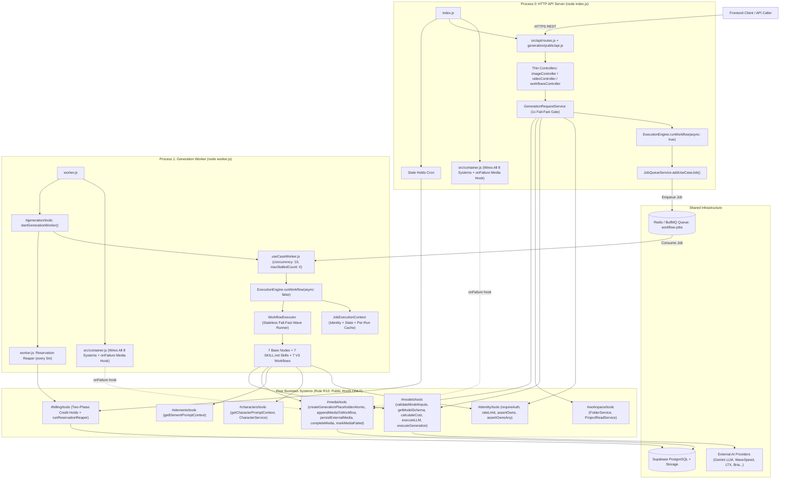
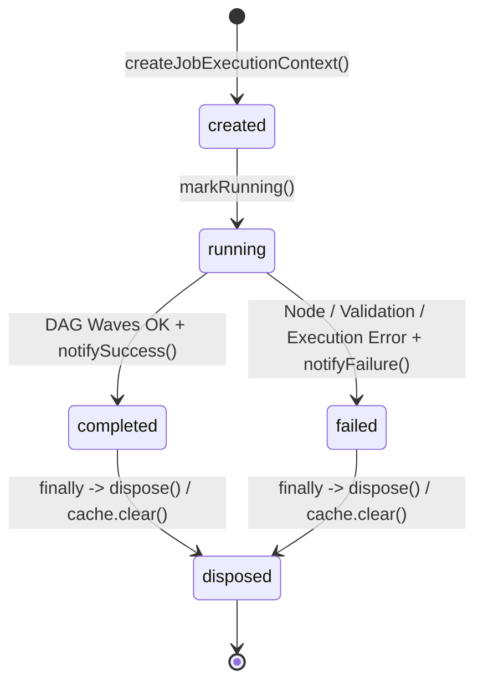

# Generation System — Complete Architecture Blueprint (`apiOpenArt`)

> **Scope:** Complete technical map of **System 1: Generation & Workflows** (`src/systems/generation/`), its two-process runtime (`index.js` + `worker.js`), its Minimal 3-Tool Pure Black-Box V3 Workflow Engine (`docs/adr/0005-pure-black-box-workflow-engine.md`), its 7 Base Nodes, 7 Active `SKILL.md` Skills, 7 Declarative V3 Workflows, and its cross-system contracts.

---

## 1. Architectural Overview (4-Layer Composable V3 Design)

System 1 (`src/systems/generation/`) follows the strict 4-Layer Composable V3 Architecture (`docs/adr/0004-four-layer-composable-v3-architecture.md`, updated by `docs/adr/0005-pure-black-box-workflow-engine.md`):

| Layer | Responsibility | Key Modules |
|---|---|---|
| **Layer 1 — API & Intake Guards** | Thin HTTP adapters + single fail-fast domain gate (validation, raw-URL ban, 1x ownership verification, edit locks, placeholder creation, `verify_ownership: false` handoff) | `src/systems/generation/public/api.js`, `imageController.js`, `videoController.js`, `generationControllerHelpers.js`, `GenerationRequestService.js`, `imageEditContract.js` |
| **Layer 2 — Black-Box Workflow Engine** | 100% domain-agnostic internal DAG engine exposing 3 internal tools (`verifyInput`, `calculateCost`, `runWorkflow`) + external lifecycle hooks (`onSuccess` / `onFailure`); zero billing, media, or entity coupling | `src/systems/generation/internal/v3/core/` (`ExecutionEngine.js`, `GraphCompiler.js`, `WorkflowExecutor.js`, `NodeRegistry.js`, `JobExecutionContext.js`) |
| **Layer 3 — Pure Base Nodes & Skills** | 7 stateless, single-responsibility `base.*` DAG nodes + 7 composable `SKILL.md` skills compiled into 7 declarative V3 workflows | `src/systems/generation/internal/v3/nodes/`, `src/systems/generation/internal/v3/skills/`, `src/systems/generation/internal/v3/workflows/` |
| **Layer 4 — Storage, Media & Billing Boundaries** | Permanent Supabase Storage persistence + atomic completion guards via `#media/tools`; Two-Phase Credit Holds & reaper via `#billing/tools`; external `onFailure` media hook wired in `src/container.js` | `src/container.js`, `#media/tools`, `#billing/tools` |

---

## 2. Two-Process Runtime Topology & Cross-System Map

The backend runs as **two independent Node.js processes** sharing the exact same composition root (`src/container.js`), communicating asynchronously through **Redis / BullMQ** (`workflow-jobs`) and persisting state in **Supabase PostgreSQL / Storage**.



### Why Root `worker.js` Exists (Peer of `index.js`)
- Under **Rule R16** (`scripts/arch-check.cjs`), files inside `src/systems/**` cannot import `src/container.js` directly.
- Root `worker.js` mirrors `index.js`: it boots `src/container.js` first (wiring all 8 systems and registering `executionEngine.onFailure(...)`), then calls `startGenerationWorker()` from `#generation/tools` (lazy dynamic import so `index.js` never starts BullMQ workers).
- `useCaseWorker.js` calls `assertWorkerConfigured()` before instantiating the BullMQ `Worker` in non-test environments, failing fast if ever started without `src/container.js`.

---

## 3. End-to-End Request, Execution & Compensation Flow

```mermaid
sequenceDiagram
    autonumber
    participant UI as Frontend Client
    participant Ctrl as imageController / videoController
    participant Req as GenerationRequestService
    participant Eng as ExecutionEngine (Black-Box Core)
    participant Hook as "Container onFailure Hook (#media/tools)"
    participant Med as "#media/tools"
    participant Q as "Redis BullMQ (workflow-jobs)"
    participant W as useCaseWorker
    participant Exec as WorkflowExecutor
    participant AI as "#models/tools (LLM + Provider)"

    Note over UI,Q: PHASE 1 — Synchronous HTTP Intake (Process 0: index.js)
    UI->>Ctrl: POST /api/images/generated (or /relight, /angles, /remove-background, /edit, /video/generated)
    Ctrl->>Req: requestGeneration(...) / requestImageEdit(...) (Thin HTTP Adapter)
    Req->>Req: 1x Fail-Fast Gate: parse contract + raw-URL ban + assertOwns / assertOwnsAny + validateModelInputs
    Req->>Med: Create workflow & single placeholder media (status = processing)
    Req->>Eng: runWorkflow(useCaseId, input + verify_ownership: false, { async: true, serverContext })
    Eng->>Eng: verifyInput() -> resolveWorkflow + requiredInputs + GraphCompiler.compile()
    Eng->>Q: addUseCaseJob(payload + opaque serverContext)
    alt Redis Dispatch Failure
        Q-->>Eng: Dispatch Error
        Eng->>Hook: notifyFailure({ stage: "launch", ... }) -> markMediaFailed()
        Eng-->>UI: HTTP 503 Queue Dispatch Failed
    end
    Eng-->>UI: HTTP 200 (workflow_id, media_id, task_id, status = processing)

    Note over Q,AI: PHASE 2 — Asynchronous Worker Execution (Process 1: worker.js)
    Q->>W: Deliver job (attempts = 1; lockDuration = 300_000; maxStalledCount = 0)
    W->>W: assertWorkerConfigured()
    W->>Eng: runWorkflow(workflowOrId, input, { async: false, runId, jobId, serverContext })
    Eng->>Eng: Create isolated JobExecutionContext + markRunning()
    Eng->>Exec: execute({ workflow, input, jobContext })
    Exec->>Exec: Wave 1: base.resolve_references (verify_ownership: false from verified service; true by default)
    Exec->>AI: Wave 2: base.llm (SKILL.md) OR base.text_template (0 credits)
    Exec->>AI: Wave 3: base.image_generate / base.video_generate (fail-fast, 1 attempt)
    Exec->>Med: Wave 4: base.save_media -> persistExternalMedia + completeMedia(status = success)
    Exec-->>Eng: status = completed + terminalOutputs + nodeOutputs (finally: cache.clear())
    Eng->>Eng: markCompleted() + notifySuccess() + jobCtx.dispose()

    Note over W,Hook: PHASE 3 — Failure & Crash Compensation
    alt Any Node Fails Inside runWorkflow(async: false)
        Eng->>Eng: ErrorSystem.process() + sanitizeClientError() -> attach err.errorReport
        Eng->>Hook: notifyFailure({ stage: "execute", ... }) -> markMediaFailed(mediaIds)
        Eng->>Eng: markFailed() + jobCtx.dispose()
    else Unhandled Worker Crash (no err.errorReport)
        W->>Eng: handleUseCaseWorkerFailure -> engine.notifyFailure({ stage: "worker_crash", ... })
        Eng->>Hook: markMediaFailed(mediaIds)
    else Process Hard-Killed (SIGKILL / OOM)
        Note over Hook: ReservationReaperService sweeps stale PENDING billing holds every 5m via #billing/tools
    end
```

---

## 4. State Machine (`JobExecutionContext`)



---

## 5. Internal Anatomy of System 1 (`src/systems/generation/`)

### 5.1 Directory & File Map

```text
apiOpenArt/
├── index.js                                             # Process 0: API Server bootstrap
├── worker.js                                            # Process 1: Generation Worker bootstrap
└── src/
    ├── container.js                                     # Composition root wiring all 8 systems + external onFailure hook
    └── systems/generation/
        ├── public/
        │   ├── api.js                                   # Express routers mounted by src/api/routes.js (Rule R13)
        │   └── tools.js                                 # Public gateway (#generation/tools) + startGenerationWorker()
        └── internal/
            ├── errors.js                                # GenerationError subclasses + sanitizeClientError()
            ├── controllers/                             # Thin HTTP request/response adapters ONLY
            │   ├── imageController.js                   # POST /api/images/{generated,relight,angles,remove-background,edit}
            │   ├── videoController.js                   # POST /api/video/generated
            │   ├── generationControllerHelpers.js       # Shared HTTP error serialization
            │   ├── workflowsController.js               # Prompt optimize, health, workflow CRUD
            │   ├── generationsQueryController.js        # Library & assets queries
            │   ├── generationsMutationController.js     # Item likes & deletes
            │   └── projectController.js                 # Project aggregated data
            ├── services/                                # Domain orchestration & queue dispatch
            │   ├── GenerationRequestService.js          # 1x fail-fast domain gate (validation, ownership, placeholders, dispatch)
            │   ├── imageEditContract.js                 # Edit contract parsers, raw-URL guard, inline entity extraction
            │   ├── GenerationService.js                 # Library/generation read & domain operations
            │   ├── WorkflowService.js                   # Workflow CRUD + entity sync handlers
            │   ├── WorkflowAuthorizationService.js      # Ownership verification helpers
            │   ├── WorkflowMediaService.js              # Media attachment & ordering inside workflows
            │   ├── jobQueueService.js                   # BullMQ queue producer (workflow-jobs)
            │   ├── mediaGuards.js                       # Media safety/state guards
            │   └── serviceAccessor.js                   # DI holder configured by src/container.js
            ├── db/                                      # Exclusive table owners (Rule R12)
            │   ├── generationClient.js                  # Supabase client wrapper
            │   ├── BaseRepository.js                    # Shared CRUD helpers
            │   ├── WorkflowRepository.js                # public.workflow owner
            │   └── dbMap.js                             # Repository aggregator helper
            ├── workers/                                 # BullMQ consumers
            │   ├── worker.js                            # Starts useCaseWorker + 5m ReservationReaper
            │   └── useCaseWorker.js                     # Delegates to engine.runWorkflow(..., { async: false }) + crash handler
            └── v3/                                      # Minimal 3-Tool Pure Black-Box Engine, Nodes, Skills, Workflows
                ├── index.js                             # Internal V3 barrel
                ├── core/                                # 5 Core Files — 100% Domain-Agnostic
                │   ├── ExecutionEngine.js               # verifyInput, calculateCost, runWorkflow (+ launch/execute aliases) & hooks
                │   ├── GraphCompiler.js                 # Backward pruning, cycle check, port check, parallel waves, O(1) cache
                │   ├── WorkflowExecutor.js              # Stateless fail-fast parallel wave runner + scoped per-run cache
                │   ├── NodeRegistry.js                  # Stateless node definition registry
                │   └── JobExecutionContext.js           # Isolated per-run context (identity, state, cache)
                ├── nodes/
                │   ├── index.js                         # Registers the 7 V3_BASE_NODES
                │   └── base/
                │       ├── resolveRefsNode.js           # base.resolve_references
                │       ├── llmNode.js                   # base.llm
                │       ├── extractNode.js               # base.extract
                │       ├── textTemplateNode.js          # base.text_template
                │       ├── imageGenerateNode.js         # base.image_generate
                │       ├── videoGenerateNode.js         # base.video_generate
                │       ├── saveMediaNode.js             # base.save_media
                │       └── mediaNodeHelpers.js          # Shared cost extraction & #models/tools invocation
                ├── skills/                              # 7 Active SKILL.md Skills
                │   ├── index.js                         # Loads YAML+Markdown SKILL.md files; fail-closed builder
                │   ├── system-safety/SKILL.md
                │   ├── translate/SKILL.md
                │   ├── json-output/SKILL.md
                │   ├── image-generation/SKILL.md
                │   ├── video-generation/SKILL.md
                │   ├── character-sheet/SKILL.md
                │   └── image-edit/SKILL.md
                └── workflows/                           # 7 Declarative V3 Workflows
                    ├── index.js                         # Registry + alias resolver
                    ├── imageGenerationV3.js             # image-generation-v3
                    ├── videoGenerationV3.js             # video-generation-v3
                    ├── characterSheetV3.js              # character-sheet-v3
                    ├── imageEditV3.js                   # image-edit-v3
                    ├── imageRelightV3.js                # image-relight-v3
                    ├── imageAnglesV3.js                 # image-angles-v3
                    └── imageRemoveBackgroundV3.js       # image-remove-background-v3
```

### 5.2 HTTP Route Surface (`src/systems/generation/public/api.js`)

| Mount Prefix | Method & Path | Middleware | Handler | Purpose |
|---|---|---|---|---|
| `/api/images` | `POST /generated` | `requireAuth`, `rateLimit("imageGeneration")` | `imageController.generateImage` | Enqueue image generation (`image-generation-v3`) |
| `/api/images` | `POST /relight` | `requireAuth`, `rateLimit("imageGeneration")` | `imageController.relightImage` | Enqueue in-place relight (`image-relight-v3`) |
| `/api/images` | `POST /angles` | `requireAuth`, `rateLimit("imageGeneration")` | `imageController.changeImageAngle` | Enqueue in-place camera angle edit (`image-angles-v3`) |
| `/api/images` | `POST /remove-background` | `requireAuth`, `rateLimit("imageGeneration")` | `imageController.removeImageBackground` | Enqueue in-place background removal (`image-remove-background-v3`) |
| `/api/images` | `POST /edit` | `requireAuth`, `rateLimit("imageGeneration")` | `imageController.editImage` | Enqueue general in-place image edit (`image-edit-v3`) |
| `/api/video` | `POST /generated` | `requireAuth`, `rateLimit("videoGeneration")` | `videoController.generateVideo` | Enqueue video generation (`video-generation-v3`) |
| `/api/prompt` | `POST /optimize` | `requireAuth`, `rateLimit("promptOptimization")` | `workflowsController.optimizePrompt` | Synchronous LLM prompt optimization |
| `/api/v2/workflows` | `GET /health` | — | `workflowsController.getWorkflowHealth` | Workflow engine health |
| `/api/v2/workflows` | `POST /run` | `requireAuth` | `workflowsController.runWorkflowDisabled` | Disabled direct arbitrary run endpoint |
| `/api/workflows` | `GET /library`, `GET /library/:workflow_id`, `GET /assets/:project_id`, `GET /project-data/:project_id`, `GET /workflow-by-media/:media_id` | `requireAuth` | Query & project controllers | Read library, assets, and project canvas data |
| `/api/workflows` | `POST /detach-media`, `PATCH /workflows/*`, `PATCH /items/:id/like`, `DELETE /workflows/*`, `DELETE /items/:id`, `DELETE /media/:media_id` | `requireAuth` | Mutation & workflow controllers | Workflow/media mutations, likes, primary media, soft/hard delete |

*(Note: Character sheet generation enters via System 6 `#characters/api` -> `CharacterService` -> `executionEngine.launch({ useCaseId: "character-sheet-v3" })` with `verify_ownership: false` after upfront ownership verification.)*

---

## 6. Minimal 3-Tool Pure Black-Box Engine Deep-Dive (`v3/core/`)

All 5 files inside `src/systems/generation/internal/v3/core/` are **100% domain-agnostic**: they contain zero imports or references to `#billing/tools`, `#identity/tools`, `#media/tools`, characters, elements, or projects.

### 6.1 The 3 Internal Tools on `ExecutionEngine` (`ExecutionEngine.js`)

`verifyInput`, `calculateCost`, and `runWorkflow` live strictly on the internal `ExecutionEngine` class (NOT exported as standalone functions on `src/systems/generation/public/tools.js`). `launch()` and `execute()` remain as thin backward-compatible aliases delegating directly to `runWorkflow()`.

| Method | Side Effects | Error Semantics | Return Shape / Behavior |
|---|---|---|---|
| `verifyInput(workflowOrId, input = {})` | **None** (100% pure dry-run) | **Never throws** | Resolves workflow, checks `workflow.requiredInputs`, compiles DAG via `GraphCompiler.compile()`; returns `{ valid, workflowId, missing, errors }`. |
| `calculateCost(workflowOrId, input = {})` | **None** (100% pure dry-run) | **Fail-closed** (throws on unknown workflow, compilation error, or node pricing error) | Resolves planned inputs (`INPUT_TYPES` defaults + static literals + `{ fromInput }` bindings) for each active node, invokes `def.estimateCost(plannedInputs)`, and returns `{ totalCredits, breakdown: [{ nodeId, nodeType, credits }] }`. |
| `runWorkflow(workflowOrId, input = {}, opts = {})` | Queue dispatch (`async: true`) or DAG execution (`async: false`) | Throws typed `GenerationError` subclass & fires `onFailure` hooks | **`async: true` (default):** merges `serverContext`, validates via `verifyInput`, enqueues 1 job to BullMQ `workflow-jobs` via `jobQueueService.js`, returns `{ status: "queued", workflowId, executionId, runId, workflowRunId, jobId }`.<br>**`async: false`:** executes compiled DAG synchronously inside `JobExecutionContext` via `WorkflowExecutor`, sanitizes errors (`ErrorSystem` + `sanitizeClientError`), invokes `onSuccess` / `onFailure` hooks, disposes context in `finally`, returns `{ status: "completed", workflowId, runId, executionId, jobId, terminalOutputs, nodeOutputs, cacheHits, wavesExecuted, state }`. Used directly by `useCaseWorker.js`. |

### 6.2 External Domain Hooks (`src/container.js`) & Thin Controllers
- **External Media Failure Hook (`src/container.js`):** Attaches `executionEngine.onFailure(...)` once at application boot to collect any media IDs from `serverContext`/`input` and invoke `markMediaFailed` (`#media/tools`). Both `ExecutionEngine.js` and `useCaseWorker.js` stay 100% decoupled from `#media/tools`.
- **Thin HTTP Adapters (`imageController.js`, `videoController.js`):** Extract `req.body` and `req.user.id`, delegate immediately to `GenerationRequestService.requestGeneration()` or `GenerationRequestService.requestImageEdit()`, and serialize the response or error via `generationControllerHelpers.js`. Zero `assertOwns`, zero `imageEditContract`, and zero media metadata helpers exist in controllers.
- **1x Fail-Fast Intake Gate (`GenerationRequestService.js`):** Validates contracts (`imageEditContract.js`), bans raw HTTP URLs and forbidden fields, verifies ownership once upfront via `#identity/tools` (project, workflow, references, media params, characters, elements, and inline `<character:id>` / `<element:id>` tags), validates model parameters via `#models/tools`, creates the workflow/placeholder via `#media/tools`, and passes `verify_ownership: false` into the worker's runtime input so `base.resolve_references` skips duplicate ownership round-trips while keeping `verify_ownership: true` as the fail-closed default for direct/untrusted engine callers.

### 6.3 `JobExecutionContext` (3-Part Isolation Model)

Every execution gets its own `JobExecutionContext` (`JobExecutionContext.js`) — no mutable state is ever shared across concurrent jobs:

```text
JobExecutionContext (1 instance per runWorkflow(async: false) execution)
├── identity  (Object.freeze) -> executionId, runId, jobId, userId, blueprintId, workflowId
├── state     (mutable)       -> status ("created" | "running" | "completed" | "failed"), startedAt, finishedAt, error
└── cache     (new Map())     -> temporary memoized node outputs ONLY for this run; cleared in dispose()
```

### 6.4 `GraphCompiler` (`GraphCompiler.js`) & `NodeRegistry` (`NodeRegistry.js`)
- `NodeRegistry` stores frozen node definitions (`INPUT_TYPES`, `RETURN_TYPES`, `OUTPUT_NODE`, `CACHEABLE`, `estimateCost`, `execute`).
- `GraphCompiler.compile(workflowDef)` performs backward pruning from terminal `OUTPUT_NODE: true` nodes, DFS cycle detection, port-type compatibility validation, required input checks, and topological wave scheduling (`waves: string[][]`), caching compiled plans in O(1) via a `WeakMap` for frozen static workflow blueprints.

### 6.5 `WorkflowExecutor` (`WorkflowExecutor.js`) & Worker Lock Safety (`useCaseWorker.js`)
- Executes each compiled wave concurrently with `Promise.all(...)` in **single-attempt fail-fast** mode (zero automatic node retries so side-effect and AI provider calls never duplicate).
- Caches only non-output nodes where `!def.OUTPUT_NODE && def.CACHEABLE !== false` using `computeNodeSignature(type, resolvedInputs, { runId, userId })` (SHA-256 over canonical JSON) in the run's private `JobExecutionContext.cache`, cleared unconditionally in `finally`.
- `useCaseWorker.js` delegates directly to `engine.runWorkflow(..., { async: false, ... })` with `USECASE_WORKER_OPTIONS`:
  - `concurrency: 10`
  - `lockDuration: 300_000` (5 minutes)
  - `lockRenewTime: 60_000` (1 minute)
  - `stalledInterval: 60_000`
  - `maxStalledCount: 0` (fail closed on stall; never double-execute)
- `handleUseCaseWorkerFailure` skips duplicate work if `err.errorReport` is already attached, otherwise notifies `engine.notifyFailure({ stage: "worker_crash", ... })`.

---

## 7. The 7 Base Nodes & 7 Active `SKILL.md` Skills

### 7.1 Base Node Registry (`src/systems/generation/internal/v3/nodes/index.js`)

| Node Type | File | Category | Required Inputs | Optional Inputs | Outputs (`RETURN_TYPES`) | Cost | Cacheable | Cross-System Tools |
|---|---|---|---|---|---|---:|:---:|---|
| `base.resolve_references` | `resolveRefsNode.js` | `context` | — | `prompt`, `references`, `characters`, `elements`, `media_id`, `allowedMediaTypes`, `maxReferences`, `verify_ownership` (default `true`) | `status`, `prepared_prompt`, `reference_urls`, `entities`, `media_url` | `0` | Yes (per-run) | `#identity/tools`, `#characters/tools`, `#elements/tools`, `#media/tools` |
| `base.llm` | `llmNode.js` | `llm` | — *(prompt or images required at runtime)* | `model` (`gemini-3.1-flash-lite`), `prompt`, `images`, `skills`, `timeout_ms` | `status`, `text`, `json`, `metadata` | Dynamic (`calculateCost`) | **No** | `#models/tools` (`executeLLM`, `calculateCost`) |
| `base.extract` | `extractNode.js` | `data` | `data`, `path` | `default_value` | `value`, `text` | `0` | Yes (per-run) | None (pure `getValueByPath`) |
| `base.text_template` | `textTemplateNode.js` | `data` | `template` | `variables`, `defaults`, `fallback_text`, `strict`, `trim` | `text`, `missing_variables` | `0` | Yes (per-run) | None (pure conditional `{{var}}` / `{{#var}}` / `{{^var}}` renderer) |
| `base.image_generate` | `imageGenerateNode.js` | `image` | `model`, `prompt` | `operation`, `images`, `parameters` | `status`, `image_url`, `assets`, `metadata` | Dynamic (`calculateCost`) | **No** | `#models/tools` (`executeGeneration`, `calculateCost`, `getModelSchema`) |
| `base.video_generate` | `videoGenerateNode.js` | `video` | `model`, `prompt` | `start_image_url`, `end_image_url`, `input_video_url`, `parameters` | `status`, `video_url`, `assets`, `metadata` | Dynamic (`calculateCost`) | **No** | `#models/tools` (`executeGeneration`, `calculateCost`) |
| `base.save_media` | `saveMediaNode.js` | `output` (`OUTPUT_NODE: true`) | `media_id`, `asset_url` | `final_prompt`, `character_description`, `metadata`, `media_role`, `save_type` | `status`, `saved_media` | `0` | **No** (`OUTPUT_NODE`) | `#media/tools` (`persistExternalMedia`, `completeMedia`) |

### 7.2 Active Composable LLM Skills (`src/systems/generation/internal/v3/skills/`)

Loaded once at module startup from standalone YAML-frontmatter + Markdown `SKILL.md` files and injected into the unified system instruction as XML `<skill name="...">` blocks. Unknown skill names **fail closed** with `GenerationValidationError`. *(Deterministic relight and camera-angle prompts now use `base.text_template` directly with zero LLM calls.)*

| Canonical Skill ID | Aliases | Guard / Mode | File | Role |
|---|---|---|---|---|
| `system-safety` | — | `guard: safety`, `json: true` | `skills/system-safety/SKILL.md` | Mandatory content policy gate; fails closed on unsafe verdict or unparseable JSON |
| `translate` | `translation` | — | `skills/translate/SKILL.md` | Translates non-English prompts cleanly into English while preserving reference tags |
| `json-output` | — | `json: true` | `skills/json-output/SKILL.md` | Enforces strict JSON response formatting |
| `image-generation` | — | — | `skills/image-generation/SKILL.md` | Crafts structured image-generation prompts preserving `@Name`/`@imageN` bindings |
| `video-generation` | — | — | `skills/video-generation/SKILL.md` | Crafts cinematic motion/camera video prompts |
| `character-sheet` | `character-description` | `json: true` | `skills/character-sheet/SKILL.md` | Produces 3-view character turnaround prompt + structured `character_description` |
| `image-edit` | — | `json: true` | `skills/image-edit/SKILL.md` | Prepares targeted in-place image editing prompt preserving untouched regions of `@image1` |

---

## 8. The 7 Declarative V3 Workflows (`src/systems/generation/internal/v3/workflows/`)

| Workflow ID | File | Aliases | Required Inputs | Pipeline Topology |
|---|---|---|---|---|
| `image-generation-v3` | `imageGenerationV3.js` | `image-generation-v1`, `imageGeneration` | `prompt` | `resolve_refs` -> `llm_process` (`system-safety`, `translate`, `image-generation`) -> `generate_image` (`nanobana_2`) -> `save_media` |
| `video-generation-v3` | `videoGenerationV3.js` | `video-generation-v1`, `videoGeneration` | `prompt` | `resolve_refs` -> `llm_process` (`system-safety`, `translate`, `video-generation`) -> `generate_video` (`ltx_2_3_fast`) -> `save_media` |
| `character-sheet-v3` | `characterSheetV3.js` | `character-sheet-v1`, `characterSheet` | `prompt` | `resolve_refs` -> `llm_enrich` (`system-safety`, `translate`, `character-sheet`) -> parallel [`extract_character_description` (`base.extract`), `generate_sheet` (`gpt-image-2`)] -> `save_media` |
| `image-edit-v3` | `imageEditV3.js` | `image-edit`, `imageEdit` | `prompt`, `source_image_url` | `resolve_refs` -> `llm_process` (`system-safety`, `translate`, `image-edit`) -> `generate_image` (`operation: "edit"`) -> `save_media` |
| `image-relight-v3` | `imageRelightV3.js` | `image-relight`, `imageRelight` | `prompt`, `source_image_url` | **Zero-LLM:** `resolve_refs` -> `build_prompt` (`base.text_template`, 0 credits) -> `generate_image` (locked `nanobana_2`, `operation: "edit"`) -> `save_media` |
| `image-angles-v3` | `imageAnglesV3.js` | `image-angles`, `imageAngles` | `prompt`, `source_image_url` | **Zero-LLM:** `resolve_refs` -> `build_prompt` (`base.text_template`, 0 credits) -> `generate_image` (locked `nanobana_2`, `operation: "edit"`) -> `save_media` |
| `image-remove-background-v3` | `imageRemoveBackgroundV3.js` | `image-remove-background`, `imageRemoveBackground`, `remove-background` | `source_image_url` | **Zero-LLM Direct 2-Node:** `generate_image` (`bria_remove_background_3_0`, `operation: "remove_background"`) -> `save_media` |

---

## 9. Verification & Architecture Gate

Every change to System 1 must pass the full repository quality gate:

```bash
npm run gate
```

This enforces:
1. `npm run arch` — `scripts/arch-check.cjs` (`R1`–`R17` + Tarjan cycle detector, `0` violations, `arch-baseline.json` = `{}`).
2. `npm run catalog` — `docs/agents/service-catalog.md` freshness.
3. `node scripts/check-doc-paths.cjs` — every file path referenced in docs exists on disk.
4. Secrets scan on staged diff.
5. `npm test` — full hermetic test suite.
