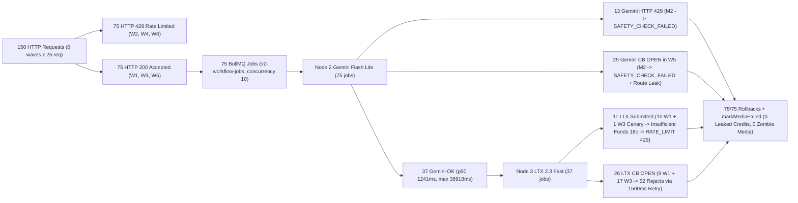
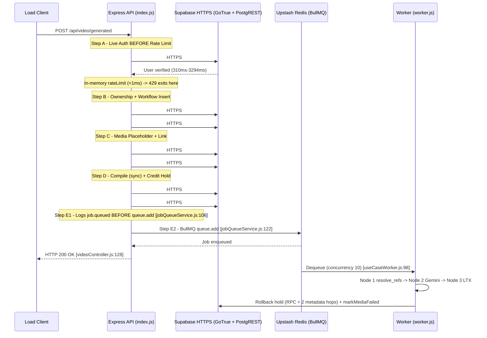

# Run 2 Video Load Test Forensic Report (`ltmwu28yq8`)

> **Scope:** End-to-end forensic analysis of the isolated 3-minute, 5-user live video generation load test (`POST /api/video/generated`, model `ltx_2_3_fast`) executed against an isolated API server (`index.js` on `PORT=5055`) and standalone BullMQ worker (`worker.js`).
> **Verification Status:** 100% of API server logs (`1,171` structured entries), worker logs (`1,085` structured entries), client manifest metrics (`150` HTTP attempts, `75` correlated jobs), and every `file:line` root-cause citation in `src/` and `supabase/migrations/` were independently verified against source and raw artifacts.

---

## 1. Executive Summary & Test Setup

### 1.1 Executive Verdict

| Dimension | Run 2 Result | Verdict |
|---|---|---|
| **HTTP Availability (`/api/*`)** | `150` attempts: `75× 200` + `75× 429`, **`0` `5xx`** | **PASS** (zero unhandled API errors) |
| **Per-User Rate Limiting** | `5 req / 60s` per user (`W1/W3/W5` 100% `200`; `W2/W4/W6` 100% `429`) | **PASS** (exact deterministic enforcement) |
| **Billing & Ledger Integrity** | `75/75` credit holds released (`1000 → 1000` for all 5 users, `0` leaked credits) | **PASS** (`balanceMatchesLedger = true` 5/5) |
| **Zombie Media Protection** | `75/75` jobs settled in `+1s` (`success=0`, `failed=75`, `processing=0`) | **PASS** (`0` zombie media rows) |
| **Tenant Isolation** | `0` cross-user media/project leaks across 5 users & 75 jobs | **PASS** (`crossUserLeaks = 0`) |
| **HTTP Intake Latency (`200`)** | `p50` escalated **`1,526ms` (W1) → `8,684ms` (W3) → `9,219ms` (W5)** (`max 9,422ms`) | **DEGRADED** (7-hop sequential Supabase HTTPS waterfall) |
| **HTTP Reject Latency (`429`)** | `p50` spiked **`347ms` (W2) → `3,264ms` (W4) → `684ms` (W6)** | **DEGRADED** (live Supabase Auth runs before rate limit) |
| **End-to-End Video Success** | **`0 / 75` (`0%`)** — both LTX (out of funds) & Gemini (15 RPM Free Tier) tripped CB `OPEN` | **FAIL** (provider exhaustion + `M2` misclassification bug) |
| **Error Classification Fidelity** | **`38 / 75` (`50.7%`)** misclassified as `CONTENT_SAFETY_VIOLATION` + internal route leaked | **FAIL (`P0`)** (`llmNode.js` + `errors.js` `M2` bug) |

### 1.2 Isolated Test Topology & Runtime Configuration

| Parameter | Value |
|---|---|
| **Run Tag** | `ltmwu28yq8` |
| **Test Window (UTC)** | `2026-11-24T02:13:36.433Z` → `2026-11-24T02:16:39.419Z` (`192.1s` load test + `6s` log flush; `exit=0`) |
| **Workload Pattern** | `5` synthetic users × `5` req/wave × `6` waves (`25` concurrent req every `30s`) = **`150` HTTP requests** over `3` minutes |
| **Target Endpoint & Payload** | `POST http://localhost:5055/api/video/generated` (`model: ltx_2_3_fast`, `6s`, `13` credits/job = `1` cr `gemini-3.1-flash-lite` + `12` cr `ltx_2_3_fast`) |
| **API Server Process** | Isolated `index.js` on `PORT=5055` (PID `43968`, terminated cleanly; existing `PORT=5000` dev server untouched) |
| **Worker Process** | Standalone `worker.js` (PID `28324`, terminated cleanly; BullMQ queue `v2-workflow-jobs`, `concurrency: 10`) |
| **Runtime Environment** | `NODE_ENV=development`, `RATE_LIMIT_STORE` unset → `"memory"` (`src/shared/config/env.js:97-99`), `LOG_PRETTY` unset → `true` (`src/shared/logger/baseLogger.js:25-35`, `translateTime: "HH:MM:ss"` — **1-second timestamp precision** on intermediate logs; exact ms via `performance.now()` on HTTP/LLM/job completion logs), Upstash TLS Redis (`rediss://`), live Supabase GoTrue + PostgREST (`*.supabase.co`) |

### 1.3 Captured Forensic Artifacts

All raw Run 2 artifacts were captured outside the repository in the session scratch directory and parsed with **zero orphan or unparsed entries**:

```text
Scratch directory: C:\Users\jihad\.gemini\antigravity\brain\de65a30d-9baa-4d72-a755-99cb235e585a\scratch\
- api-server.log      :   496,334 bytes |  8,682 lines | 1,171 entries (DEBUG: 396, INFO: 696, WARN: 76, ERROR: 3,   FATAL: 0)
- worker.log          : 1,004,595 bytes | 14,600 lines | 1,085 entries (DEBUG: 324, INFO: 406, WARN: 55, ERROR: 300, FATAL: 0)
- load-client.log     :     4,433 bytes |     78 lines | Wave summaries, +1s settle poll, per-user reconciliation
- load-test-run2.json :    10,966 bytes |    347 lines | Run manifest, user/project/wallet IDs, latency & error buckets
```

### 1.4 Run 2 Synthetic Users, Projects & Wallets (`runTag: ltmwu28yq8`)

| User | Email | User ID | Wallet ID | Project ID | Balance (`Start → End`) | Accepted / Failed / Rolled Back |
|---:|---|---|---|---|---:|---:|
| **u1** | `loadtest.ltmwu28yq8.u1@labveil.test` | `6067e86e-1521-4220-bb06-d700dd6bae28` | `26dbc208-443b-422a-af73-d4a9267a91bb` | `6b9842c1-79bc-4bc8-af50-75654e2362b9` | `1000 → 1000` | `15 / 15 / 15` |
| **u2** | `loadtest.ltmwu28yq8.u2@labveil.test` | `c3f8d8c8-f5ef-4e9d-8f29-25bb153611d3` | `ab8918ac-7939-41b0-aec1-879d47fbea73` | `79ae6760-00a8-4e49-b5ca-037bb481977d` | `1000 → 1000` | `15 / 15 / 15` |
| **u3** | `loadtest.ltmwu28yq8.u3@labveil.test` | `b572adf0-02e3-486e-909c-740d163804b2` | `6666a61f-a135-4d51-a578-3f3f7e31a1da` | `d2928893-902a-49e6-93bb-cff8adb68b30` | `1000 → 1000` | `15 / 15 / 15` |
| **u4** | `loadtest.ltmwu28yq8.u4@labveil.test` | `d32913bc-67cd-4cb6-b7d2-ef89e66b3493` | `db5a2f3f-ca7a-4d45-8058-352f36a362bd` | `ee533027-4e38-4fd0-9eb4-788e440d4008` | `1000 → 1000` | `15 / 15 / 15` |
| **u5** | `loadtest.ltmwu28yq8.u5@labveil.test` | `4b7a6f09-1c66-4f84-9fdc-3d8e7dd29755` | `8859c282-ac8e-48f6-815a-e25a199d2e15` | `99d18619-a069-45fb-b7e7-6f56e5d89b24` | `1000 → 1000` | `15 / 15 / 15` |

> **Cleanup:** Remove all 5 synthetic users, projects, workflows, media rows, wallets, and transactions with `scripts/cleanup-load-test-users.mjs` (full command in Section 6).

---

## 2. End-to-End Timing Forensics (API + Queue + Worker)

### 2.1 End-to-End Request & Failure Cascade Overview



### 2.2 Wave-by-Wave HTTP Latency Table (`POST /api/video/generated`)

**Setup & Probe Requests (Before Wave 1):**
- `GET /health` (`2×`): `200` in `4ms` (`02:13:25`, L24) and `1ms` (`02:13:27`, L111).
- `GET /ready` (`5×`): `3× 503` in `1ms`, `2ms`, `1ms` (`02:13:25–02:13:26`, L45/L60/L81); cleared at `02:13:27` (`200` in `276ms` live dual-Redis PING at L96; cached `200` in `1ms` at L126).
- `POST /api/projects` (`5×`, `02:13:31–02:13:36`, 100% `200`): `durationMs` = `[581, 278, 282, 228, 248]` (`min=228 / p50=278 / max=581 / avg=323.4ms`; User 1 paid cold Supabase TLS/DNS handshake).

**Load Waves (`n=25` concurrent requests per wave; 5 per user):**

| Wave | Offset | UTC Window (`api-server.log`) | HTTP Status | Client Wall (ms) | Server `durationMs` (`min / p50 / p95 / max`, avg) | Client `latencyMs` (`p50 / p95 / max`) |
|---|---:|---|---|---:|---|---|
| **W1** | `+0.0s` | `02:13:36–02:13:38` | `25× 200` | `2,294` | `1,460 / 1,526 / 1,993 / 2,146` (avg `1,564.8`) | `1,629 / 2,148 / 2,296` |
| **W2** | `+30.0s` | `02:14:06–02:14:06` | `25× 429` | `383` | `310 / 347 / 366 / 374` (avg `344.5`) | `367 / 383 / 383` |
| **W3** | `+60.0s` | `02:14:36–02:14:45` | `25× 200` | `8,748` | **`8,592 / 8,684 / 8,728 / 8,733`** (avg `8,679.1`) | `8,714 / 8,747 / 8,749` |
| **W4** | `+90.0s` | `02:15:06–02:15:09` | `25× 429` | `3,322` | **`3,132 / 3,264 / 3,287 / 3,294`** (avg `3,225.3`) | `3,297 / 3,307 / 3,323` |
| **W5** | `+120.0s` | `02:15:36–02:15:45` | `25× 200` | `9,470` | **`9,107 / 9,219 / 9,360 / 9,422`** (avg `9,237.6`) | `9,267 / 9,413 / 9,472` |
| **W6** | `+150.0s` | `02:16:06–02:16:07` | `25× 429` | `754` | `593 / 684 / 710 / 729` (avg `668.2`) | `726 / 749 / 759` |
| **All 150** | — | `02:13:36–02:16:07` | `75× 200`, `75× 429` | — | `310 / 3,132 / 9,283 / 9,422` | `3,164 / 9,332 / 9,472` |
| **Accepted (`200`)** | — | `W1, W3, W5` | `75× 200` | — | `1,460 / 8,684 / 9,336 / 9,422` | `8,714 / 9,409 / 9,472` |
| **Limited (`429`)** | — | `W2, W4, W6` | `75× 429` | — | `310 / 684 / 3,285 / 3,294` | — |

### 2.3 Synchronous Hot Path Inside `POST /api/video/generated`

Every accepted request mounted at `src/systems/generation/public/api.js:27` (`requireAuth`, `rateLimit("videoGeneration")`, `videoController.generateVideo`) executes **7 strictly sequential remote Supabase HTTPS round-trips** (via singleton `supabase` / `supabaseAdmin` in `src/shared/db/supabase.js:14,23`) followed by **1 Upstash Redis BullMQ Lua script** (`src/shared/redis/index.js:38-40`):



**Exact Per-Step Breakdown Across Waves** *(1-second `pino-pretty` timestamp deltas in seconds: `min / p50 / p95 / max (avg)`)*:

| Step (Log Transition & Code Anchor) | W1 (`200`) | W2 (`429`) | W3 (`200`) | W4 (`429`) | W5 (`200`) | W6 (`429`) |
|---|---|---|---|---|---|---|
| **Step A:** `http.request.started` → `auth.verified` (`auth.js:118`) | `0/0/0/0 (0.0)` | `0/0/0/0 (0.0)` `[310–374ms]` | **`1/1/1/1 (1.0)`** | **`3/3/3/3 (3.0)`** `[3132–3294ms]` | **`3/3/3/3 (3.0)`** | `1/1/1/1 (1.0)` `[593–729ms]` |
| **Step B:** `auth.verified` → `Workflow created` (`OwnershipService.js:51` + `WorkflowRepository.js:37`) | `1/1/1/1 (1.0)` | — | **`6/6/6/6 (6.0)`** | — | **`3/3/5/5 (3.7)`** | — |
| **Step C:** `Workflow created` → `Media placeholder` (`MediaRepository.js:56` + `WorkflowMediaRepository.js:150`) | `0/0/0/0 (0.0)` | — | **`1/1/1/1 (1.0)`** | — | **`0/2/3/3 (1.6)`** | — |
| **Step D:** `Media placeholder` → `Placed credit hold` (`WalletRepository.js:59` + `TransactionRepository.js:24`) | `0/0/1/1 (0.1)` | — | `0/1/1/1 (0.6)` | — | `0/1/1/1 (0.7)` | — |
| **Step E1:** `Placed credit hold` → `job.queued` *(premature log at `jobQueueService.js:106`)* | `0/0/0/0 (0.0)` | — | `0/0/0/0 (0.0)` | — | `0/0/0/0 (0.0)` | — |
| **Step E2:** `job.queued` → `usecase.started` *(actual `queue.add` at `jobQueueService.js:122`)* | `0/1/1/1 (0.9)` | — | `0/0/1/1 (0.4)` | — | **`0/0/0/0 (0.0)`** | — |
| **Step F2:** `usecase.started` → `http.request.completed` (`videoController.js:128`) | `0/0/0/0 (0.0)` | — | `0/0/0/0 (0.0)` | — | `0/0/0/0 (0.0)` | — |
| **Step 429:** `auth.verified` → `429 http.request.failed` (`rateLimit.js:154-162`) | — | `0/0/0/0 (0.0)` | — | `0/0/0/0 (0.0)` | — | `0/0/0/0 (0.0)` |

### 2.4 Forensic Proof: Why HTTP Latency Escalated in Waves 3, 4 & 5

**Proven Root Cause:** Synchronized **3-second and 6-second upstream stalls on live Supabase HTTPS hops (`*.supabase.co`)**, amplified by the API's **7-hop sequential waterfall** (`175` HTTPS calls per 25-request wave) and live auth executing before rate limiting.

1. **Exact Per-Request Log Traces Proving Synchronized Supabase Stalls:**
   - **Wave 3 (`+469%` over W1; `8,684ms` p50):** All 25 requests arrived at `02:14:36`, completed `auth.verified` at `02:14:37` (`+1s`), then **all 25 stalled together for exactly `6s` inside Step B** (`02:14:37 → 02:14:43`, `min=6s, max=6s`), followed by `1s` in Step C (`02:14:44`) and `0–1s` for Step D + E2 (`02:14:45`). Verified trace (`req_aa97fbac-33d0-498c-beba-a07b8e1c017e`, `8,733ms`): `L3099 [02:14:36]` start → `L3329 [02:14:37]` auth → `L3441 [02:14:43]` Workflow created → `L3923 [02:14:44]` Media placeholder → `L4647 [02:14:45]` Hold → `L4654 [02:14:45]` `job.queued` → `L5261 [02:14:45]` Launched → `L5295 [02:14:45]` `200`.
   - **Wave 4 (`429`, `+841%` over W2; `3,264ms` p50):** Zero Postgres queries and zero Redis/BullMQ calls ran. All 25 requests arrived at `02:15:06` and **stalled together inside `supabase.auth.getUser(token)` until `02:15:09`** (`3,132–3,294ms`), then rejected `429` in `<1ms`. Verified trace (`req_f9050832-6650-48c0-8709-8cd7f077c30f`, `3,294ms`): `L5435 [02:15:06]` start → `L5869 [02:15:09]` `auth.verified` → `L5874 [02:15:09]` `429`.
   - **Wave 5 (`9,219ms` p50):** All 25 stalled `3s` in Step A (`02:15:36 → 02:15:39`), `3–5s` in Step B (`15` at `02:15:42`, `2` at `02:15:43`, `8` at `02:15:44`), and `1–3s` in Step C (`18` at `02:15:44`, `7` at `02:15:45`), while Step D + E2 completed within `02:15:45`. Verified trace (`req_de4f1079-b8ed-4c5b-b254-be0f7a2053f3`, `9,422ms`): `L5946 [02:15:36]` start → `L6128 [02:15:39]` auth → `L6632 [02:15:44]` Workflow → `L7294 [02:15:45]` Media → `L7988 [02:15:45]` Hold → `L7995 [02:15:45]` `job.queued` → `L8132 [02:15:45]` Launched → `L8149 [02:15:45]` `200`.
   - **Wave 6 (`429`, `684ms` p50):** Latency dropped back to `593–729ms` (`02:16:06 → 02:16:07`), proving transient upstream Supabase burst/edge queuing rather than an API memory leak or socket exhaustion.

2. **Four Disproven Hypotheses (100% Eliminated by Hard Evidence):**
   - **Rate Limiter Contention (Disproven):** `RATE_LIMIT_STORE` resolved to `"memory"` (`RateLimiterMemory`, `src/systems/identity/internal/middleware/rateLimit.js:79-82`). For **75/75** `429` responses, `http.request.failed` is the immediate next log entry after `auth.verified` (`0s` delta, `0` interleaved entries).
   - **BullMQ / Upstash Redis Slowdown (Disproven):** Actual `queue.add` duration (`Step E2`) became *faster* across waves: `0.9s` (W1) → `0.4s` (W3) → **`0.0s` (W5, 25/25 same-second at `02:15:45`)**.
   - **Worker DB Contention (Disproven):** `worker.log` recorded **exactly `0` log entries** during Wave 3's 6s Step B stall (`02:14:36–02:14:44`), **`0` entries** during Wave 4's 3s auth stall (`02:15:04–02:15:12`), and **`0` entries** during Wave 5's Step A/B stalls (`02:15:36–02:15:44`).
   - **Per-User Wallet Row Locking (Disproven):** All 5 independent users (`u1`–`u5`, separate wallets and projects) completed in tight lockstep every wave (`W3` spread `141ms` across `8,592–8,733ms`; `W4` spread `162ms` across `3,132–3,294ms`; `W5` spread `315ms` across `9,107–9,422ms`).

### 2.5 Worker, Queue & Provider Timing Breakdown (`75/75` Correlated Jobs)

All 75 accepted jobs were correlated 1:1 by `jobId` between `api-server.log` (`job.queued`) and `worker.log` (`job.started` → LLM → LTX → `wallet.hold.released` → `job.failed`):

| Stage / Metric | Wave 1 (`n=25`) | Wave 3 (`n=25`) | Wave 5 (`n=25`) | Overall (`n=75`) |
|---|---:|---:|---:|---:|
| API `job.queued` window | `02:13:37–02:13:38` | `02:14:44–02:14:45` | `02:15:45–02:15:45` | `3` active waves (`W2/W4/W6` = `429`) |
| Worker `job.started` window | `02:13:38–02:13:49` | `02:14:46–02:14:58` | `02:15:45–02:15:48` | `02:13:38–02:15:48` |
| Worker `job.failed` window | `02:13:45–02:14:29` *(24/25 by `02:13:53`)* | `02:14:55–02:14:59` | `02:15:46–02:15:48` | `130s` total span (`0.58 jobs/s`, `0%` OK) |
| **Queue wait** (`job.queued → job.started`, s) | `min 1 / p50 9 / p95 12 / max 12` (avg `6.6`) | `min 1 / p50 10 / p95 13 / max 13` (avg `7.2`) | `min 0 / p50 2 / p95 3 / max 3` (avg `1.6`) | `min 0 / p50 2 / p95 12 / max 13` (avg `5.2`) |
| **Node 1 `resolve_refs` + compile** (s) | `0s` (`25/25`) | `0s` (`25/25`) | `0s` (`25/25`) | `0s` (`75/75`; `150` `models.cost.calculated`) |
| **Node 2 LLM (`gemini-3.1-flash-lite`) OK** (ms) | `n=19`: `694 / 1,085 / 38,918 / 38,918` (avg `3,327.0`) | `n=18`: `729 / 1,373 / 2,861 / 2,861` (avg `1,462.8`) | `n=0` | `n=37`: `694 / 1,241 / 5,135 / 38,918` (avg `2,420.1`) |
| **Node 2 LLM FAIL — Gemini `429`** (ms) | `n=6`: `643 / 717 / 733 / 733` | `n=7`: `571 / 775 / 956 / 956` | `n=0` | `n=13`: `571 / 727 / 956 / 956` (avg `735.5`) |
| **Node 2 LLM FAIL — Gemini CB OPEN** (ms) | `n=0` | `n=0` | `n=25`: `0 / 0 / 8 / 12` (avg `2.1`) | `n=25`: `0 / 0 / 8 / 12` (avg `2.1`) |
| **Node 3 LTX — Submitted (`202 → poll fail`)** | `n=10`: post-LLM `5,727 / 6,051 / 6,354 / 6,354` ms | `n=1` (canary): post-LLM `8,130` ms (`jobMs=9,086`) | `n=0` | `n=11`: post-LLM `5,727 / 6,051 / 8,130 / 8,130` ms |
| **Node 3 LTX — CB OPEN (incl. `1500ms` retry)** | `n=9`: post-LLM `1,866 / 1,933 / 4,408 / 4,408` ms | `n=17`: post-LLM `1,901 / 6,179 / 8,010 / 8,010` ms | `n=0` | `n=26`: post-LLM `1,866 / 1,941 / 7,888 / 8,010` ms |
| **Cleanup (`usecase.failed → job.failed`)** (s) | `0 / 0 / 1 / 3` (avg `0.5`) | `0 / 1 / 6 / 7` (avg `2.5`) | `0 / 0 / 1 / 1` (avg `0.5`) | `0 / 1 / 6 / 7` (avg `1.2`; baseline `~400ms`) |
| **Total Worker Job (`wrapWorkerJob` `durationMs`)** | `1,020 / 3,816 / 7,679 / 43,326` (avg `5,996.3`) | `986 / 3,442 / 9,050 / 9,086` (avg `4,954.7`) | `346 / 406 / 492 / 494` (avg `416.0`) | `346 / 1,376 / 9,040 / 43,326` (avg `3,789.0`) |
| **Peak Active Concurrency** (`concurrency: 10`) | `10 / 10` (`02:13:39`, L565) | `10 / 10` (`02:14:46` & `02:14:55`) | `10 / 10` (`02:15:46`) | **`10 / 10`** saturated every wave (`0` leaked slots) |

**Key Worker & Provider Forensics:**

1. **10-Slot BullMQ Step Function (`src/systems/generation/internal/workers/useCaseWorker.js:98`):** Each 25-job wave drained in 3 concurrency batches (`10 + 10 + 5`): W1 started 10 at `02:13:38–39`, 10 at `02:13:46`, 5 at `02:13:48–49`; W3 started 10 at `02:14:46`, 10 at `02:14:55`, 5 at `02:14:56–58`; W5 (fast CB rejections `~400ms`) drained all 25 in `3s` (`02:15:45–48`).
2. **Gemini `38.9s` Tail Outlier:** `usecase-0a218efd-d311-47ef-ade5-38cf517f940f` (W1, `u4`) waited `38,918ms` on a single `gemini-3.1-flash-lite` call with `0` retries (`L1673 [02:13:46]` → `L5459 [02:14:24]`), finishing at `43,326ms` (`L5529 [02:14:29]`) and holding 1 of 10 worker slots for 43 seconds.
3. **Wave 3 Synchronized `5–7s` Rollback Stall (`02:14:48–02:14:55`):** In W3 batch 1, 9 jobs reached `usecase.failed` at `02:14:48–50` and the LTX canary failed at `02:14:53`, yet **zero** `wallet.hold.released` events completed between `02:14:48` and `02:14:54`. All **`10/10` releases unblocked together at `02:14:55`**, followed by `2` at `02:14:56`, `8` at `02:14:58`, and `5` at `02:14:59`. Because `WalletService.resolveTransaction` (`src/systems/billing/internal/services/WalletService.js:556-558` → `src/systems/billing/internal/db/TransactionRepository.js:103-115`) executes **2 extra PostgREST round-trips** (`SELECT metadata` + `UPDATE metadata`) after `rollback_transaction`, any upstream Supabase stall blocks all 10 worker slots from picking up batch 2 (explaining W3's `9–10s` queue wait).
4. **Dual Circuit Breaker Timeline (`failureThreshold = 5`, `cooldownDurationMs = 60000`, `src/systems/models/internal/execution/circuitBreaker.js:5-72`):**
   - **LTX (`ltx_2_3_fast:ltx:ltx_2_3_fast.ltx`):**
     - `02:13:39–02:13:40` (L776–L1211): First 10 W1 jobs submitted to LTX (`POST /v2/text-to-video`), all 10 accepted HTTP `202`.
     - LTX failed jobs server-side in `~373ms` (`02:13:40.320Z → 02:13:40.693Z`) with `{ "type": "insufficient_funds_error", "message": "Insufficient funds. Required: 18 cents" }`, while `src/systems/models/internal/runtime/ltx/runner.js:122` slept `5,000ms` (`src/systems/models/internal/manifests/ltx_2_3_fast/bindings/ltx.json:122`) before polling.
     - **`02:13:45` (L1560):** 5th consecutive `PROVIDER_QUOTA_EXCEEDED` failure (`usecase-31dc6e28-7f54-4919-9564-22e98390e8fb`) **tripped LTX OPEN** (`cooldownUntil ≈ 02:14:45`). Failures #6–#10 (already in-flight) completed at `02:13:46`.
     - **`02:14:47` (L6252 → L6521 → L6976 at `02:14:53`):** Cooldown expired; W3 job `usecase-cf6c3846-992e-411b-898b-119a934e18ab` ran as the single-flight **`HALF-OPEN` canary probe** (`circuitBreaker.js:39-44`), got `202`, polled `5s`, failed with `Insufficient funds. Required: 18 cents`, and immediately re-opened LTX until `~02:15:53`.
     - Total LTX CB OPEN impact: **`26` jobs** (`9` W1 + `17` W3) × `2` V3Executor attempts = **`52` OPEN rejections** (`39.0s` wasted sleeping on guaranteed-fail `1,500ms` retries).
   - **Gemini (`gemini_3_1_flash_lite:google:gemini_3_1_flash_lite.google`):**
     - Free Tier `15 RPM` limit (`GenerateRequestsPerMinutePerProjectPerModel-FreeTier`, `quotaValue: "15"`, `retryDelay: "12s"`). `RuntimeExecutor` ran `29` retries (`15` attempt `1/3` + `14` attempt `2/3`) with `11–266ms` jitter (`p50=100ms`); only `2/15` jobs recovered, while `13/15` exhausted all 3 attempts (`39` wasted calls).
     - In W1, consecutive 429s hit `4` (`02:13:49–50`, L4716–L4990), narrowly saved by 1 success at `02:13:51` (L5301, `5,134ms`) resetting `consecutiveFailures 4 → 0`.
     - **`02:14:59` (L10427):** In W3, the 5th consecutive Gemini `429` (`usecase-2c98b301-92c9-4be3-9eb0-fb0d5d040c8b`; L9154 #1, L9229 #2, L10064 #3, L10114 #4, L10427 #5) **tripped Gemini OPEN** (`cooldownUntil = 02:15:59`).
     - In W5 (`02:15:45–02:15:48`), all **`25/25`** jobs arrived 11–14s before cooldown expiry and failed in `0–12ms` (`L10799–L14183`). Zero `HALF-OPEN` probes occurred because W6 was 100% rate-limited at the API layer.
5. **Cold Catalog Fan-Out (`02:13:39`, L694–L746):** The first `getModelConfig("ltx_2_3_fast")` call (`src/systems/generation/internal/v3/nodes/base/mediaNodeHelpers.js:132`) computed catalog pricing across 5 LTX models (`ltx_2_3_fast` 16cr, `ltx_2_3_pro` 35cr, `ltx_2_5_fast` 20cr, `ltx_2_5_pro` 40cr, `ltx_retake` 22cr).

---

## 3. Complete Error & Warning Inventory

### 3.1 API Server (`api-server.log`) — `79` Total (`76 WARN`, `3 ERROR`, `0 FATAL`)

| Level | Count | UTC Window (Lines) | Module / Event | Message Pattern | Root Cause (`file:line`) |
|---|---:|---|---|---|---|
| `WARN` | `1` | `02:13:25` (L39) | `READY` / `ready.check_failed` | `Readiness check failed` (`rateLimitReady: false, queueReady: false`) | `index.js:237-241` skips Redis wait in `memory` mode; `src/api/probes/ready.js:38-44,68` unconditionally checks both Redis clients |
| `ERROR` | `3` | `02:13:25–02:13:26` (L45, L60, L81) | `HTTP` / `http.request.failed` | `503 GET /ready (1–2ms)` | Poll #1 failed readiness (`ready.js:69`); Polls #2–#3 hit `1500ms` negative cache (`ready.js:31-35`, `src/shared/config/env.js:122`). Cleared `02:13:27` (L96) |
| `WARN` | `75` | `02:14:06–02:16:07` (L2719–L8674) | `HTTP` / `http.request.failed` | `429 POST /api/video/generated (<X>ms)` | Expected `5 req / 60s` rate limit (`src/shared/config/rateLimitPolicies.js:32-37`, `src/systems/identity/internal/middleware/rateLimit.js:154-162`) logged as `WARN` (`src/shared/logger/middleware.js:59-60`) |

> **Zero** `5xx` errors on `/api/*`, **zero** Redis errors, **zero** queue dispatch failures, and **zero** `401`/`403`/`404` responses across all 150 load requests and 5 project creations.

### 3.2 Background Worker (`worker.log`) — `355` Total (`55 WARN`, `300 ERROR`, `0 FATAL`)

Every single `WARN` and `ERROR` entry in `worker.log` is accounted for (`26×3 + 25×4 + 13×5 + 11×5 + 2 = 300 ERROR`; `26 + 15 + 14 = 55 WARN`):

| Level | Count | First–Last UTC (Lines) | Module / Event | Code | Normalized Message | Root Cause (`file:line`) |
|---|---:|---|---|---|---|---|
| `ERROR` | `26` | `02:13:48–02:14:58` (L3793–L10021) | `EXECUTION-ENGINE` / `usecase.failed` | `PROVIDER_TRANSIENT_ERROR` | `Execution failed for "video-generation-v3": Provider route "ltx_2_3_fast:ltx:ltx_2_3_fast.ltx" is temporarily unavailable (circuit breaker OPEN)` | `src/systems/models/internal/execution/modelRunner.js:138-141` → `src/systems/generation/internal/v3/core/ExecutionEngine.js:586-597` |
| `ERROR` | `26` | `02:13:49–02:14:59` (L3940–L10397) | `WORKER` / `job.failed` | `PROVIDER_TRANSIENT_ERROR` | `Job <JOB> failed on usecase-worker: Provider route "ltx_2_3_fast:..." is temporarily unavailable (circuit breaker OPEN)` | `src/shared/logger/middleware.js:114-124` (`wrapWorkerJob`) |
| `ERROR` | `26` | `02:13:49–02:14:59` (L4084–L10521) | `WORKER` / `job.failed` | *(none)* | `Job #<JOB> FAILED: Provider route "ltx_2_3_fast:..." is temporarily unavailable (circuit breaker OPEN)` | `src/systems/generation/internal/workers/useCaseWorker.js:129` *(duplicate `job.failed` log)* |
| `ERROR` | `25` | `02:15:45–02:15:48` (L10799–L14168) | `LLM` / `provider.request.failed` | `PROVIDER_TRANSIENT_ERROR` | `[LLMService] Request failed after <X>ms for model "gemini-3.1-flash-lite": Provider route "gemini_3_1_flash_lite:..." (circuit breaker OPEN)` | `modelRunner.js:138-141` → `src/systems/models/internal/services/LLMService.js:144-159` |
| `ERROR` | `25` | `02:15:45–02:15:48` (L10814–L14183) | `EXECUTION-ENGINE` / `usecase.failed` | `SAFETY_CHECK_FAILED` | `Execution failed for "video-generation-v3": Safety verification failed (fail-closed): Provider route "gemini_3_1_flash_lite:..." (circuit breaker OPEN)` | `src/systems/generation/internal/v3/nodes/base/llmNode.js:132-151` (`M2` bug) → `ExecutionEngine.js:586-597` |
| `ERROR` | `25` | `02:15:46–02:15:48` (L10851–L14472) | `WORKER` / `job.failed` | `SAFETY_CHECK_FAILED` | `Job <JOB> failed on usecase-worker: Safety verification failed (fail-closed): Provider route "gemini_3_1_flash_lite:..." (circuit breaker OPEN)` | `src/shared/logger/middleware.js:114-124` |
| `ERROR` | `25` | `02:15:46–02:15:48` (L10884–L14576) | `WORKER` / `job.failed` | *(none)* | `Job #<JOB> FAILED: Safety verification failed (fail-closed): Provider route "gemini_3_1_flash_lite:..." (circuit breaker OPEN)` | `useCaseWorker.js:129` *(duplicate `job.failed` log)* |
| `ERROR` | `13` | `02:13:47–02:14:59` (L3268–L10427) | `MODELS` / `models.execution.failed` | `RATE_LIMITED` | `Execution failed for gemini-3.1-flash-lite via google: Provider rate limit reached. Please try again shortly.` | Gemini Free Tier 15 RPM quota → `modelRunner.js:172-184` |
| `ERROR` | `13` | `02:13:47–02:14:59` (L3287–L10446) | `LLM` / `provider.request.failed` | `RATE_LIMITED` | `[LLMService] Request failed after <X>ms for model "gemini-3.1-flash-lite": Provider rate limit reached.` | `LLMService.js:144-159` |
| `ERROR` | `13` | `02:13:47–02:14:59` (L3302–L10461) | `EXECUTION-ENGINE` / `usecase.failed` | `SAFETY_CHECK_FAILED` | `Execution failed for "video-generation-v3": Safety verification failed (fail-closed): Provider rate limit reached.` | `llmNode.js:132-151` (`M2` bug) → `ExecutionEngine.js:586-597` |
| `ERROR` | `13` | `02:13:47–02:14:59` (L3431–L10664) | `WORKER` / `job.failed` | `SAFETY_CHECK_FAILED` | `Job <JOB> failed on usecase-worker: Safety verification failed (fail-closed): Provider rate limit reached.` | `src/shared/logger/middleware.js:114-124` |
| `ERROR` | `13` | `02:13:48–02:14:59` (L3564–L10693) | `WORKER` / `job.failed` | *(none)* | `Job #<JOB> FAILED: Safety verification failed (fail-closed): Provider rate limit reached.` | `useCaseWorker.js:129` *(duplicate `job.failed` log)* |
| `ERROR` | `11` | `02:13:45–02:14:53` (L1269–L6961) | `MODELS` / `models.provider.quota_exhausted` | *(none)* | `[PROVIDER_OUT_OF_CREDITS] Provider "ltx" account balance is exhausted. Admin top-up required!` | LTX `insufficient_funds_error` → `modelRunner.js:159-171` |
| `ERROR` | `11` | `02:13:45–02:14:53` (L1284–L6976) | `MODELS` / `models.execution.failed` | `PROVIDER_QUOTA_EXCEEDED` | `Execution failed for ltx_2_3_fast via ltx: Insufficient funds. Required: 18 cents` | `src/systems/models/internal/runtime/ltx/runner.js:159-166` → `modelRunner.js:172-184` |
| `ERROR` | `11` | `02:13:45–02:14:53` (L1310–L7002) | `EXECUTION-ENGINE` / `usecase.failed` | `PROVIDER_QUOTA_EXCEEDED` | `Execution failed for "video-generation-v3": Insufficient funds. Required: 18 cents` | `mediaNodeHelpers.js:75` (misclassified as `RATE_LIMIT`/429) → `ExecutionEngine.js:586-597` |
| `ERROR` | `11` | `02:13:45–02:14:55` (L1392–L7378) | `WORKER` / `job.failed` | `PROVIDER_QUOTA_EXCEEDED` | `Job <JOB> failed on usecase-worker: Insufficient funds. Required: 18 cents` | `src/shared/logger/middleware.js:114-124` |
| `ERROR` | `11` | `02:13:46–02:14:55` (L1602–L8173) | `WORKER` / `job.failed` | *(none)* | `Job #<JOB> FAILED: Insufficient funds. Required: 18 cents` | `useCaseWorker.js:129` *(duplicate `job.failed` log)* |
| `ERROR` | `2` | `02:15:00` (L10718), `02:15:17` (L10727) | `WALLET-WORKER` / `wallet.job_failed` | *(none)* | `Job retry-failed-ops failed: Could not find the table 'public.failed_wallet_operations' in the schema cache` | Missing DB table (`src/systems/billing/internal/db/FailedOpsRepository.js:47-58`, `src/systems/billing/internal/workers/walletWorker.js:75`, `src/systems/billing/internal/workers/walletQueue.js:64`) |
| `WARN` | `26` | `02:13:47–02:14:57` (L3167–L9088) | `V3-EXECUTOR` / *(none)* | *(none)* | `[V3Executor] Node "generate_video" (base.video_generate) failed on attempt 1/2. Retrying...` (`1500ms` backoff on LTX CB OPEN) | `modelRunner.js:139` (`retryable: true`) → `src/systems/generation/internal/v3/core/WorkflowExecutor.js:331-338` |
| `WARN` | `15` | `02:13:46–02:14:58` (L3079–L9910) | `MODELS` / *(none)* | *(none)* | `[RuntimeExecutor] Retryable provider error on attempt 1/3. Backing off with jitter for <X>ms...` (Gemini 429) | `src/systems/models/internal/execution/runtimeExecutor.js:73-91` |
| `WARN` | `14` | `02:13:47–02:14:58` (L3182–L10164) | `MODELS` / *(none)* | *(none)* | `[RuntimeExecutor] Retryable provider error on attempt 2/3. Backing off with jitter for <X>ms...` (Gemini 429) | `runtimeExecutor.js:73-91` |

### 3.3 Load Client (`load-client.log`) & Persisted `media.error_message` Buckets (`75/75`)

- **Client-Side Errors (`load-client.log`):** **`0`** transport/timeout/5xx errors; **`75`** expected HTTP `429` rate limits (W2, W4, W6); **`0`** settlement timeouts (`75/75` settled at `+1s`).
- **Exact Persisted `media.error_message` Distribution Across Users (`75` Failed Rows):**

| Persisted `media.error_message` (User-Visible DB Value) | True Root Cause | u1 | u2 | u3 | u4 | u5 | Total |
|---|---|---:|---:|---:|---:|---:|---:|
| `Generation failed due to a temporary service issue. Your credits have been refunded.` | LTX CB `OPEN` (`9` W1 + `17` W3) | `4` | `3` | `6` | `8` | `5` | **`26`** |
| `Safety verification failed (fail-closed): Provider route "gemini_3_1_flash_lite:provider:gemini_3_1_flash_lite.provider"...` | Gemini CB `OPEN` (W5) + `M2` bug + leak | `5` | `5` | `5` | `5` | `5` | **`25`** |
| `Safety verification failed (fail-closed): Provider rate limit reached. Please try again shortly.` | Gemini Free Tier `429` + `M2` bug | `2` | `3` | `2` | `2` | `4` | **`13`** |
| `Generation service is currently busy. Please try again in a moment.` | LTX `insufficient_funds_error` misclassified as `RATE_LIMIT` | `4` | `4` | `2` | `0` | `1` | **`11`** |
| **Total Failed Media Rows** | — | **`15`** | **`15`** | **`15`** | **`15`** | **`15`** | **`75`** |

---

## 4. Ranked Bug & Bottleneck Catalog (`P0` / `P1` / `P2`)

### P0 — Critical (Broken Core Flows, Data/Schema Defects, Severe User Misclassification)

#### `P0-1`: Broken `credit_wallet` SQL RPC Guarantees `23502 NOT NULL` Failure on Credit Top-Ups
- **Symptom & Evidence:** `public.transactions.expires_at` is declared `timestamp with time zone NOT NULL` with no default (`supabase/migrations/20261018161500_baseline.sql:519`), and no subsequent migration alters it. `scripts/load-test-video-5users.mjs:76-119` had to bypass `credit_wallet` and directly insert a synthetic `+365d` `expires_at` to fund the 5 test wallets.
- **Root Cause (`file:line`):** `supabase/migrations/20261018161500_baseline.sql:152-175` — `credit_wallet` executes `INSERT INTO transactions (wallet_id, amount, type, status, reference_id, metadata)` omitting `expires_at`, failing with PostgreSQL `23502` on every real `WalletService.credit()` call.
- **Business Impact:** Any real customer credit purchase, refund top-up, or subscription grant routed through `credit_wallet` fails immediately.
- **Smallest-Clean Fix:** Ship a single SQL migration that executes `ALTER TABLE public.transactions ALTER COLUMN expires_at DROP NOT NULL;` (credits do not expire; only `HOLD` transactions require `expires_at`) and verifies `credit_wallet` in an integration test.

#### `P0-2`: `M2` Bug — Gemini `429` & Circuit Breaker `OPEN` Misclassified as `CONTENT_SAFETY_VIOLATION` + Internal Route Key Leak
- **Symptom & Evidence:** **`38 / 75` (`50.7%`)** of all Run 2 jobs (`13` Gemini `429` + `25` Gemini CB `OPEN`, vs `0` real safety violations) failed with `code: "SAFETY_CHECK_FAILED"`, `category: "CONTENT_SAFETY_VIOLATION"` (HTTP `422`), zero V3Executor retries, and **`25` user-facing `media.error_message` rows leaked the internal route key** `Provider route "gemini_3_1_flash_lite:provider:gemini_3_1_flash_lite.provider"`.
- **Root Cause (`file:line`):** Three-file chain:
  1. `src/systems/generation/internal/v3/nodes/base/llmNode.js:132-152` — When `requiresSafety` is true (always true for `video-generation-v3`, `src/systems/generation/internal/v3/workflows/videoGenerationV3.js:47`), the `catch` block computes `isTransient` (`:133-138`), yet hardcodes `failErr.code = "SAFETY_CHECK_FAILED"` (`:142,149`) AND `failErr.is_safe = false` (`:150`). Line `:143` also checks `err?.category === "RATE_LIMIT"`, which is always `false` because `ModelsSystemError` never sets `.category` (`src/systems/models/internal/execution/errorNormalizer.js:76-84`).
  2. `src/systems/generation/internal/v3/core/WorkflowExecutor.js:55,73,76` — `isErrorRetryable` returns `false` on `err?.is_safe === false` (`:73`) and `NON_RETRYABLE_CODES.has("SAFETY_CHECK_FAILED")` (`:55,76`), nullifying `llmNode.js:67-71` (`retryPolicy.maxAttempts: 2`).
  3. `src/systems/generation/internal/errors.js:398-418,364,377` — `sanitizeClientError` matches `err?.is_safe === false` first (`:403`) and returns scrubbed `rawMsg` (`:406-409`), replacing only `google` → `provider` (`:364,377`) while exposing the internal model/circuit key.
- **Business Impact:** Users with benign prompts are falsely flagged for content policy violations during upstream traffic spikes, and internal infrastructure identifiers leak into persisted DB rows and API responses.
- **Smallest-Clean Fix:** In `src/systems/generation/internal/v3/nodes/base/llmNode.js:132-152`, when `isTransient` is true, keep fail-closed execution (do not proceed to video generation) **without** setting `failErr.is_safe = false`; use `code: "SAFETY_CHECK_UNAVAILABLE"`, `category: status === 429 ? "RATE_LIMIT" : "UPSTREAM_FAULT"`, `retryable: true`. In `src/systems/generation/internal/errors.js:398-418`, never return raw `err.message` when `rawCode === "SAFETY_CHECK_FAILED"`; return a static safe message.

#### `P0-3`: Missing Table `public.failed_wallet_operations` Breaks Billing Dead-Letter Recovery
- **Symptom & Evidence:** `worker.log` emitted `2` `ERROR` entries (`02:15:00` L10718, `02:15:17` L10727): `Job retry-failed-ops failed: [FailedOpsRepository] getPendingOps failed: Could not find the table 'public.failed_wallet_operations' in the schema cache`.
- **Root Cause (`file:line`):** `src/systems/billing/internal/db/FailedOpsRepository.js:24,47-58` queries `public.failed_wallet_operations`, scheduled every 5 minutes by `src/systems/billing/internal/workers/walletQueue.js:64` and executed by `src/systems/billing/internal/workers/walletWorker.js:75`, but the table does not exist in any migration under `supabase/migrations/`.
- **Business Impact:** If a credit settlement or rollback fails during a transient DB outage and falls back to `FailedOpsService`, the dead-letter write itself fails—creating silent unrecovered credit drift—and pollutes production logs every 5 minutes.
- **Smallest-Clean Fix:** Add a migration creating `public.failed_wallet_operations` (with RLS enabled, `service_role`-only access, and an index on `(status, next_retry_at)`) matching `FailedOpsRepository.js:24-94`.

#### `P0-4`: Upstream Provider Quota Exhaustion Caused `75 / 75` (`100%`) Generation Failure
- **Symptom & Evidence:** LTX failed all `11` submitted jobs with `Insufficient funds. Required: 18 cents` (`10` W1 + `1` W3 canary), tripping LTX CB `OPEN` (`26` more jobs rejected). Gemini hit Free Tier `15 RPM` (`13` failures in W1/W3), tripping Gemini CB `OPEN` (`25` W5 jobs rejected).
- **Root Cause (`file:line`):** Operational credential/quota limits (LTX balance `< $0.18`; Gemini API key on Free Tier `15 RPM`), compounded by `P1-2`, `P1-3`, and `P1-4`.
- **Business Impact:** Complete video generation outage under a modest 5-user burst (`25` req/min).
- **Smallest-Clean Fix:** Top up the LTX provider balance, upgrade Gemini to a paid tier (or route safety/prompt expansion to a higher-RPM key/tier), and wire alerting on `models.provider.quota_exhausted` (`src/systems/models/internal/execution/modelRunner.js:159-171`).

---

### P1 — High (Severe Latency Escalation, Misclassification, Wasted Retries & Process Coupling)

#### `P1-1`: 7-Hop Sequential Supabase HTTPS Waterfall + Live Auth Before Rate Limiting (`p50` `1.5s → 9.2s`)
- **Symptom & Evidence:** Accepted `POST /api/video/generated` `p50` escalated from `1,526ms` (W1) to **`8,684ms` (W3)** and **`9,219ms` (W5)**; even rejected `429` requests stalled up to **`3,294ms` (W4)** inside `supabase.auth.getUser(token)`.
- **Root Cause (`file:line`):**
  - `src/systems/generation/public/api.js:27` runs `requireAuth` (`src/systems/identity/internal/middleware/auth.js:118` → `src/systems/identity/internal/db/authClient.js:48`, live HTTPS `/auth/v1/user` with zero local JWT verification or caching) *before* `rateLimit("videoGeneration")`.
  - Accepted requests then execute 6 more strictly sequential HTTPS calls: `OwnershipService.js:51` (`ProjectRepository.js:163`), `WorkflowRepository.js:37`, `MediaRepository.js:56`, `WorkflowMediaRepository.js:150`, redundant `WalletRepository.js:59` (`WalletService.js:115`), and `TransactionRepository.js:24` (`rpc("hold_credits")`).
- **Business Impact:** `175` sequential HTTPS calls per 25-req wave make HTTP intake latency hypersensitive to any transient Supabase RTT jitter (`~9s` UX latency just to enqueue an async job) and allow abusive callers to hammer Supabase GoTrue even while rate-limited.
- **Smallest-Clean Fix:** (1) Verify Supabase JWTs locally (HMAC secret / JWKS with short revocation cache) in `auth.js:118` (saves 1 HTTPS hop on 100% of requests and drops `429` latency to `<5ms`); (2) eliminate the redundant `getWalletOrThrow` SELECT (`WalletService.js:115`) by accepting `p_user_id` in `hold_credits` (saves 1 HTTPS hop); (3) collapse workflow + media + link placeholder creation into a single SQL RPC (cuts 3 hops to 1). Total: **7 sequential HTTPS calls → 2**.

#### `P1-2`: `WorkflowExecutor` Retries Circuit-Breaker `OPEN` Rejections (`39.0s` Wasted Across `26` Jobs)
- **Symptom & Evidence:** `26` jobs hit LTX CB `OPEN` and triggered `26` `V3-EXECUTOR` `WARN` retries (`1,500ms` sleep each = `39.0s` wasted worker slot time; `52` total OPEN rejections for `26` jobs).
- **Root Cause (`file:line`):** `src/systems/models/internal/execution/modelRunner.js:138-142` throws `ProviderTransientError` (`src/systems/models/internal/errors.js:264-273`, `retryable: true`). `src/systems/generation/internal/v3/nodes/base/mediaNodeHelpers.js:99-105` preserves `retryable: true`, so `src/systems/generation/internal/v3/core/WorkflowExecutor.js:331-338` obeys `videoGenerateNode.js:84-88` (`maxAttempts: 2`, `backoffMs: 1500`) even though circuit cooldown is `60,000ms`.
- **Business Impact:** Doubles queue wait and pins `concurrency: 10` worker slots during provider outages on retries that are mathematically guaranteed to fail.
- **Smallest-Clean Fix:** In `modelRunner.js:138-142`, throw with `code: "CIRCUIT_BREAKER_OPEN"` and `retryable: false` (and include `"CIRCUIT_BREAKER_OPEN"` in `NON_RETRYABLE_CODES` at `WorkflowExecutor.js:55`).

#### `P1-3`: `PROVIDER_QUOTA_EXCEEDED` Misclassified as `RATE_LIMIT` (`429`) & Unconditional Circuit Breaker Recording
- **Symptom & Evidence:** All `11` LTX `insufficient_funds_error` jobs bypassed the provider-maintenance safe message and persisted `"Generation service is currently busy. Please try again in a moment."` (`RATE_LIMIT` / `429`) to `media.error_message`. Additionally, `modelRunner.js:157` calls `circuitBreakerRegistry.recordFailure(circuitKey)` unconditionally before `normalizeError`.
- **Root Cause (`file:line`):**
  1. `src/systems/models/internal/runtime/ltx/runner.js:157-161` sets both `err.terminal = true` AND `err.code = "PROVIDER_QUOTA_EXCEEDED"`.
  2. `src/systems/models/internal/execution/errorNormalizer.js:37-46` matches `if (err.terminal ...)` **before** check #3 (`:60-73`), bypassing the safe provider-maintenance message (`:70`) and `statusCode = 503`.
  3. `src/systems/generation/internal/v3/nodes/base/mediaNodeHelpers.js:75` and `src/systems/generation/internal/errors.js:471` match `/RATE_LIMIT|QUOTA/i` on `code`, turning `PROVIDER_QUOTA_EXCEEDED` into `RATE_LIMIT` (`429`).
  4. `src/systems/models/internal/execution/modelRunner.js:157` records circuit-breaker failures before normalizing, so even `4xx` bad-input or account-billing errors can trip the breaker.
- **Business Impact:** Users are told to "try again in a moment" when the platform's LTX balance is `$0`, encouraging retry storms; client validation errors can poison healthy routes.
- **Smallest-Clean Fix:** Move `errorNormalizer.js:60-73` (`PROVIDER_QUOTA_EXCEEDED`) above `:37` (`err.terminal`); exclude `PROVIDER_QUOTA_EXCEEDED` from the `RATE_LIMIT` regex in `mediaNodeHelpers.js:75` and `errors.js:471`; and call `circuitBreakerRegistry.recordFailure(circuitKey)` in `modelRunner.js:157` only for upstream availability/5xx/quota faults (not user `4xx` input rejections).

#### `P1-4`: `RuntimeExecutor` Ignores Provider `retryDelay` (`29` Retries at `11–266ms` Against Gemini's `12s` Limit)
- **Symptom & Evidence:** Across `15` Gemini `429` jobs, `RuntimeExecutor` ran `29` retries (`15` attempt 1/3 + `14` attempt 2/3) with `11–266ms` jitter (`p50=100ms`, `avg=104ms`) while Gemini's raw response explicitly specified `retryDelay: "12s"`. Only `2/15` jobs recovered; `13/15` failed after burning `39` upstream requests.
- **Root Cause (`file:line`):** `src/systems/models/internal/execution/runtimeExecutor.js:38-41,73-91` uses hardcoded `initialBackoffMs ?? 150` and `maxBackoffMs ?? 2000` without inspecting `Retry-After` or `providerRaw` `retryDelay`.
- **Business Impact:** Amplifies upstream `429` storms by 3× without waiting long enough for the RPM window to reset, accelerating Gemini CB trips.
- **Smallest-Clean Fix:** Parse `Retry-After` / `retryDelay` in `errorNormalizer.js:76-84` into `error.retryAfterMs`; in `runtimeExecutor.js:73-91`, if `retryAfterMs` exceeds `maxBackoffMs` (e.g., `> 2000ms`), fail fast without futile sub-second retries (or cap wait / defer to BullMQ delayed retry).

#### `P1-5`: Duplicate `walletWorker` & Triple Overlapping Stale-Hold Reapers Across API and Worker Processes
- **Symptom & Evidence:** `api-server.log` booted `WalletQueue` + `WalletWorker` (L68, L71), ran `expire-stale-holds` inside the HTTP API process (`02:15:02`, L5339), **and** registered `index.js`'s 10-minute `setInterval` stale-hold reaper (L14). Meanwhile `worker.log` booted its own 5-minute `Reaper` (L14–L21) **and** a second `WalletQueue` + `WalletWorker` (L22–L27).
- **Root Cause (`file:line`):** Importing `#billing/tools` (`index.js:13`, `src/container.js:1-15` → `src/systems/billing/public/tools.js:44-49`) evaluates `src/systems/billing/internal/workers/walletWorker.js:353-412` as an import side effect, unconditionally starting a BullMQ worker and attaching `SIGINT`/`SIGTERM` `process.exit(0)` handlers inside the HTTP API process. Meanwhile `index.js:248-261` runs a separate `setInterval` reaper.
- **Business Impact:** Violates API/worker process isolation, duplicates Redis polling and DB sweeps across every horizontal API replica, and can abruptly `process.exit(0)` the HTTP server before in-flight requests drain.
- **Smallest-Clean Fix:** Replace the top-level auto-start in `walletWorker.js:353-412` with an explicit `startWalletWorker()` called solely from `worker.js`, and remove the redundant `setInterval` in `index.js:248-261`.

#### `P1-6`: Extra PostgREST Round-Trips on Every Rollback + Missing `transactions(wallet_id)` Index & RPC Hardening
- **Symptom & Evidence:** During W3 batch 1 (`02:14:48–02:14:55`), all `10/10` worker slots stalled `5–7s` waiting for `wallet.hold.released` before unblocking together at `02:14:55`. Baseline rollback + media failure cleanup took `~400ms` per job.
- **Root Cause (`file:line`):**
  1. `src/systems/billing/internal/services/WalletService.js:542-565` → `src/systems/billing/internal/db/TransactionRepository.js:103-115` runs **2 extra PostgREST round-trips** (`SELECT metadata` + `UPDATE metadata`) after every `rollback_transaction` / `commit_transaction` RPC when `extraMetadata` is passed.
  2. `supabase/migrations/20261018161500_baseline.sql:886-896` indexes only `reference_id` and `(status, expires_at)` on `public.transactions`—**no index on `wallet_id`** (full table scans on history & reconciliation) and **no RLS** on `public.transactions`.
  3. Unlike `extend_hold` and `expire_stale_holds` (`supabase/migrations/20261018170000_atomic_wallet_hold_rpcs.sql:98-192,198-382`), the 4 baseline wallet RPCs (`credit_wallet`, `hold_credits`, `commit_transaction`, `rollback_transaction` at `20261018161500_baseline.sql:71-91,152-248`) lack `SECURITY DEFINER`, `SET search_path = public, pg_temp`, and `REVOKE ALL FROM PUBLIC, anon, authenticated`.
- **Business Impact:** Triples DB calls on every worker settlement/rollback, degrades ledger queries linearly with table size, and leaves baseline billing RPCs less locked down than v2 hold RPCs.
- **Smallest-Clean Fix:** Add an optional `p_extra_metadata jsonb DEFAULT NULL` parameter to `commit_transaction` and `rollback_transaction` to merge metadata atomically inside the RPC; ship a migration adding `CREATE INDEX idx_transactions_wallet_id ON public.transactions(wallet_id)`, enabling RLS on `public.transactions`, and matching the `SECURITY DEFINER` + `REVOKE/GRANT` posture of `20261018170000_atomic_wallet_hold_rpcs.sql`.

---

### P2 — Medium / Low (Boot Probes, Polling Waste & Observability Hygiene)

#### `P2-1`: Boot Readiness Mismatch Causes `3× 503 GET /ready` on Startup
- **Symptom & Evidence:** On boot (`02:13:25–02:13:26`), `GET /ready` returned `3` `503` `ERROR`s (L45, L60, L81) and `1` `WARN ready.check_failed` (`rateLimitReady: false, queueReady: false`, L39) before recovering at `02:13:27` (L96).
- **Root Cause (`file:line`):** `index.js:237-241` skips `await waitForRateLimitRedis(5000)` when `RATE_LIMIT_STORE !== "redis"` and does not wait for queue `redisConnection` either, binding HTTP before Upstash TLS completes; meanwhile `src/api/probes/ready.js:38-44,68-69` unconditionally requires `rateLimitRedisConnection` to be `"ready"` and caches the `503` for `1,500ms` (`src/shared/config/env.js:122`).
- **Business Impact:** False startup `503` alerts and delayed readiness cutover on container deploys in `memory` rate-limit mode.
- **Smallest-Clean Fix:** In `src/api/probes/ready.js:38-44`, only require `rateLimitRedisConnection` when `envConfig.rateLimitStore === "redis"`, and wait for queue `redisConnection` readiness in `index.js:237-241` before `app.listen`.

#### `P2-2`: LTX Fixed `5,000ms` First Poll Sleep Wastes `~4.6s` on Immediate Failures
- **Symptom & Evidence:** LTX rejected all `11` jobs server-side in `~373ms` (`02:13:40.320Z → .693Z`), yet each worker slot waited `5,000ms` before detecting failure.
- **Root Cause (`file:line`):** `src/systems/models/internal/runtime/ltx/runner.js:122` unconditionally sleeps `pollIntervalMs` (`5s` from `src/systems/models/internal/manifests/ltx_2_3_fast/bindings/ltx.json:122`) before the first status `GET`.
- **Business Impact:** Holds scarce worker concurrency slots (`10`) ~4.6s longer than necessary on fast rejections.
- **Smallest-Clean Fix:** Use a short initial poll delay (`1,000–1,500ms`) for poll #1, then step up to `pollIntervalMs` (`5,000ms`).

#### `P2-3`: Observability, Logging & Timeout Hygiene (6 Focused Fixes)
1. **Premature `job.queued` Log (`src/systems/generation/internal/services/jobQueueService.js:106` vs `:122`):** Logs `event: "job.queued"` *before* `await queue.add(...)` (`75/75` adjacent `0s` deltas from hold), masking true Redis enqueue latency and emitting false `job.queued` logs if dispatch throws. **Fix:** Move `queueLogger.info` after `await queue.add(...)` and record `enqueueDurationMs`.
2. **Duplicate `job.failed` ERROR Logs (`150` entries for `75` failed jobs):** Both `src/shared/logger/middleware.js:114-124` (`wrapWorkerJob`) and `src/systems/generation/internal/workers/useCaseWorker.js:129` (`handleUseCaseWorkerFailure`) emit `ERROR` with `event: "job.failed"`. **Fix:** Log at `DEBUG` in `useCaseWorker.js:129` when `err?.errorReport` is already present (keep `ERROR` for genuine uncaught crashes).
3. **LTX `jobId` Overwrites BullMQ `jobId` in Log Context (`src/systems/models/internal/runtime/ltx/runner.js:283` + `src/shared/logger/index.js:43-46`):** Passing `{ jobId }` clobbers AsyncLocalStorage's BullMQ `jobId` on all `11` `[LTX] Job submitted — polling` entries, breaking log correlation. **Fix:** Rename the field to `providerJobId`.
4. **1-Second Dev Log Precision (`src/shared/logger/baseLogger.js:25-35`):** `translateTime: "HH:MM:ss"` strips milliseconds in dev logs. **Fix:** Change to `translateTime: "HH:MM:ss.l"`.
5. **Cold Catalog Cost Fan-Out (`src/systems/generation/internal/v3/nodes/base/mediaNodeHelpers.js:132`):** First `getModelConfig("ltx_2_3_fast")` evaluated pricing across 5 LTX models (`5` extra `models.cost.calculated` logs at `02:13:39` L694–L746). **Fix:** Resolve single-model config directly without computing costs for unrelated catalog entries.
6. **Long-Tail LLM Call Guard (`38,918ms` outlier on `usecase-0a218efd-d311-47ef-ade5-38cf517f940f`):** A single hung Gemini prompt-expansion call pinned 10% of worker capacity for `43.3s`. **Fix:** Enforce a tight per-call `timeoutMs` (e.g., `15,000ms`) for fast prompt-expansion/safety LLM nodes in `videoGenerationV3.js`.

---

## 5. What Worked Under Load (Proven Guarantees)

Despite 100% upstream provider exhaustion across both Gemini and LTX, every core safety invariant of `apiOpenArt`'s isolated 8-system V3 architecture held under concurrent 5-user burst load:

1. **Exact Per-User Rate Limiting (`5 req / 60s`, `failPolicy: "close"`):** `W1`, `W3`, and `W5` (`+0s`, `+60s`, `+120s`) accepted exactly `25/25` requests (`5/user`); `W2`, `W4`, and `W6` (`+30s`, `+90s`, `+150s`) rejected exactly `25/25` with HTTP `429`. Zero bypasses and zero HTTP `5xx` errors on `/api/*`.
2. **100% Two-Phase Credit Hold & Ledger Reconciliation (`0` Leaked Credits):** All `75` accepted jobs reserved `13` credits atomically via `hold_credits` (`975` credits held in total across the run), and all `75/75` failures emitted `wallet.hold.released` via `rollback_transaction`. Every user finished at **`1000 → 1000`** (`netDeducted = 0`, `HOLD_PENDING = 0`, `HOLD_COMPLETED = 0`, `HOLD_ROLLED_BACK = 15` per user, `balanceMatchesLedger = true` for `5/5` users).
3. **Zero Zombie Media (`0` Stuck `processing` Rows):** Every failed job executed `markMediaFailed` cleanly before finishing. Polling settled `75/75` media rows within `+1s` of the 3-minute load window (`success = 0`, `failed = 75`, `processing = 0`).
4. **Zero Cross-User Leaks (`crossUserLeaks = 0`):** Every project, workflow, media row, credit hold, and rollback stayed strictly isolated to its owning user across all 5 concurrent tenants.
5. **Working Per-Route Circuit Breakers with Single-Flight `HALF-OPEN` Probing:** Both `ltx_2_3_fast` and `gemini_3_1_flash_lite` tripped `OPEN` cleanly on consecutive failure #5, shielding upstream providers from `51` redundant calls (`26` LTX + `25` Gemini). After LTX's `60s` cooldown expired, `CircuitBreakerRegistry` admitted exactly **one** `HALF-OPEN` canary (`usecase-cf6c3846-992e-411b-898b-119a934e18ab` at `02:14:47`) while holding concurrent jobs back, and re-opened cleanly when the canary failed.
6. **Stable Standalone `worker.js` & Clean Concurrency Accounting:** `worker.js` connected cleanly to Upstash TLS Redis (`v2-workflow-jobs`), saturated all `10/10` concurrency slots across every active wave, suffered `0` worker crashes or Redis disconnects, and leaked `0` active slots.

---

## 6. Reproducibility & Cleanup Commands

### 6.1 Reproducing the Isolated Load Test

Run in three separate terminals against an isolated port so any local `:5000` dev server stays untouched:

```bash
# Terminal 1: Isolated API server on PORT=5055
PORT=5055 node index.js

# Terminal 2: Standalone BullMQ worker
node worker.js

# Terminal 3: 5-user, 6-wave (150 req / 3 min) live video load test
API_BASE=http://localhost:5055 node scripts/load-test-video-5users.mjs
```

### 6.2 Cleaning Up Run 2 (`ltmwu28yq8`) Synthetic Data

Use `scripts/cleanup-load-test-users.mjs` with the Run 2 manifest to remove all 5 synthetic Supabase Auth users, projects, workflows, `workflow_media` links, media rows, wallets, `transactions`, and `usage_events`:

```bash
node scripts/cleanup-load-test-users.mjs "C:\Users\jihad\.gemini\antigravity\brain\de65a30d-9baa-4d72-a755-99cb235e585a\scratch\load-test-run2.json"
```
