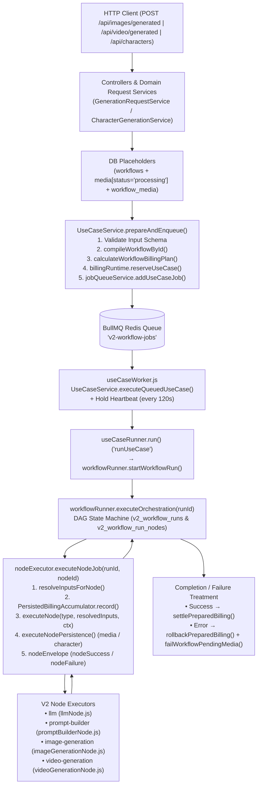

# الدليل المعماري والتشغيلي الشامل: UseCases، `runUseCase`، محرك Workflows V2، والعُقد (Nodes)

هذه الوثيقة هي المرجع الهندسي الشامل (End-to-End Reference) لكل ما يخص **الـ UseCases**، دورة حياة **`runUseCase`**، **المترجم (Compiler)**، **منفّذ الـ DAG (`workflowRunner` & `nodeExecutor`)**، **العُقد الأربع (`Nodes`)**، **المهارات (`Skills`)**، **المعالجات (`Processors`)**، **الفوترة (`Billing`)**، **الطوابير والـ Workers (`BullMQ`)**، و**سياسات الأخطاء والتعويض (`Error Policy & Compensation`)** داخل النظام الأول (**System 1: Generation & Workflows**).

---

## 1. النظرة المعمارية الشاملة (High-Level Architecture)

يعمل نظام التوليد في المنصة عبر معمارية ذات طبقتين متكاملتين داخل `src/systems/generation/`:

1. **طبقة حالة الاستخدام (`UseCase Layer`)**:
   - تمثل **العقد التجاري (Business Contract)** الذي تستدعيه الـ Controllers (`imageController.js`، `videoController.js`، و`CharacterGenerationService.js`).
   - تتولى: التحقق من المدخلات، ترجمة الـ Workflow، حساب التكلفة المسبقة (`Upfront Billing Plan`)، حجز الرصيد (`Credit Hold`)، دفع المهمة إلى طابور Redis (`v2-workflow-jobs`)، ومراقبة التنفيذ في الخلفية مع تسوية الحجز (`Settle`) عند النجاح أو استرجاعه (`Rollback`) وتنظيف الـ Media Placeholders عند الفشل.
2. **طبقة محرك سير العمل (`V2 Workflow Engine & Nodes Layer`)**:
   - تمثل **محرك التنفيذ البياني (DAG Execution Engine)**.
   - تقرأ تعريفات YAML من `src/systems/generation/internal/v2/registry/`، وتحولها عبر `compileWorkflow.js` إلى مخطط تنفيذ غير حلقي (`ExecutionGraph`)، ثم تنفذ العُقد (`Nodes`) بالترتيب الاعتمادي عبر `workflowRunner.js` و`nodeExecutor.js`.



---

## 2. الجرد الكامل للملفات والخدمات (Complete File & Service Inventory)

### 2.1 البوابات العامة (`public/`)

| الملف | الدور والمسؤولية | أبرز الصادرات (`Exports`) |
|---|---|---|
| `src/systems/generation/public/api.js` | بوابة HTTP العامة (`#generation/api`) — تعرّف مسارات Express للصور والفيديو والـ Prompts وWorkflows V1/V2. | `generationRouter`, `imagesRouter`, `videoRouter`, `promptRouter`, `v2WorkflowsRouter`, `workflowsRouter` |
| `src/systems/generation/public/tools.js` | البوابة البرمجية للنظام (`#generation/tools`) — تصدّر جميع خدمات ووظائف الـ UseCases والـ V2 Engine والـ Nodes للأنظمة الأخرى والاختبارات. | `UseCaseService`, `runUseCase`, `GenerationRequestService`, `compileWorkflow`, `startWorkflowRun`, `executeNodeJob`, `useCaseWorker`, إلخ. |

### 2.2 خدمات الـ UseCases والـ Requests والطوابير (`internal/services/` و`internal/use-cases/`)

| الملف | الدور والمسؤولية | أبرز الصادرات (`Exports`) |
|---|---|---|
| `src/systems/generation/internal/services/useCaseService.js` | الخدمة المركزية لإدارة دورة حياة الـ UseCase بالكامل (تحضير، حجز رصيد، إرسال للطابور، نبضات تمديد الحجز، تنفيذ، تسوية أو استرجاع، وتنظيف الـ Media العالقة). | `UseCaseService` |
| `src/systems/generation/internal/services/GenerationRequestService.js` | المنسق الموحد لطلبات توليد الصور والفيديو: يتحقق من المجلد، يطهر المدخلات من المفاتيح السرية ويفحصها عبر `validateInput`، ينشئ سجل `workflow` وسجلات `media` بحالة `processing`، ثم يستدعي `useCaseService.prepareAndEnqueue`. | `GenerationRequestService` |
| `src/systems/characters/internal/services/CharacterGenerationService.js` | منسق توليد الشخصيات (في النظام السابع/السادس `characters`): ينشئ `placeholderMedia` لدور `sheet` ويدفع UseCase `character-sheet-v1` عبر `useCaseService.prepareAndEnqueue`. | `CharacterGenerationService` |
| `src/systems/generation/internal/services/jobQueueService.js` | خدمة طابور BullMQ (`v2-workflow-jobs`) المسؤولة عن إرسال مهام `run-usecase` و`node-execute` مع آلية إعادة محاولة الإرسال (3 محاولات بـ Exponential Backoff 300ms/600ms). | `JobQueueService`, `jobQueueService`, `getUseCaseQueue`, `USECASE_QUEUE_NAME`, `QueueDispatchError` |
| `src/systems/generation/internal/use-cases/useCaseRunner.js` | المنفذ الفعلي لـ `runUseCase`: يحمّل تعريف الـ UseCase، يترجم الـ Workflow المرتبط به، ويشغّل `startWorkflowRun` بتمرير المعرفات الموثقة من السيرفر (`serverWorkflowId`, `serverMediaIds`). | `run` (المصدر كـ `runUseCase`), `getRegistries` |
| `src/systems/generation/internal/use-cases/useCaseRegistry.js` | السجل في الذاكرة (`Map`) لحفظ واسترجاع تعريفات الـ UseCases بعد تجميدها (`Object.freeze`). | `registerUseCase`, `getUseCase`, `listUseCases`, `clearUseCaseRegistry` |
| `src/systems/generation/internal/use-cases/useCaseSchema.js` | مدقق صحة تعريف الـ UseCase (`useCaseId`, `label`, `workflowRef`, `billing.strategy`, `inputSchema`). | `validateUseCaseDefinition` |
| `src/systems/generation/internal/use-cases/registerUseCases.js` | يسجل الـ UseCases الثلاثة المعتمدة عند إقلاع السيرفر أو الـ Worker. | `registerAllUseCases` |
| `src/systems/generation/internal/use-cases/workflowBillingPlan.js` | يحسب التكلفة المسبقة (`Upfront Billing Plan`) عبر استخراج العُقد القابلة للفوترة (`image-generation`, `video-generation`, `llm`) واستدعاء `calculateCost` من `#models/tools`. | `calculateWorkflowBillingPlan`, `getBillableNodes` |
| `src/systems/generation/internal/use-cases/definitions/imageGeneration.js` | تعريف UseCase توليد الصور (`image-generation-v1`). | `imageGenerationUseCase` |
| `src/systems/generation/internal/use-cases/definitions/videoGeneration.js` | تعريف UseCase توليد الفيديو (`video-generation-v1`). | `videoGenerationUseCase` |
| `src/systems/generation/internal/use-cases/definitions/characterSheet.js` | تعريف UseCase توليد صحيفة الشخصية (`character-sheet-v1`). | `characterSheetUseCase` |

### 2.3 ملفات المترجم (`internal/v2/compiler/`) والسجلات (`internal/v2/registry/`)

| الملف | الدور والمسؤولية | أبرز الصادرات / المحتوى |
|---|---|---|
| `src/systems/generation/internal/v2/compiler/compileWorkflow.js` | يحول تعريف الـ Workflow (من YAML) إلى مخطط تنفيذ (`ExecutionGraph`)، يتحقق من عدم وجود حلقات مغلقة (`CYCLIC_DEPENDENCY`)، يبني مجموعات التوازي (`parallel_groups` عبر خوارزمية Kahn)، ويفصل المدخلات الثابتة (`resolved_inputs`) عن التعبيرات الديناميكية (`bindings`). | `compileWorkflow`, `compileWorkflowById`, `getDefaultRegistryRoot` |
| `src/systems/generation/internal/v2/compiler/validateBindings.js` | يتحقق من صحة تعبيرات الربط `${input.field}` و`${nodeId.output.path}`، ويمنع استخدام الحقل المفرد `character`، ويتأكد من وجود `depends_on` لكل عقدة تقرأ من مخرجات عقدة سابقة. | `validateBindings`, `parseBinding`, `isBindingExpression` |
| `src/systems/generation/internal/v2/compiler/resolveRetryPolicy.js` | يحدد سياسة إعادة المحاولة لكل عقدة (`max_attempts`, `backoff`). | `resolveRetryPolicy` |
| `src/systems/generation/internal/v2/registry/registryLoader.js` | يقرأ ويحلل ملفات YAML (`nodes.yaml`, `processors.yaml`, `skills/**/*.yaml`, `workflows/*.yaml`) ويتحقق من ترابطها. | `loadRegistries`, `getRegistryRoot` |
| `src/systems/generation/internal/v2/registry/skillLoader.js` | يحمّل ملفات مهارات الـ LLM (`skills/llm/*.yaml`) ويدمج حقول `prompt_instruction` بفاصل `---`. | `loadSkills` |
| `src/systems/generation/internal/v2/registry/nodes.yaml` | السجل التصريحي للعُقد الأربع (`prompt-builder`, `image-generation`, `video-generation`, `llm`) ومدخلاتها ومخرجاتها الافتراضية. | YAML |
| `src/systems/generation/internal/v2/registry/processors.yaml` | السجل التصريحي لـ 17 معالجاً (`Processors`) مع خاصية `network: true|false`. | YAML |
| `src/systems/generation/internal/v2/registry/workflows/image-generation-v1.yaml` | مخطط سير عمل توليد الصور: `llm_translate` ← `build_prompt` ← `generate`. | YAML |
| `src/systems/generation/internal/v2/registry/workflows/video-generation-v1.yaml` | مخطط سير عمل توليد الفيديو: `llm_translate` ← `build_prompt` ← `generate`. | YAML |
| `src/systems/generation/internal/v2/registry/workflows/character-sheet-v1.yaml` | مخطط سير عمل صحيفة الشخصية: `build_prompt` ← `llm_enrich` ← `generate`. | YAML |
| `src/systems/generation/internal/v2/registry/skills/llm/system-safety.yaml` | مهارة فحص الأمان الصارم ومنع الإباحية/العري (`is_safe`, `safety_reason`). | YAML |
| `src/systems/generation/internal/v2/registry/skills/llm/translate.yaml` | مهارة الترجمة الأمينة غير الملخِّصة (Lossless Meaning-Preserving Translator v4.0.0) للصور والفيديو. | YAML |
| `src/systems/generation/internal/v2/registry/skills/llm/translation.yaml` | مهارة ترجمة اللهجة التونسية (Derja) واللغات المتعددة مع حفظ الوسوم، مستخدمة في `character-sheet-v1`. | YAML |
| `src/systems/generation/internal/v2/registry/skills/llm/character-description.yaml` | مهارة هندسة وصف الشخصية الاحترافي ذي الـ 3 لوحات (أمامي، خلفي، بورتريه كامل الرأس) مع قيود سلبية صارمة ضد النصوص. | YAML |
| `src/systems/generation/internal/v2/registry/skills/llm/json-output.yaml` | مهارة إجبار الـ LLM على إرجاع JSON نقي فقط بدون Markdown. | YAML |

### 2.4 منفّذ الـ Workflow والعُقد والفوترة ووقت التشغيل (`runner/`, `nodes/`, `resolvers/`, `runtime/`, `workers/`)

| الملف | الدور والمسؤولية | أبرز الصادرات (`Exports`) |
|---|---|---|
| `src/systems/generation/internal/v2/runner/workflowRunner.js` | يدير دورة حياة تشغيل الـ Workflow في قاعدة البيانات (`startWorkflowRun`) وآلة الحالة للـ DAG (`executeOrchestration`). | `startWorkflowRun`, `executeOrchestration`, `initializeGateways`, `getGateways` |
| `src/systems/generation/internal/v2/runner/nodeExecutor.js` | ينفذ عقدة مفردة (`executeNodeJob`)، يحل التعبيرات الديناميكية (`resolveInputsForNode`)، ويحفظ النتائج في جداول `media` أو `characters` (`executeNodePersistence`). | `executeNodeJob`, `resolveInputsForNode`, `executeNodePersistence`, `getValueAtPath` |
| `src/systems/generation/internal/v2/runner/nodeBilling.js` | يدير `PersistedBillingAccumulator` (الذي يكتب تكلفة كل عقدة فوراً في `v2_workflow_runs.metadata.billingAccumulator`)، وحساب التكلفة الفعلي للعقدة (`estimateNodeBillingAmount`). | `PersistedBillingAccumulator`, `beginRunBillingAccumulator`, `getRunBillingAccumulator`, `estimateNodeBillingAmount`, `reserveNodeBilling`, `settleNodeBilling`, `rollbackNodeBilling` |
| `src/systems/generation/internal/v2/nodes/index.js` | موزع تنفيذ العُقد (`Node Dispatcher`) الذي يربط اسم نوع العقدة بدالة التنفيذ الخاصة بها. | `executeNode`, `registerNodeExecutor`, `registry` |
| `src/systems/generation/internal/v2/nodes/llmNode.js` | منفذ عقدة `llm` (تركيب الـ Skills، استدعاء `llmService.generate`، إعادة المحاولة مرة واحدة عند فشل تحليل JSON، وتطبيق سياسة Fail-Closed للأمان). | `executeLLM`, `executeLLMNode` |
| `src/systems/generation/internal/v2/nodes/promptBuilderNode.js` | منفذ عقدة `prompt-builder` (حل المراجع من الداتابيز، ترقيم الصور `@image1..N`، استبدال الوسوم `<type:id>` بـ `@Name` أو `@imageN`، وبناء قسم `[Reference Guide]`). | `executePromptBuilder` |
| `src/systems/generation/internal/v2/nodes/imageGenerationNode.js` | منفذ عقدة `image-generation` (Pure Pass-Through: يحل `input_image` و`images` من معرفات Workflows إلى روابط CDN، ثم يستدعي `models.run`). | `executeImageGeneration` |
| `src/systems/generation/internal/v2/nodes/videoGenerationNode.js` | منفذ عقدة `video-generation` (Pure Pass-Through: يحل `input_image`, `last_frame`, `input_video`, `images` إلى روابط CDN، ثم يستدعي `models.run`). | `executeVideoGeneration` |
| `src/systems/generation/internal/v2/nodes/safety/NodeSafetyService.js` | خدمة التحقق السريع (Fail-fast) من مدخلات جميع العُقد قبل أي اتصال بمزود خارجي أو فوترة. | `NodeSafetyService` |
| `src/systems/generation/internal/v2/resolvers/WorkflowReferenceResolver.js` | يحل معرفات الـ Workflows (`CHARACTER_SHEET`, `ELEMENT_SHEET`, `GENERATION`, `UPLOAD`) مع التحقق من الملكية (`assertOwns`) إلى كيانات كاملة مع صورها وسماتها (`visualTraits`)، أو يستخرج الرابط الأساسي (`resolvePrimaryMediaUrl`). | `resolveWorkflowReferences`, `resolveWorkflowReference`, `resolveAsCharacter`, `resolveAsElement`, `resolveAsMedia`, `resolvePrimaryMediaUrl` |
| `src/systems/generation/internal/v2/runtime/useCaseBillingRuntime.js` | يغلف عمليات الحجز المسبق (`reserveUseCase`) والتسوية (`settleUseCase`) والاسترجاع (`rollbackUseCase`) على مستوى الـ UseCase، ويضغط تفاصيل التكلفة (`buildCompactCostBreakdown`) لتبقى أقل من 4KB في جدول المعاملات. | `UseCaseBillingRuntime`, `useCaseBillingRuntime`, `buildCompactCostBreakdown` |
| `src/systems/generation/internal/v2/runtime/nodeEnvelope.js` | يغلف مخرجات أو أخطاء كل عقدة في غلاف قياسي موحد (`__nodeEnvelope`). | `nodeSuccess`, `nodeFailure`, `fromNodeResult` |
| `src/systems/generation/internal/v2/runtime/errorPolicy.js` | نظام تصنيف الأخطاء المركزي (`USER_FAULT`, `BILLING_FAULT`, `UPSTREAM_FAULT`, `SERVER_FAULT`) وتطهير الأخطاء المرسلة للعميل (`sanitizeClientError`). | `ErrorSystem`, `ERROR_CATEGORIES`, `RUNTIME_ERROR_CODES`, `formatWorkflowError`, `sanitizeClientError`, `processSystemError` |
| `src/systems/generation/internal/v2/runtime/runtimeConstants.js` | ثوابت حالات التشغيل (`RUN_STATUS`, `NODE_STATUS`, `BILLING_STATUS`). | `RUN_STATUS`, `NODE_STATUS`, `BILLING_STATUS` |
| `src/systems/generation/internal/db/RunRepository.js` | مستودع قاعدة البيانات لجدولي `v2_workflow_runs` و`v2_workflow_run_nodes` (مع دعم وضع الذاكرة في `NODE_ENV=test` فقط). | `RunRepository` |
| `src/systems/generation/internal/workers/useCaseWorker.js` | عامل الخلفية (`BullMQ Worker` بتوازي `concurrency: 10`) الذي يستمع لطابور `v2-workflow-jobs` ويعالج مهام `run-usecase` و`node-execute`، ويحتوي على معالج الطوارئ عند انهيار العامل (`handleUseCaseWorkerFailure`). | `useCaseWorker`, `handleUseCaseWorkerFailure` |
| `src/systems/generation/internal/workers/worker.js` | نقطة تشغيل الـ Worker مع حلقة `startReaper` التي تشغّل `runReservationReaper()` عند الإقلاع وكل 5 دقائق لتحرير الحجوزات اليتيمة المنتهية. | `worker`, `useCaseWorker`, `startReaper`, `handleUseCaseWorkerFailure` |

---

## 3. طبقة الـ UseCases: التعريف، التسجيل، والتحضير (`UseCase Layer`)

### 3.1 ما هو الـ UseCase؟
الـ UseCase هو كائن توصيفي ثابت (Immutable Metadata Object) يُسجَّل في `useCaseRegistry.js` ويُفحص عبر `useCaseSchema.js`. يجب أن يحتوي كل UseCase على الحقول الخمسة الإلزامية التالية:
- `useCaseId`: المعرف الفريد (مثل `"image-generation-v1"`).
- `label`: الاسم المقروء.
- `workflowRef`: معرف ملف الـ Workflow YAML في `src/systems/generation/internal/v2/registry/workflows/`.
- `billing`: كائن يحدد استراتيجية الفوترة (`strategy`: `"per-node"` أو `"workflow-budget"` أو `"free"`).
- `inputSchema`: مخطط التحقق الأولي من المدخلات (`string`, `number`, `enum`, `array`, `boolean`, `object`).

### 3.2 الـ UseCases الثلاثة المسجلة في النظام

| `useCaseId` | ملف التعريف | `workflowRef` | المدخلات الإلزامية (`required: true`) | المدخلات الاختيارية (`required: false`) |
|---|---|---|---|---|
| **`image-generation-v1`** | `definitions/imageGeneration.js` | `image-generation-v1` | `prompt` (`string`), `model` (`string`) | `references` (`array`), `parameters` (`object`) |
| **`video-generation-v1`** | `definitions/videoGeneration.js` | `video-generation-v1` | `prompt` (`string`), `model` (`string`) | `references` (`array`), `parameters` (`object`) |
| **`character-sheet-v1`** | `definitions/characterSheet.js` | `character-sheet-v1` | `prompt` (`string`) | `references` (`array`), `characters` (`array`) |

---

## 4. رحلة الطلب من الـ HTTP Controller حتى الطابور (`Request → Queue`)

### المرحلة أ: التحقق الأمني وإنشاء الـ Placeholders (`GenerationRequestService.requestGeneration`)
عند استدعاء `POST /api/images/generated` (`imageController.js`) أو `POST /api/video/generated` (`videoController.js`):
1. **منع الروابط المباشرة (Anti-SSRF / ID-Only Policy)**:
   - يرفض الـ Controller أي رابط مباشر (`http://` أو `https://`) في `references` أو داخل `parameters`، ويشترط تمرير معرفات `workflow_id` فقط.
2. **التحقق من الملكية (`Ownership Verification`)**:
   - يتحقق من ملكية المستخدم للمشروع (`assertOwns("project", projectId, userId)`).
   - يتحقق من ملكية جميع المراجع (`assertOwnsAny(["workflow", "character", "element", "media"], refId, userId)`).
   - يتحقق من ملكية أي وسائط داخل `parameters` (`input_image`, `last_frame`, `input_video`, `images`, إلخ).
3. **التحقق من المجلد والموديل (`GenerationRequestService.js`)**:
   - يتحقق من صلاحية المجلد إن وُجد عبر `folderService.validateAndAssertUsable(folderId, userId, projectId)`.
   - يطهر `parameters` من أي مفاتيح تشبه الأسرار (`secret|token|password|auth|bearer|api_key`) ومن مفاتيح الدفعات (`count`, `outputCount`)، ثم يتحقق من المدخلات عبر `validateInput(model, ...)` من `#models/tools` **قبل** لمس قاعدة البيانات.
4. **إنشاء سجلات الـ Workflow والـ Media Placeholders**:
   - ينشئ سجلاً جديداً في جدول `workflows` بنوع `workflow_type: "GENERATION"`.
   - ينشئ سجلاً (أو أكثر حسب `outputCount`) في جدول `media` بحالة `status: "processing"` ورابط `url: null` مع حفظ `initialGenerationConfig` مسبقاً، ويربطها بالـ Workflow عبر `createMediaInWorkflow` في جدول `workflow_media`.

### المرحلة ب: الحساب المالي والحجز والإرسال للطابور (`UseCaseService.prepareAndEnqueue`)
يستدعي `GenerationRequestService` (أو `CharacterGenerationService`) الدالة `useCaseService.prepareAndEnqueue(...)` التي تنفذ الخطوات الـ 6 التالية بالترتيب:

1. **فحص تعريف الـ UseCase والمدخلات**:
   - تجلب التعريف عبر `getUseCase(useCaseId)` وتتحقق من المدخلات عبر `validateUseCaseInputs(input, useCase.inputSchema)`.
2. **ترجمة الـ Workflow (`compileWorkflowById`)**:
   - تحمّل السجلات عبر `loadRegistries()` وتبني الـ `ExecutionGraph` (`plan`) للتأكد من سلامة الـ Workflow قبل خصم أي رصيد.
3. **حساب التكلفة المسبقة (`calculateWorkflowBillingPlan`)**:
   - تمر على جميع العُقد في الـ `plan` وتفلتر العُقد القابلة للفوترة (`image-generation`, `video-generation`, `llm`).
   - لكل عقدة قابلة للفوترة، تستخرج الموديل والمدخلات الدلالية (`inputForNode`) وتستدعي `calculateCost(modelKey, billable.input)` من `#models/tools`.
   - إذا فشل التسعير أو أرجع قيمة غير صالحة (`NaN` أو سالبة)، ترمي خطأ `PRICING_CONFIG_ERROR` (HTTP 500) — **ممنوع افتراض التكلفة = 0 عند فشل التسعير**.
   - تجمع التكاليف مع التقريب للأعلى (`Math.ceil(rawCost)`) في `totalCredits`.
4. **حجز الرصيد المسبق (`billingRuntime.reserveUseCase`)**:
   - تبني معرف مرجعي فريد ومحصن ضد التكرار (`Idempotency Reference ID`):
     `usecase:<useCaseId>:<userId>:<executionId>`
   - تستدعي `walletService.reserve` (أو `hold`) لحجز `totalCredits` مع تمرير `metadata` مضغوط عبر `buildCompactCostBreakdown` يحتوي على `workflowId` و`mediaId`.
   - إذا لم يكن لدى المستخدم رصيد كافٍ (`INSUFFICIENT_CREDITS`)، يلتقط `GenerationRequestService` الخطأ ويحوّل حالة الـ Media Placeholders إلى `status: "saved"` مع إرجاع `needsCredits: true` للواجهة الأمامية.
5. **إرسال المهمة إلى طابور BullMQ (`jobQueueService.addUseCaseJob`)**:
   - ترسل مهمة باسم `"run-usecase"` ومعرف `jobId: "usecase-<executionId>"` إلى طابور Redis `"v2-workflow-jobs"`، مع تمرير المعرفات الموثقة من السيرفر (`serverWorkflowId`, `serverMediaIds`, `serverProjectId`) ومعرف الحجز المالي (`billing_hold_id`).
   - يحاول `jobQueueService` الإرسال حتى **3 محاولات** (بفاصل تراجعي 300ms ثم 600ms).
6. **بروتوكول التعويض الفوري عند فشل الطابور (`Queue Dispatch Failure Compensation`)**:
   - إذا فشلت المحاولات الثلاث ورمى `QueueDispatchError`:
     1. يستدعي `UseCaseService` فوراً `this.billingRuntime.rollbackUseCase(reserve.billingHoldId)` لإرجاع الرصيد المحجوز للمستخدم.
     2. يستدعي `failWorkflowPendingMedia` و`db.media.updateMedia` لتحويل جميع الـ Placeholders من `processing` إلى `failed` حتى لا تبقى أي سجل `processing` يتيم (Zero Zombies).
     3. يرمي خطأ `QUEUE_DISPATCH_FAILED` (HTTP 503).

---

## 5. دورة حياة التنفيذ في الخلفية (`Worker → executeQueuedUseCase → runUseCase`)

### 5.1 استلام المهمة في `useCaseWorker.js`
يستمع `useCaseWorker` لطابور `"v2-workflow-jobs"` بتوازي `concurrency: 10` ويدعم 3 أنواع من المهام:
1. **`job.name === "run-usecase"`**: يستدعي `useCaseService.executeQueuedUseCase(...)`.
2. **`job.data.nodeId` موجود (`node-execute`)**: يستدعي `executeNodeJob(runId, nodeId)` ثم `executeOrchestration(runId)`.
3. **`runId` فقط**: يستدعي `executeOrchestration(runId)`.

### 5.2 حراسة الحجز المالي والـ Heartbeat (`UseCaseService.executeQueuedUseCase`)
عند بدء `executeQueuedUseCase`:
1. **فحص الحجز (`assertPaidJobHasHold`)**:
   - يتأكد من أن أي مهمة مدفوعة تحمل `billingHoldId` صالحاً، وإلا يرمي `BILLING_HOLD_REQUIRED` (402).
2. **تشغيل نبضات تمديد الحجز (`startHoldHeartbeat`)**:
   - يشغّل مؤقتاً دورياً كل **120 ثانية** (`intervalMs: 120_000`) يستدعي `walletService.extendHold(billingHoldId, 300)` لتمديد صلاحية الحجز بمقدار **300 ثانية (5 دقائق)** طالما أن المهمة قيد التنفيذ (مهم جداً لمهام الفيديو الطويلة).
   - يتوقف المؤقت تلقائياً في بلوك `finally { heartbeat.stop(); }`.
3. **استدعاء `this.runUseCase({ useCaseId, input, userId })`**:
   - يفوض التنفيذ الفعلي إلى `run` في `src/systems/generation/internal/use-cases/useCaseRunner.js`.
4. **عند نجاح `runUseCase` (`result.status === "completed"`)**:
   - يستدعي `this.settlePreparedBilling(guard.billingHoldId, { node_breakdown, totalCost })` لتحويل الحجز المالي (`held`) إلى خصم نهائي (`settled`/`committed`).
5. **عند حدوث أي خطأ في `executeQueuedUseCase` (`catch (err)`)**:
   - يمرر الخطأ عبر `ErrorSystem.process(err, ...)` لتصنيفه.
   - **قاعدة صارمة (F2.3-e)**: يستدعي دائماً `this.rollbackPreparedBilling(guard.billingHoldId, ...)` لإلغاء الحجز وإرجاع الرصيد للمستخدم أياً كان سبب الفشل.
   - يستدعي `failWorkflowPendingMedia` ويحدّث جميع `serverMediaIds` إلى `status: "failed"` مع رسالة الخطأ المصفاة.
6. **حماية إضافية عند انهيار الـ Worker (`handleUseCaseWorkerFailure`)**:
   - إذا انهار الـ Worker أو فشل Job بدون `err.errorReport`، يتدخل مستمع الحدث `useCaseWorker.on("failed", handleUseCaseWorkerFailure)` كشبكة أمان ثانية، فيلغي الحجز المالي (`rollbackPreparedBilling`) ويحوّل جميع الـ Media Placeholders إلى `failed`.

---

## 6. كيف يعمل `runUseCase` ومحرك الـ DAG (`useCaseRunner` → `workflowRunner` → `nodeExecutor`)

### 6.1 دالة `run` (`runUseCase`) في `useCaseRunner.js`
1. تجلب تعريف الـ UseCase من `useCaseRegistry.js`.
2. تحمّل السجلات (`getRegistries()` — تُخزَّن مؤقتاً في الذاكرة في بيئة الإنتاج `isProduction` وتُقرأ مباشرة في التطوير/الاختبار).
3. تترجم الـ Workflow المرتبط (`compileWorkflowById(useCase.workflowRef, finalRegistries)`).
4. تستخرج المعرفات الموثقة من السيرفر حصراً (`serverWorkflowId`, `serverMediaIds`, `serverProjectId`) وتستدعي:
   `startWorkflowRun(plan, runtimeInput, null, serverContext)`
5. إذا لم تكن حالة `runResult.status === "completed"`، ترمي خطأ يحمل `code`, `category`, `userMessage`, `nodeId`, و`billingBreakdown`.

### 6.2 بدء تشغيل الـ Workflow (`startWorkflowRun` في `workflowRunner.js`)
1. تنشئ معرف تشغيل `finalRunId` وتبدأ تراكم الفوترة في الذاكرة والداتابيز عبر `beginRunBillingAccumulator(finalRunId)`.
2. تنشئ سجلاً في جدول **`v2_workflow_runs`** عبر `runRepo.createRun(...)` بحالة `status: "pending"`، ويُحفظ بداخله:
   - `input`: مدخلات التشغيل.
   - `execution_plan`: مخطط الـ DAG المترجم (`nodes`, `edges`, `parallel_groups`, `outputs`) مضافاً إليه `targetWorkflowId`, `targetMediaIds`, `targetProjectId`.
   - `v1_workflow_id`: معرف الـ Workflow في جدول `workflows`.
   - `target_media_ids`: مصفوفة معرفات الـ Media Placeholders المسموح بتحديثها.
3. تنشئ سجلاً لكل عقدة في جدول **`v2_workflow_run_nodes`** عبر `runRepo.createNodeRun(...)` بحالة `status: "pending"` و`attempt: 1`.
4. تسجل حدث `workflow.start` في `eventRecorder`، ثم تستدعي `executeOrchestration(finalRunId)`.

### 6.3 آلة الحالة وتنسيق الـ DAG (`executeOrchestration` في `workflowRunner.js`)
تعمل `executeOrchestration(runId)` بشكل تكراري (Recursive State Machine) في كل خطوة:

1. **الانتقال إلى `running`**:
   - إذا كانت حالة الـ Run هي `"pending"`, تحدّثها إلى `"running"`.
2. **فحص العُقد الفاشلة (`failedNode`)**:
   - إذا وُجدت أي عقدة في `v2_workflow_run_nodes` بحالة `"failed"`، تستخرج الخطأ وتنسقه عبر `formatWorkflowError`، وتحدّث سجل `v2_workflow_runs` إلى `status: "failed"`، وتفشل جميع الـ Media المعلقة عبر `failWorkflowPendingMedia`، وتتوقف.
3. **فحص اكتمال جميع العُقد (`allCompleted`)**:
   - إذا أصبحت جميع عُقد الـ `plan.nodes` في حالة `"completed"`:
     - تحل تعبيرات المخرجات النهائية (`plan.outputs`) عبر `parseBinding` و`getValueAtPath`.
     - تحدّث سجل `v2_workflow_runs` إلى `status: "completed"` مع حفظ `outputs` و`completed_at`.
4. **تشغيل العُقد الجاهزة (`Enqueue / Execute Ready Nodes`)**:
   - تمر على كل عقدة في حالة `"pending"`، وتفحص جميع الحواف الداخلة إليها (`plan.edges.filter(e => e.to === node.id)`).
   - إذا كانت جميع العُقد التي تعتمد عليها (`deps`) في حالة `"completed"`:
     - تحدّث حالة العقدة إلى `"running"`، وتستدعي `await executeNodeJob(runId, node.id)`، ثم تعيد استدعاء `await executeOrchestration(runId)`.
5. **كشف الجمود (`ORCHESTRATION_DEADLOCK`)**:
   - إذا لم تكن هناك أي عقدة قيد التشغيل (`running`) ولا توجد أي عقدة معلقة جاهزة للتنفيذ بينما لم يكتمل الـ Workflow، تعلن حالة `ORCHESTRATION_DEADLOCK` وتنهي الـ Run بحالة `"failed"`.

---

## 7. معالجة وتنفيذ العقدة المفردة (`executeNodeJob` في `nodeExecutor.js`)

عند استدعاء `executeNodeJob(runId, nodeId)`، يتم تنفيذ الخطوات الدقيقة التالية:

### الخطوة 1: حل المدخلات الديناميكية (`resolveInputsForNode`)
تدمج المدخلات الثابتة المترجمة (`nodeConfig.resolved_inputs`) مع تعبيرات الربط الديناميكية (`bindings`):
- إذا كان التعبير على شكل `${input.field}` ← يقرأ القيمة من `run.input[field]`.
- إذا كان التعبير على شكل `${upstreamNodeId.output.path.to.val}` ← يبحث عن مخرجات العقدة السابقة (`depRun.output`) ويستخرج القيمة عبر `getValueAtPath`.

### الخطوة 2: تسجيل تكلفة العقدة (`PersistedBillingAccumulator`)
- إذا كان الـ Run مغطى بحجز UseCase مسبق (`isCoveredByUseCase = Boolean(run.input.billing_hold_id)`):
  - **لا يتم لمس المحفظة (`WalletService`) أثناء تنفيذ العُقد إطلاقاً**.
  - بدلاً من ذلك، إذا كانت العقدة من الأنواع المدعومة بمزود (`image-generation`, `video-generation`, `llm`)، تحسب تكلفتها الفعلية عبر `estimateNodeBillingAmount(nodeConfig, resolvedInputs)` وتسجلها في `ctx.billing.record(...)` (`PersistedBillingAccumulator`) الذي يحفظها فوراً في الذاكرة وفي عمود `v2_workflow_runs.metadata.billingAccumulator` في قاعدة البيانات.
- أما إذا كان الـ Run يعمل مباشرة بدون UseCase Hold (مثل تشغيل Workflow V2 مباشر)، فيحجز رصيد العقدة منفرداً عبر `reserveNodeBilling` ويسويه عبر `settleNodeBilling`.

### الخطوة 3: استدعاء منفذ العقدة (`executeNode`)
يستدعي `executeNode(nodeConfig.type, resolvedInputs, ctx)` من `src/systems/generation/internal/v2/nodes/index.js`.

### الخطوة 4: الحفظ التصريحي للمخرجات (`executeNodePersistence`)
إذا كان تعريف العقدة في ملف الـ Workflow YAML يحتوي على بلوك `persist:`:
- **حماية أمنية صارمة (F2a)**: لا تقرأ `executeNodePersistence` معرف الـ Workflow أو الـ Media من مدخلات المستخدم (`run.input`) أبداً، بل تقرأ حصراً `run.targetWorkflowId` و`run.targetMediaIds` الموثقة من السيرفر.
- **الحالة الأولى: `target: "character"`** (كما في عقدة `llm_enrich` داخل `character-sheet-v1.yaml`):
  - تستخرج القيمة المحددة في `value` (مثل `"$outputs.json.description"`) وتحدّث جدول الشخصيات عبر:
    `activeDb.characters.updateCharacter(workflowId, { [field]: resolvedValue })`.
- **الحالة الثانية: `target: "media"`** (كما في عقدة `generate` في جميع الـ Workflows):
  1. تجلب سجلات الـ Media المرتبطة بالـ Workflow (`activeDb.media.findByWorkflow(workflowId)`) وتطابقها بالترتيب مع `allowedMediaIds`.
  2. **حماية ضد إحياء الحجوزات المنتهية (`HOLD_EXPIRED` Guard)**: إذا وجدت أن أي Placeholder قد تحول إلى `failed` أو `cancelled` (بسبب انتهاء صلاحية الحجز عبر الـ Reaper أو إلغاء المهمة)، ترفض حفظ المخرجات وترمي خطأ `HOLD_EXPIRED` (409) لمنع تسريب وسائط مجانية بعد استرجاع الرصيد.
  3. **فحص تطابق عدد المخرجات (`Output Contract Validation`)**:
     - **نقص المخرجات (`assets.length < activePlaceholders.length`)**: تفشل جميع الـ Placeholders وترمي خطأ غير قابل لإعادة المحاولة `OUTPUT_CONTRACT_VIOLATION` (422) لأن المستخدم دفع مقابل `N` مخرجات وحصل على أقل.
     - **فائض المخرجات (`assets.length > activePlaceholders.length`)**: تسجل تحذيراً منظماً (`[OUTPUT_SURPLUS]`) وتقتطع أول `N` مخرجات لتطابق الـ Placeholders.
  4. **دمج وحفظ `generation_config` والـ `url`**:
     - تدمج الإعدادات الأولية المحفوظة في الـ Placeholder (`existingConfig`) مع القيم المكتشفة وقت التشغيل (`provider`, `prompt_optimized` إذا تغير الـ Prompt بعد الترجمة/الإثراء، والأبعاد `width`/`height`).
     - تحدّث كل Placeholder عبر `activeDb.media.updateMedia(placeholder.id, { url, status: "completed", width, height, generation_config })`.

### الخطوة 5: التغليف (`nodeEnvelope`) أو إعادة المحاولة والفشل
- **عند النجاح**: تغلف المخرجات عبر `nodeSuccess(output, metadata)` وتحفظها في `v2_workflow_run_nodes` بحالة `"completed"`.
- **عند الفشل**:
  - تفحص `nodeConfig.retry_policy.max_attempts`: إذا كان `currentAttempt < maxAttempts` والخطأ قابل لإعادة المحاولة (`error.retryable !== false`)، تزيد `attempt` بـ 1 وتعيد استدعاء `executeNodeJob`.
  - إذا استُنفدت المحاولات: تستدعي `failWorkflowPendingMedia`، وتغلف الخطأ عبر `nodeFailure(error, metadata)`، وتحدّث سجل العقدة في `v2_workflow_run_nodes` إلى `"failed"`.

---

## 8. تشريح العُقد الأربع (The 4 V2 Nodes in Detail)

يحتوي النظام على **4 أنواع عُقد (Node Types)** مسجلة في `src/systems/generation/internal/v2/nodes/index.js` و`nodes.yaml`:

### 8.1 عقدة الذكاء اللغوي والأمان: `llm` (`llmNode.js`)
- **الخصائص**: `skill_aware: true` | `provider_backed: true` | الموديل الافتراضي: `"gemini-3.1-flash-lite"`.
- **المدخلات**:
  - `userPrompt` (إلزامي، بحد أقصى `7000` حرف يُفحص عبر `NodeSafetyService.assertLLMInputs`).
  - `skills` (مصفوفة معرفات مهارات مثل `["llm/system-safety", "llm/translate", "llm/json-output"]`) أو `systemPromptOverride`.
  - `context` (اختياري — كائن السياق القادم من `prompt-builder`).
  - `images` (اختياري — مصفوفة روابط الصور المرجعية لتحليلها بصرياً عبر LLM Vision).
  - `jsonMode` (`boolean`), `temperature` (`0.0` إلى `2.0`), `parameters` (`object`).
- **خطوات المعالجة الداخلية (Internal Treatment)**:
  1. **التحقق الأولي (`NodeSafetyService.assertLLMInputs`)**: يفحص طول النص، وجود `skills` أو `systemPromptOverride`، ويضبط `temperature`.
  2. **تركيب تعليمات النظام (`Skill Loader & System Prompt Composition`)**:
     - يحمّل ملفات YAML للمهارات المطلوبة عبر `loadSkills(skillIds)` ويفك قوالب `{{param}}` عبر `renderTemplate`.
     - إذا وُجد `context`، يلحقه في نهاية `systemPrompt` تحت قسم `=== RESOLVED CONTEXT SNAPSHOT ===`.
     - إذا كان `jsonMode === true`، يلحق عقد المخرجات الصارم (`OUTPUT CONTRACT`) الذي يفرض إرجاع JSON يحتوي على `is_safe`, `safety_reason`, `title`, `description`, `keywords`, `references`, `generationConfig`.
  3. **استدعاء المزود (`llmService.generate`)**:
     - يستدعي `llmService.generate` من `#models/tools`.
     - **سياسة Fail-Closed الصارمة**: إذا فشل استدعاء الـ LLM لأي سبب، **يُمنع منعاً باتاً** تمرير النص الأصلي غير المفحوص أمنياً؛ بل يفشل التنفيذ فوراً بـ `CONTENT_SAFETY_VIOLATION` (إذا كان رفضاً أمنياً من المزود) أو `SAFETY_CHECK_FAILED` (إذا كان خطأ تقنياً).
  4. **تحليل الـ JSON وإعادة المحاولة الذكية (1-Retry with Reinforcement)**:
     - ينظف النص من علامات ` ```json ` ويحلله عبر `parseJSONResponse` ثم يطبعه عبر `normalizeStructuredJSON`.
     - إذا فشل تحليل الـ JSON في المرة الأولى، يعيد استدعاء `llmService.generate` **مرة واحدة إضافية** مع إضافة تحذير `CRITICAL ERROR REINFORCEMENT` لإجبار الموديل على إرجاع JSON صالح فقط.
  5. **فرض الأمان (`Content Safety Enforcement`)**:
     - إذا كانت مهارة `llm/system-safety` مفعلة، يشترط وجود حقل `is_safe` منطقي (`boolean`) ونص غير فارغ عند `is_safe: true`.
     - إذا أرجع الموديل `is_safe: false`، يرمي فوراً خطأ `CONTENT_SAFETY_VIOLATION` (`category: "USER_FAULT"`, `statusCode: 422`) مع سبب الرفض (`safety_reason`)، مما يوقف الـ Workflow فوراً ويسترجع الرصيد المحجوز.
- **المخرجات (`Output`)**:
  `{ text, json, is_safe, safety_reason, modelUsed }`

---

### 8.2 عقدة بناء وتجميع الـ Prompt والمراجع: `prompt-builder` (`promptBuilderNode.js`)
- **الخصائص**: `skill_aware: true` | `provider_backed: false` (مجانية، **0 استدعاءات LLM**).
- **المدخلات**:
  - `prompt` (`string`), `references` (`array` من معرفات `workflow_id`), `characters` (`array`), `style` (`string`).
- **خطوات المعالجة الداخلية (Internal Treatment)**:
  1. **التحقق والتطبيع (`NodeSafetyService.assertPromptBuilderInputs`)**: يتأكد من وجود نص `prompt` أو استنتاجه من أول شخصية في `characters`.
  2. **حل المراجع من قاعدة البيانات (`resolveWorkflowReferences`)**:
     - يستدعي `resolveWorkflowReferences(refIds, userId)` في `WorkflowReferenceResolver.js`.
     - يفحص `workflow_type` في جدول `workflows` مع التحقق من ملكية المستخدم (`assertOwns`):
       - `CHARACTER_SHEET` ← `resolveAsCharacter`: يجلب بيانات الشخصية من `db.characters`، ويصنف صورها المرتبطة في `db.media` عبر `inferWorkflowMediaRole` إلى `sheetImages` (Turnaround) و`detailImages` (Closeups)، ويستخرج سماتها البصرية (`visualTraits`: `archetype`, `gender`, `hair`, `eyes`, `skin`, `outfit`, إلخ).
       - `ELEMENT_SHEET` ← `resolveAsElement`: يجلب العنصر من `elementRepository.resolveRecord` وصوره المرجعية وسماته (`element_type`).
       - `GENERATION` / `UPLOAD` ← `resolveAsMedia`: يجلب الوسائط من `db.media`، وإذا كانت تنتمي لـ Workflow أب من نوع `CHARACTER_SHEET` أو `ELEMENT_SHEET` يصعد تلقائياً لحل الكيان الأب بالكامل!
  3. **بناء خريطة الكيانات وترقيم الصور (`Image Registry & @imageN Tagging`)**:
     - يسجل جميع روابط الصور الفريدة بالترتيب الطبيعي لورودها في `references[]` ويمنح كل صورة رقماً تسلسلياً `@image1`, `@image2`, `@imageN`.
  4. **تنسيق النص واستبدال الوسوم المضمنة (`formatPrompt`)**:
     - الوسوم المضمنة في النص مثل `<character:uuid>` أو `<element:uuid>` أو `<MediaAsset:uuid>` هي **علامات موضعية (Positional Markers)** فقط وليست طلبات جلب من الداتابيز:
       - إذا كان المعرف موجوداً في `entityMap` (لأنه مُرسل ضمن `references[]`) ← يُستبدل بـ `@CharacterName` أو `@ElementName` أو `@imageN`.
       - إذا لم يكن المعرف موجوداً في `references[]` ← يُحذف الوسم بصمت مع تنظيف الفواصل والمسافات الزائدة.
     - يفك وسوم العرض مثل `<Trait:X>` إلى `X`.
  5. **إضافة الكيانات غير المذكورة والـ Style**:
     - إذا أرسل المستخدم شخصية أو عنصراً في `references[]` ولم يذكر اسمه `@Name` داخل النص، تضيفه العقدة تلقائياً في بداية الـ Prompt.
     - تلحق `style` في نهاية الـ Prompt إذا لم يكن موجوداً.
  6. **بناء بلوك دليل المراجع (`[Reference Guide]`)**:
     - تنشئ بطاقة تعريفية منظمة لكل كيان في نهاية الـ Prompt تحت عنوان `[Reference Guide]` تحتوي على الاسم، النوع، الوصف (`description`)، السمات (`traits`)، وأرقام الصور المرجعية (`turnaround sheet: @image1 | detail closeups: @image2`).
- **المخرجات (`Output`)**:
  `{ finalPrompt: string, context: WorkflowContext }` (حيث يحتوي `context` على `references` كقائمة روابط الصور، `referenceGuide`, `entities.characters`, `entities.elements`, `standaloneMedia`).

---

### 8.3 عقدة توليد الصور: `image-generation` (`imageGenerationNode.js`)
- **الخصائص**: `skill_aware: false` | `provider_backed: true` | **Pure Pass-Through**.
- **المدخلات**: `{ model, prompt, parameters }`.
- **خطوات المعالجة الداخلية (Internal Treatment)**:
  1. **التحقق من الـ Prompt (`NodeSafetyService.assertImageInputs`)**: يتأكد أن `prompt` نص غير فارغ ولا يتجاوز `7000` حرف، وأن `model` محدد.
  2. **حل معرفات الصور المدخلة إلى روابط CDN (`resolvePrimaryMediaUrl`)**:
     - إذا كان `parameters.input_image` يحتوي على `workflow_id` (وليس رابط `http`)، يحله عبر `resolvePrimaryMediaUrl(workflowId, userId)` إلى رابط الصورة الأساسي (مع التحقق من ملكية المستخدم). إذا فشل الحل يرمي خطأ واضحاً.
     - إذا كان `parameters.images` مصفوفة معرفات، يحولها عبر `toMediaIdList` ويحل كل معرف إلى رابط CDN بالتوازي.
  3. **التمرير المباشر لنظام الموديلات (`models.run`)**:
     - يبني `canonicalInput = { prompt, ...resolvedParams }` ويستدعي `run(modelFamily, canonicalInput, { idempotencyKey: "node:<runId>:<nodeId>", userId })` من `#models/tools`.
  4. **تطبيع المخرجات (`Normalize to V2 Asset Shape`)**:
     - يحول روابط الصور الراجعة من المزود إلى مصفوفة `assets: [{ id, type: "image", url, metadata }]`.
- **المخرجات (`Output`)**:
  `{ assets, metadata: { model, provider, latencyMs } }`

---

### 8.4 عقدة توليد الفيديو: `video-generation` (`videoGenerationNode.js`)
- **الخصائص**: `skill_aware: false` | `provider_backed: true` | **Pure Pass-Through**.
- **المدخلات**: `{ model, prompt, parameters }`.
- **خطوات المعالجة الداخلية (Internal Treatment)**:
  1. **التحقق من الـ Prompt (`NodeSafetyService.assertVideoInputs`)**: يتأكد من صحة `prompt` و`model`.
  2. **حل إطارات ومقاطع الفيديو المرجعية إلى روابط CDN (`resolvePrimaryMediaUrl`)**:
     - يحل الحقول الأربعة التالية في `parameters` من `workflow_id` إلى روابط CDN حقيقية (مع فحص الملكية):
       - `parameters.input_image` (الإطار الأول / Start Frame).
       - `parameters.last_frame` (الإطار الأخير / End Frame).
       - `parameters.input_video` (فيديو المصدر للاستكمال / Source Video).
       - `parameters.images` (صور مرجعية متعددة / Multi-reference Images).
  3. **التمرير المباشر لنظام الموديلات (`models.run`)**:
     - يستدعي `run(modelFamily, { prompt, ...resolvedParams }, { idempotencyKey: "node:<runId>:<nodeId>", userId })` من `#models/tools`.
  4. **تطبيع المخرجات (`Normalize to V2 Video Asset Shape`)**:
     - يحول الفيديوهات الراجعة إلى مصفوفة `assets: [{ id, type: "video", url, metadata }]`.
- **المخرجات (`Output`)**:
  `{ assets, metadata: { model, provider, latencyMs } }`

---

## 9. خطوط أنابيب الـ Workflows الثلاثة بالتفصيل (Workflow DAG Pipelines)

### 9.1 `image-generation-v1` (`workflows/image-generation-v1.yaml`)
يتكون من **3 عُقد متسلسلة**:
1. **`llm_translate` (`type: llm`)**:
   - يأخذ `userPrompt: "${input.prompt}"`.
   - يشغّل الموديل `gemini-3.1-flash-lite` مع المهارات `[llm/system-safety, llm/translate, llm/json-output]` و`jsonMode: true`.
   - يتحقق من خلو النص من المحتوى الإباحي/العري، ويترجم النص ترجمة أمينة غير ملخِّصة إلى الإنجليزية مع الحفاظ الحرفي على جميع الوسوم (`<character:uuid>`, `@Name`, `@image1`).
2. **`build_prompt` (`type: prompt-builder`, يعتمد على `llm_translate`)**:
   - يأخذ `prompt: "${llm_translate.output.text}"` و`references: "${input.references}"`.
   - يحل جميع المراجع من الداتابيز، يستبدل الوسوم بأسماء الكيانات أو `@imageN`، ويلحق بلوك `[Reference Guide]`.
3. **`generate` (`type: image-generation`, يعتمد على `build_prompt`)**:
   - يأخذ `model: "${input.model}"`, `prompt: "${build_prompt.output.finalPrompt}"`, `parameters: "${input.parameters}"`.
   - ينفذ التوليد عبر `#models/tools`، ويحفظ النتيجة تلقائياً في جدول `media` (`persist: { target: media, step_id: image_generation, status: completed, value: "$outputs.assets[0].url" }`).

### 9.2 `video-generation-v1` (`workflows/video-generation-v1.yaml`)
يتكون من **3 عُقد متسلسلة** مطابقة في البنية لـ `image-generation-v1` مع اختلاف العقدة الثالثة:
1. **`llm_translate` (`type: llm`)**: فحص الأمان والترجمة الأمينة (`[llm/system-safety, llm/translate, llm/json-output]`).
2. **`build_prompt` (`type: prompt-builder`)**: حل المراجع وبناء `finalPrompt` مع `[Reference Guide]`.
3. **`generate` (`type: video-generation`)**: حل إطارات البداية/النهاية والفيديو المرجعي، استدعاء موديل الفيديو، وحفظ النتيجة في جدول `media` (`step_id: video_generation`).

### 9.3 `character-sheet-v1` (`workflows/character-sheet-v1.yaml`)
يتكون من **3 عُقد** بترتيب معكوس بين `prompt-builder` و`llm` لأن الـ LLM يحتاج إلى رؤية الصور المرجعية المحلولة (`images`) والسياق (`context`):
1. **`build_prompt` (`type: prompt-builder`)**:
   - يأخذ `prompt: "${input.prompt}"`, `characters: "${input.characters}"`, `references: "${input.references}"`.
   - يحل المراجع ويخرج `finalPrompt` و`context` (الذي يضم روابط الصور المرجعية في `context.references`).
2. **`llm_enrich` (`type: llm`, يعتمد على `build_prompt`)**:
   - يأخذ `userPrompt: "${build_prompt.output.finalPrompt}"`, `context: "${build_prompt.output.context}"`, `images: "${build_prompt.output.context.references}"`.
   - يشغّل `gemini-3.1-flash-lite` مع المهارات `[llm/system-safety, llm/translation, llm/character-description, llm/json-output]` و`jsonMode: true`.
   - يصمم وصفاً تفصيلياً احترافياً لصحيفة شخصية من 3 لوحات (أمامي، خلفي، بورتريه) وينتهي بقيود منع النصوص، ثم **يحفظ الوصف تلقائياً في جدول الشخصيات** (`persist: { target: character, field: description, value: "$outputs.json.description" }`).
3. **`generate` (`type: image-generation`, يعتمد على `llm_enrich` و`build_prompt`)**:
   - يأخذ `prompt: "${llm_enrich.output.json.description}"` و`references: "${build_prompt.output.context.references}"`.
   - يستخدم إعدادات ثابتة (`model: gpt-image-2`, `ratio: "16:9"`, `width: 1344`, `height: 768`, `count: 1`)، ويحفظ الصورة الناتجة في جدول `media` (`step_id: character_sheet`).

---

## 10. المعالجات المساعدة (`internal/v2/processors/`)

توجد في `src/systems/generation/internal/v2/processors/` 13 وحدة معالجة مسجلة في `processors.yaml` ومصدرة عبر `#generation/tools`:

| ملف المعالج | `network` | الوظيفة |
|---|---|---|
| `resolveCharacters.js` | `false` | تحميل بيانات وصور الشخصيات داخل `context.characters`. |
| `resolveReferences.js` | `false` | تحميل وتصنيف الصور المرجعية حسب الدور (`role`). |
| `applyCharacterTemplate.js` | `false` | حقن وصف الشخصية داخل قالب الـ Prompt. |
| `applyPoseTemplate.js` | `false` | حقن تعليمات الوضعيات والزوايا (`views`). |
| `applyCameraStyle.js` | `false` | حقن إعدادات العدسة وزاوية الكاميرا والإضاءة. |
| `buildStoryboardLayout.js` | `false` | إضافة تعليمات تقسيم اللوحات (`Storyboard Grid Layout`). |
| `applySheetLayout.js` | `false` | إضافة تعليمات تخطيط صحيفة الشخصية (`3-panel studio turnaround`). |
| `applyComposition.js` | `false` | إضافة قواعد التكوين البصري للبوسترات والمشاهد. |
| `applyTypographyArea.js` | `false` | حجز المساحات الآمنة للنصوص والعناوين في التصميمات. |
| `generateNegativePrompt.js` | `false` | توليد قيود الـ Negative Prompt لمنع التشوهات والنصوص العشوائية. |
| `enhancePrompt.js` | `true` | إثراء وتحسين الـ Prompt عبر LLM. |
| `moderationSafety.js` | `true` | فحص أمان المحتوى عبر LLM. |
| `optimizeVisualPrompt.js` | `true` | ترجمة النصوص متعددة اللغات وتكثيف الوصف البصري عبر LLM. |

---

## 11. نظام تصنيف الأخطاء والتعويض المالي (`errorPolicy.js` & `Reaper`)

### 11.1 الفئات الأربع للأخطاء (`ERROR_CATEGORIES`)

| الفئة | متى تحدث؟ | الرسالة التي تظهر للمستخدم (`userMessage`) | إجراء الفوترة (`billingAction`) | كود HTTP |
|---|---|---|---|---|
| **`USER_FAULT`** | محتوى مخالف للأمان (`CONTENT_SAFETY_VIOLATION` / `PROVIDER_CONTENT_POLICY_ERROR`) أو مدخلات غير صالحة (`INVALID_INPUT` / `VALIDATION_ERROR` / `SSRF_BLOCKED`). | رسالة واضحة ومهذبة تشرح للمستخدم ما يجب تعديله في الـ Prompt أو المدخلات. | `rollback` (أو `none` إذا رُفض قبل الحجز) | `422` (للأمان) أو `400` |
| **`BILLING_FAULT`** | رصيد غير كافٍ (`INSUFFICIENT_CREDITS`) أو غياب حجز الفوترة (`BILLING_HOLD_REQUIRED`). | إشعار صريح بضرورة شحن المحفظة. | `none` | `402` |
| **`UPSTREAM_FAULT`** | خطأ من مزود الذكاء الاصطناعي الخارجي (`PROVIDER_TIMEOUT`, `PROVIDER_RATE_LIMIT`, `PROVIDER_UNAVAILABLE`, `PROVIDER_QUOTA_EXCEEDED`, `SAFETY_CHECK_FAILED`). | رسالة اعتذار قياسية آمنة (`"Please try again in a few moments."`) بدون تسريب أي تفاصيل داخلية. (وفي حالة `PROVIDER_QUOTA_EXCEEDED` يُطلق تنبيه `ADMIN_ACTION_REQUIRED` في السجلات). | `rollback` | `429` أو `503` |
| **`SERVER_FAULT`** | خطأ داخلي في السيرفر أو الداتابيز أو المفاتيح (`CREDENTIAL_ERROR`, `PRICING_CONFIG_ERROR`, `OUTPUT_CONTRACT_VIOLATION`, `PERSISTENCE_FAILED`, `ORCHESTRATION_DEADLOCK`, `INTERNAL_ERROR`). | رسالة اعتذار قياسية آمنة (`"Please try again in a few moments."`) مع إخفاء كامل للـ Stack Traces والأسرار. | `rollback` | `500` |

### 11.2 التسوية الدورية للحجوزات اليتيمة (`Reservation Reaper`)
في حال انقطاع اتصال Worker أو توقف عملية قبل الوصول إلى `executeQueuedUseCase` أو `handleUseCaseWorkerFailure`:
1. يعمل `startReaper()` في `src/systems/generation/internal/workers/worker.js` عند إقلاع الـ Worker وكل **5 دقائق** (`REAPER_INTERVAL_MS = 300_000`).
2. يستدعي `runReservationReaper()` من `#billing/tools` (`ReservationReaperService.js`).
3. يبحث عن جميع حجوزات الرصيد (`held`) التي انتهت صلاحيتها (`expires_at < now`)، فيسترجع الرصيد للمستخدم (`rollback`)، ويستخرج `workflowId` و`mediaId` من `metadata` الحجز ليحوّل جميع سجلات الـ Media المعلقة المرتبطة بها إلى `status: "failed"`.
