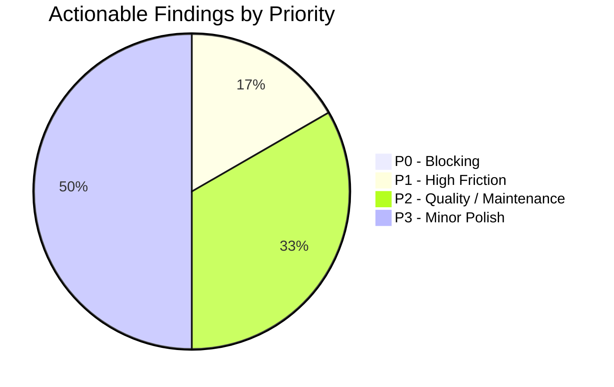
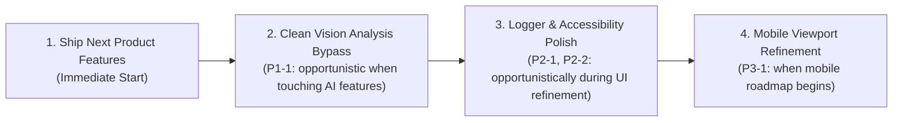

# OpenArt Product Readiness Assessment — Post Architecture Cleanup

**Date:** 2026-11-07  
**Branch:** `runway-design`  
**Assessment Type:** Read-Only Product Foundation & Feature Readiness  
**Target:** Cinema Studio, Media Management, Prompt Bar, Generations, Elements & Characters  
**Status:** **READY FOR PRODUCT DEVELOPMENT**

---

## 1. Executive Summary

Following the completion of the 5-phase Frontend Architecture Cleanup (Shared UI Promotion, UserDropdown Extraction, Entity Edit Navbar Consolidation, MediaGridItem Lifecycle Decomposition, and Targeted FSD Boundary Corrections), this assessment evaluated whether the frontend codebase provides a reliable, minimal, and scalable foundation for shipping product features.

### Key Metrics & Verification Evidence
* **Unit & Integration Tests:** **137 test files passed**, **905 tests passed** (100% pass rate).
* **Design System Ratchet (`ui:check`):** **0 new violations** across all 7 rules (U1–U7). Arbitrary Tailwind classes reduced from 660 to 633; raw color literals reduced from 218 to 214.
* **Production Build (`npm run build`):** Clean Next.js 16.2.1 Turbopack compilation in 8.1s; 0 TypeScript or bundling errors across all static and dynamic routes.
* **Knowledge Graph (`graphify`):** Fully synchronized (9,962 nodes, 22,133 edges, 685 communities).

### Verdict
The frontend foundation is **READY FOR PRODUCT DEVELOPMENT**. There are **zero P0 blocking issues**. The component architecture, state management patterns, and design system primitives are stable, cohesive, and fully capable of supporting rapid feature delivery without further architectural refactoring phases.

---

## 2. Current Product Foundation Assessment

The evaluation inspected the codebase across the eight core product dimensions:

| Dimension | Current State | Assessment & Evidence |
|---|---|---|
| **1. Shared UI Primitives** | **Fully Canonical** | [`button.jsx`](file:///c:/Users/jihad/Desktop/open%20art/my-app/src/shared/ui/button.jsx#L31-L54) standardizes 6 semantic variants with sharp 4px radius (`rounded-sm`). [`dialog.jsx`](file:///c:/Users/jihad/Desktop/open%20art/my-app/src/shared/ui/dialog.jsx#L58-L70) standardizes flat modal surfaces (`rounded-2xl`, zero shadows). Zero raw `<button>` elements exist in production pages (all 13 baseline occurrences are confined to internal `/test/` routes). |
| **2. Design Tokens & Styling** | **Strict & Flat** | Strictly aligned with the Runway specification: zero positive shadows, standard 4px spacing grid (`gap-1.5`, `gap-2`, `p-3`, `p-4`), semantic color tokens (`bg-background`, `bg-surface-card`, `text-muted-foreground`), and canonical radius hierarchy (`rounded-sm`, `rounded-lg`, `rounded-2xl`, `rounded-full`). |
| **3. Feature Public APIs** | **FSD Compliant** | Every feature (`media`, `prompt-bar`, `characters`, `elements`, `workflows`, `trash`, `folders`) exports clean public interfaces via `index.js`. Upward feature-to-widget imports and widget re-exports have been completely eliminated. |
| **4. Composition Patterns** | **High Cohesion** | Top-level routes in `src/app/cinema-studio/` act as thin orchestrators. Layouts (`StudioLayout`) handle entry caching, prefetching, and error boundaries. Edit pages isolate headers (`EntityEditNavbar`, `AssetDetailNavbar`, `EditNavbar`). |
| **5. Feedback & States** | **Consistent** | Universal loading states via [`LoadingScreen.jsx`](file:///c:/Users/jihad/Desktop/open%20art/my-app/src/shared/ui/LoadingScreen.jsx), in-flight media via [`ProcessingCard.jsx`](file:///c:/Users/jihad/Desktop/open%20art/my-app/src/shared/ui/ProcessingCard.jsx), generation error feedback via [`FlowErrorTile.jsx`](file:///c:/Users/jihad/Desktop/open%20art/my-app/src/shared/ui/FlowErrorTile.jsx), empty feeds across all sections, and optimistic rollback toasts via `notifyOptimisticError.js`. |
| **6. Interaction Patterns** | **Desktop-Class** | Fluid 2D masonry galleries via [`SharedGalleryGrid.jsx`](file:///c:/Users/jihad/Desktop/open%20art/my-app/src/features/media/ui/SharedGalleryGrid.jsx), HTML5 drag-and-drop targeting to prompt bar and folders via [`useStudioItemDrag.js`](file:///c:/Users/jihad/Desktop/open%20art/my-app/src/features/studio/hooks/useStudioItemDrag.js), and spatial keyboard navigation via [`spatialNavigation.js`](file:///c:/Users/jihad/Desktop/open%20art/my-app/src/features/media/ui/ImportMediaDialog/keyboard/spatialNavigation.js). |
| **7. Responsive Behavior** | **Fluid & Robust** | [`PromptBarPlatform.jsx:340`](file:///c:/Users/jihad/Desktop/open%20art/my-app/src/features/prompt-bar/platform/PromptBarPlatform.jsx#L340) uses responsive centering (`w-full max-w-[650px] px-6`). Navigation rails expand/collapse cleanly. Navbar auto-hides on downward scroll (>80px) and reveals instantly on upward scroll. |
| **8. Accessibility** | **Accessible Core** | Radix UI headless primitives ensure native ARIA dialog roles, focus traps, escape key dismissal, and dropdown keyboard traversal. High contrast compliance across dark surfaces. |

---

## 3. Verified Strengths Across Product Flows

### A. Cinema Studio & Gallery Pipeline
* **Canonical Rendering Engine:** [`MediaView.jsx`](file:///c:/Users/jihad/Desktop/open%20art/my-app/src/features/media/ui/MediaView.jsx) completely unifies image rendering, video playback with hover scrubbing, `ProcessingCard` states, `FlowErrorTile` error fallbacks, and context menu actions.
* **Separated Lifecycle Adapters:** Decomposed cards ([`StudioMediaGridCard.jsx`](file:///c:/Users/jihad/Desktop/open%20art/my-app/src/widgets/StudioLayout/GenerationsStudio/MediaGridItem/StudioMediaGridCard.jsx), [`TrashMediaGridCard.jsx`](file:///c:/Users/jihad/Desktop/open%20art/my-app/src/widgets/StudioLayout/GenerationsStudio/MediaGridItem/TrashMediaGridCard.jsx), [`CollectionMediaGridItem.jsx`](file:///c:/Users/jihad/Desktop/open%20art/my-app/src/widgets/StudioLayout/GenerationsStudio/MediaGridItem/CollectionMediaGridItem.jsx)) prevent cross-domain state pollution, motion observer leaks, or collection drag logic inside trash/detail views.
* **Stable Object References:** WeakMap caching ([`SharedGalleryGrid.jsx:16-17`](file:///c:/Users/jihad/Desktop/open%20art/my-app/src/features/media/ui/SharedGalleryGrid.jsx#L16-L17)) ensures media items are normalized once without triggering cascading re-renders during gallery layout calculations.

### B. Prompt Bar Platform
* **Zero-Store UI Parts:** UI parts (`PromptBarTopPanel`, `PromptBarSlotsRow`, `PromptBarControlsRow`, `PromptEditor`) receive pure props with zero direct store subscriptions.
* **Drop-in Feature Wrappers:** `<GeneratedPromptBar />` and `<CharacterPromptBar />` provide clean, zero-configuration wrappers that assemble mode selectors, reference slots, and model catalogues automatically.
* **Isolated Multi-Instance Store Registry:** Multiple prompt bars on different routes maintain independent state machines without cross-instance interference.

### C. Media Import & Upload System
* **Controlled Concurrency Throttling:** `useUploadMedia` enforces strict upload queue limits (maximum 2 concurrent HTTP requests in flight, 15 files per batch), eliminating ghost media records and backend connection exhaustion.
* **Canonical Media Picker:** [`ImportMediaPopover.jsx`](file:///c:/Users/jihad/Desktop/open%20art/my-app/src/features/media/ui/ImportMediaDialog/ImportMediaPopover.jsx) natively supports category filtering (All, Images, Videos, Characters, Elements, Uploads), project-level workflow resolution, and keyboard navigation.

### D. Characters & Elements Ecosystem
* **Deduplicated Edit Headers:** [`EntityEditNavbar.jsx`](file:///c:/Users/jihad/Desktop/open%20art/my-app/src/widgets/EntityEditNavbar/EntityEditNavbar.jsx) provides a unified, single source of truth for Character and Element edit navigation, title editing, delete confirmation, and asset attachment dropdowns.
* **Canonical Creation Modals:** Element creation is cleanly consolidated into [`NewElementDialog.jsx`](file:///c:/Users/jihad/Desktop/open%20art/my-app/src/widgets/NewElementDialog/NewElementDialog.jsx), eliminating dead modals and direct feature-to-widget circular imports.

---

## 4. Actionable Gaps Ranked by Priority

### Priority Overview
* **P0 (Blocks safe product development):** **0**
* **P1 (Creates significant friction or inconsistency):** **1**
* **P2 (Improvement worth addressing when relevant):** **2**
* **P3 (Cosmetic or optional polish):** **1**



---

### Detailed Findings

#### [P1-1] Redundant Next.js Vision Analysis Route & Dead Bypass Service
* **Files:**
  - [`src/features/workflows/services/ElementVisionService.js`](file:///c:/Users/jihad/Desktop/open%20art/my-app/src/features/workflows/services/ElementVisionService.js#L176-L185) (417 lines)
  - [`src/app/api/elements/analyze/route.js`](file:///c:/Users/jihad/Desktop/open%20art/my-app/src/app/api/elements/analyze/route.js) (35 lines)
* **Code Evidence:**
  1. The actual production UI mutation [`useAnalyzeElementVision.js:15`](file:///c:/Users/jihad/Desktop/open%20art/my-app/src/features/elements/hooks/useAnalyzeElementVision.js#L15) calls the backend:
     ```javascript
     const res = await api.post("/v2/elements/analyze", { ... });
     ```
  2. The backend (`apiOpenArt/controllers/elementController.js:217`) owns `POST /api/v2/elements/analyze` with user ownership checks (`assertOwns("element")`), rate limiting (`RATE_LIMIT_ELEMENT_ANALYZE_POINTS`), and billing boundaries.
  3. Meanwhile, `src/app/api/elements/analyze/route.js` is an unreferenced Next.js API route that delegates to `ElementVisionService.js`.
  4. `ElementVisionService.js` contains hardcoded fallback API keys in source code:
     ```javascript
     const geminiApiKey = process.env.GEMINI_API_KEY || "<REDACTED_GCP_API_KEY>";
     const groqApiKey = process.env.GROQ_API_KEY || "<REDACTED_GROQ_API_KEY>";
     ```
  5. It also accounts for 5 of the 8 remaining U4 violations in `ui-baseline.json`.
* **Impact:** High confusion for engineers developing new AI analysis features; credential exposure risk in source control; architectural duplication of a feature already implemented and rate-limited on the backend.
* **Why Insufficient:** Product code should have a single, unambiguous path for vision analysis that enforces tenant isolation and billing.
* **Recommended Minimal Correction:** Delete `src/app/api/elements/analyze/route.js` and `src/features/workflows/services/ElementVisionService.js`. Ensure all AI analysis requests route exclusively through the backend `/api/v2/elements/analyze` controller.

---

#### [P2-1] Raw `console.*` Calls in Production Code
* **Files:**
  - [`src/features/projects/ui/ProjectError.jsx:32`](file:///c:/Users/jihad/Desktop/open%20art/my-app/src/features/projects/ui/ProjectError.jsx#L32) (`console.error("Project Studio Error:", error)`)
  - [`src/features/elements/hooks/useElementEdit.js:201`](file:///c:/Users/jihad/Desktop/open%20art/my-app/src/features/elements/hooks/useElementEdit.js#L201) (`console.error("Failed to analyze element vision:", err)`)
  - [`src/features/elements/hooks/useUpdateElementMetadata.js:24`](file:///c:/Users/jihad/Desktop/open%20art/my-app/src/features/elements/hooks/useUpdateElementMetadata.js#L24) (`console.error("❌ Element metadata update failed:", err)`)
  - [`src/views/AssetsLibraryPage.jsx:32`](file:///c:/Users/jihad/Desktop/open%20art/my-app/src/views/AssetsLibraryPage.jsx#L32) (`console.error("❌ Failed to download assets as zip:", error)`)
  - [`src/shared/lib/utils.js:46`](file:///c:/Users/jihad/Desktop/open%20art/my-app/src/shared/lib/utils.js#L46) (`console.error("❌ Download failed:", error)`)
* **Code Evidence:** Direct invocation of `console.error` and `console.warn` bypassing the canonical telemetry logger.
* **Impact:** Inconsistent logging format in production client bundles; violates AGENTS.md rule: *"Structured logger only, never console.*"*.
* **Why Insufficient:** [`src/shared/lib/logger.js`](file:///c:/Users/jihad/Desktop/open%20art/my-app/src/shared/lib/logger.js) is designated as the single client module permitted to log to console, providing structured metadata and payload filtering.
* **Recommended Minimal Correction:** Replace raw `console.error` / `console.warn` calls with `logger.error` / `logger.warn` when touching these files during upcoming feature work.

---

#### [P2-2] Missing `aria-label` / `title` on Media Card Icon Action Buttons
* **Files:**
  - [`src/widgets/StudioLayout/GenerationsStudio/MediaGridItem/StudioMediaGridCard.jsx:422-432`](file:///c:/Users/jihad/Desktop/open%20art/my-app/src/widgets/StudioLayout/GenerationsStudio/MediaGridItem/StudioMediaGridCard.jsx#L422-L432)
* **Code Evidence:**
  ```jsx
  <ActionBtn onClick={(e) => { e.stopPropagation(); handleLike(); }}>
    <GoogleIcon iconName="favorite" fill={isLiked} className="text-xs text-neutral-800" />
  </ActionBtn>
  {showReuseSettings && canReuse && (
    <ActionBtn onClick={(e) => { e.stopPropagation(); handleReuseSettings(); }}>
      <GoogleIcon iconName="history" className="text-xs text-neutral-800" />
    </ActionBtn>
  )}
  ```
* **Impact:** Screen readers encounter interactive buttons with no accessible name, announcing generic "button" with no indication of whether clicking will like the item or reuse prompt settings.
* **Why Insufficient:** In contrast, `MediaView.jsx:340` properly supplies `title={isLiked ? "Unlike" : "Like"}` and `aria-label="Liked"`.
* **Recommended Minimal Correction:** Add `aria-label={isLiked ? "Unlike generation" : "Like generation"}` and `title={isLiked ? "Unlike" : "Like"}` to the like button, and `aria-label="Reuse generation prompt settings"` to the reuse button.

---

#### [P3-1] Viewport Space on Small Mobile Displays (< 640px)
* **Files:**
  - [`src/widgets/StudioLayout/LeftNavigationRail.jsx:125`](file:///c:/Users/jihad/Desktop/open%20art/my-app/src/widgets/StudioLayout/LeftNavigationRail.jsx#L125)
* **Code Evidence:**
  `LeftNavigationRail` hardcodes fixed widths (`width: isExpanded ? 230 : 64`) across all viewports.
* **Impact:** On mobile screens under 640px width, the collapsed 64px rail permanently occupies 15–20% of the screen width alongside the fluid media grid.
* **Why Insufficient:** While fully functional for desktop and tablet users, mobile web experiences typically collapse rails into a bottom bar or slide-over sheet.
* **Recommended Minimal Correction:** In a future mobile polish pass, render `LeftNavigationRail` as a slide-over drawer or bottom navigation bar on viewports `< 640px`.

---

## 5. Recommended Implementation Order

Because there are **zero P0 blockers**, OpenArt is cleared to begin feature development immediately. The identified gaps should be addressed opportunistically or as a single preparatory hygiene task:



1. **Immediate Focus:** Begin planned product feature development (workflows, new generation capabilities, asset enhancements).
2. **Opportunistic Hygiene (When touching Element Vision):** Delete `src/app/api/elements/analyze/route.js` and `src/features/workflows/services/ElementVisionService.js` to eliminate dead code and hardcoded secrets.
3. **Opportunistic UI Polish (When editing Studio Cards):** Add `aria-label` tags to icon buttons in `StudioMediaGridCard.jsx` and replace residual `console.error` calls with `logger.error`.

---

## 6. Explicit List of Areas That Should NOT Be Changed

To protect velocity and avoid architectural churn, the following areas are stable, tested, and should **NOT** be refactored:

1. **`src/shared/ui/button.jsx`:** The 6-core variant architecture (`primary`, `secondary`, `outline`, `ghost`, `danger`, `link`) is complete, consistent, and passes all tests. Do not add speculative variants.
2. **`src/shared/ui/dialog.jsx` & `ConfirmDeleteDialog.jsx`:** The modal system complies with Runway flat aesthetics and zero-shadow specifications. Do not alter modal geometry or reintroduce shadows.
3. **`src/features/media/ui/MediaView.jsx`:** The canonical media engine is fully unified across images, videos, processing, and error tiles. Do not fork or rebuild rendering logic for individual screens.
4. **`src/features/media/ui/SharedGalleryGrid.jsx`:** WeakMap caching and fluid masonry rows (`RowsPhotoAlbum`) are optimal. Do not replace with ad-hoc flex or CSS grid galleries.
5. **`src/features/prompt-bar/` Platform & Composition Engine:** The 4-hook platform architecture (`usePromptBarModels`, `usePromptBarSlots`, `usePromptBarReferences`, `usePromptBarGenerate`) and route watcher are verified by 50 test files. Do not modify the store lifecycle.
6. **`src/widgets/EntityEditNavbar/EntityEditNavbar.jsx`:** The unified header for Character and Element edit views is solid and fully tested. Do not split back into duplicated headers.
7. **`src/widgets/StudioLayout/GenerationsStudio/MediaGridItem/`:** The decomposed card architecture (`StudioMediaGridCard`, `TrashMediaGridCard`, `CollectionMediaGridItem`) cleanly separates lifecycles. Do not re-merge into a monolith.
8. **`src/features/media/model/useUploadMedia.js`:** The batch upload queue and concurrency limiter (max 2 concurrent requests) prevents backend socket exhaustion and ghost media bugs. Do not remove concurrency controls.

---

## 7. Final Readiness Decision

### Decision: **READY FOR PRODUCT DEVELOPMENT**

The OpenArt frontend architecture provides a stable, performant, and maintainable foundation. 

* All 5 architectural phases are successfully completed and validated.
* The test suite is green (137 files, 905 tests).
* The UI ratchet gate has 0 new violations.
* The production build compiles cleanly without warnings.
* All core SaaS user flows (Studio generation feed, Prompt Bar, Assets library, Characters, Elements, and Trash lifecycle) are operating on unified, canonical foundations.

**Recommendation:** Proceed immediately with product feature development without scheduling further architecture cleanup phases.
