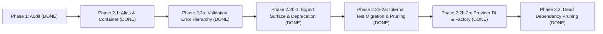

# Storage System (`storage.md`)

> **Audit Status**: Complete (Phase 1 Approved with Changes; Phase 2.1 Implemented).
> **Governing Specifications**: [BUSINESS_SYSTEMS_RULES.md](../BUSINESS_SYSTEMS_RULES.md), [_TEMPLATE.md](_TEMPLATE.md), [AGENTS.md](../../../AGENTS.md), [ADR-0012](../../adr/0012-stateless-media-upload-and-domain-attachment-boundary.md).

| Metadata | Value |
|---|---|
| **System Name** | Storage |
| **Tier** | `Foundation` |
| **Public Import Alias** | `#platform/storage` *(Implemented in Phase 2.1: exact mapping to `./src/platform/storage/index.js`)* |
| **Entry File** | `apiOpenArt/src/platform/storage/index.js` |
| **Base Error Class** | `StorageError` *(Proposed for Phase 2.2)* |
| **Audit Classification** | `REFACTOR` *(Responsibilities are valid; needs encapsulation, typed error hierarchy, single alias, and removal of dead caller injections)* |
| **Phase Status** | Phase 2.1 Complete — Phase 2.2 Analysis Prepared (Awaiting Approval) |

---

## 1. Purpose

- **Business Responsibility**: Physical object storage operations, storage key construction and allowlist validation, content-type inference and magic-byte defense-in-depth, public CDN URL resolution, and storage provider delegation.
- **Qualification Proof (Rule 2)**:
  - **Persistent State Owned**: The physical storage bucket (`generated_images` Supabase Storage / S3 bucket), its directory hierarchy, and stored binary blobs. (Storage owns zero Postgres database tables per locked ADR-0012 and Rule 5).
  - **External Consumers (>= 2)**:
    1. `MediaUploadService` (`src/platform/media-ingestion/MediaUploadService.js:53-65`)
    2. `WorkflowMediaService` (`src/platform/workflow/WorkflowMediaService.js:42-53`)
    3. `CharacterMediaService` (`src/domain/character/CharacterMediaService.js:32-50`)
    4. `ElementMediaService` (`src/domain/element/ElementMediaService.js:48-67`)
    5. Test suite (e.g. `tests/unit/storageServiceContract.test.js:8-15`, `tests/boundary/containerWiringBoundary.test.js`)
- **Explicit Non-Goals**:
  - Does **not** own database records (`public.media` is owned exclusively by `MediaService` per ADR-0008).
  - Does **not** manage workflow-to-media placements (`public.workflow_media` is owned exclusively by `WorkflowMediaService` per ADR-0006/ADR-0007).
  - Does **not** perform domain-level upload orchestration, quotas, or WebP 4K transcoding (`MediaUploadService` owns stateless validation and optimization per ADR-0012).
  - Does **not** expose storage buckets or signed upload URLs directly to client browsers or HTTP controllers.

---

## 2. Owns (Tables, Resources & Constants)

### Owned Database Tables & SQL RPCs (Rule 5)
| Postgres Table / RPC | Repository (`private`) | Key Invariants / Constraints |
|---|---|---|
| *None* | *None* | **Zero database tables owned**. As formalized in Preserved Decision #1 and ADR-0012, Storage owns physical object storage only. All database persistence is delegated to `MediaService` (`public.media`) and `WorkflowMediaService` (`public.workflow_media`). |

### Owned Physical Resources & Constants
| Resource / Constant | Source (`file:line`) | Description |
|---|---|---|
| Bucket `generated_images` | `src/platform/storage/StorageService.js:162` | Primary public CDN bucket in Supabase Storage |
| `ALLOWED_STORAGE_FOLDERS` | `src/platform/storage/StoragePathResolver.js:21-30` | Canonical folder allowlist (`uploads`, `video_uploads`, `element-references`, `element-sheets`, `character-sheets`, `character-details`, `avatars`, `video-references`) |
| `SAFE_MEDIA_MIME_TYPES` | `src/platform/storage/StorageService.js:120-145` | Allowlist of safe MIME types for provider/internal assets |
| `DANGEROUS_MIME_TYPES` | `src/platform/storage/StorageService.js:147-159` | Blocklist of executable/script types (`text/html`, `image/svg+xml`, `application/zip`, etc.) |
| Magic Bytes Inspector | `src/platform/storage/StorageService.js:30-118` | Defense-in-depth raster/video byte validator (`MZ`, `ELF`, HTML/script, SVG/XML, `PK` ZIP blocked) |

---

## 3. Public Surface: `storageService` Facade Contract

Per approved decision **OD-STOR-2**, the existing **`storageService` Facade** is retained as the sole public surface. Standalone function wrappers (`uploadObject`, `buildStorageKey`, etc.) are omitted to avoid unnecessary indirection since all consumers inject the facade.

### Exported Surface (`src/platform/storage/index.js`)
- `storageService`: Default configured singleton facade instance (for runtime injection in `container.js`).
- `StorageService`: Class definition (for instantiation in custom/isolated test scopes).
- `InMemoryStorageProvider`: Exported and explicitly documented as **test-only** (per approved **OD-STOR-4**).

### Facade Public Methods (`storageService.*`)
| Method | Mode | Parameters (`JSDoc`) | Returns | Thrown Errors | Description |
|---|---|---|---|---|---|
| `buildKey({ userId, folder, filename })` | `Sync` | `{ userId: string, folder?: string, filename: string }` | `string` | `StorageValidationError` (currently `CrudServiceError`) | Constructs validated key: `<cleanUserId>/<validatedFolder>/<filename>`. |
| `validateFolder(folder)` | `Sync` | `folder: string` | `string` | `StorageValidationError` (currently `CrudServiceError`) | Validates folder segment against `ALLOWED_STORAGE_FOLDERS`. |
| `extractKey(url)` / `extractStoragePath(url)` | `Sync` | `url: string` | `string \| null` | *None* | Parses public CDN URL or storage path to bucket-relative key. |
| `upload(path, payload, options)` | `Async` | `path: string`, `payload: Buffer\|Stream\|string`, `options?: object` | `Promise<string>` | `StorageValidationError`, `StorageUploadError` | Uploads binary blob, performs magic-bytes sniffing, sets MIME type, writes with `upsert: true`. Returns public URL. |
| `getPublicUrl(path)` | `Async` | `path: string` | `Promise<string>` | *None* | Resolves full public CDN URL for storage path. |
| `delete(path)` | `Async` | `path: string` | `Promise<void>` | `StorageUploadError` | Deletes single storage object by relative key. |
| `deleteFiles(paths)` | `Async` | `paths: string[]` | `Promise<{ deletedCount: number, failures: Array }>` | *None* | Batch deletes storage objects; deduplicates keys; reports failure array on partial error. |
| `deleteByUrl(url)` | `Async` | `url: string` | `Promise<void>` | *None* | **`@deprecated`** (per approved **OD-STOR-3**). Extracts key from URL and calls `delete(key)`. Retained for backward-compatible orphan sweeping. |

---

## 4. Internal Components (Private)

Private to `src/platform/storage/` (Rule 7):

| Component | File (`file:line`) | `@owns` Statement | Constructor Dependencies | Existing Tests |
|---|---|---|---|---|
| `StorageService` | `src/platform/storage/StorageService.js:161` | Physical object storage operations, storage key construction and validation, and storage provider delegation. | `{ bucketName, provider }` | `tests/unit/storageServiceContract.test.js` |
| `StoragePathResolver` | `src/platform/storage/StoragePathResolver.js:12` | Storage key format construction, folder allowlist validation, and URL path extraction. | `{ defaultBucket }` | `tests/unit/storagePathFolderSegment.test.js` |
| `IStorageProvider` | `src/platform/storage/IStorageProvider.js:7` | Standard abstract contract for physical storage engines. | *None* | `tests/unit/storageServiceContract.test.js` |
| `SupabaseStorageProvider` | `src/platform/storage/providers/SupabaseStorageProvider.js:17` | Supabase Storage HTTP API integration and batch operations. | `{ bucketName, client }` | `tests/unit/storageServiceContract.test.js` |
| `InMemoryStorageProvider` | `src/platform/storage/providers/InMemoryStorageProvider.js:7` | Hermetic in-memory storage simulation (test-only). | `{ bucketName, baseUrl }` | `tests/unit/storageServiceContract.test.js` |

---

## 5. Allowed Dependencies

Dependencies point strictly downward (Rule 6):

| Target | Kind | Import Specifier | Reason |
|---|---|---|---|
| `Logging` | `Platform` | `src/infrastructure/logging/index.js` | Structured logger via `createLogger("storage")` |
| `Supabase Admin Client` | `Platform Infrastructure` | `lib/supabase.js` (`supabaseAdmin`) | Provider execution client for Supabase Storage API |

---

## 6. Forbidden Dependencies

Prohibited imports for the Storage System (Rules 3, 5, 6, 9):

- **Upper Domain Systems**: Never import from `src/domain/**` (`asset`, `character`, `element`, `folder`, `generation`, `project`, `trash`).
- **Application / Coordinators**: Never import from `src/use-cases/**`, `src/v2/**`, `UseCaseService`, `controllers/**`, or `routes/**`.
- **Media & Ingestion**: Never import from `src/platform/media/**` or `src/platform/media-ingestion/**`.
- **Database Repositories**: Never import from `src/db/**` or execute `supabase.from(...)` table queries.
- **Unrelated Utilities**: No imports of `src/utils/crudOperationLog.js` (`CrudServiceError`).

---

## 7. Error Classes (Proposed for Phase 2.2)

All Storage System errors inherit from `StorageError` with the `Storage` prefix (Rule 8):

| Error Class | `code` | `statusCode` | `retryable` | Safe Public Message | When Thrown |
|---|---|---|---|---|---|
| `StorageError` | `STORAGE_ERROR` | `500` | `false` | `"Internal storage error"` | Base class for all Storage System errors |
| `StorageValidationError` | `STORAGE_VALIDATION_ERROR` *(with `errorCode: "VALIDATION_ERROR"` alias)* | `400` | `false` | `"Invalid storage request"` | Folder not in allowlist, path traversal detected, or dangerous file type |
| `StorageUploadError` | `STORAGE_UPLOAD_ERROR` | `502` | `true` | `"Storage provider error"` | Upstream provider failure (network, bucket 5xx) |
| `StorageNotFoundError` | `STORAGE_NOT_FOUND` | `404` | `false` | `"Storage object not found"` | Requested storage key does not exist |

> *Note on Payload Size*: Per the audit in §12, `StoragePayloadTooLargeError` is **not needed** in StorageService because file size limits are fully enforced by `uploadMiddleware.js` (Multer) and `MediaUploadService.js` (Media Ingestion) via `createPayloadTooLargeError` (`PAYLOAD_TOO_LARGE`, 413). If physical bucket limits ever reject oversized payloads, it will use code `STORAGE_PAYLOAD_TOO_LARGE`.

---

## 8. Current Status & Verification

- **Package Import Alias**: `"#platform/storage": "./src/platform/storage/index.js"` (wildcard `"#platform/storage/*.js"` removed).
- **Container Wiring (`apiOpenArt/src/container.js:3`)**: Uses `import { StorageService } from "#platform/storage"`.
- **Caller Injections**:
  - `MediaUploadService` (`src/platform/media-ingestion/MediaUploadService.js:53`) uses `storageService` for upload, discard, key building, and folder validation.
  - `WorkflowMediaService` (`src/platform/workflow/WorkflowMediaService.js:1052, 1104, 1381`) uses `storageService.deleteByUrl(...)` during orphan cleanup.
  - `CharacterMediaService` (`src/domain/character/CharacterMediaService.js:472, 500`) and `ElementMediaService` (`src/domain/element/ElementMediaService.js:573`) call `storageService.deleteByUrl(...)`.
  - `AssetUploadService`, `CharacterService`, `ElementService`, and `WorkflowStorageGateway` hold unused references (to be pruned in Phase 2.3).
- **Test Suite**: Fully passing hermetically (`tests/unit/storageServiceContract.test.js`, `tests/unit/storagePathFolderSegment.test.js`, boundary suites).

---

## 9. Known Gaps

| ID | Severity | Rule Violated | Location (`file:line`) | Current Behavior | Target Fix | Planned Phase |
|---|---|---|---|---|---|---|
| `G-STOR-1` | **Resolved** | **Rule 3** (Single public surface) | `package.json:11` | Wildcard alias previously allowed deep imports. | Replaced with exact `"#platform/storage": "./src/platform/storage/index.js"`. | **Phase 2.1 (Done)** |
| `G-STOR-2` | **Resolved** | **Rule 3** (No deep imports) | `src/container.js:3` | Previously deep-imported from `#platform/storage/StorageService.js`. | Updated to `import { StorageService } from "#platform/storage"`. | **Phase 2.1 (Done)** |
| `G-STOR-3` | **Resolved** | **Rule 3** (Export hygiene) | `src/platform/storage/index.js:1-6` | Previously re-exported internal classes (`IStorageProvider`, `SupabaseStorageProvider`, `StoragePathResolver`). | Removed dead `storageService` singleton export. Migrated `storageServiceContract.test.js` to internal relative imports and pruned internal classes from `index.js`. Public surface strictly limited to `StorageService`, `StorageError`, `StorageValidationError`, and `InMemoryStorageProvider`. | **Phase 2.2b-2a (Done)** |
| `G-STOR-4` | **Resolved** | **Rule 8** (Error hierarchy) | `src/platform/storage/StoragePathResolver.js:10,48-54` | Previously threw `CrudServiceError` from `src/utils/crudOperationLog.js`. | Replaced with `StorageValidationError` (`statusCode: 400`, `code: "STORAGE_VALIDATION_ERROR"`, `errorCode: "VALIDATION_ERROR"`). | **Phase 2.2a (Done)** |
| `G-STOR-5` | **Resolved** | **Rule 8** (Error hierarchy) | `src/platform/storage/StorageService.js:34,37,46,54,59,259,290` | Previously threw bare `new Error("[StorageService] ...")` (500 masked). | Replaced with typed `StorageValidationError` (`statusCode: 400`). | **Phase 2.2a (Done)** |
| `G-STOR-6` | **Resolved** | **Rule 7** (Dead dependencies) | `src/domain/asset/AssetUploadService.js:44,58`, `CharacterService.js:31,33`, `ElementService.js:64,76`, `workflowStorageGateway.js:11,12` | Injected `storageService` into 4 services/gateways that never called any storage methods. | Removed unused `storageService` constructor parameters, properties, and container wiring. Regenerated service catalog. | **Phase 2.3 (Done)** |
| `G-STOR-7` | **Resolved** | **Rule 7** (Constructor DI) | `src/platform/storage/StorageService.js:162` | Constructor previously used positional args and fell back to `new SupabaseStorageProvider(...)`. | Implemented dual-signature support in `StorageService` (`{ bucketName, provider }` and `(bucket, provider)`), throwing `StorageError("STORAGE_CONFIG_ERROR")` if provider is missing. | **Phase 2.2b-2b (Done)** |
| `G-STOR-8` | **Resolved** | **Rule 7** (Provider DI) | `src/platform/storage/providers/SupabaseStorageProvider.js:26` | Constructor previously defaulted `client = supabaseAdmin` fallback from `lib/supabase.js`. | Removed `supabaseAdmin` import and default; provider strictly requires injected `client`. Added `createStorageService({ client, bucketName })` factory on public surface. | **Phase 2.2b-2b (Done)** |

---

## 10. Decisions Log & Open Decisions

### Resolved Decisions
- **OD-STOR-1 (Import Alias)**: **Resolved (Option A)**. Keep alias `"#platform/storage"` -> `./src/platform/storage/index.js`.
- **OD-STOR-2 (Public Interface Shape)**: **Resolved**. Retain `storageService` facade as the sole public surface. No standalone function wrappers.
- **OD-STOR-3 (`deleteByUrl` Retention)**: **Resolved (Option A)**. Retain `deleteByUrl(url)` as `@deprecated`. Do not remove it.
- **OD-STOR-4 (`InMemoryStorageProvider`)**: **Resolved (Option A)**. Keep `InMemoryStorageProvider` exported on `index.js`, documented as test-only.
- **Ajv Validation Schemas**: **Cancelled**. Removed from the plan per human direction.
- **StoragePayloadTooLargeError**: **Cancelled**. File size limits are owned upstream by Multer (`uploadMiddleware.js`) and Media Ingestion (`MediaUploadService.js`). StorageService performs no byte-counting limits.
- **HTTP 500 -> 400 Error Mapping Behavior Change**: **Resolved (Theoretical / Defense-in-Depth for HTTP routes)**. Bare `new Error("[StorageService] ...")` previously threw un-typed errors mapped to HTTP 500 (`INTERNAL_ERROR`) by `safePublicRouteError`. Replacing them with `StorageValidationError` (`statusCode: 400`, `code: "STORAGE_VALIDATION_ERROR"`, `errorCode: "VALIDATION_ERROR"`) ensures storage-level validation failure produces a typed 400.
  - *Call-site reality check (`MediaUploadService.js:263`)*: In the unified upload pipeline, `MediaInspector.inspect` already rejects executable/script byte disguises upfront with HTTP 415 (`UNSUPPORTED_MEDIA_TYPE`). Furthermore, `MediaUploadService._uploadSingleOptimizedItem` wraps **every** error caught from `storageService.upload()` unconditionally into `new UploadError("Storage upload failed: ...")` (`statusCode: 502, code: "STORAGE_UPLOAD_ERROR"`). Therefore, through the standard HTTP upload route, the 500->400 change is **not directly observable** by HTTP clients (it is caught and rejected as 415 upfront by Media Ingestion, or wrapped into 502 if reaching upload); the 400 `StorageValidationError` is directly observable by direct consumers, contract/unit test harnesses, and internal services bypassing the HTTP upload wrapper.

### Audit of Ownership on Delete Operations (OD-STOR-5)
- **Question**: Who is responsible for tenant ownership checks on delete operations (does Storage verify the `"<userId>/"` key prefix, or is the caller responsible)?
- **Audit Findings**:
  1. `StorageService.delete(path)` (`StorageService.js:321`) and `StorageService.deleteFiles(paths)` (`StorageService.js:333`) accept raw storage keys without taking a `userId` or tenant context parameter.
  2. `SupabaseStorageProvider.delete` and `deleteFiles` execute physical removals using `supabaseAdmin` (the Postgres/Supabase `service_role` client), which bypasses all Storage RLS policies.
  3. Consequently, **Storage performs zero tenant ownership verification**.
  4. **Caller Responsibility**:
     - In `MediaUploadService.discard(storageKeys)`: Discards only keys constructed during that immediate request's `buildKey({ userId, ... })`.
     - In `WorkflowMediaService`, `CharacterMediaService`, and `ElementMediaService`: Ownership is verified via `authService.verifyWorkflowOwnership(workflowId, userId)` or `authService.verifyMediaOwnership(mediaId, userId)` **prior to unlinking**. Only when the database record is confirmed an orphan does the caller pass the asset's URL/path to `storageService.deleteByUrl(url)`.
- **Conclusion**: Ownership verification is **strictly the responsibility of the Caller** (Domain Service / Upload Pipeline) before invoking Storage delete. Storage acts purely as a low-level physical I/O engine.

---

## 11. Phased Implementation Plan



- **Phase 2.1 — Alias & Container Deep-Import Hygiene** *(DONE)*:
  - `package.json` maps `"#platform/storage"` to `"./src/platform/storage/index.js"`.
  - Wildcard `"#platform/storage/*.js"` removed.
  - `src/container.js:3` updated to `import { StorageService } from "#platform/storage"`.
- **Phase 2.2a — Typed Validation Error Hierarchy** *(DONE)*:
  - Created `src/platform/storage/StorageErrors.js` with `StorageError` (base, extending `AppError`) and `StorageValidationError`.
  - Configured `StorageValidationError` with `code: "STORAGE_VALIDATION_ERROR"`, `statusCode: 400`, `errorCode: "VALIDATION_ERROR"`, and preserved safe message text.
  - Replaced `CrudServiceError` in `StoragePathResolver.js` with `StorageValidationError`.
  - Replaced bare `new Error(...)` in `StorageService.js` (magic bytes and MIME mismatches) with `StorageValidationError`.
  - Verified hermetic test suite (1194 tests on clean isolated HEAD commit; 1203 tests with media refactor).
- **Phase 2.2b-1 — Public Export Surface & Deprecation** *(DONE)*:
  - `src/platform/storage/index.js` exports `StorageService`, `StorageError`, `StorageValidationError`, `InMemoryStorageProvider` (test-only).
  - Removed unused `storageService` singleton export (and singleton instantiation at `StorageService.js:362`).
  - Added `@deprecated` JSDoc to `StorageService.prototype.deleteByUrl`.
- **Phase 2.2b-2a — Internal Test Migration & Pruning** *(DONE)*:
  - Moved imports of `StoragePathResolver`, `SupabaseStorageProvider`, and `IStorageProvider` in `storageServiceContract.test.js` to internal relative imports.
  - Pruned `StoragePathResolver`, `storagePathResolver`, `IStorageProvider`, and `SupabaseStorageProvider` from `src/platform/storage/index.js`.
  - Public entry point exports strictly `StorageService`, `StorageError`, `StorageValidationError`, and `InMemoryStorageProvider`.
- **Phase 2.2b-2b — Provider Dependency Injection & Factory** *(DONE)*:
  - Created `src/platform/storage/storageFactory.js` exporting `createStorageService({ client, bucketName })` that injects the client into `SupabaseStorageProvider` and instantiates `StorageService`.
  - Exported `createStorageService` from `src/platform/storage/index.js`.
  - Removed `supabaseAdmin` default fallback and direct import in `src/platform/storage/providers/SupabaseStorageProvider.js`.
  - Hardened `StorageService` constructor to require `provider` (fails closed with `StorageError("STORAGE_CONFIG_ERROR")`) while maintaining dual-signature compatibility (`{ bucketName, provider }` and positional `(bucket, provider)`) for test isolation.
  - Updated `src/container.js` to instantiate `export const storageService = createStorageService({ client: supabaseAdmin });`.
  - Added contract tests in `tests/unit/storageServiceContract.test.js`.
- **Phase 2.3 — Prune Dead Consumer Dependencies** *(DONE)*:
  - Removed unused `storageService` constructor parameters and properties from `AssetUploadService`, `CharacterService`, `ElementService`, and `WorkflowStorageGateway`.
  - Updated `src/container.js` wiring to stop passing `storageService` to these 4 services.
  - Regenerated `docs/agents/service-catalog.md` (`StorageService` file references dropped from 11 to 7).
  - Full test suite verified passing (1204 passing, 0 failing).

---

## 12. Addendum for Phase 2.2 Analysis (Prepared for Approval)

### 12.1 Error Inspection & Call Site Audit

A comprehensive grep across all callers, controllers, and tests inspecting errors originating from `StorageService` / `StoragePathResolver`:

1. **`StoragePathResolver.validateFolderSegment` (`StoragePathResolver.js:48-54`)**:
   - Currently throws:
     ```js
     new CrudServiceError(`Invalid storage folder "${preview}": must be one of allowed storage folders.`, {
         statusCode: 400,
         errorCode: "VALIDATION_ERROR",
     });
     ```
   - **Call Sites & Tests Caught**:
     - `tests/unit/storageServiceContract.test.js:158`: asserts `err.statusCode === 400 && err.errorCode === "VALIDATION_ERROR"`.
     - `tests/unit/assetUploadServiceMigrated.test.js:437,441`: asserts `err.statusCode === 400 && err.errorCode === "VALIDATION_ERROR"`.
     - `src/utils/safePublicRouteError.js:22`: maps non-5xx errors via `err.errorCode || ...`.
   - **Impact of Error Type Change**:
     - If changed to `StorageValidationError` with `code: "STORAGE_VALIDATION_ERROR"`, any client or test checking `err.errorCode === "VALIDATION_ERROR"` would break unless `errorCode: "VALIDATION_ERROR"` is preserved as a property on `StorageValidationError`.
     - **Recommendation**: In `StorageValidationError`, set:
       ```js
       this.name = "StorageValidationError";
       this.code = "STORAGE_VALIDATION_ERROR";
       this.errorCode = "VALIDATION_ERROR"; // Backward-compatible alias for safePublicRouteError and tests
       this.statusCode = 400;
       ```
       This satisfies Rule 8 while causing zero regressions on HTTP clients or existing unit tests.

2. **`StorageService.js` Bare `new Error("[StorageService] ...")`**:
   - Thrown at lines 34 (`MZ`), 37 (`ELF`), 46 (HTML/script), 54 (SVG/XML), 59 (`PK` ZIP), 259 (dangerous declared MIME), and 290 (declared vs detected mismatch).
   - **Call Sites & Tests Caught**:
     - `tests/boundary/parseBeforeAuthAndUploadHardeningBoundary.test.js:132`: checks `/Executable binary/`.
     - In HTTP routes, caught by `safePublicRouteError`: since bare `Error` has no `statusCode`, it defaults to 500 (`INTERNAL_ERROR`).
     - In `MediaUploadService.upload()`, uploads catch errors: when `storageService.upload()` throws, `MediaUploadService` wraps it in `UploadError` (502 `STORAGE_UPLOAD_ERROR`) or propagates it.
   - **Impact of Error Type Change**:
     - Changing these bare errors to `StorageValidationError` (`statusCode: 400`) means client requests uploading malicious scripts/executables will receive HTTP 400 (`VALIDATION_ERROR`) instead of masked 500 (`INTERNAL_ERROR`), which is significantly more accurate and matches API contracts.
     - Preserving error message strings (`"[StorageService] Executable binary payload (MZ) detected..."`) ensures boundary regex tests like `parseBeforeAuthAndUploadHardeningBoundary.test.js` continue passing unchanged.

### 12.2 Review of `StoragePayloadTooLargeError`
- **Is it needed in Storage?**:
  - `StorageService.js` does **not** inspect or enforce file size limits.
  - File size limits (e.g. 50MB, 100MB) are fully owned and validated upstream by:
    1. HTTP Transport: `uploadMiddleware.js` (Multer) via `sizeLimitedStorage.js` (rejecting before buffering).
    2. Media Ingestion: `MediaUploadService.js` enforcing `policy.maxImageSize` and `policy.maxVideoSize` using `createPayloadTooLargeError(actualBytes, limitBytes)` (`MediaUploadErrors.js:66`, `statusCode: 413, code: "PAYLOAD_TOO_LARGE"`).
- **Conclusion**:
  - `StoragePayloadTooLargeError` is **redundant** and should **not** be introduced into `StorageService` for normal upload processing.
  - If retained as an edge-case wrapper for physical provider 413 HTTP rejections, it will use code `STORAGE_PAYLOAD_TOO_LARGE` with `statusCode: 413`.

---

## 13. Accepted Technical Debt & Removal Conditions

| Item | Context & Rationale | Exact Removal Condition |
|---|---|---|
| **Dual-signature on `StorageService` constructor (`(bucketName, legacyProvider)` vs `{ bucketName, provider }`)** | `StorageService` supports legacy positional arguments `(bucketName, provider)` alongside the modern options object `{ bucketName, provider }` to maintain backward compatibility with 19 legacy test call sites (`tests/boundary/authHardeningD26Boundary.test.js:626`, `tests/boundary/ssrfSourcePolicyBoundary.test.js:31`, `tests/boundary/uploadHardeningAndSniffBoundary.test.js:171, 186, 201, 221, 250`, `tests/boundary/uploadHardeningD24Boundary.test.js:151, 211`, `tests/boundary/uploadHardeningD25Boundary.test.js:179, 198`, `tests/unit/mediaServiceContract.test.js:143`, `tests/unit/mediaUploadServiceAndPolicy.test.js:638`, `tests/unit/storagePathFolderSegment.test.js:75`, `tests/unit/storageServiceContract.test.js:29, 139, 166, 257`, `tests/unit/uploadPipelineAndPolicy.test.js:53`). In production, only `storageFactory.js:30` constructs `StorageService`, and it uses the options-object signature. | Remove positional parameter fallback when all 19 test call sites are refactored to either use `createStorageService({ client, bucketName })` factory or pass the modern options object `new StorageService({ bucketName, provider })`. |

