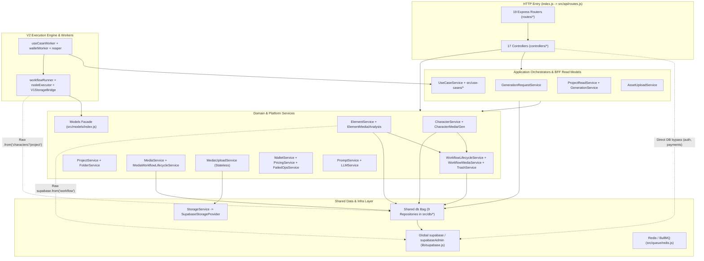
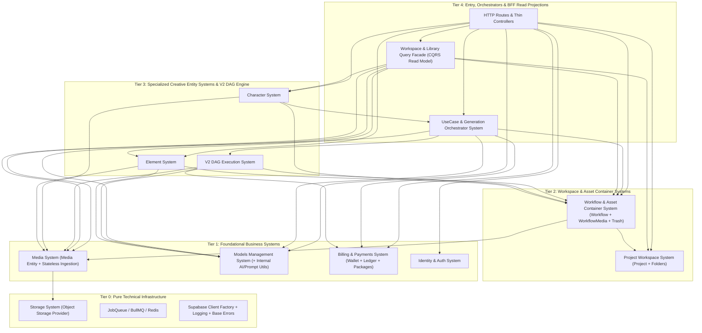

# OpenArt Backend Architecture Audit (Read-Only) — Complete Report (Parts 1, 2 & 3)

> **Audit Mode & Scope:** 100% read-only architectural audit of `apiOpenArt/` (`236` production JS files, `132` `*.test.js` files + `setup-env.js` = `133` files under `tests/`) and SQL schema/migrations (`51` SQL files across `supabase/migrations/` and `apiOpenArt/migrations/`), evaluated against the target Modular Monolith vision in [backend-modularization-context.md](file:///c:/Users/jihad/Desktop/open%20art/docs/architecture/backend-modularization-context.md).
> **Backend Repository Safety:** Zero files inside `apiOpenArt/` were created, edited, moved, or deleted during this audit.

## Table of Contents

- **Part 1 of 3 — Baseline, Systems, Data Ownership & Component Inventory**
  - [Phase 0: Baseline](#phase-0-baseline)
  - [Deliverable 1: Current Architecture Map](#deliverable-1-current-architecture-map-confirmed)
  - [Deliverable 2: Business Systems & Candidates (`A1–A4`)](#deliverable-2-business-systems--candidates-a1a4)
  - [Deliverable 3: Data Ownership Table (`B1–B4`)](#deliverable-3-data-ownership-table-b1b4)
  - [Deliverable 4: Services, Repositories & Adapters Inventory (`C1–C4`)](#deliverable-4-services-repositories--adapters-inventory-c1c4)
- **Part 2 of 3 — Dependencies, Duplication, Composition & Execution Flows**
  - [Deliverable 5: Dependency Map, Leaks, Cycles & Singletons (`D1–D6`)](#deliverable-5-dependency-map-leaks-cycles--singletons-d1d6)
  - [Deliverable 6: Duplicated & Mixed Logic (`E1–E3`)](#deliverable-6-duplicated--mixed-logic-e1e3)
  - [Deliverable 7: Composition & Dependency Injection (`F1–F3`)](#deliverable-7-composition--dependency-injection-f1f3)
  - [Deliverable 8: Key End-to-End Flow Traces (`G1–G5`)](#deliverable-8-key-end-to-end-flow-traces-g1g5)
- **Part 3 of 3 — Target Modular Monolith, Public Contracts, Gate Enforcement & Migration Plan**
  - [Deliverable 9: Proposed Target Architecture, Public Interfaces & Refactoring Classification (`H1–H3`, `I1–I3`, `K1–K2`)](#deliverable-9-proposed-target-architecture-public-interfaces--refactoring-classification)
  - [Deliverable 10: Tests & Boundary Enforcement Proposal (`J1–J3`)](#deliverable-10-tests--boundary-enforcement-proposal-j1j3)
  - [Deliverable 11: Ordered Migration Plan & Risk Analysis (`L1–L2`)](#deliverable-11-ordered-migration-plan--risk-analysis-l1l2)
  - [Deliverable 12: Open Architectural & Product Questions](#deliverable-12-open-architectural--product-questions)

---

# Part 1 of 3 — Baseline, Systems, Data Ownership & Component Inventory

## Phase 0: Baseline

### 0.1 Git State & Uncommitted Work (`CONFIRMED`)

- **Repository:** `c:/Users/jihad/Desktop/open art/apiOpenArt`
- **Branch:** `refactory-service-system`
- **`HEAD` Commit:** `b37113b` — `refactor(storage): isolate StorageService public contract and provider architecture (Phase 1)`
- **Working Tree Status (`28` uncommitted changes — Media Service Phase is UNCOMMITTED):**
  - **Staged Deletions (`2`):** `src/platform/media-ingestion/BinaryIngestionService.js`, `src/platform/media-ingestion/MediaIngestionService.js`
  - **Modified (`23`):** [service-catalog.md](file:///c:/Users/jihad/Desktop/open%20art/apiOpenArt/docs/agents/service-catalog.md), [container.js](file:///c:/Users/jihad/Desktop/open%20art/apiOpenArt/src/container.js), [MediaRepository.js](file:///c:/Users/jihad/Desktop/open%20art/apiOpenArt/src/db/MediaRepository.js), [AssetUploadService.js](file:///c:/Users/jihad/Desktop/open%20art/apiOpenArt/src/domain/asset/AssetUploadService.js), [CharacterService.js](file:///c:/Users/jihad/Desktop/open%20art/apiOpenArt/src/domain/character/CharacterService.js), [MediaUploadErrors.js](file:///c:/Users/jihad/Desktop/open%20art/apiOpenArt/src/platform/media-ingestion/MediaUploadErrors.js), [MediaUploadService.js](file:///c:/Users/jihad/Desktop/open%20art/apiOpenArt/src/platform/media-ingestion/MediaUploadService.js), [MediaLifecycleService.js](file:///c:/Users/jihad/Desktop/open%20art/apiOpenArt/src/platform/media/MediaLifecycleService.js), [MediaService.js](file:///c:/Users/jihad/Desktop/open%20art/apiOpenArt/src/platform/media/MediaService.js), [WorkflowAuthorizationService.js](file:///c:/Users/jihad/Desktop/open%20art/apiOpenArt/src/platform/workflow/WorkflowAuthorizationService.js), [WorkflowMediaService.js](file:///c:/Users/jihad/Desktop/open%20art/apiOpenArt/src/platform/workflow/WorkflowMediaService.js), plus `12` test files under `tests/`.
  - **Untracked (`3`):** [src/platform/media-ingestion/index.js](file:///c:/Users/jihad/Desktop/open%20art/apiOpenArt/src/platform/media-ingestion/index.js), [src/platform/media/index.js](file:///c:/Users/jihad/Desktop/open%20art/apiOpenArt/src/platform/media/index.js), `tests/unit/mediaServiceContract.test.js`.
  - **Audit Baseline Note (`CONFIRMED`):** All findings in this report reflect `HEAD` (`b37113b`, Storage Phase 1 committed) **plus** the uncommitted Media Service Phase working tree above.

### 0.2 Technology Stack (`CONFIRMED`)

| Layer | Technology | Evidence |
|---|---|---|
| **Runtime & Module System** | Node.js ES Modules (`"type": "module"`) + Node `#*` subpath imports (`#db/*`, `#platform/*`, `#domain/*`, `#container.js`, etc.) | [package.json](file:///c:/Users/jihad/Desktop/open%20art/apiOpenArt/package.json#L6-L25) |
| **HTTP Framework** | Express `^4.18.3`, `cors`, `cookie-parser`, `multer` `^2.1.1` | [package.json](file:///c:/Users/jihad/Desktop/open%20art/apiOpenArt/package.json#L53-L61), [index.js](file:///c:/Users/jihad/Desktop/open%20art/apiOpenArt/index.js#L2-L81) |
| **DB & Auth Client** | `@supabase/supabase-js` `^2.97.0` (PostgREST query builder + PL/pgSQL `.rpc(...)` + Supabase Auth PKCE/JWT + Supabase Storage; **no ORM**) | [package.json](file:///c:/Users/jihad/Desktop/open%20art/apiOpenArt/package.json#L48), [supabase.js](file:///c:/Users/jihad/Desktop/open%20art/apiOpenArt/lib/supabase.js#L1-L45) |
| **Queue & Cache** | `bullmq` `^5.75.2` + `ioredis` `^5.10.1` (`3` separate TCP clients: `redisConnection`, `workerRedisConnection`, `rateLimitRedisConnection`) + `rate-limiter-flexible` `^11.2.1` | [package.json](file:///c:/Users/jihad/Desktop/open%20art/apiOpenArt/package.json#L52-L65), [redis.js](file:///c:/Users/jihad/Desktop/open%20art/apiOpenArt/src/queue/redis.js#L38-L61) |
| **Validation, Math & Media** | `zod` `^4.3.6`, `ajv` `^8.20.0`, `decimal.js` `^10.6.0`, `sharp` `^0.34.5`, `yaml` `^2.8.0` | [package.json](file:///c:/Users/jihad/Desktop/open%20art/apiOpenArt/package.json#L50-L71) |
| **AI Provider SDKs** | `@google/genai` `^2.19.0`, `wavespeed` `^0.3.2`, `node-fetch` `^3.3.2` (REST/LTX/Groq) | [package.json](file:///c:/Users/jihad/Desktop/open%20art/apiOpenArt/package.json#L46-L69) |
| **Logging** | `pino` `^10.3.1` (`createLogger` + `AsyncLocalStorage` context) | [package.json](file:///c:/Users/jihad/Desktop/open%20art/apiOpenArt/package.json#L64), [logging/index.js](file:///c:/Users/jihad/Desktop/open%20art/apiOpenArt/src/infrastructure/logging/index.js#L11-L45) |
| **Test Runner & Gate** | Native `node --test` (`132` test files + `setup-env.js`) + custom [gate.cjs](file:///c:/Users/jihad/Desktop/open%20art/apiOpenArt/scripts/gate.cjs#L52-L63) & [arch-check.cjs](file:///c:/Users/jihad/Desktop/open%20art/apiOpenArt/scripts/arch-check.cjs#L70-L125) | [package.json](file:///c:/Users/jihad/Desktop/open%20art/apiOpenArt/package.json#L27-L42) |

- **Unused / Dead Dependencies in `package.json` (`CONFIRMED`):** `@fal-ai/client`, `@huggingface/inference`, `@upstash/redis`, `express-async-handler`, `express-rate-limit`, `openai`, `socket.io`, and devDependency `eslint-plugin-react-hooks` ([package.json](file:///c:/Users/jihad/Desktop/open%20art/apiOpenArt/package.json#L45-L78)) have **zero** imports across all `236` production files.

### 0.3 Top-Level Backend Structure & Entry Points (`CONFIRMED`)

```text
apiOpenArt/
├── index.js                      # HTTP API server entrypoint (Express)
├── controllers/                  # 17 HTTP controllers (+ payments/, v2/)
├── routes/                       # 19 Express route files (+ v2/)
├── lib/                          # Legacy shared helpers (supabase.js, modelRegistryKeys.js, dead helpers/crud)
├── migrations/                   # Legacy SQL migrations (001..005, plus root supabase/migrations/*)
├── scripts/                      # CI/arch gates (gate.cjs, arch-check.cjs, gen-service-catalog.cjs, etc.)
└── src/
    ├── api/routes.js             # Central "/api" router mounting 19 sub-routers
    ├── container.js              # Composition root instantiating repositories, gateways, and services
    ├── db/                       # 9 repositories + BaseRepository + workflowMediaOps/Linker
    ├── domain/                   # Domain services: asset/, character/, element/, folder/, generation/, project/, trash/
    ├── platform/                 # Shared platform modules: ai/, billing/, media/, media-ingestion/, security/, storage/, workflow/
    ├── infrastructure/           # Technical adapters: billing/, events/, logging/, queue/, storage/
    ├── middleware/               # Auth, admin, rate-limit, multer upload, element capacity guard
    ├── models/                   # Manifest-driven Models System: registry/, schema/, pricing/, execution/, providers/, manifests/ (43)
    ├── use-cases/                # Declarative Use Case definitions + billing plan + registry + runner
    ├── v2/                       # V2 DAG Workflow Engine: compiler/, nodes/, processors/, runner/, runtime/, services/, skills/
    ├── services/                 # UseCaseService, JobQueueService, InMemoryWalletService
    ├── queue/                    # ioredis clients, walletQueue.js, legacy queue.js/treatmentJob.js
    ├── workers/                  # BullMQ worker entrypoints & reservation reaper
    └── errors/ & utils/ & runtime/ # Error types, helpers, legacy runtime logger/guards
```

**Runtime Entry Points (`CONFIRMED`):**
1. **HTTP Server — [index.js](file:///c:/Users/jihad/Desktop/open%20art/apiOpenArt/index.js#L17-L257):** Calls [`bootstrapV2()`](file:///c:/Users/jihad/Desktop/open%20art/apiOpenArt/src/v2/bootstrap.js#L16-L28), configures CORS/raw-webhook/scoped-30MB vs global-1MB body parsers ([index.js](file:///c:/Users/jihad/Desktop/open%20art/apiOpenArt/index.js#L91-L167)), mounts `/health`, `/ready`, and `/api` ([routes.js](file:///c:/Users/jihad/Desktop/open%20art/apiOpenArt/src/api/routes.js#L24-L43)), and starts an in-process **10-minute `setInterval`** calling `walletService.expireStaleHolds()` ([index.js](file:///c:/Users/jihad/Desktop/open%20art/apiOpenArt/index.js#L248-L255)).
2. **Generation & V2 DAG Worker — [worker.js](file:///c:/Users/jihad/Desktop/open%20art/apiOpenArt/src/workers/worker.js#L1-L43) (re-exported by [v2WorkflowWorker.js](file:///c:/Users/jihad/Desktop/open%20art/apiOpenArt/src/v2/queue/v2WorkflowWorker.js#L1-L5)):** Boots [`useCaseWorker`](file:///c:/Users/jihad/Desktop/open%20art/apiOpenArt/src/workers/useCaseWorker.js#L26-L66) (`concurrency: 10`) on BullMQ queue `"v2-workflow-jobs"` ([jobQueueService.js](file:///c:/Users/jihad/Desktop/open%20art/apiOpenArt/src/services/jobQueueService.js#L23)), handling `run-usecase`, node jobs, and V2 DAG orchestration; also runs [`runReservationReaper()`](file:///c:/Users/jihad/Desktop/open%20art/apiOpenArt/src/workers/reservationReaperWorker.js#L13-L68) on boot and every **5 minutes** ([worker.js](file:///c:/Users/jihad/Desktop/open%20art/apiOpenArt/src/workers/worker.js#L15-L40)).
3. **Wallet Maintenance Worker — [walletWorker.js](file:///c:/Users/jihad/Desktop/open%20art/apiOpenArt/src/workers/walletWorker.js#L342-L369):** Separate BullMQ worker (`concurrency: 1`) on queue `"wallet-maintenance"` ([walletQueue.js](file:///c:/Users/jihad/Desktop/open%20art/apiOpenArt/src/queue/walletQueue.js#L21-L68)), scheduling `expire-stale-holds` (every 5m), `retry-failed-ops` (every 5m), and `reconcile-wallets` (`0 3 * * *` UTC).
4. **CLI / Gate Entry Points — [package.json](file:///c:/Users/jihad/Desktop/open%20art/apiOpenArt/package.json#L28-L42):** `scripts/gate.cjs`, `scripts/arch-check.cjs`, `scripts/gen-service-catalog.cjs`, `scripts/check-media-integrity.js`, `scripts/validate-all-configs.js`.

---

## Deliverable 1: Current Architecture Map (`CONFIRMED`)

The codebase is currently a **partially refactored layered monolith** mid-transition between three historical generations (`V1 CRUD/Workflows`, `Feature 008/V2 DAG Engine`, and `Platform/Domain Service Extraction`), glued together by a shared `db` repository bag in [container.js](file:///c:/Users/jihad/Desktop/open%20art/apiOpenArt/src/container.js#L175-L185):



**Structural Reality (`CONFIRMED`):**
- **Cleanly isolated subsystems today (`3`):** `StorageService` (`src/platform/storage`), `MediaUploadService` (`src/platform/media-ingestion`), and `Models Management` (`src/models/index.js`).
- **Tightly entangled core (`CONFIRMED`):** `container.js` passes the **entire `db` object** (`9` repositories) into `14` services across `platform/`, `domain/`, `services/`, and `infrastructure/` ([container.js](file:///c:/Users/jihad/Desktop/open%20art/apiOpenArt/src/container.js#L191-L272)). Consequently, `8` different services directly write `public.workflow` and `9` services/workers directly write `public.media`.

---

## Deliverable 2: Business Systems & Candidates (`A1–A4`)

### A1 & A2. Complete Inventory of Business Capabilities in Code (`CONFIRMED`)

| # | Capability Found in Code | Implementing Files / Folders | Exposing API Routes |
|---|---|---|---|
| **1** | **Auth & User Profile** (email signup/login, Google/Microsoft PKCE OAuth, cookie session refresh, profile upsert, initial wallet provisioning) | [authController.js](file:///c:/Users/jihad/Desktop/open%20art/apiOpenArt/controllers/authController.js#L35-L264), [auth.js](file:///c:/Users/jihad/Desktop/open%20art/apiOpenArt/src/middleware/auth.js#L45-L100), [requireAdmin.js](file:///c:/Users/jihad/Desktop/open%20art/apiOpenArt/src/middleware/requireAdmin.js#L31-L66), [supabase.js](file:///c:/Users/jihad/Desktop/open%20art/apiOpenArt/lib/supabase.js#L38-L73) | `/api/auth/*` ([authRoutes.js](file:///c:/Users/jihad/Desktop/open%20art/apiOpenArt/routes/authRoutes.js#L8-L19)) |
| **2** | **Model Catalog, Schema Validation, Retail Pricing & Provider Execution** (`43` model manifests, dynamic multi-provider bindings, WaveSpeed/Google/LTX/REST runners, BYOK/DB/env credentials) | `src/models/**` via facade [src/models/index.js](file:///c:/Users/jihad/Desktop/open%20art/apiOpenArt/src/models/index.js#L1-L287) | `GET /api/models*`, `POST /api/models/:key/quote` ([modelsRoute.js](file:///c:/Users/jihad/Desktop/open%20art/apiOpenArt/routes/modelsRoute.js#L23-L168)); `POST /api/admin/models/reload` ([admin.js](file:///c:/Users/jihad/Desktop/open%20art/apiOpenArt/routes/admin.js#L49)) |
| **3** | **Wallet, Credit Holds & Financial Ledger** (2-phase `hold_credits` -> `commit`/`rollback`, `usage_events` free-tier audit, `failed_wallet_operations` retry, daily reconciliation, DB `pricing_rules`) | [WalletService.js](file:///c:/Users/jihad/Desktop/open%20art/apiOpenArt/src/platform/billing/WalletService.js#L28-L75), [PricingService.js](file:///c:/Users/jihad/Desktop/open%20art/apiOpenArt/src/platform/billing/PricingService.js#L42-L93), [FailedOpsService.js](file:///c:/Users/jihad/Desktop/open%20art/apiOpenArt/src/platform/billing/FailedOpsService.js#L26-L65), [UsageEventRepository.js](file:///c:/Users/jihad/Desktop/open%20art/apiOpenArt/src/platform/billing/UsageEventRepository.js#L20-L65), `walletController.js`, [walletWorker.js](file:///c:/Users/jihad/Desktop/open%20art/apiOpenArt/src/workers/walletWorker.js#L60-L369), [reservationReaperWorker.js](file:///c:/Users/jihad/Desktop/open%20art/apiOpenArt/src/workers/reservationReaperWorker.js#L13-L68) | `/api/wallet/*` ([wallet.js](file:///c:/Users/jihad/Desktop/open%20art/apiOpenArt/routes/wallet.js#L26-L32)), `GET /api/auth/wallet/balance` ([authRoutes.js](file:///c:/Users/jihad/Desktop/open%20art/apiOpenArt/routes/authRoutes.js#L19)), `/api/admin/wallet/*`, `/api/admin/reconciliation/latest`, `/api/admin/pricing/:id` ([admin.js](file:///c:/Users/jihad/Desktop/open%20art/apiOpenArt/routes/admin.js#L29-L46)) |
| **4** | **Payments & Credit Packages** (LemonSqueezy checkout URL generation, HMAC-SHA256 `order_created` webhook, idempotent wallet top-up, purchase history) | [paymentsController.js](file:///c:/Users/jihad/Desktop/open%20art/apiOpenArt/controllers/paymentsController.js#L45-L249), `controllers/payments/paymentsUtils.js` | `/api/payments/*` ([payments.js](file:///c:/Users/jihad/Desktop/open%20art/apiOpenArt/routes/payments.js#L14-L27)) |
| **5** | **Project Workspace Management** (CRUD on user projects + thumbnail listing) | [ProjectService.js](file:///c:/Users/jihad/Desktop/open%20art/apiOpenArt/src/domain/project/ProjectService.js#L17-L122), `ProjectRepository.js`, `projectsController.js` | `GET/POST/PATCH/DELETE /api/projects*` ([projects.js](file:///c:/Users/jihad/Desktop/open%20art/apiOpenArt/routes/projects.js#L17-L20)) |
| **6** | **Project Folders** (hierarchical tree up to depth 3, max 50/project, cycle detection, move/reorder) | [FolderService.js](file:///c:/Users/jihad/Desktop/open%20art/apiOpenArt/src/domain/folder/FolderService.js#L37-L60), `src/domain/folderTree.js`, `FolderRepository.js`, `foldersController.js` | `GET/POST /api/projects/:projectId/folders` ([projects.js](file:///c:/Users/jihad/Desktop/open%20art/apiOpenArt/routes/projects.js#L13-L14)), `PATCH/DELETE /api/folders/:folderId` ([folders.js](file:///c:/Users/jihad/Desktop/open%20art/apiOpenArt/routes/folders.js#L10-L11)) |
| **7** | **Workflow Lifecycle & Workflow-Media Association** (workflow rename/folder-move/favorite/detach/delete, `workflow_media` roles, atomic primary cover, orphan reaping) | [WorkflowService.js](file:///c:/Users/jihad/Desktop/open%20art/apiOpenArt/src/platform/workflow/WorkflowService.js#L12), [WorkflowServiceBase.js](file:///c:/Users/jihad/Desktop/open%20art/apiOpenArt/src/platform/workflow/WorkflowServiceBase.js#L230-L260), [WorkflowMediaService.js](file:///c:/Users/jihad/Desktop/open%20art/apiOpenArt/src/platform/workflow/WorkflowMediaService.js#L42-L85), [WorkflowAuthorizationService.js](file:///c:/Users/jihad/Desktop/open%20art/apiOpenArt/src/platform/workflow/WorkflowAuthorizationService.js#L10-L55), `WorkflowRepository.js`, `WorkflowMediaRepository.js`, [workflowsController.js](file:///c:/Users/jihad/Desktop/open%20art/apiOpenArt/controllers/workflowsController.js#L10-L120), `generationsMutationController.js` | `/api/workflows/*` ([workflows.js](file:///c:/Users/jihad/Desktop/open%20art/apiOpenArt/routes/workflows.js#L16-L31)), `DELETE /api/assets/media/:media_id`, `PATCH /api/assets/:media_id/workflow` ([assets.js](file:///c:/Users/jihad/Desktop/open%20art/apiOpenArt/routes/assets.js#L60-L118)) |
| **8** | **Trash / Soft-Delete Lifecycle** (soft-delete workflows into `public.trash`, restore single/all, permanent delete dispatch to Workflow/Element/Character) | [TrashService.js](file:///c:/Users/jihad/Desktop/open%20art/apiOpenArt/src/domain/trash/TrashService.js#L35-L60), `TrashRepository.js`, `trashController.js` | `POST /api/trash/restore-all`, `POST /api/trash/:workflowId/restore` ([trash.js](file:///c:/Users/jihad/Desktop/open%20art/apiOpenArt/routes/trash.js#L9-L10)), plus `DELETE /api/workflows/*` |
| **9** | **Canonical Media Entity & Placeholder Lifecycle** (`public.media` CRUD, processing placeholder creation/finalization/failure/30m stale sweep) | [MediaService.js](file:///c:/Users/jihad/Desktop/open%20art/apiOpenArt/src/platform/media/MediaService.js#L18-L90), [MediaLifecycleService.js](file:///c:/Users/jihad/Desktop/open%20art/apiOpenArt/src/platform/media/MediaLifecycleService.js#L75-L115), `MediaRepository.js`, `mediaMetadataResolver.js` | Internal platform API (no dedicated `/api/media` CRUD route; mutated via upload/workflow/worker flows) |
| **10** | **Media Ingestion & Standalone Asset Upload** (SSRF-guarded URL fetch, base64/multipart decode, magic-byte inspection, Sharp WebP normalization, `UPLOAD` workflow creation) | [MediaUploadService.js](file:///c:/Users/jihad/Desktop/open%20art/apiOpenArt/src/platform/media-ingestion/MediaUploadService.js#L52-L85), `UploadPolicy.js`, `SourceResolver.js`, `SourceReader.js`, `SourcePolicy.js`, `MediaInspector.js`, [AssetUploadService.js](file:///c:/Users/jihad/Desktop/open%20art/apiOpenArt/src/domain/asset/AssetUploadService.js#L26-L70), `uploadMiddleware.js` | `POST /api/assets/upload` ([assets.js](file:///c:/Users/jihad/Desktop/open%20art/apiOpenArt/routes/assets.js#L18)), `POST /api/media/ingest` ([mediaIngestRoutes.js](file:///c:/Users/jihad/Desktop/open%20art/apiOpenArt/routes/mediaIngestRoutes.js#L20)) |
| **11** | **Physical Object Storage** (bucket key validation/building, upload, delete, signed URLs on `generated_images` bucket) | [StorageService.js](file:///c:/Users/jihad/Desktop/open%20art/apiOpenArt/src/platform/storage/StorageService.js#L40-L90), `SupabaseStorageProvider.js`, `InMemoryStorageProvider.js`, `StoragePathResolver.js` | Internal infrastructure (no direct HTTP route) |
| **12** | **Characters Domain** (character entity + `CHARACTER_SHEET` workflow, sheet/detail uploads, LLM art-director bio generation, AI turnaround sheet job) | [CharacterService.js](file:///c:/Users/jihad/Desktop/open%20art/apiOpenArt/src/domain/character/CharacterService.js#L21-L60), `CharacterMediaService.js`, `CharacterGenerationService.js`, `CharacterRepository.js`, `characterController.js` | `/api/characters/*` ([characters.js](file:///c:/Users/jihad/Desktop/open%20art/apiOpenArt/routes/characters.js#L22-L55)) |
| **13** | **Elements Reference Domain** (reusable visual reference entities + `ELEMENT_SHEET` workflow, capacity-guarded reference uploads, Gemini vision DNA extraction, `@Element` prompt token compilation) | [ElementService.js](file:///c:/Users/jihad/Desktop/open%20art/apiOpenArt/src/domain/element/ElementService.js#L53-L60), `ElementMediaService.js`, [ElementAnalysisService.js](file:///c:/Users/jihad/Desktop/open%20art/apiOpenArt/src/domain/element/ElementAnalysisService.js#L145-L270), `promptBuilderProService.js`, `ElementRepository.js`, [elementUploadGuard.js](file:///c:/Users/jihad/Desktop/open%20art/apiOpenArt/src/middleware/elementUploadGuard.js#L9-L28), `elementController.js` | `/api/v2/elements/*` ([elementRoutes.js](file:///c:/Users/jihad/Desktop/open%20art/apiOpenArt/routes/elementRoutes.js#L41-L64)) |
| **14** | **Use-Case Registry & Image/Video Generation Orchestration** (`5` declarative use cases: `image-generation-v1`, `image-edit-v1`, `video-generation-v1`, `character-sheet-v1`, `element-generation-v1`; upfront billing + placeholder creation + queue dispatch) | [UseCaseService.js](file:///c:/Users/jihad/Desktop/open%20art/apiOpenArt/src/services/useCaseService.js#L48-L95), `src/use-cases/**`, [GenerationRequestService.js](file:///c:/Users/jihad/Desktop/open%20art/apiOpenArt/src/domain/generation/GenerationRequestService.js#L21-L75), [imageController.js](file:///c:/Users/jihad/Desktop/open%20art/apiOpenArt/controllers/imageController.js#L30-L100), [videoController.js](file:///c:/Users/jihad/Desktop/open%20art/apiOpenArt/controllers/videoController.js#L30-L90) | `POST /api/images/generated` ([images.js](file:///c:/Users/jihad/Desktop/open%20art/apiOpenArt/routes/images.js#L9)), `POST /api/video/generated` ([video.js](file:///c:/Users/jihad/Desktop/open%20art/apiOpenArt/routes/video.js#L9)) |
| **15** | **V2 Composable DAG Workflow Engine** (DAG validation/compilation, `v2_workflow_runs` & `v2_workflow_run_nodes` state machine, node processors, skills, `V1StorageBridge`) | `src/v2/**`, [v2/workflowsController.js](file:///c:/Users/jihad/Desktop/open%20art/apiOpenArt/controllers/v2/workflowsController.js#L22-L120), [WorkflowBillingGateway](file:///c:/Users/jihad/Desktop/open%20art/apiOpenArt/src/infrastructure/billing/workflowBillingGateway.js#L1-L73), [WorkflowStorageGateway](file:///c:/Users/jihad/Desktop/open%20art/apiOpenArt/src/infrastructure/storage/workflowStorageGateway.js#L10-L52) | `GET /api/v2/workflows/health`, `POST /api/v2/workflows/run`, `GET /api/v2/workflows/runs/:run_id` ([routes/v2/workflows.js](file:///c:/Users/jihad/Desktop/open%20art/apiOpenArt/routes/v2/workflows.js#L12-L16)) |
| **16** | **Workspace & Library Read Projections** (composite BFF queries joining projects, workflows, `workflow_media`, media, elements, characters, trash, and model catalog pricing) | [ProjectReadService.js](file:///c:/Users/jihad/Desktop/open%20art/apiOpenArt/src/domain/project/ProjectReadService.js#L31-L60), [GenerationService.js](file:///c:/Users/jihad/Desktop/open%20art/apiOpenArt/src/domain/generation/GenerationService.js#L36-L75), `projectController.js`, `generationsQueryController.js` | `GET /api/workflows/library*`, `GET /api/workflows/assets/:project_id`, `GET /api/workflows/project-data/:project_id` ([workflows.js](file:///c:/Users/jihad/Desktop/open%20art/apiOpenArt/routes/workflows.js#L12-L15)), `GET /api/projects/:projectId/assets` ([projects.js](file:///c:/Users/jihad/Desktop/open%20art/apiOpenArt/routes/projects.js#L15)) |
| **17** | **Prompt Optimization, Safety Moderation & Health/Admin Ops** | [PromptService.js](file:///c:/Users/jihad/Desktop/open%20art/apiOpenArt/src/platform/ai/PromptService.js#L6-L60), [LLMService.js](file:///c:/Users/jihad/Desktop/open%20art/apiOpenArt/src/platform/ai/LLMService.js#L32-L60), `src/v2/nodes/safety/NodeSafetyService.js`, [adminController.js](file:///c:/Users/jihad/Desktop/open%20art/apiOpenArt/controllers/adminController.js#L165-L185), `routes/health.js`, `routes/ready.js` | `POST /api/prompt/optimize` ([prompt.js](file:///c:/Users/jihad/Desktop/open%20art/apiOpenArt/routes/prompt.js#L16)), `/api/admin/*` ([admin.js](file:///c:/Users/jihad/Desktop/open%20art/apiOpenArt/routes/admin.js#L29-L49)), `/health`, `/ready` |

### A3. Classification: Real Business Systems vs Internal Services vs Pure Infrastructure (`CONFIRMED`)

| Candidate | Verdict | Justification from Code Evidence |
|---|---|---|
| **1. Identity & Auth System** | **Real Business System** (thin) | Owns `public.profiles`, Supabase Auth session/cookie lifecycle, admin role check (`app_metadata.role === "admin"` in [requireAdmin.js](file:///c:/Users/jihad/Desktop/open%20art/apiOpenArt/src/middleware/requireAdmin.js#L50)), and account onboarding orchestration (`ensureUserAccount` in [authController.js](file:///c:/Users/jihad/Desktop/open%20art/apiOpenArt/controllers/authController.js#L96-L101)). Currently lacks a service/repository layer. |
| **2. Models Management System** | **Real Business System** | Owns `43` model manifests, `provider_credentials` lookup, input/binding schema validation, retail pricing formulas, and multi-provider execution behind [src/models/index.js](file:///c:/Users/jihad/Desktop/open%20art/apiOpenArt/src/models/index.js#L1-L55). Changes whenever AI models, providers, or pricing formulas change. |
| **3. Billing & Payments System** | **Real Business System** (merge #3 + #4) | Owns `wallets`, `transactions`, `failed_wallet_operations`, `usage_events`, `pricing_rules`, `credit_packages`, 6 atomic ledger PL/pgSQL RPCs, LemonSqueezy webhook verification, and `walletWorker` reconciliation. `paymentsController` only exists to sell `credit_packages` and call `walletService.credit()`. |
| **4. Project Workspace System** | **Real Business System** (merge #5 + #6) | Owns `public.project` and `public.folders`. Folders cannot exist outside a project (`folders.project_id`), enforce per-project limits (`maxFoldersPerProject = 50` in [FolderService.js](file:///c:/Users/jihad/Desktop/open%20art/apiOpenArt/src/domain/folder/FolderService.js#L43)), and share project tenant ownership. |
| **5. Media System** | **Real Business System** (merge #9 + stateless #10) | Owns `public.media` (`MediaService`) and stateless binary ingestion/inspection/normalization (`MediaUploadService`). Changes when supported media formats, codecs, dimensions, or media status lifecycle change. |
| **6. Workflow & Asset Container System** | **Real Business System** (merge #7 + #8 + `AssetUploadService`) | In V1 OpenArt, a `workflow` row is the universal workspace card/container (`GENERATION`, `UPLOAD`, `CHARACTER_SHEET`, `ELEMENT_SHEET`). Owns `workflow`, `workflow_media`, `generation_config`, `generation_config_reference`, and `trash` (which strictly soft-deletes `workflow` IDs). `TrashService` and `AssetUploadService` are lifecycle operations on `workflow` + `workflow_media`. |
| **7. Character System** | **Real Business System** | Owns `public.characters` (`CharacterRepository`) and character-specific domain rules (1 primary turnaround sheet + detail references, AI art-director trait synthesis, `character-sheet-v1` turnaround generation). |
| **8. Element System** | **Real Business System** | Owns `public.element` (`ElementRepository`) and element-specific domain rules (reference image capacity caps, multimodal vision DNA extraction per element category, `@ElementName` prompt compilation). |
| **9. V2 DAG Execution System** | **Real Business System** (Execution Engine) | Owns `v2_workflow_runs` and `v2_workflow_run_nodes` ([runRepository.js](file:///c:/Users/jihad/Desktop/open%20art/apiOpenArt/src/v2/runner/runRepository.js#L20-L80)), DAG compiler, node execution state machine, and node processors. |
| **10. UseCase & Generation Orchestrator** | **Application Orchestration System** (zero owned tables) | `src/use-cases/*`, `UseCaseService`, and `GenerationRequestService` own **no database tables**. They coordinate Models, Billing, Workflow/Media placeholders, and V2 DAG execution. |
| **Workspace/Library Read Facade (`ProjectReadService`, `GenerationService` queries)** | **Internal Read-Model / BFF Query Layer** (not an entity-owning system) | Owns zero tables; performs read-only cross-table projections for UI screens (`/library`, `/project-data/:id`, `/projects/:id/assets`). |
| **`PromptService` + `LLMService` + `NodeSafetyService`** | **Internal AI Utility / Sub-capability** | Stateless wrappers over `Models Management` (`run("gemini-3.1-flash-lite")` in [LLMService.js](file:///c:/Users/jihad/Desktop/open%20art/apiOpenArt/src/platform/ai/LLMService.js#L10-L36)); owns zero tables. |
| **`StorageService`, `JobQueueService`/`src/queue/*`, `logging`, `middleware`** | **Pure Technical Infrastructure** | Stateless or transport-level adapters for Supabase Storage (`generated_images`), Redis/BullMQ, Pino structured logs, and Express HTTP middleware. |

### A4. Split Capabilities & Mixed-Responsibility Modules (`CONFIRMED`)

1. **`V1 Workflow Container` vs `V2 Workflow DAG Engine` naming & storage collision (`CONFIRMED`):** "Workflow" means two completely different things in code: `src/platform/workflow/*` manages V1 **asset card containers** (`public.workflow`), whereas `src/v2/*` executes **multi-node AI DAGs** (`public.v2_workflow_runs`) and reaches back into V1 tables through [`V1StorageBridge`](file:///c:/Users/jihad/Desktop/open%20art/apiOpenArt/src/v2/services/v1StorageBridge.js#L95-L405).
2. **Pricing split across two incompatible subsystems (`CONFIRMED`):** Manifest-based pricing (`src/models/pricing/pricingEngine.js` + [workflowBillingPlan.js](file:///c:/Users/jihad/Desktop/open%20art/apiOpenArt/src/use-cases/workflowBillingPlan.js#L93-L120)) prices all real UseCase and V2 runs, while DB-backed [`PricingService`](file:///c:/Users/jihad/Desktop/open%20art/apiOpenArt/src/platform/billing/PricingService.js#L42-L93) (`public.pricing_rules`) is exposed on `GET /api/wallet/price` and `PATCH /api/admin/pricing/:id` and injected into `UseCaseService` ([container.js](file:///c:/Users/jihad/Desktop/open%20art/apiOpenArt/src/container.js#L204)) where `this.pricingService` is **never called**.
3. **Standalone Asset Upload duplicated across two routes (`CONFIRMED`):** Both `POST /api/assets/upload` ([assets.js](file:///c:/Users/jihad/Desktop/open%20art/apiOpenArt/routes/assets.js#L18-L35)) and `POST /api/media/ingest` ([mediaIngestRoutes.js](file:///c:/Users/jihad/Desktop/open%20art/apiOpenArt/routes/mediaIngestRoutes.js#L20-L35)) invoke `assetUploadService.uploadAsset(...)` with slightly different request field parsing.
4. **Generation reads, workflow mutations, and project asset listing mixed in `GenerationService` (`CONFIRMED`):** [GenerationService.js](file:///c:/Users/jihad/Desktop/open%20art/apiOpenArt/src/domain/generation/GenerationService.js#L10-L15) mixes global library queries (`getLibrary`), project folder asset pagination (`listProjectAssets`), like toggling (`mutateGeneration`), and workflow deletion (`deleteItem`).
5. **Reaper scheduled in 3 places (`CONFIRMED`):** Stale billing holds are swept by `index.js` (`setInterval` 10m, [index.js](file:///c:/Users/jihad/Desktop/open%20art/apiOpenArt/index.js#L249-L253)), `worker.js` (`setInterval` 5m, [worker.js](file:///c:/Users/jihad/Desktop/open%20art/apiOpenArt/src/workers/worker.js#L29-L37)), and `walletWorker.js` (`BullMQ` repeatable every 5m, [walletQueue.js](file:///c:/Users/jihad/Desktop/open%20art/apiOpenArt/src/queue/walletQueue.js#L44-L48)).

---

## Deliverable 3: Data Ownership Table (`B1–B4`)

### B1. Complete Inventory of Persistent Stores (`CONFIRMED`)

- **Supabase Postgres Tables (`24` total across SQL + JS):** `19` active tables with SQL schema, `3` tables queried in JS with **no migration in repo**, and `5` orphaned/dropped SQL tables.
- **Database Views (`0`):** None found (`CONFIRMED`).
- **PL/pgSQL RPCs Called via `.rpc(...)` (`11` total, `CONFIRMED`):**
  - *Billing (`6` in `WalletService.js`):* `hold_credits`, `commit_transaction`, `rollback_transaction`, `credit_wallet`, `extend_hold`, `expire_stale_holds`.
  - *Workflow/Media (`5`):* `attach_workflow_reference_media` ([WorkflowMediaRepository.js](file:///c:/Users/jihad/Desktop/open%20art/apiOpenArt/src/db/WorkflowMediaRepository.js#L267)), `set_workflow_primary_media` ([WorkflowMediaRepository.js](file:///c:/Users/jihad/Desktop/open%20art/apiOpenArt/src/db/WorkflowMediaRepository.js#L338), [WorkflowRepository.js](file:///c:/Users/jihad/Desktop/open%20art/apiOpenArt/src/db/WorkflowRepository.js#L67)), `set_workflow_primary_media_if_none` ([WorkflowMediaRepository.js](file:///c:/Users/jihad/Desktop/open%20art/apiOpenArt/src/db/WorkflowMediaRepository.js#L390)), `unlink_workflow_media_and_reap_orphan` ([WorkflowMediaRepository.js](file:///c:/Users/jihad/Desktop/open%20art/apiOpenArt/src/db/WorkflowMediaRepository.js#L815)), `create_workflow_with_placeholder_media` ([workflowMediaOps.js](file:///c:/Users/jihad/Desktop/open%20art/apiOpenArt/src/db/workflowMediaOps.js#L120)).
- **Supabase Storage Buckets (`1`, `CONFIRMED`):** `generated_images` (default in `SupabaseStorageProvider` / `StoragePathResolver`).
- **Redis Keyspaces (`6`, `CONFIRMED`):**
  1. BullMQ queue `"v2-workflow-jobs"` ([jobQueueService.js](file:///c:/Users/jihad/Desktop/open%20art/apiOpenArt/src/services/jobQueueService.js#L23) — exported constant is named `USECASE_QUEUE_NAME`).
  2. BullMQ queue `"wallet-maintenance"` ([walletQueue.js](file:///c:/Users/jihad/Desktop/open%20art/apiOpenArt/src/queue/walletQueue.js#L21)).
  3. BullMQ queue `"jobs"` ([queue.js](file:///c:/Users/jihad/Desktop/open%20art/apiOpenArt/src/queue/queue.js#L4) — dead legacy queue).
  4. Pricing cache `pricing:{modelKey}:{operationType}:{qualityTier}` ([PricingService.js](file:///c:/Users/jihad/Desktop/open%20art/apiOpenArt/src/platform/billing/PricingService.js#L43-L87)).
  5. Rate-limit keys `rl:*` (`src/middleware/rateLimit.js`) and `ratelimit:wallet:*` / `rate:admin:*` (`src/middleware/walletRateLimit.js`).
  6. Reconciliation snapshot key **BUG (`CONFIRMED`):** `walletWorker` writes `"reconcile:latest"` ([walletWorker.js](file:///c:/Users/jihad/Desktop/open%20art/apiOpenArt/src/workers/walletWorker.js#L315)), whereas `adminController` reads `"reconciliation:latest"` ([adminController.js](file:///c:/Users/jihad/Desktop/open%20art/apiOpenArt/controllers/adminController.js#L179)).

### B2 & B3. Per-Table Readers, Writers & Ownership Classification (`CONFIRMED`)

| Table | Readers (by Domain) | Writers (by Domain) | Classification | Conflict Risk & Evidence |
|---|---|---|---|---|
| `profiles` | *(None — note `requireAdmin.js` checks `auth.users.app_metadata.role` via `auth.admin.getUserById`)* | **Auth:** [authController.js](file:///c:/Users/jihad/Desktop/open%20art/apiOpenArt/controllers/authController.js#L89-L90) (`upsert`) | `single-owner (clean)` | **Low** — Only Auth touches it, though via raw `supabase.from("profiles")` without a repository. |
| `wallets` | **Billing:** `WalletService`, `walletWorker`; **Health:** `routes/ready.js` (`SELECT id LIMIT 1`) | **Billing:** [WalletService.js](file:///c:/Users/jihad/Desktop/open%20art/apiOpenArt/src/platform/billing/WalletService.js#L47-L50) + 6 wallet RPCs | `cross-domain read` | **Low** — All mutations go through `WalletService` / RPCs; `ready.js` only runs a readiness ping. |
| `transactions` | **Billing:** `WalletService`, `walletWorker`; **Payments:** `paymentsController.js` (`getPurchaseHistory`) | **Billing:** `WalletService` via wallet RPCs | `cross-domain read` | **Low** — Single writer (`WalletService` RPCs); `paymentsController` reads `CREDIT` rows for purchase history. |
| `failed_wallet_operations` | **Billing:** `FailedOpsService` | **Billing:** [FailedOpsService.js](file:///c:/Users/jihad/Desktop/open%20art/apiOpenArt/src/platform/billing/FailedOpsService.js#L41-L65) (`record`, `markResolved`, `incrementAttempt`) | `single-owner (clean)` | **Low** — Exclusively owned by `FailedOpsService` + `walletWorker`. |
| `usage_events` | **Billing:** `UsageEventRepository` | **Billing:** [UsageEventRepository.js](file:///c:/Users/jihad/Desktop/open%20art/apiOpenArt/src/platform/billing/UsageEventRepository.js#L40-L65) | `single-owner (clean)` | **Low** — Exclusively owned by `UsageEventRepository` (injected into `WalletService`). |
| `pricing_rules` | **Billing:** `PricingService` | **Billing:** `PricingService` (`updateRule`, called by `adminController`) | `single-owner (clean)` | **Medium (Semantic)** — Clean table owner, **but** duplicates manifest pricing in `src/models/pricing/`. |
| `credit_packages` | **Payments:** [paymentsController.js](file:///c:/Users/jihad/Desktop/open%20art/apiOpenArt/controllers/paymentsController.js#L55-L60) (`getCreditPackages`, `getCheckoutUrl`, `handleWebhook`) | *Seeded via SQL migration only* | `single-owner (clean)` | **Low** — Read-only in `paymentsController` (raw `supabase`, no repository). |
| `project` | **Project:** `ProjectRepository` (`ProjectService`, `FolderService`); **Read/Gen:** `ProjectReadService`, `GenerationService`; **Security:** `ownership.js`, `WorkflowAuthorizationService`; **Asset/Char/Elem:** via `db.projects`; **V2:** `V1StorageBridge` | **Project:** `ProjectRepository` (`ProjectService`); **V2 Engine:** raw `.from("project").insert(...)` in [v1StorageBridge.js](file:///c:/Users/jihad/Desktop/open%20art/apiOpenArt/src/v2/services/v1StorageBridge.js#L394-L399) (+ dead [helpers.js](file:///c:/Users/jihad/Desktop/open%20art/apiOpenArt/lib/helpers.js#L26)) | `multi-writer (ownership conflict)` | **Medium** — `V1StorageBridge.getOrCreateDefaultProject` bypasses `ProjectService` to insert `"V2 Works"` projects directly. |
| `folders` | **Folder:** `FolderRepository` (`FolderService`); **Generation:** `GenerationService` (`listProjectAssets`) | **Folder:** `FolderRepository` (`FolderService`) | `cross-domain read` | **Low** — Only `FolderService` mutates `folders`; `GenerationService` reads folder trees for recursive asset listing. |
| `workflow` | **Workflow:** `WorkflowRepository`, `WorkflowServiceBase`, `WorkflowAuthorizationService`; **Trash:** `TrashRepository`, `TrashService`; **Asset/Char/Elem/Gen/Read/V2:** `AssetUploadService`, `Character*`, `Element*`, `ProjectReadService`, `GenerationService`, `GenerationRequestService`, `MediaLifecycleService`, `V1StorageBridge`, `WorkflowReferenceResolver`, `ownership.js` | **8 Domains Write:** `WorkflowServiceBase` (repo + raw `.from("workflow").update` at [WorkflowServiceBase.js](file:///c:/Users/jihad/Desktop/open%20art/apiOpenArt/src/platform/workflow/WorkflowServiceBase.js#L243)), `AssetUploadService`, `CharacterService`/`CharacterMediaService`, `ElementService`/`ElementMediaService`, raw `supabase.from("workflow").update` in [ElementAnalysisService.js](file:///c:/Users/jihad/Desktop/open%20art/apiOpenArt/src/domain/element/ElementAnalysisService.js#L156-L262), `GenerationService`, `GenerationRequestService`, `TrashRepository`, `V1StorageBridge`, `workflowMediaOps` RPC | `multi-writer (ownership conflict)` | **HIGH** — Central entanglement point of the monolith: every domain creates, patches, or deletes `workflow` rows directly through `db.workflows` or raw `supabase`. |
| `media` | **Media:** `MediaRepository` (`MediaService`, `MediaLifecycleService`); **Workflow:** `WorkflowMediaService`; **Char/Elem/Asset/Gen/Read/V2/Security:** via `db.media`, `nodeExecutor.js`, `WorkflowReferenceResolver`, `ownership.js` | **9 Domains/Workers Write:** `MediaService`, `MediaLifecycleService`, `WorkflowMediaService` (`db.media`), `CharacterMediaService`, `CharacterGenerationService`, `ElementMediaService`, `GenerationRequestService`, [useCaseWorker.js](file:///c:/Users/jihad/Desktop/open%20art/apiOpenArt/src/workers/useCaseWorker.js#L131), [nodeExecutor.js](file:///c:/Users/jihad/Desktop/open%20art/apiOpenArt/src/v2/runner/nodeExecutor.js#L108), `V1StorageBridge` / `workflowMediaOps` | `multi-writer (ownership conflict)` | **HIGH** — Media Phase eliminated raw `.from("media")` bypasses, **but** `db.media` (`MediaRepository`) is still called directly by Workflow, Character, Element, Generation, V2 Runner/Bridge, and `useCaseWorker` instead of going through `MediaService`. |
| `workflow_media` | **Workflow:** `WorkflowMediaRepository`, `WorkflowMediaService`; **Read/Gen/Char/Elem/V2:** `ProjectReadService`, `GenerationService`, `ElementService`, `ElementMediaService`, [ElementAnalysisService.js](file:///c:/Users/jihad/Desktop/open%20art/apiOpenArt/src/domain/element/ElementAnalysisService.js#L191) (raw query!), `WorkflowReferenceResolver` | **Workflow:** `WorkflowMediaRepository` + 4 RPCs; **Cross-Repo Leaks:** [WorkflowRepository.js](file:///c:/Users/jihad/Desktop/open%20art/apiOpenArt/src/db/WorkflowRepository.js#L77-L98), [MediaRepository.js](file:///c:/Users/jihad/Desktop/open%20art/apiOpenArt/src/db/MediaRepository.js#L254) (`deleteByIdAndWorkflow`), [workflowMediaLinker.js](file:///c:/Users/jihad/Desktop/open%20art/apiOpenArt/src/db/workflowMediaLinker.js#L37-L55) | `multi-writer (ownership conflict)` | **HIGH** — Primary-cover invariants and orphan reference counts depend on `workflow_media`, yet `MediaRepository`, `WorkflowRepository`, and `workflowMediaLinker` mutate it outside `WorkflowMediaService`. |
| `generation_config` & `generation_config_reference` | **Read/Gen:** `GenerationConfigRepository` (`ProjectReadService`, `GenerationService`) | **Media Lifecycle / V2 Bridge:** `GenerationConfigRepository` called by `workflowMediaOps.js` (`MediaLifecycleService`, `V1StorageBridge`) | `cross-domain read` | **Medium** — Written during V2/UseCase output persistence; read directly by `ProjectReadService` and `GenerationService`. |
| `trash` | **Trash:** `TrashRepository`; **Read/Gen:** `ProjectReadService`, `GenerationService` | **Trash:** `TrashRepository` (`TrashService`); `WorkflowRepository` cleanup on permanent delete | `cross-domain read` | **Low-Medium** — Mutations centralized in `TrashService`/`TrashRepository`; read projections query `db.trash` directly. |
| `characters` | **Character:** `CharacterRepository` (`CharacterService`, `CharacterMediaService`); **Read/Trash/V2/Security:** `ProjectReadService`, `TrashService`, `WorkflowReferenceResolver`, `ownership.js` | **Character:** `CharacterRepository`; **V2 Engine Conflicts:** [nodeExecutor.js](file:///c:/Users/jihad/Desktop/open%20art/apiOpenArt/src/v2/runner/nodeExecutor.js#L49) (`activeDb.characters.updateCharacter`) + raw `.from("characters").insert(...)` in [v1StorageBridge.js](file:///c:/Users/jihad/Desktop/open%20art/apiOpenArt/src/v2/services/v1StorageBridge.js#L110-L119) and [L303-L312](file:///c:/Users/jihad/Desktop/open%20art/apiOpenArt/src/v2/services/v1StorageBridge.js#L303-L312)! | `multi-writer (ownership conflict)` | **HIGH** — `V1StorageBridge` inserts directly into `public.characters` with hardcoded columns, and `nodeExecutor` mutates `db.characters` directly. |
| `element` | **Element:** `ElementRepository` (`ElementService`, `ElementMediaService`, `ElementAnalysisService`, `promptBuilderProService`); **Read/Trash/V2/Security:** `ProjectReadService`, `TrashService`, `WorkflowReferenceResolver`, `ownership.js` | **Element:** `ElementRepository` (`ElementService`, `ElementMediaService`, `ElementAnalysisService`) | `cross-domain read` | **Low-Medium** — Single domain writes via `ElementRepository`; `ProjectReadService`, `TrashService`, `WorkflowReferenceResolver`, and `ownership.js` read `db.elements`. |
| `v2_workflow_runs` & `v2_workflow_run_nodes` | **V2 Engine:** [RunRepository](file:///c:/Users/jihad/Desktop/open%20art/apiOpenArt/src/v2/runner/runRepository.js#L20-L80) (`workflowRunner`, `nodeExecutor`, `v2/workflowsController`) | **V2 Engine:** `RunRepository` (`workflowRunner`, `nodeExecutor`) | `single-owner (clean)` | **Low** — Exclusively read and written through `src/v2/runner/runRepository.js`. |

### B4. Unowned, Orphaned, or Migration-Missing Tables (`CONFIRMED`)

1. **Queried in JS with NO SQL Migration in Repo (`3` tables, `CONFIRMED` — `NEEDS RUNTIME CHECK` on live Supabase DB):**
   - `provider_credentials`: queried in [credentialResolver.js](file:///c:/Users/jihad/Desktop/open%20art/apiOpenArt/src/models/credentials/credentialResolver.js#L62-L65) (`SELECT encrypted_key`), zero `CREATE TABLE` in repo (falls through to env vars on error).
   - `collection_items`: queried in [ownership.js](file:///c:/Users/jihad/Desktop/open%20art/apiOpenArt/src/platform/security/ownership.js#L250-L253), zero `CREATE TABLE` in repo.
   - `audit_log`: inserted in [AuditService.js](file:///c:/Users/jihad/Desktop/open%20art/apiOpenArt/src/platform/security/AuditService.js#L72-L79), zero `CREATE TABLE` in repo (`AuditService` is dead code).
2. **Defined in SQL Migrations/Schema with Zero Active Production JS Callers (`5` tables, `CONFIRMED`):**
   - `subscriptions` (`apiOpenArt/migrations/005_subscriptions.sql`): zero JS references anywhere.
   - `session` (`database_schema.sql` / baseline): only referenced in dead [lib/helpers.js](file:///c:/Users/jihad/Desktop/open%20art/apiOpenArt/lib/helpers.js#L40-L55).
   - `batch` & `dna` (`database_schema.sql`): legacy V0 tables with zero active repository or service queries.
   - `provider_calls`: created in `20261018193500` and dropped in `supabase/migrations/20261018195000_drop_unused_provider_calls.sql`.

---

## Deliverable 4: Services, Repositories & Adapters Inventory (`C1–C4`)

### C1. Component Inventory by System Candidate (`CONFIRMED`)

| System Candidate | Controllers | Services | Repositories | Workers / Gateways / External Providers |
|---|---|---|---|---|
| **Auth & Identity** | `authController.js` | *(None — logic in controller/middleware)* | *(None — raw `supabase`)* | Supabase Auth (`signUp`, `signInWithPassword`, `signInWithOAuth` Google/Microsoft PKCE, `getUser`, `refreshSession`, `auth.admin.getUserById`), `auth.js`, `requireAdmin.js` |
| **Models Management** | `routes/modelsRoute.js` (inline), `adminController.reloadModels` | Facade `src/models/index.js`, `modelRegistry.js`, `bindingResolver.js`, `schemaValidator.js`, `pricingEngine.js`, `modelRunner.js`, `credentialResolver.js` | *(Inline query on `provider_credentials`)* | `providers/wavespeed/runner.js` (`wavespeed` SDK + REST), `providers/google/runner.js` (`@google/genai`), `providers/ltx/runner.js` (REST), `providers/generic/restRunner.js` (Groq/OpenAI-compatible REST) |
| **Billing & Payments** | `walletController.js`, `paymentsController.js`, `adminController.js` | `WalletService`, `PricingService`, `FailedOpsService`, `InMemoryWalletService` (`src/services/walletService.js`) | `UsageEventRepository` *(Wallet/Pricing/FailedOps use own `createClient`)* | `walletWorker.js`, `reservationReaperWorker.js`, `WorkflowBillingGateway`, `UseCaseBillingRuntime`, LemonSqueezy (`paymentsController` + `paymentsUtils`), Redis (`walletQueue.js`) |
| **Project Workspace** | `projectsController.js`, `foldersController.js` | `ProjectService`, `FolderService`, `folderTree.js` | `ProjectRepository`, `FolderRepository` | — |
| **Media & Ingestion** | *(Exposed via Asset/Workflow/Char/Elem routes)* | `MediaService`, `MediaWorkflowLifecycleService`, `MediaUploadService`, `UploadPolicy`, `SourceResolver`, `SourceReader`, `SourcePolicy`, `MediaInspector` | `MediaRepository` | Sharp (`MediaInspector` / image normalization), `fetch` with SSRF DNS/IP policy (`SourceReader` + `SourcePolicy`), `uploadMiddleware.js`, `sizeLimitedStorage.js` |
| **Storage (Infra)** | — | `StorageService`, `StoragePathResolver` | — | `SupabaseStorageProvider` (bucket `generated_images`), `InMemoryStorageProvider` |
| **Workflow, Trash & Standalone Asset** | `workflowsController.js`, `trashController.js`, `generationsMutationController.js`, `routes/assets.js`, `routes/mediaIngestRoutes.js` | `WorkflowLifecycleService` (`WorkflowServiceBase`), `WorkflowMediaService`, `WorkflowAuthorizationService`, `TrashService`, `AssetUploadService` | `WorkflowRepository`, `WorkflowMediaRepository`, `TrashRepository`, `GenerationConfigRepository`, `workflowMediaOps.js`, `workflowMediaLinker.js` | — |
| **Characters** | `characterController.js` | `CharacterService`, `CharacterMediaService`, `CharacterGenerationService` | `CharacterRepository` | Dispatches `character-sheet-v1` via `UseCaseService`; calls `LLMService` |
| **Elements** | `elementController.js` | `ElementService`, `ElementMediaService`, `ElementAnalysisService`, `PromptBuilderProService` | `ElementRepository` | `elementUploadGuard.js` middleware; calls `LLMService.analyzeVision` |
| **UseCase & Gen Orchestration** | `imageController.js`, `videoController.js` | `UseCaseService`, `GenerationRequestService`, `src/use-cases/**` (`5` configs + registry + `workflowBillingPlan`) | *(Uses shared `db`)* | `JobQueueService` (BullMQ `"v2-workflow-jobs"`), `useCaseWorker.js` (`worker.js`) |
| **V2 Workflow Engine** | `controllers/v2/workflowsController.js` | `compileWorkflow.js`, `workflowRunner.js`, `nodeExecutor.js`, `WorkflowReferenceResolver.js`, `V1StorageBridge`, `NodeSafetyService`, `skills/*` | `RunRepository` (`src/v2/runner/runRepository.js`) | `WorkflowStorageGateway`, `WorkflowBillingGateway`, `WorkflowEventRecorder`, `nodes/*` & `processors/*` |
| **Read Projections & AI Utils** | `projectController.js`, `generationsQueryController.js`, `routes/prompt.js` | `ProjectReadService`, `GenerationService`, `LLMService`, `PromptService` | *(Uses shared `db`)* | Delegates LLM calls to `src/models/index.js` (`run`) |

### C2. Service-by-Service Responsibility, Public API, Dependencies & Callers (`CONFIRMED`)

| Service | 1-Sentence Actual Responsibility | Key Public Methods | Dependencies (Injected / Imported) | Production Callers |
|---|---|---|---|---|
| [`StorageService`](file:///c:/Users/jihad/Desktop/open%20art/apiOpenArt/src/platform/storage/StorageService.js#L40-L90) | Validates binary headers/keys and uploads, deletes, or signs object keys in bucket storage via a pluggable provider. | `upload`, `uploadBuffer`, `deleteFile`, `deleteFiles`, `createSignedUploadUrl`, `createSignedDownloadUrls`, `buildKey`, `validateFolder`, `extractStorageKey` | `SupabaseStorageProvider` (default) or injected provider, `StoragePathResolver` | `MediaUploadService`, `WorkflowServiceBase`, `WorkflowMediaService`, `WorkflowStorageGateway`, `AssetUploadService`, `CharacterService`/`Media`, `ElementService`/`Media` |
| [`MediaUploadService`](file:///c:/Users/jihad/Desktop/open%20art/apiOpenArt/src/platform/media-ingestion/MediaUploadService.js#L52-L85) | Executes stateless two-phase binary ingestion (source resolution, SSRF-safe read, magic-byte inspection, Sharp WebP conversion, storage upload, and rollback `discard`). | `upload`, `discard` | `storageService`, `SourceResolver`, `SourceReader`, `MediaInspector`, `UploadPolicy` | `AssetUploadService`, `CharacterMediaService`, `ElementMediaService`, `WorkflowMediaService` (`discard`), `WorkflowServiceBase` |
| [`MediaService`](file:///c:/Users/jihad/Desktop/open%20art/apiOpenArt/src/platform/media/MediaService.js#L18-L90) | Owns canonical CRUD and status update operations on `public.media` rows without touching `workflow_media` or storage. | `createMedia`, `getMediaById`, `getMediaByIds`, `updateMedia`, `markFailed`, `deleteMediaRecord` | `db.media` (`MediaRepository`) | `AssetUploadService` *(under-adopted by older services that still call `db.media` directly)* |
| [`MediaWorkflowLifecycleService`](file:///c:/Users/jihad/Desktop/open%20art/apiOpenArt/src/platform/media/MediaLifecycleService.js#L75-L115) | Creates processing `workflow` + `media` placeholders before async runs, finalizes output media, and marks expired/crashed/stale (>30m) placeholders failed. | `startPlaceholder(s)`, `finalizePlaceholder`, `failPlaceholders`, `failForExpiredHold`, `sweepStalePlaceholders`, `failWorkflowPendingMedia` | `db` (`workflows`, `media`, `workflowMedia`, `configs`), `V1StorageBridge`, `workflowMediaOps`, `workflowMediaLinker`, `mediaMetadataResolver` | `WorkflowStorageGateway`, `reservationReaperWorker`, `useCaseWorker`, `UseCaseService`, `workflowRunner`, `nodeExecutor` |
| [`WorkflowLifecycleService` / `WorkflowServiceBase`](file:///c:/Users/jihad/Desktop/open%20art/apiOpenArt/src/platform/workflow/WorkflowServiceBase.js#L230-L260) | Manages `public.workflow` updates (rename + Character/Element sync callbacks, folder moves, single/bulk like toggles) and permanent workflow + orphan-media deletion. | `patchWorkflow`, `toggleLike`, `bulkToggleLike`, `deleteWorkflow`, `bulkDeleteWorkflows`, `deleteWorkflowItem`, `moveAllOutOfFolders`, `setEntitySyncHandlers` | `db`, `storageService`, `folderService`, `mediaUploadService`, internal `WorkflowAuthorizationService` + `WorkflowMediaService` | `workflowsController`, `generationsMutationController`, `TrashService`, `CharacterService`, `ElementService`, `FolderService`, `routes/assets.js` |
| [`WorkflowMediaService`](file:///c:/Users/jihad/Desktop/open%20art/apiOpenArt/src/platform/workflow/WorkflowMediaService.js#L42-L85) | Manages `public.workflow_media` attachments, role quotas, primary-cover switching, workflow detachment, and atomic orphan media/storage reaping. | `attachMediaItems`, `setPrimaryMedia`, `deleteMedia`, `detachMediaToNewWorkflow`, `reassignMediaWorkflow`, `getWorkflowByMedia`, `resolveExistingMediaAsset` | `db` (`workflowMedia`, `media`, `workflows`), `storageService`, `authService`, `mediaUploadService` | `workflowsController`, `routes/assets.js`, `AssetUploadService`, `CharacterMediaService`, `ElementMediaService`, `WorkflowServiceBase` |
| [`WorkflowAuthorizationService`](file:///c:/Users/jihad/Desktop/open%20art/apiOpenArt/src/platform/workflow/WorkflowAuthorizationService.js#L10-L55) | Verifies single/bulk workflow, project, and media tenant ownership via `project.user_id` joins (plus non-prod `DEV_AUTH_BYPASS`). | `verifyWorkflowOwnership`, `verifyWorkflowOwnershipBulk`, `verifyProjectOwnership`, `verifyMediaOwnership` | `db` (`workflows`, `projects`, `media`) | `WorkflowServiceBase`, `WorkflowMediaService`, `AssetUploadService`, `CharacterMediaService`, `ElementMediaService`, `TrashService` |
| [`AssetUploadService`](file:///c:/Users/jihad/Desktop/open%20art/apiOpenArt/src/domain/asset/AssetUploadService.js#L26-L70) | Orchestrates standalone user asset uploads: checks project/folder ownership, calls `MediaUploadService.upload()`, auto-creates an `UPLOAD` workflow container, and attaches media via `WorkflowMediaService`. | `uploadAsset` | `db`, `mediaUploadService`, `workflowMediaService`, `authService`, `mediaService`, `folderService`, `storageService` | `routes/assets.js`, `routes/mediaIngestRoutes.js` |
| [`ProjectService`](file:///c:/Users/jihad/Desktop/open%20art/apiOpenArt/src/domain/project/ProjectService.js#L17-L60) | Owns user-scoped CRUD and default naming on `public.project`. | `listUserProjects`, `createProject`, `updateProject`, `deleteProject` | `projectRepo` (`ProjectRepository`) | `projectsController.js` |
| [`FolderService`](file:///c:/Users/jihad/Desktop/open%20art/apiOpenArt/src/domain/folder/FolderService.js#L37-L60) | Enforces project folder tree invariants (max depth 3, max 50 folders, no cycles), CRUD, and evacuates workflows out of deleted folders. | `list`, `create`, `update`, `remove`, `assertFolderUsable`, `validateAndAssertUsable`, `setWorkflowService` | `folderRepo`, `projectRepo`, late-bound `workflowService`, `folderTree.js` | `foldersController`, `WorkflowServiceBase`, `AssetUploadService`, `GenerationRequestService` |
| [`TrashService`](file:///c:/Users/jihad/Desktop/open%20art/apiOpenArt/src/domain/trash/TrashService.js#L35-L60) | Implements two-stage delete: first delete moves `workflow` into `public.trash`; second delete permanently dispatches to `ElementService`, `CharacterService`, or `WorkflowService`. | `requestDelete`, `requestDeleteMany`, `restore`, `restoreAll` | `db`, `workflowService`, `elementService`, `characterService`, `ownership.js` | `trashController`, `workflowsController`, `generationsMutationController` |
| [`CharacterService`](file:///c:/Users/jihad/Desktop/open%20art/apiOpenArt/src/domain/character/CharacterService.js#L21-L60) | Orchestrates character creation (`CHARACTER_SHEET` workflow + `characters` row), metadata sync, deletion, and delegates media/AI tasks to `CharacterMediaService` and `CharacterGenerationService`. | `createCharacter`, `updateCharacter`, `deleteCharacter`, `generateCharacterSheet`, `generateCharacterDescription`, `addMedia`, `removeMedia`, `setSheetMedia`, `uploadMedia` | `db`, `storageService`, `workflowService`, `useCaseService`, `CharacterMediaService`, `CharacterGenerationService`, `ownership.js` | `characterController`, `TrashService`, `WorkflowServiceBase` (sync callback) |
| `CharacterMediaService` | Handles character sheet and detail media uploads/replacements/removals via `MediaUploadService` and `WorkflowMediaService` and syncs `characters.image_url`. | `uploadInitialSheetMedia`, `addDetailMedia`, `removeDetailMedia`, `setSheetMedia`, `uploadGeneralMedia` | `db`, `storageService`, `mediaUploadService`, `workflowMediaService`, `authService` | `CharacterService` |
| `CharacterGenerationService` | Enqueues `character-sheet-v1` turnaround generation jobs with placeholder media and generates structured character bios via `LLMService`. | `enqueueTurnaroundSheet`, `regenerateTurnaroundSheet`, `generateArtDirectorDescription` | `db`, `useCaseService`, `llmService`, `workflowMediaLinker`, `ownership.js` | `CharacterService` |
| [`ElementService`](file:///c:/Users/jihad/Desktop/open%20art/apiOpenArt/src/domain/element/ElementService.js#L53-L60) | Orchestrates `ELEMENT_SHEET` workflow + `element` creation, listing, updates, deletion, `@Element` prompt building, and delegates uploads/vision analysis. | `createElement`, `listProjectElements`, `getElementById`, `updateElement`, `deleteElement`, `addImageToElement`, `removeImageFromElement`, `analyzeElement`, `buildPrompt` | `db`, `storageService`, `workflowService`, `ElementMediaService`, `ElementAnalysisService`, `promptBuilderProService` | `elementController`, `TrashService`, `WorkflowServiceBase` (sync callback) |
| `ElementMediaService` | Uploads, links, re-covers, and unlinks element reference images (`role = 'detail'`) while enforcing per-element reference caps. | `assertUploadAllowed`, `addReferenceImages`, `removeReferenceImage`, `setCoverImage` | `db`, `storageService`, `mediaUploadService`, `workflowMediaService`, `authService` | `ElementService`, `elementUploadGuard.js` |
| [`ElementAnalysisService`](file:///c:/Users/jihad/Desktop/open%20art/apiOpenArt/src/domain/element/ElementAnalysisService.js#L145-L270) | Runs category-specific multimodal vision analysis via `LLMService` and writes extracted DNA description/keywords back to `element` and `workflow`. | `analyzeAndPersist`, `updateElementMetadata`, `runVisionLLMAnalysis`, `fetchWorkflowContext`, `persistElementMetadata` | `llmService`, `ElementRepository`, raw `supabase` (`lib/supabase.js`) | `ElementService` |
| `PromptBuilderProService` | Resolves `@ElementName` tokens in user prompts against project elements and builds multi-reference image arrays + enhanced instructions. | `buildElementPrompt` | `ElementRepository` | `ElementService` |
| [`WalletService`](file:///c:/Users/jihad/Desktop/open%20art/apiOpenArt/src/platform/billing/WalletService.js#L28-L75) | Executes atomic credit holds, commits, rollbacks, top-ups, hold extensions, stale-hold reaping, and ledger queries against Supabase RPCs + `usage_events`. | `createWallet`, `ensureWallet`, `getBalance`, `getTransactions`, `hold`, `commit`, `rollback`, `credit`, `extendHold`, `expireStaleHolds`, `reapExpiredHolds` | Own `createClient`, `UsageEventRepository`, `Decimal` | `authController`, `walletController`, `paymentsController`, `adminController`, `WorkflowBillingGateway`, `UseCaseBillingRuntime`, `index.js` cron, `walletWorker`, `reservationReaperWorker` |
| [`PricingService`](file:///c:/Users/jihad/Desktop/open%20art/apiOpenArt/src/platform/billing/PricingService.js#L42-L93) | Reads and updates `public.pricing_rules` with Redis read-through caching (`pricing:*`). | `getPrice`, `updateRule`, `invalidateCache` | Own `createClient`, `redisConnection` | `walletController.getPrice`, `adminController.updatePricingRule` *(unused in `UseCaseService`)* |
| [`FailedOpsService`](file:///c:/Users/jihad/Desktop/open%20art/apiOpenArt/src/platform/billing/FailedOpsService.js#L26-L65) | Persists failed wallet commits/rollbacks/credits into `failed_wallet_operations` for background replay. | `record`, `getRetryable`, `markResolved`, `incrementAttempt` | Own `createClient` | `walletWorker` (`handleRetryFailedOps`) *(zero active callers invoke `.record()` in current prod code)* |
| [`UseCaseService`](file:///c:/Users/jihad/Desktop/open%20art/apiOpenArt/src/services/useCaseService.js#L48-L95) | Validates UseCase inputs, compiles the target V2 workflow, reserves upfront credits via `UseCaseBillingRuntime`, enqueues `run-usecase` on BullMQ, and executes/settles it in the worker. | `prepareAndEnqueue`, `executeQueuedUseCase`, `rollbackPreparedBilling`, `runUseCase`, `getUseCase`, `listUseCases` | `walletService`, `pricingService` (unused), `jobQueueService`, `UseCaseBillingRuntime`, `db`, `src/use-cases/*`, `src/v2/*` | `GenerationRequestService`, `CharacterGenerationService`, `useCaseWorker` |
| [`GenerationRequestService`](file:///c:/Users/jihad/Desktop/open%20art/apiOpenArt/src/domain/generation/GenerationRequestService.js#L21-L75) | Validates folder/model inputs, creates V1 `workflow` + `media` processing placeholders, dispatches `useCaseService.prepareAndEnqueue`, and marks placeholders failed if billing/enqueue fails. | `requestGeneration` | `db`, `useCaseService`, `folderService`, `models/index.js`, `workflowMediaLinker`, `ownership.js` | `imageController.generateImage`, `videoController.generateVideo` |
| [`ProjectReadService`](file:///c:/Users/jihad/Desktop/open%20art/apiOpenArt/src/domain/project/ProjectReadService.js#L31-L60) | Builds composite workspace payload (`workflows`, `media`, `elements`, `characters`, model pricing) for a project screen. | `getProjectData` | `db` (`projects`, `workflows`, `media`, `workflowMedia`, `configs`, `elements`, `characters`, `trash`), `getCatalog`, raw `supabase` fallback | `projectController.getProjectData` |
| [`GenerationService`](file:///c:/Users/jihad/Desktop/open%20art/apiOpenArt/src/domain/generation/GenerationService.js#L36-L75) | Serves user library/detail views, cursor-paginated project folder asset listings, and legacy item like/delete mutations. | `listGenerations`, `getLibrary`, `getWorkflowDetail`, `listProjectAssets`, `mutateGeneration` | `db` (`projects`, `workflows`, `media`, `workflowMedia`, `configs`, `folders`, `trash`), `folderTree.js`, `modelRegistryKeys.js` | `generationsQueryController`, `generationsMutationController`, `projectsController.listAssets` |
| [`LLMService`](file:///c:/Users/jihad/Desktop/open%20art/apiOpenArt/src/platform/ai/LLMService.js#L32-L60) | Enforces billing/internal-reason context and routes text, JSON, and multimodal vision prompts through `src/models/index.js` (`run`). | `generate`, `generateText`, `generateJSON`, `analyzeVision` | `src/models/index.js` (`run`) | `PromptService`, `ElementAnalysisService`, `CharacterGenerationService`, V2 `llmNode`/`enhancePrompt`/`NodeSafetyService` |
| [`PromptService`](file:///c:/Users/jihad/Desktop/open%20art/apiOpenArt/src/platform/ai/PromptService.js#L6-L60) | Provides prompt moderation/translation (`checkPrompt`) and image/video prompt optimization (`optimizePrompt`) on top of `LLMService`. | `complete`, `completeJSON`, `checkPrompt`, `optimizePrompt` *(+ 4 dead DNA v4 methods)* | `llmService` | `routes/prompt.js`, `NodeSafetyService` |
| [`JobQueueService`](file:///c:/Users/jihad/Desktop/open%20art/apiOpenArt/src/services/jobQueueService.js#L45-L60) | Wraps BullMQ queue `"v2-workflow-jobs"` with retry/timeout dispatch for UseCase, V2 run orchestration, and V2 node jobs. | `enqueueUseCase`, `enqueueOrchestration`, `enqueueNodeExecution`, `getQueue` | `bullmq`, `src/queue/redis.js` | `UseCaseService`, `v2/workflowsController`, `workflowRunner` |

### C3. Multi-Job, Duplicated, and Dead/Unused Services (`CONFIRMED`)

- **Services Doing >1 Unrelated Job (`CONFIRMED`):**
  1. [`GenerationService`](file:///c:/Users/jihad/Desktop/open%20art/apiOpenArt/src/domain/generation/GenerationService.js#L10-L15): combines global cross-project library read models (`getLibrary`), folder-tree-aware project asset pagination (`listProjectAssets`), and workflow state mutations (`mutateGeneration`).
  2. [`V1StorageBridge`](file:///c:/Users/jihad/Desktop/open%20art/apiOpenArt/src/v2/services/v1StorageBridge.js#L95-L405): mixes V2 output persistence, V1 `workflow`/`media` creation, raw `public.characters` row creation, and raw `"V2 Works"` `public.project` creation.
  3. [`WorkflowServiceBase`](file:///c:/Users/jihad/Desktop/open%20art/apiOpenArt/src/platform/workflow/WorkflowServiceBase.js#L230-L260): mixes workflow metadata CRUD, cross-domain Character/Element rename synchronization (`entitySyncHandlers`), folder evacuation, and orphan media/storage cleanup orchestration.
- **Duplicated / Overlapping Implementations (`CONFIRMED`):**
  1. **Two Pricing Systems:** `PricingService` (`public.pricing_rules` DB table) vs `src/models/pricing/pricingEngine.js` (manifest pricing).
  2. **Two Wallet Implementations:** `src/platform/billing/WalletService.js` (production Supabase RPC ledger) vs `src/services/walletService.js` (`InMemoryWalletService`, still imported as fallback in [reservationReaperWorker.js](file:///c:/Users/jihad/Desktop/open%20art/apiOpenArt/src/workers/reservationReaperWorker.js#L2)).
  3. **Four Ownership / Auth Mechanisms:** `src/platform/security/ownership.js` (`assertOwns`), `WorkflowAuthorizationService`, inline `#getOwnedProjectIds`/`_verifyMediaOwnership` in `GenerationService`/`ProjectReadService`, plus two dead classes in `src/platform/security/`.
  4. **Six Competing Error Classes:** `src/utils/AppError.js`, `src/errors/AppError.js`, `CrudServiceError` (`src/utils/crudOperationLog.js`), `src/runtime/ErrorSystem.js`, `MediaUploadError`, `WalletError`.
- **Dead / Unused Production Files & Methods (`11` items, `CONFIRMED`):**
  1. `src/platform/security/AuthorizationService.js` — zero production imports.
  2. `src/platform/security/TenantAccessService.js` — only imported by dead `AuthorizationService.js`.
  3. [`src/platform/security/AuditService.js`](file:///c:/Users/jihad/Desktop/open%20art/apiOpenArt/src/platform/security/AuditService.js#L62-L84) — zero production imports (queries non-existent `audit_log` table).
  4. [`lib/helpers.js`](file:///c:/Users/jihad/Desktop/open%20art/apiOpenArt/lib/helpers.js#L7-L60) — zero production imports.
  5. `lib/supabaseCrud.js` — zero production imports.
  6. [`src/queue/queue.js`](file:///c:/Users/jihad/Desktop/open%20art/apiOpenArt/src/queue/queue.js#L4-L18), `src/queue/treatmentJob.js`, and `src/infrastructure/queue/workflowQueueGateway.js` — legacy `"jobs"` queue stack superseded by `JobQueueService` (`"v2-workflow-jobs"`).
  7. `src/v2/runtime/billingAccumulator.js` — superseded by `PersistedBillingAccumulator` in `workflowRunner.js` and `UseCaseBillingRuntime`; zero production callers.
  8. `src/v2/processors/registry.js` — unused duplicate of [src/v2/nodes/index.js](file:///c:/Users/jihad/Desktop/open%20art/apiOpenArt/src/v2/nodes/index.js#L6-L15).
  9. `src/middleware/validate.js` & `src/runtime/processGuards.js` — zero production imports.
  10. [`FailedOpsService.record()`](file:///c:/Users/jihad/Desktop/open%20art/apiOpenArt/src/platform/billing/FailedOpsService.js#L36) — `walletWorker` polls `getRetryable()`, **but nothing in production ever calls `failedOpsService.record(...)`**.
  11. `PromptService.js` lines `188–246` (`generateDnaFromPrompt`, `expandMinimalDna`, `processEditIntent`, `generateProfessionalPromptFromDna`) — zero callers.

### C4. Repositories & DB Clients Leaked Outside Their Domain (`CONFIRMED`)

1. **Shared `db` Bag Anti-Pattern ([container.js](file:///c:/Users/jihad/Desktop/open%20art/apiOpenArt/src/container.js#L175-L272)):** Every repository in `src/db/*` is bundled into `export const db = { projects, workflows, media, workflowMedia, configs, characters, elements, folders, trash }` and passed wholesale into `14` services, plus imported directly by `useCaseWorker.js`, `workflowRunner.js`, `nodeExecutor.js`, `WorkflowReferenceResolver.js`, and `ownership.js`.
2. **Cross-Table Repository Violations inside `src/db/` (`CONFIRMED`):**
   - [`MediaRepository.deleteByIdAndWorkflow`](file:///c:/Users/jihad/Desktop/open%20art/apiOpenArt/src/db/MediaRepository.js#L251-L258) directly runs `.from("workflow_media").delete()`.
   - [`WorkflowRepository.updatePrimaryMedia`](file:///c:/Users/jihad/Desktop/open%20art/apiOpenArt/src/db/WorkflowRepository.js#L60-L99) directly calls `.rpc("set_workflow_primary_media")` and `.from("workflow_media").update/upsert(...)`.
3. **`.client()` Escape-Hatch Leaks (`CONFIRMED`):** [`BaseRepository.client()`](file:///c:/Users/jihad/Desktop/open%20art/apiOpenArt/src/db/BaseRepository.js#L8-L10) exposes the raw Supabase client, enabling callers to bypass repository methods altogether — e.g. `this.db.projects.client().from("characters").insert(...)` in [v1StorageBridge.js](file:///c:/Users/jihad/Desktop/open%20art/apiOpenArt/src/v2/services/v1StorageBridge.js#L110) and `this.db.workflows.client().from("workflow").update(...)` in [WorkflowServiceBase.js](file:///c:/Users/jihad/Desktop/open%20art/apiOpenArt/src/platform/workflow/WorkflowServiceBase.js#L243).
4. **Raw `lib/supabase.js` Imports Outside Repositories (`CONFIRMED`):** Imported directly by `controllers/authController.js`, `controllers/paymentsController.js`, `routes/ready.js`, `src/middleware/auth.js`, `src/domain/element/ElementAnalysisService.js`, `src/domain/project/ProjectReadService.js`, `src/platform/security/ownership.js`, and `src/platform/storage/providers/SupabaseStorageProvider.js`.
5. **Ad-Hoc `createClient(...)` Instances (`6` separate Supabase clients outside `lib/supabase.js`, `CONFIRMED`):** `container.js` (`_supabaseForUsageEvents`, `_supabaseForPricing` at [container.js](file:///c:/Users/jihad/Desktop/open%20art/apiOpenArt/src/container.js#L132-L152)), `WalletService`, `FailedOpsService`, `walletWorker`, `requireAdmin.js` ([requireAdmin.js](file:///c:/Users/jihad/Desktop/open%20art/apiOpenArt/src/middleware/requireAdmin.js#L20-L29)), and `RunRepository` ([runRepository.js](file:///c:/Users/jihad/Desktop/open%20art/apiOpenArt/src/v2/runner/runRepository.js#L8-L15)).


---

# Part 2 of 3 — Dependencies, Duplication, Composition & Execution Flows

## Deliverable 5: Dependency Map, Leaks, Cycles & Singletons (`D1–D6`)

### D1. Module-to-Module Dependency Map (`CONFIRMED`)

The matrix below maps real import edges across architectural buckets, distinguishing **Facade / Barrel** imports (`index.js` entrypoints) from **Deep Internal** imports:

| Caller Layer / Module | Imports via Public Barrel / Facade (`index.js`) | Deep Internal Cross-Module Imports (`VIOLATIONS / COUPLING`) |
|---|---|---|
| `routes/*` & `controllers/*` | `src/models/index.js` (`modelsRoute`), `src/infrastructure/logging/index.js` | `src/container.js` (singleton grab), `lib/supabase.js` (`authController`, `paymentsController`, `ready.js`), `src/v2/runner/runRepository.js` & `workflowRunner.js` & `compileWorkflow.js` (`v2/workflowsController`), `src/platform/media-ingestion/UploadPolicy.js` (`assets.js`, `characters.js`, `elementRoutes.js`), `src/platform/security/ownership.js` (`imageController`, `videoController`), `src/platform/media/mediaMetadataResolver.js` (`imageController`, `videoController`) |
| `src/domain/asset/*` | *(None — bypasses barrels!)* | Deep-imports `MediaUploadService.js`, `SourceResolver.js`, `UploadPolicy.js`, `WorkflowMediaService.js`, `WorkflowAuthorizationService.js` ([AssetUploadService.js](file:///c:/Users/jihad/Desktop/open%20art/apiOpenArt/src/domain/asset/AssetUploadService.js#L18-L22)) |
| `src/domain/character/*` | `src/infrastructure/logging/index.js` | Deep-imports `ownership.js` ([CharacterService.js](file:///c:/Users/jihad/Desktop/open%20art/apiOpenArt/src/domain/character/CharacterService.js#L16)), `workflowMediaLinker.js`, `UploadPolicy.js`, `LLMService.js` |
| `src/domain/element/*` | `src/infrastructure/logging/index.js` | Deep-imports `ElementRepository.js`, `WorkflowRepository.js`, `MediaRepository.js`, `WorkflowMediaRepository.js` ([ElementService.js](file:///c:/Users/jihad/Desktop/open%20art/apiOpenArt/src/domain/element/ElementService.js#L18-L21)), `lib/supabase.js` ([ElementAnalysisService.js](file:///c:/Users/jihad/Desktop/open%20art/apiOpenArt/src/domain/element/ElementAnalysisService.js#L155-L262)), `LLMService.js`, `UploadPolicy.js` |
| `src/domain/generation/*` | `src/models/index.js`, `src/infrastructure/logging/index.js` | Deep-imports `workflowMediaLinker.js`, `ownership.js` ([GenerationRequestService.js](file:///c:/Users/jihad/Desktop/open%20art/apiOpenArt/src/domain/generation/GenerationRequestService.js#L14-L15)), `folderTree.js`, `lib/modelRegistryKeys.js` ([GenerationService.js](file:///c:/Users/jihad/Desktop/open%20art/apiOpenArt/src/domain/generation/GenerationService.js#L18-L21)) |
| `src/domain/project/*` | `src/models/index.js`, `src/infrastructure/logging/index.js` | Deep-imports `lib/supabase.js` ([ProjectReadService.js](file:///c:/Users/jihad/Desktop/open%20art/apiOpenArt/src/domain/project/ProjectReadService.js#L1)) |
| `src/domain/trash/*` | *(None)* | Deep-imports `ownership.js` ([TrashService.js](file:///c:/Users/jihad/Desktop/open%20art/apiOpenArt/src/domain/trash/TrashService.js#L14)); holds runtime references to `workflowService`, `elementService`, `characterService` |
| `src/platform/media/*` | `src/infrastructure/logging/index.js` | **Inverted layer import:** `MediaLifecycleService.js` imports `src/v2/services/v1StorageBridge.js`, `src/db/workflowMediaOps.js`, `src/db/workflowMediaLinker.js` |
| `src/platform/workflow/*` | `src/infrastructure/logging/index.js` | Receives `folderService` (`domain -> platform` inversion via DI), `mediaUploadService`, `storageService`, and full `db` bag |
| `src/services/useCaseService.js` | `src/infrastructure/logging/index.js` | Deep-imports `src/v2/compiler/*`, `src/v2/runtime/useCaseBillingRuntime.js`, `src/use-cases/useCaseRunner.js` (dynamic import at [useCaseService.js](file:///c:/Users/jihad/Desktop/open%20art/apiOpenArt/src/services/useCaseService.js#L369)), `src/platform/media/MediaLifecycleService.js` |
| `src/v2/**` | `src/models/index.js`, `src/infrastructure/logging/index.js` | Deep-imports `src/container.js` (`db` in [workflowRunner.js](file:///c:/Users/jihad/Desktop/open%20art/apiOpenArt/src/v2/runner/workflowRunner.js#L9), [nodeExecutor.js](file:///c:/Users/jihad/Desktop/open%20art/apiOpenArt/src/v2/runner/nodeExecutor.js#L14), [WorkflowReferenceResolver.js](file:///c:/Users/jihad/Desktop/open%20art/apiOpenArt/src/v2/resolvers/WorkflowReferenceResolver.js#L11)), `ElementRepository.js`, `ownership.js`, `MediaLifecycleService.js`, `mediaMetadataResolver.js`, `PromptService.js`, `LLMService.js` |
| `src/workers/*` | `src/infrastructure/logging/index.js` | Deep-imports `src/container.js`, `WalletService.js`, `FailedOpsService.js`, `InMemoryWalletService` (`src/services/walletService.js`), `MediaLifecycleService.js`, `nodeExecutor.js`, `workflowRunner.js` |

### D2. High-Severity Cross-Domain Internal Imports & DB Access (`CONFIRMED`)

| # | Source File (`Caller`) | Target Internal File / Table (`Callee`) | Violation Type |
|---|---|---|---|
| **1** | [v1StorageBridge.js](file:///c:/Users/jihad/Desktop/open%20art/apiOpenArt/src/v2/services/v1StorageBridge.js#L110-L119) & [L303](file:///c:/Users/jihad/Desktop/open%20art/apiOpenArt/src/v2/services/v1StorageBridge.js#L303-L312) | `.from("characters").insert(...)` & `.from("project").insert(...)` ([L396](file:///c:/Users/jihad/Desktop/open%20art/apiOpenArt/src/v2/services/v1StorageBridge.js#L396)) | V2 Engine writes directly to Character and Project tables via `.client()` escape hatch |
| **2** | [nodeExecutor.js](file:///c:/Users/jihad/Desktop/open%20art/apiOpenArt/src/v2/runner/nodeExecutor.js#L49-L112) | `activeDb.characters.updateCharacter(...)` & `activeDb.media.findByWorkflow / updateMedia(...)` | V2 Node Runner directly mutates Character and Media repositories |
| **3** | [WorkflowReferenceResolver.js](file:///c:/Users/jihad/Desktop/open%20art/apiOpenArt/src/v2/resolvers/WorkflowReferenceResolver.js#L11-L15) | Imports `db` from `container.js` + `elementRepository` from `src/db/ElementRepository.js` | V2 Resolver reaches directly into Workflow, Media, Character, and Element repositories |
| **4** | [ElementAnalysisService.js](file:///c:/Users/jihad/Desktop/open%20art/apiOpenArt/src/domain/element/ElementAnalysisService.js#L155-L262) | Raw `supabase.from("workflow").select/update` + `supabase.from("workflow_media").select` | Element service bypasses both `WorkflowService` and `WorkflowRepository` |
| **5** | [ElementService.js](file:///c:/Users/jihad/Desktop/open%20art/apiOpenArt/src/domain/element/ElementService.js#L18-L33) | Instantiates `new MediaRepository()`, `new WorkflowRepository()`, `new WorkflowMediaRepository()` at module load | Element domain directly imports and instantiates Workflow and Media repositories |
| **6** | [AssetUploadService.js](file:///c:/Users/jihad/Desktop/open%20art/apiOpenArt/src/domain/asset/AssetUploadService.js#L18-L22) | Imports internal files `SourceResolver.js`, `UploadPolicy.js`, `MediaUploadService.js`, `WorkflowMediaService.js`, `WorkflowAuthorizationService.js` | Bypasses `src/platform/media-ingestion/index.js` barrel and reaches into Workflow internals |
| **7** | [MediaRepository.js](file:///c:/Users/jihad/Desktop/open%20art/apiOpenArt/src/db/MediaRepository.js#L254) & [WorkflowRepository.js](file:///c:/Users/jihad/Desktop/open%20art/apiOpenArt/src/db/WorkflowRepository.js#L77-L98) | Both execute `.from("workflow_media")` mutations outside `WorkflowMediaRepository` | Cross-table mutation inside repositories |
| **8** | [authController.js](file:///c:/Users/jihad/Desktop/open%20art/apiOpenArt/controllers/authController.js#L89-L100) & [paymentsController.js](file:///c:/Users/jihad/Desktop/open%20art/apiOpenArt/controllers/paymentsController.js#L55-L195) | Raw `supabase.from("profiles")`, `supabase.from("credit_packages")`, `supabase.auth.admin.*` | Controllers query Postgres and Supabase Admin SDK directly without services/repositories |
| **9** | [v2/workflowsController.js](file:///c:/Users/jihad/Desktop/open%20art/apiOpenArt/controllers/v2/workflowsController.js#L7-L12) | `const runRepo = new RunRepository()` directly in HTTP controller | Controller imports repository directly (flagged in [arch-baseline.json](file:///c:/Users/jihad/Desktop/open%20art/apiOpenArt/arch-baseline.json#L2)) |
| **10** | [elementUploadGuard.js](file:///c:/Users/jihad/Desktop/open%20art/apiOpenArt/src/middleware/elementUploadGuard.js#L7-L14) | HTTP middleware imports `elementMediaService` from `src/container.js` | Transport middleware coupled to domain service singleton |

### D3. Circular Dependencies (`CONFIRMED`)

Static + dynamic import graph analysis confirmed **3 distinct cycle groups** plus **2 runtime setter cycles**:

1. **Direct Static Cycle #1 — Models Facade <-> Catalog Presentation (`CONFIRMED`):**
   - [src/models/index.js](file:///c:/Users/jihad/Desktop/open%20art/apiOpenArt/src/models/index.js#L285) -> `./catalogPresentation.js` -> [src/models/catalogPresentation.js](file:///c:/Users/jihad/Desktop/open%20art/apiOpenArt/src/models/catalogPresentation.js#L6) (`import { calculateCost, getCatalog } from "./index.js"`).
2. **Direct Static Cycle #2 — V2 Workflow Runner <-> Node Executor (`CONFIRMED`):**
   - [workflowRunner.js](file:///c:/Users/jihad/Desktop/open%20art/apiOpenArt/src/v2/runner/workflowRunner.js#L5) (`import { getValueAtPath, executeNodeJob } from "./nodeExecutor.js"`) <-> [nodeExecutor.js](file:///c:/Users/jihad/Desktop/open%20art/apiOpenArt/src/v2/runner/nodeExecutor.js#L4-L12) (`import { reserveNodeBilling, settleNodeBilling, ... } from "./workflowRunner.js"`).
3. **15-File Composition Super-Cycle through `src/container.js` (`CONFIRMED`):**
   - Because V2 runner/node/resolver files import `db` directly from `src/container.js` while `container.js` instantiates `UseCaseService` (which dynamically imports `useCaseRunner.js` -> `workflowRunner.js`), a multi-hop cycle spans `container.js` <-> `UseCaseService` <-> `useCaseRunner` <-> `workflowRunner` <-> `nodeExecutor` <-> `nodes/index.js` <-> `imageGenerationNode` / `videoGenerationNode` / `promptBuilderNode` <-> `WorkflowReferenceResolver` <-> `container.js`, AND `nodeExecutor` -> `MediaLifecycleService` -> `V1StorageBridge` -> `workflowMediaOps` -> `workflowMediaLinker` (dynamic `import("../container.js")` at [workflowMediaLinker.js](file:///c:/Users/jihad/Desktop/open%20art/apiOpenArt/src/db/workflowMediaLinker.js#L18)) -> `container.js`.
4. **Runtime Bidirectional Setter Cycles in `container.js` (`2` cycles, `CONFIRMED`):**
   - **`FolderService` <-> `WorkflowLifecycleService`:** `workflowService` receives `folderService` in constructor ([container.js](file:///c:/Users/jihad/Desktop/open%20art/apiOpenArt/src/container.js#L210)), then line `211` calls `folderService.setWorkflowService(workflowService)` ([FolderService.js](file:///c:/Users/jihad/Desktop/open%20art/apiOpenArt/src/domain/folder/FolderService.js#L59)).
   - **`WorkflowLifecycleService` <-> `CharacterService` & `ElementService`:** `characterService` and `elementService` receive `workflowService` in constructors ([container.js](file:///c:/Users/jihad/Desktop/open%20art/apiOpenArt/src/container.js#L233-L255)), then lines `257–260` register callbacks back into `workflowService.setEntitySyncHandlers({ syncCharacter, syncElement })`.

### D4. Existing Public Interfaces (`index.js` Barrels & Facades) (`CONFIRMED`)

Only **6** modules expose an explicit `index.js` barrel or facade today, and consumer adherence is **inconsistent**:

| Barrel / Facade | Export Quality | Adherence by Callers |
|---|---|---|
| [src/models/index.js](file:///c:/Users/jihad/Desktop/open%20art/apiOpenArt/src/models/index.js#L1-L55) | **Strong** — Clean functional facade (`getCatalog`, `getModelSchema`, `validateInput`, `calculateCost`, `estimatePrice`, `run`, `reloadModels`); hides internal manifests/providers. | **High (`~95%`)** — Routes, `LLMService`, `GenerationRequestService`, `ProjectReadService`, `workflowBillingPlan`, and V2 nodes all go through `src/models/index.js`. |
| [src/platform/storage/index.js](file:///c:/Users/jihad/Desktop/open%20art/apiOpenArt/src/platform/storage/index.js#L1-L6) | **Good** (Phase 1 closed) — Exports `StorageService`, `IStorageProvider`, `SupabaseStorageProvider`, `InMemoryStorageProvider`, transitional `StoragePathResolver`. | **Mixed** — `container.js:3` still imports `#platform/storage/StorageService.js` directly rather than `#platform/storage/index.js`. |
| [src/platform/media-ingestion/index.js](file:///c:/Users/jihad/Desktop/open%20art/apiOpenArt/src/platform/media-ingestion/index.js#L1-L20) | **Good** (Media Phase uncommitted) — Exports `MediaUploadService`, `UPLOAD_POLICIES`, `MediaUploadErrors`, `Source*`, `MediaInspector`. | **Partial** — `container.js:29` uses `#platform/media-ingestion/index.js`, **but** `AssetUploadService`, `CharacterMediaService`, `ElementMediaService`, `routes/assets.js`, `routes/characters.js`, and `routes/elementRoutes.js` still deep-import `UploadPolicy.js` / `SourceResolver.js`. |
| [src/platform/media/index.js](file:///c:/Users/jihad/Desktop/open%20art/apiOpenArt/src/platform/media/index.js#L1-L11) | **Good** (Media Phase uncommitted) — Exports `MediaService`, `MediaWorkflowLifecycleService`, `failWorkflowPendingMedia`, `resolveMediaMetadata`. | **Low** — `container.js:27` uses it, **but** `useCaseWorker.js`, `workflowRunner.js`, `nodeExecutor.js`, `WorkflowStorageGateway.js`, `imageController.js`, and `videoController.js` still deep-import `MediaLifecycleService.js` or `mediaMetadataResolver.js`. |
| [src/infrastructure/logging/index.js](file:///c:/Users/jihad/Desktop/open%20art/apiOpenArt/src/infrastructure/logging/index.js#L1-L45) | **Strong** — Exports `createLogger`, `runWithContext`, `setContext`, `LogEvents`, `LogErrorCodes`. | **High** — Almost universal, except legacy `src/runtime/logger.js` in `runRepository.js:3` and `51` `console.*` baseline violations ([arch-baseline.json](file:///c:/Users/jihad/Desktop/open%20art/apiOpenArt/arch-baseline.json#L3-L17)). |
| [src/v2/nodes/index.js](file:///c:/Users/jihad/Desktop/open%20art/apiOpenArt/src/v2/nodes/index.js#L1-L27) | **Internal V2 Registry** (`executeNode`, `registerNodeExecutor`). | Used internally by `nodeExecutor.js`. |

**Missing Public Entrypoints (`CONFIRMED`):** `src/platform/billing/`, `src/platform/workflow/`, `src/domain/character/`, `src/domain/element/`, `src/domain/project/`, `src/domain/folder/`, `src/domain/trash/`, `src/use-cases/`, and `src/v2/` have **no** public system `index.js` facade at all.

### D5. Singletons, Global State & Shared Mutable Caches (`CONFIRMED`)

1. **Module-Level Eager DB & Redis Connections (`CONFIRMED`):**
   - `supabase` & `supabaseAdmin` in [lib/supabase.js](file:///c:/Users/jihad/Desktop/open%20art/apiOpenArt/lib/supabase.js#L13-L32); `supabaseAdmin` in [requireAdmin.js](file:///c:/Users/jihad/Desktop/open%20art/apiOpenArt/src/middleware/requireAdmin.js#L20) and [runRepository.js](file:///c:/Users/jihad/Desktop/open%20art/apiOpenArt/src/v2/runner/runRepository.js#L8).
   - `redisConnection`, `workerRedisConnection`, `rateLimitRedisConnection` in [redis.js](file:///c:/Users/jihad/Desktop/open%20art/apiOpenArt/src/queue/redis.js#L39-L60) + eager `walletMaintenanceQueue` in [walletQueue.js](file:///c:/Users/jihad/Desktop/open%20art/apiOpenArt/src/queue/walletQueue.js#L23) + dead eager `jobQueue` in [queue.js](file:///c:/Users/jihad/Desktop/open%20art/apiOpenArt/src/queue/queue.js#L6).
2. **Duplicate Service Singletons Exported Outside `container.js` (`CONFIRMED`):**
   - `export const storageService = new StorageService()` at `StorageService.js:361` **vs** `export const storageService = new StorageService()` in `container.js:48` (two separate instances!).
   - `export const llmService = new LLMService()` at `LLMService.js:261` (not registered in `container.js`).
   - `export const jobQueueService = new JobQueueService()` at `jobQueueService.js:207`.
   - `export const useCaseBillingRuntime = new UseCaseBillingRuntime()` at [useCaseBillingRuntime.js](file:///c:/Users/jihad/Desktop/open%20art/apiOpenArt/src/v2/runtime/useCaseBillingRuntime.js#L144) (with `walletService = null`!) **vs** `new UseCaseBillingRuntime({ walletService })` inside `UseCaseService` (`useCaseService.js:62`).
   - `export default new ElementService(...)` at `ElementService.js:566` + `export const elementRepository = new ElementRepository()` + `export const trashRepository = new TrashRepository()` — shadow singletons alongside `container.js`!
3. **Mutable Module-Scoped Runtime State (`CONFIRMED`):**
   - `let billingGateway = null; let storageGateway = null; let eventRecorder = null;` + `const activeAccumulators = new Map()` in `workflowRunner.js:152,185-187` (mutated globally by [`bootstrapV2()`](file:///c:/Users/jihad/Desktop/open%20art/apiOpenArt/src/v2/bootstrap.js#L18-L22)).
   - `WorkflowEventRecorder.events = []` ([workflowEventRecorder.js](file:///c:/Users/jihad/Desktop/open%20art/apiOpenArt/src/infrastructure/events/workflowEventRecorder.js#L9-L26)): **unbounded in-memory array** pushed on every workflow event in a singleton (`container.js:188`) — **memory leak risk in long-lived worker/API processes (`CONFIRMED`)**!
   - `let _db = null` lazy singleton cache in `src/platform/security/ownership.js:1`.
   - `memoryWorkflowMedia = []` in `WorkflowMediaRepository.js` and `memoryRuns = new Map()` in [runRepository.js](file:///c:/Users/jihad/Desktop/open%20art/apiOpenArt/src/v2/runner/runRepository.js#L17-L18) (test-mode state).
   - `registryState`, `credentialCache`, `circuitBreakerRegistry`, `idempotencyStore`, `cachedModelConfig` inside `src/models/**`.

### D6. Synchronous Calls vs Queue / Events (`CONFIRMED`)

- **Synchronous In-Process Calls (`~90%` of interactions):** Controllers -> Services -> Collaborating Services -> Repositories -> Supabase HTTP/RPC all execute synchronously via `async/await` in the same Node.js process. Cross-domain sync side effects even use **imperative callback hooks** (`workflowService.setEntitySyncHandlers` calling `characterService.updateCharacter` / `elementService.updateElement` synchronously during `patchWorkflow` at [container.js](file:///c:/Users/jihad/Desktop/open%20art/apiOpenArt/src/container.js#L257-L260)).
- **Asynchronous Queue Dispatch (`BullMQ` over Redis):** Used **only** for:
  1. AI generation / UseCase execution (`JobQueueService.enqueueUseCase` -> job `"run-usecase"` on queue `"v2-workflow-jobs"`).
  2. V2 DAG orchestration & node execution (`enqueueOrchestration` / `enqueueNodeExecution` on the same `"v2-workflow-jobs"` queue).
  3. Scheduled wallet maintenance (`"wallet-maintenance"` repeatable jobs in `walletQueue.js`).
- **Domain Events (`NONE — CONFIRMED`):** Despite its name, [`WorkflowEventRecorder`](file:///c:/Users/jihad/Desktop/open%20art/apiOpenArt/src/infrastructure/events/workflowEventRecorder.js#L6-L34) is **not** an event bus or pub/sub dispatcher — it only appends log objects to `this.events[]` and calls `this.logger.debug(...)` with **zero subscribers**. No domain event bus (`EventEmitter`, outbox, or message broker pub/sub) exists anywhere in the backend.

---

## Deliverable 6: Duplicated & Mixed Logic (`E1–E3`)

### E1. Business Rules Duplicated in Multiple Places (`CONFIRMED`)

1. **Credit / Pricing Calculation (`2` parallel engines + `2` billable-node lists, `CONFIRMED`):**
   - Manifest pricing (`calculateCost` in `src/models/index.js` + `calculateWorkflowBillingPlan` in [workflowBillingPlan.js](file:///c:/Users/jihad/Desktop/open%20art/apiOpenArt/src/use-cases/workflowBillingPlan.js#L93-L120)) vs DB rule pricing (`PricingService.getPrice` in [PricingService.js](file:///c:/Users/jihad/Desktop/open%20art/apiOpenArt/src/platform/billing/PricingService.js#L42)).
   - `BILLABLE_NODE_TYPES = new Set(["image-generation", "video-generation", "llm"])` in [workflowBillingPlan.js](file:///c:/Users/jihad/Desktop/open%20art/apiOpenArt/src/use-cases/workflowBillingPlan.js#L5-L9) is duplicated verbatim as `PROVIDER_BACKED_NODE_TYPES` in [workflowRunner.js](file:///c:/Users/jihad/Desktop/open%20art/apiOpenArt/src/v2/runner/workflowRunner.js#L15-L19) and `MediaLifecycleService.js:20`.
   - Wallet method duck-typing (`walletService.commitHoldIdempotent ? ... : walletService.commit(...)`) is duplicated in both [WorkflowBillingGateway](file:///c:/Users/jihad/Desktop/open%20art/apiOpenArt/src/infrastructure/billing/workflowBillingGateway.js#L48-L50) and [UseCaseBillingRuntime](file:///c:/Users/jihad/Desktop/open%20art/apiOpenArt/src/v2/runtime/useCaseBillingRuntime.js#L113-L138).
2. **Aspect Ratio & Media Dimension Resolution (`3` places, `CONFIRMED`):**
   - `src/utils/ratioUtils.js` (`calculateAspectRatio`), `src/platform/media/mediaMetadataResolver.js` (`resolveMediaMetadata` + re-exported `calculateAspectRatio`), and inline `getAspectRatio(width, height)` in [v1StorageBridge.js](file:///c:/Users/jihad/Desktop/open%20art/apiOpenArt/src/v2/services/v1StorageBridge.js#L370-L376).
3. **Primary Media Cover & `workflow_media` Linking (`3` places, `CONFIRMED`):**
   - `WorkflowMediaService` / [WorkflowMediaRepository.setPrimaryMedia](file:///c:/Users/jihad/Desktop/open%20art/apiOpenArt/src/db/WorkflowMediaRepository.js#L293-L358) (fails closed with 503 if RPC missing) **vs** [WorkflowRepository.updatePrimaryMedia](file:///c:/Users/jihad/Desktop/open%20art/apiOpenArt/src/db/WorkflowRepository.js#L60-L100) (silently falls back to non-atomic sequential `.update()` calls!) **vs** [workflowMediaLinker.js](file:///c:/Users/jihad/Desktop/open%20art/apiOpenArt/src/db/workflowMediaLinker.js#L37-L55).
4. **Pending Placeholder Failure Cleanup (`4` places, `CONFIRMED`):**
   - Implemented separately in `GenerationRequestService` (on prepare failure), `UseCaseService.executeQueuedUseCase` ([useCaseService.js](file:///c:/Users/jihad/Desktop/open%20art/apiOpenArt/src/services/useCaseService.js#L339-L342)), `handleUseCaseWorkerFailure` ([useCaseWorker.js](file:///c:/Users/jihad/Desktop/open%20art/apiOpenArt/src/workers/useCaseWorker.js#L121-L150)), and `MediaWorkflowLifecycleService.failForExpiredHold` ([reservationReaperWorker.js](file:///c:/Users/jihad/Desktop/open%20art/apiOpenArt/src/workers/reservationReaperWorker.js#L28-L33)).
5. **Image vs Video Controller Request Validation (`95%` copy-paste duplication, `CONFIRMED`):**
   - [imageController.js](file:///c:/Users/jihad/Desktop/open%20art/apiOpenArt/controllers/imageController.js#L9-L100) (`152` lines) and [videoController.js](file:///c:/Users/jihad/Desktop/open%20art/apiOpenArt/controllers/videoController.js#L9-L90) (`152` lines) duplicate `MEDIA_PARAM_KEYS`, URL-rejection loops, `assertOwns("project")`, `assertOwnsAny(["workflow", "character", "element", "media"])`, and error mapping line-for-line.
6. **`workflows/` Prefix Stripping (`cleanId`) (`4+` places, `CONFIRMED`):**
   - `String(id || "").replace(/^workflows\//, "").trim()` is repeated in [WorkflowAuthorizationService.js](file:///c:/Users/jihad/Desktop/open%20art/apiOpenArt/src/platform/workflow/WorkflowAuthorizationService.js#L40), [TrashService.js](file:///c:/Users/jihad/Desktop/open%20art/apiOpenArt/src/domain/trash/TrashService.js#L17), [workflowsController.js](file:///c:/Users/jihad/Desktop/open%20art/apiOpenArt/controllers/workflowsController.js#L13), and `WorkflowServiceBase.js`.

### E2. Authorization & Tenant Ownership Logic (`CONFIRMED`)

- **Where It Lives Today (`5` scattered locations):**
  1. **HTTP Authentication & Role Guards:** [auth.js](file:///c:/Users/jihad/Desktop/open%20art/apiOpenArt/src/middleware/auth.js#L45-L100) (`requireAuth` + S2S `x-internal-secret` whitelist) and [requireAdmin.js](file:///c:/Users/jihad/Desktop/open%20art/apiOpenArt/src/middleware/requireAdmin.js#L31-L60) (`app_metadata.role === "admin"`).
  2. **Generic Cross-Entity Helper:** [ownership.js](file:///c:/Users/jihad/Desktop/open%20art/apiOpenArt/src/platform/security/ownership.js#L235-L265) (`assertOwns` / `assertOwnsAny` querying `project`, `workflow`, `media`, `characters`, `element`, and non-existent `collection_items`). Called by `imageController`, `videoController`, `CharacterService`, `CharacterGenerationService`, `TrashService`, and `WorkflowReferenceResolver`.
  3. **Workflow-Specific Auth Service:** [WorkflowAuthorizationService.js](file:///c:/Users/jihad/Desktop/open%20art/apiOpenArt/src/platform/workflow/WorkflowAuthorizationService.js#L27-L55) (`verifyWorkflowOwnership`, `verifyProjectOwnership`, `verifyMediaOwnership` — **note:** includes `DEV_AUTH_BYPASS` check at line `20`, whereas `ownership.js` does not!).
  4. **Domain-Scoped Checks:** `ProjectService` (`projectRepo.findByIdAndUser`), `FolderService` (`assertFolderUsable`), `GenerationService.#getOwnedProjectIds`, `ProjectReadService` (`projectData.user_id !== userId`), `ElementMediaService.assertUploadAllowed` (via `elementUploadGuard.js`).
  5. **Dead Platform Security Classes:** `AuthorizationService.js` and `TenantAccessService.js` (`0` callers).
- **Target Ownership Recommendation:** Authentication (`requireAuth`, `requireAdmin`) belongs in **Identity & Auth**; **resource tenant ownership** (`project`, `folder`, `workflow`, `media`, `character`, `element`) must belong to **each owning System's public interface** (returning `NOT_FOUND` / 404 on cross-tenant access), eliminating the shared `ownership.js` god-helper that queries 6 domains' tables directly.

### E3. Layering Leaks: Business/DB Logic in Controllers/Routes & HTTP Concerns in Services (`CONFIRMED`)

- **Business Logic & Direct DB Calls in Routes / Controllers (`CONFIRMED`):**
  1. [paymentsController.js](file:///c:/Users/jihad/Desktop/open%20art/apiOpenArt/controllers/paymentsController.js#L45-L195): contains **100%** of Payments business logic + raw `supabase.from("credit_packages")`, `supabase.from("transactions")`, `supabase.auth.admin.getUserById`, LemonSqueezy checkout URL building, and webhook variant resolution.
  2. [authController.js](file:///c:/Users/jihad/Desktop/open%20art/apiOpenArt/controllers/authController.js#L57-L110): contains **100%** of Auth/Profile business logic + raw `supabase.from("profiles").upsert(...)`, PKCE OAuth exchange, token refresh, and `walletService.ensureWallet(userId)`.
  3. [v2/workflowsController.js](file:///c:/Users/jihad/Desktop/open%20art/apiOpenArt/controllers/v2/workflowsController.js#L63-L120): instantiates `RunRepository` directly, implements `validateRunInput` and `resolveModelInput` business rules, and compiles/starts V2 runs without an application service.
  4. [adminController.js](file:///c:/Users/jihad/Desktop/open%20art/apiOpenArt/controllers/adminController.js#L174-L185): reads Redis `"reconciliation:latest"` directly (`req.redisConnection.get(...)`) and orchestrates wallet/pricing admin operations.
  5. [imageController.js](file:///c:/Users/jihad/Desktop/open%20art/apiOpenArt/controllers/imageController.js#L84-L100) & [videoController.js](file:///c:/Users/jihad/Desktop/open%20art/apiOpenArt/controllers/videoController.js#L84-L90): perform multi-entity ownership verification (`assertOwns` / `assertOwnsAny`) and media metadata resolution before calling `generationRequestService`.
  6. [modelsRoute.js](file:///c:/Users/jihad/Desktop/open%20art/apiOpenArt/routes/modelsRoute.js#L6-L35) & [prompt.js](file:///c:/Users/jihad/Desktop/open%20art/apiOpenArt/routes/prompt.js#L16-L33): inline controller logic directly inside Express route files (plus `console.log`/`console.error`).
- **HTTP Concerns (`req`, `statusCode`, Express headers) Leaked into Domain/Platform Services (`CONFIRMED`):**
  1. **`req` object passed into domain/platform services:** `WorkflowServiceBase.patchWorkflow({ ..., req })`, `deleteWorkflow({ ..., req })` ([WorkflowServiceBase.js](file:///c:/Users/jihad/Desktop/open%20art/apiOpenArt/src/platform/workflow/WorkflowServiceBase.js#L259)), `WorkflowAuthorizationService.verifyWorkflowOwnership(workflowId, userId, req)` ([WorkflowAuthorizationService.js](file:///c:/Users/jihad/Desktop/open%20art/apiOpenArt/src/platform/workflow/WorkflowAuthorizationService.js#L27)), and `TrashService.requestDelete({ ..., req })` ([TrashService.js](file:///c:/Users/jihad/Desktop/open%20art/apiOpenArt/src/domain/trash/TrashService.js#L57)) accept the raw Express `req` object!
  2. **HTTP `statusCode` hardcoded across services & repositories:** Services throw `AppError(..., 401/404)`, `CrudServiceError(..., { statusCode: 400 })`, or ad-hoc `err.statusCode = 404/409/422/500/503` (even inside [WorkflowMediaRepository.js](file:///c:/Users/jihad/Desktop/open%20art/apiOpenArt/src/db/WorkflowMediaRepository.js#L282) `unavailableErr.statusCode = 503` and [nodeExecutor.js](file:///c:/Users/jihad/Desktop/open%20art/apiOpenArt/src/v2/runner/nodeExecutor.js#L71) `holdErr.statusCode = 409`).

---

## Deliverable 7: Composition & Dependency Injection (`F1–F3`)

### F1. How Services Are Created and Wired Today (`CONFIRMED`)

Wiring is split across **4 competing mechanisms**:
1. **Central Composition Root ([src/container.js](file:///c:/Users/jihad/Desktop/open%20art/apiOpenArt/src/container.js#L47-L273)):** Instantiates `9` repositories in `db`, `3` gateways (`WorkflowEventRecorder`, `WorkflowBillingGateway`, `WorkflowStorageGateway`), and `18` platform/domain services, plus runs boot-time production security assertions (`assertWalletConfiguredForEnvironment`, `assertSecurityConfiguredForEnvironment`, `assertRateLimitConfiguredForEnvironment` at lines `63–130`).
2. **`req.*` Middleware Injection (Wallet & Admin routes only):** [routes/wallet.js](file:///c:/Users/jihad/Desktop/open%20art/apiOpenArt/routes/wallet.js#L15-L19) and [routes/admin.js](file:///c:/Users/jihad/Desktop/open%20art/apiOpenArt/routes/admin.js#L18-L23) attach `req.walletService`, `req.pricingService`, and `req.redisConnection` whereas all other `15` controllers import singletons directly from `src/container.js`.
3. **Imperative Global Boot Wiring ([bootstrapV2()](file:///c:/Users/jihad/Desktop/open%20art/apiOpenArt/src/v2/bootstrap.js#L16-L28)):** Mutates module-global gateway variables inside `workflowRunner.js` (`initializeGateways`) and populates the global `useCaseRegistry` (`registerAllUseCases()`). Must be remembered in every entrypoint (`index.js:17` and `useCaseWorker.js:16`).
4. **Standalone Worker Re-Instantiation ([walletWorker.js](file:///c:/Users/jihad/Desktop/open%20art/apiOpenArt/src/workers/walletWorker.js#L2-L48)):** Imports `../container.js` on line `2` (triggering full container boot!) and then **ignores** container exports to construct its own second `new WalletService(...)` (notably **without** `usageEventRepo`!) and second `new FailedOpsService(...)` on lines `47–48`.

### F2. Services Creating Collaborators Internally (`new ...`) Instead of Injection (`CONFIRMED`)

| File & Line | Internal `new` Instantiation | Problem Created |
|---|---|---|
| [WorkflowServiceBase.js:51–52](file:///c:/Users/jihad/Desktop/open%20art/apiOpenArt/src/platform/workflow/WorkflowServiceBase.js) | `new WorkflowAuthorizationService({ db })` & `new WorkflowMediaService(...)` | `container.js:212` has to reach inside `workflowService.mediaService` and `workflowService.authService` to extract sub-services for other consumers |
| [CharacterService.js:40](file:///c:/Users/jihad/Desktop/open%20art/apiOpenArt/src/domain/character/CharacterService.js#L40) | `new CharacterGenerationService({ db, useCaseService })` | Hidden internal construction unless overridden |
| [container.js:254](file:///c:/Users/jihad/Desktop/open%20art/apiOpenArt/src/container.js#L254) & `ElementService.js:83,558,566` | `new ElementAnalysisService()` (zero injected deps — imports `supabase` & `llmService` globals) + module-bottom default `ElementService` | `ElementAnalysisService` cannot be wired with repositories or tested without mocking module globals |
| [UseCaseService.js:62](file:///c:/Users/jihad/Desktop/open%20art/apiOpenArt/src/services/useCaseService.js#L62) | `new UseCaseBillingRuntime({ walletService })` | Bypasses `WorkflowBillingGateway` created in `container.js:189` |
| `MediaLifecycleService.js:129` | `new V1StorageBridge({ db })` | Pulls V2 `V1StorageBridge` inside `src/platform/media/` |
| [workflowRunner.js:14](file:///c:/Users/jihad/Desktop/open%20art/apiOpenArt/src/v2/runner/workflowRunner.js#L14), [nodeExecutor.js:23](file:///c:/Users/jihad/Desktop/open%20art/apiOpenArt/src/v2/runner/nodeExecutor.js#L23), [v2/workflowsController.js:12](file:///c:/Users/jihad/Desktop/open%20art/apiOpenArt/controllers/v2/workflowsController.js#L12) | Three separate `new RunRepository()` instances | Hardcodes repository dependency inside runner and controller modules |
| [WalletService.js:29](file:///c:/Users/jihad/Desktop/open%20art/apiOpenArt/src/platform/billing/WalletService.js#L29) & [FailedOpsService.js:28](file:///c:/Users/jihad/Desktop/open%20art/apiOpenArt/src/platform/billing/FailedOpsService.js#L28) | `this.supabase = createClient(supabaseUrl, supabaseServiceKey)` | Creates private Supabase clients instead of accepting an injected DB client/repository |

### F3. Can `src/container.js` Wire Modular Systems Without a DI Framework? (`CONFIRMED`)

- **Verdict: YES (`CONFIRMED`) — Do NOT introduce a DI framework (e.g. Inversify/Awilix/TSyringe).**
- **Evidence:** The backend has ~10 real Systems and ~28 services in plain JavaScript ES Modules (no TypeScript decorators). [src/container.js](file:///c:/Users/jihad/Desktop/open%20art/apiOpenArt/src/container.js#L1-L273) is already a concise `273`-line composition root protected by boundary tests (`tests/boundary/containerWiringBoundary.test.js`). Its current flaws are **architectural**, not framework-related:
  1. Exporting `export const db` (`container.js:175`) and passing the whole `db` bag into every service.
  2. Allowing runtime modules (`workflowRunner.js`, `nodeExecutor.js`, `WorkflowReferenceResolver.js`, `workflowMediaLinker.js`) to **import `container.js` back** (creating the 15-file cycle).
  3. Mixing side-effectful env assertions (`assert*ConfiguredForEnvironment` executing on module import at lines `128–130`) with object graph construction.
- Refactoring `src/container.js` into a pure `createAppContainer(config)` factory that instantiates each System internally and passes **only other Systems' public facades** completely solves composition with zero new dependencies.

---

## Deliverable 8: Key End-to-End Flow Traces (`G1–G5`)

### G1. Flow 1 — Running a Use Case (`POST /api/images/generated`) (`CONFIRMED`)

1. **HTTP Entry:** `POST /api/images/generated` ([images.js](file:///c:/Users/jihad/Desktop/open%20art/apiOpenArt/routes/images.js#L9)) -> `requireAuth` -> `rateLimit("imageGeneration")` -> [`imageController.generateImage`](file:///c:/Users/jihad/Desktop/open%20art/apiOpenArt/controllers/imageController.js#L30-L100).
2. **Pre-Flight Ownership (`Controller Leak`):** `imageController` rejects raw URLs, calls `assertOwns("project", projectId, userId)` and `assertOwnsAny(["workflow", "character", "element", "media"], ...)` via [ownership.js](file:///c:/Users/jihad/Desktop/open%20art/apiOpenArt/src/platform/security/ownership.js#L235), and computes dimensions via `resolveMediaMetadata`.
3. **Placeholder Persistence (`GenerationRequestService`):** [`generationRequestService.requestGeneration`](file:///c:/Users/jihad/Desktop/open%20art/apiOpenArt/src/domain/generation/GenerationRequestService.js#L39-L75) validates `folderId` via `FolderService`, validates model params via `src/models/index.js` (`validateInput`), inserts a `public.workflow` row (`db.workflows.createWorkflow`), inserts `N` `public.media` rows with `status: "processing"` (`db.media.createMedia`), and links them in `public.workflow_media` via `createMediaInWorkflow`.
4. **Compilation, Upfront Hold & Queue Dispatch (`UseCaseService.prepareAndEnqueue`):** [`UseCaseService.prepareAndEnqueue`](file:///c:/Users/jihad/Desktop/open%20art/apiOpenArt/src/services/useCaseService.js#L70-L95) loads `image-generation-v1`, compiles the V2 workflow plan, calculates retail credits via `calculateWorkflowBillingPlan` -> `models.calculateCost`, reserves credits atomically via [`UseCaseBillingRuntime.reserveUseCase`](file:///c:/Users/jihad/Desktop/open%20art/apiOpenArt/src/v2/runtime/useCaseBillingRuntime.js#L40-L103) -> `WalletService.hold` (RPC `hold_credits`), and enqueues `"run-usecase"` onto BullMQ `"v2-workflow-jobs"` via `JobQueueService.enqueueUseCase`. *(Compensation: if hold or enqueue fails, `GenerationRequestService` marks placeholders `"failed"`, and `UseCaseService` rolls back the hold.)* HTTP returns `202` with `workflow_id` & `media_ids`.
5. **Async Worker Execution & Settlement (`useCaseWorker`):** [`useCaseWorker`](file:///c:/Users/jihad/Desktop/open%20art/apiOpenArt/src/workers/useCaseWorker.js#L34-L44) calls [`useCaseService.executeQueuedUseCase`](file:///c:/Users/jihad/Desktop/open%20art/apiOpenArt/src/services/useCaseService.js#L290-L355) -> starts hold-extension heartbeat -> `useCaseRunner.run` -> `workflowRunner` -> [`nodeExecutor`](file:///c:/Users/jihad/Desktop/open%20art/apiOpenArt/src/v2/runner/nodeExecutor.js#L28-L120) -> `imageGenerationNode` (resolves references via `WorkflowReferenceResolver`, runs provider via `src/models/index.js` `run()`, uploads output bytes via `StorageService`, updates `public.media` placeholders to `completed`). Finally, `UseCaseService` settles the hold (`WalletService.commit` -> RPC `commit_transaction`), or on any error rolls back the hold (`rollback_transaction`) and calls `failWorkflowPendingMedia`.

### G2. Flow 2 — Running a Direct V2 DAG Workflow (`POST /api/v2/workflows/run`) (`CONFIRMED`)

1. **HTTP Entry:** `POST /api/v2/workflows/run` ([routes/v2/workflows.js](file:///c:/Users/jihad/Desktop/open%20art/apiOpenArt/routes/v2/workflows.js#L15)) -> `requireAuth` -> [`submitWorkflowRun`](file:///c:/Users/jihad/Desktop/open%20art/apiOpenArt/controllers/v2/workflowsController.js#L115-L120) *(guarded by feature flag `ENABLE_V2_WORKFLOW_RUN_ENDPOINT === "true"` — disabled by default in prod)*.
2. **Controller Compilation (`Layer Violation`):** Controller directly loads YAML registries, validates inputs, calls `compileWorkflow`, and calls `startWorkflowRun` in [workflowRunner.js](file:///c:/Users/jihad/Desktop/open%20art/apiOpenArt/src/v2/runner/workflowRunner.js#L1-L50).
3. **Run Creation & Node Dispatch:** `workflowRunner` creates `v2_workflow_runs` + `v2_workflow_run_nodes` via `RunRepository`, creates V1 placeholders via `WorkflowStorageGateway` -> `MediaWorkflowLifecycleService` -> [`V1StorageBridge`](file:///c:/Users/jihad/Desktop/open%20art/apiOpenArt/src/v2/services/v1StorageBridge.js#L95-L125) *(which directly writes `workflow`, `media`, `workflow_media`, `characters`, and `project`!)*, and enqueues orchestration/node jobs on `"v2-workflow-jobs"`.
4. **Per-Node Billing & Persistence:** Unlike UseCase upfront holds, standalone V2 runs reserve/settle/rollback per node via `WorkflowBillingGateway` + `PersistedBillingAccumulator` ([workflowRunner.js](file:///c:/Users/jihad/Desktop/open%20art/apiOpenArt/src/v2/runner/workflowRunner.js#L50-L120)).

### G3. Flow 3 — Uploading Media (Standalone Asset vs Character/Element Attachment) (`CONFIRMED`)

1. **Pre-Buffer Guard & Multer:** [index.js](file:///c:/Users/jihad/Desktop/open%20art/apiOpenArt/index.js#L148-L160) enforces IP rate-limit + `requireAuth` before 30MB body parsing; `createUploadMiddleware(policy)` streams multipart files via `sizeLimitedStorage` (and Element routes run [`preUploadElementCapacityGuard`](file:///c:/Users/jihad/Desktop/open%20art/apiOpenArt/src/middleware/elementUploadGuard.js#L9-L25) first).
2. **Stateless Binary Ingestion (`MediaUploadService.upload`):** Orchestrator (`AssetUploadService`, `CharacterMediaService`, or `ElementMediaService`) calls [`mediaUploadService.upload({ files, policy, userId })`](file:///c:/Users/jihad/Desktop/open%20art/apiOpenArt/src/platform/media-ingestion/MediaUploadService.js#L78-L85) -> `SourceResolver` -> `SourceReader` (SSRF-safe fetch/decode) -> `MediaInspector` (magic-byte sniffing + Sharp WebP resize/encode) -> `StorageService.upload` -> `SupabaseStorageProvider` (`generated_images` bucket). Zero DB rows exist yet.
3. **Domain Container & Atomic Attachment:**
   - *Standalone (`/api/assets/upload` or `/api/media/ingest`):* [`AssetUploadService`](file:///c:/Users/jihad/Desktop/open%20art/apiOpenArt/src/domain/asset/AssetUploadService.js#L64-L70) verifies project/folder ownership, creates an `UPLOAD` row in `public.workflow` (`db.workflows`), and calls `WorkflowMediaService.attachMediaItems`.
   - *Character / Element:* `CharacterMediaService` / `ElementMediaService` verifies entity ownership and calls `WorkflowMediaService.attachMediaItems`, which inserts `public.media` and calls RPC `attach_workflow_reference_media` (with `FOR KEY SHARE` quota & cover locking).
4. **Compensation Boundary:** Not a single DB+Storage transaction. If `attachMediaItems` or workflow creation fails after storage upload, `WorkflowMediaService._discardUploadedItems` ([WorkflowMediaService.js](file:///c:/Users/jihad/Desktop/open%20art/apiOpenArt/src/platform/workflow/WorkflowMediaService.js#L80-L85)) / `AssetUploadService` calls `mediaUploadService.discard(storageKeys)` -> `storageService.deleteFiles` (and deletes any empty `UPLOAD` workflow container).

### G4. Flow 4 — Charging, Holding, Refunding & Topping Up Credits (`CONFIRMED`)

1. **Top-Up Flow (`LemonSqueezy Webhook`):** `POST /api/payments/webhook` (`express.raw` at [index.js](file:///c:/Users/jihad/Desktop/open%20art/apiOpenArt/index.js#L78)) -> [`paymentsController.handleWebhook`](file:///c:/Users/jihad/Desktop/open%20art/apiOpenArt/controllers/paymentsController.js#L116-L195) verifies HMAC-SHA256 `x-signature`, queries `public.credit_packages`, and calls `walletService.credit(userId, creditsToAdd, " ls_order_<id>")` -> atomic PL/pgSQL RPC `credit_wallet` (idempotent on `reference_id`).
2. **Two-Phase Generation Charge (`Hold -> Commit / Rollback`):**
   - **Hold:** `WalletService.hold` calls PL/pgSQL RPC `hold_credits` (`FOR UPDATE` row lock on `wallets`, deducts `balance`, inserts `PENDING` row in `transactions` with `10`-minute `expires_at`). Zero-credit runs record `ACTIVE` in `usage_events` via `UsageEventRepository` instead of touching `wallets`.
   - **Commit:** `WalletService.commit` calls RPC `commit_transaction` (`PENDING -> COMPLETED`).
   - **Refund / Rollback:** `WalletService.rollback` calls RPC `rollback_transaction` (`PENDING -> FAILED` and restores `wallets.balance`; idempotent on repeated calls).

### G5. Flow 5 — Background Jobs, Queues & Reapers (`CONFIRMED`)

1. **Generation Queue (`"v2-workflow-jobs"`):** Produced by `JobQueueService`; consumed by [`useCaseWorker.js`](file:///c:/Users/jihad/Desktop/open%20art/apiOpenArt/src/workers/useCaseWorker.js#L28-L151) (`concurrency: 10`). If a worker crashes mid-job without `err.errorReport`, `handleUseCaseWorkerFailure` (lines `80–151`) rolls back `billingHoldId` and marks direct + workflow pending media `"failed"`.
2. **Stale Hold & Orphan Placeholder Reaper (`3` overlapping triggers!):**
   - `index.js:249` runs `walletService.expireStaleHolds()` every **10m** (calls RPC `expire_stale_holds`, **without** reconciling media placeholders!).
   - `worker.js:29` and `walletWorker.js:348` both run [`runReservationReaper()`](file:///c:/Users/jihad/Desktop/open%20art/apiOpenArt/src/workers/reservationReaperWorker.js#L13-L68) every **5m**, which calls `walletService.reapExpiredHolds()` **plus** `mediaWorkflowLifecycleService.failForExpiredHold(...)` and `sweepStalePlaceholders()` (>30m processing media).
3. **Wallet Maintenance Queue (`"wallet-maintenance"`):** Consumed exclusively by [`walletWorker.js`](file:///c:/Users/jihad/Desktop/open%20art/apiOpenArt/src/workers/walletWorker.js#L342-L369) (`concurrency: 1`):
   - `expire-stale-holds` (every 5m) -> `runReservationReaper`.
   - `retry-failed-ops` (every 5m) -> replays `failed_wallet_operations` *(currently a no-op because zero callers invoke `failedOpsService.record()`)*.
   - `reconcile-wallets` (`03:00 UTC` daily) -> compares `wallets.balance` vs `SUM(transactions)` and writes `"reconcile:latest"` to Redis *(mismatched with `"reconciliation:latest"` in `adminController.js:179`)*.


---

# Part 3 of 3 — Target Modular Monolith, Public Contracts, Gate Enforcement & Migration Plan

> **IMPORTANT ARCHITECTURAL NOTICE:** Everything in **Deliverable 9** below represents the **PROPOSED Target Architecture & Public Interface Contracts** derived from the codebase evidence in Parts 1–2. None of these target system facades (beyond Storage Phase 1, Models `index.js`, and the uncommitted Media Phase barrels) are implemented as full system boundaries yet.

## Deliverable 9: Proposed Target Architecture, Public Interfaces & Refactoring Classification

### 9.1 Dependency Direction & Layering Rules (`I1–I3`, `PROPOSED`)

#### I1. Target System Tiers (Strict Directed Acyclic Graph)



*(Note on `CharacterSystem -> UseCaseSystem`: Character turnaround generation either delegates upward via an application command in `UseCaseSystem` (`generateCharacterTurnaround`) so Tier 3 never depends on Tier 4, **or** `UseCaseSystem` sits at Tier 3.5 above `V2Sys` and below `CharSys`. Placing `generateCharacterSheet` in `UseCaseSystem` keeps all arrows strictly top-down!)*

#### I2. Allowed Dependency Rules vs Current Violations (`CONFIRMED` vs `PROPOSED`)

- **Allowed Rules (`PROPOSED`):**
  1. Systems import **only** another System's public `index.js` contract (e.g. `#systems/media/index.js`), never internal `*Repository.js`, `*ServiceBase.js`, or helper files.
  2. Higher-tier systems call lower-tier systems; lower-tier systems **never** import or hold setter references to higher-tier systems.
  3. Zero runtime modules import `src/container.js`; only entrypoints (`index.js`, `worker.js`, `walletWorker.js`) import the composition root.
- **Concrete Existing Violations to Eliminate (`CONFIRMED`):**
  - `src/platform/media/MediaLifecycleService.js:7` -> `src/v2/services/v1StorageBridge.js` (Tier 1 Media importing Tier 3 V2 Engine).
  - `WorkflowServiceBase` -> `characterService` & `elementService` via `setEntitySyncHandlers` ([container.js](file:///c:/Users/jihad/Desktop/open%20art/apiOpenArt/src/container.js#L257-L260)) (Tier 2 Workflow calling Tier 3 Character/Element). *Fix:* Character/Element own rename operations and call `workflowSystem.renameContainer(...)` downward, or `TrashService` / an application orchestrator dispatches by `workflow_type`.
  - `FolderService` <-> `WorkflowLifecycleService` bidirectional dependency ([container.js](file:///c:/Users/jihad/Desktop/open%20art/apiOpenArt/src/container.js#L210-L211)). *Fix:* When a folder is deleted, `WorkflowSystem` listens/is called by an application coordinator or `ON DELETE SET NULL` FK handles `workflow.folder_id` in Postgres without `FolderService` calling `WorkflowService`.
  - `src/v2/**` importing `db` from `src/container.js` ([workflowRunner.js](file:///c:/Users/jihad/Desktop/open%20art/apiOpenArt/src/v2/runner/workflowRunner.js#L9), [nodeExecutor.js](file:///c:/Users/jihad/Desktop/open%20art/apiOpenArt/src/v2/runner/nodeExecutor.js#L14), [WorkflowReferenceResolver.js](file:///c:/Users/jihad/Desktop/open%20art/apiOpenArt/src/v2/resolvers/WorkflowReferenceResolver.js#L11)).

#### I3. Shared Technical Code vs Misplaced Business Logic (`CONFIRMED`)

- **Belongs in Shared Technical Infrastructure (`KEEP` in shared):**
  - Structured Pino logger + `AsyncLocalStorage` request/job context ([src/infrastructure/logging/index.js](file:///c:/Users/jihad/Desktop/open%20art/apiOpenArt/src/infrastructure/logging/index.js)).
  - Unified base `DomainError` / `AppError` hierarchy + HTTP error serializer (`safePublicRouteError.js`).
  - Constant-time secret comparison (`src/platform/security/secretComparison.js`).
  - Shared Supabase client factory (`lib/supabase.js`) & Redis connection factory (`src/queue/redis.js`).
  - Pure math/cursor helpers with zero domain concepts.
- **Misplaced Business Logic Currently in Shared Code (`MUST MOVE OUT`):**
  - [src/platform/security/ownership.js](file:///c:/Users/jihad/Desktop/open%20art/apiOpenArt/src/platform/security/ownership.js#L235-L265): queries 6 domain tables (`project`, `workflow`, `media`, `characters`, `element`, `collection_items`) directly -> **split into each owning System's `assertOwned*` public method**.
  - `src/db/workflowMediaOps.js` & `src/db/workflowMediaLinker.js`: cross-table workflow+media+config orchestration sitting inside `src/db/` -> **move inside `Workflow & Asset Container System`**.
  - `lib/modelRegistryKeys.js`: hidden-model filtering rules sitting in `lib/` -> **move inside `Models Management System`**.

---

### 9.2 System-by-System Ownership Specifications (`10-Field Template`, `PROPOSED`)

#### System 1: Storage System (`CLOSED — Phase 1 Completed`)
1. **System Name:** Storage System (`src/platform/storage`)
2. **Business Responsibility:** Provider-agnostic physical object storage, key building/folder validation, binary header safety defense-in-depth, and signed URL generation.
3. **Entity Ownership:** `StorageObject` (value object: `key`, `publicUrl`, `mimeType`, `sizeBytes`).
4. **Database / Resource Ownership:** Supabase Storage bucket `generated_images` (zero SQL tables).
5. **Internal Services & Adapters:** `StorageService`, `SupabaseStorageProvider`, `InMemoryStorageProvider`, transitional `StoragePathResolver`.
6. **Public Interface (`IMPLEMENTED`):** `upload`, `deleteFile`, `deleteFiles`, `createSignedUploadUrl`, `createSignedDownloadUrls`, `buildKey`, `validateFolder`, `extractStorageKey`.
7. **External / Infra Dependencies:** `@supabase/supabase-js` Storage SDK, `logging`.
8. **Systems Allowed to Depend on It:** Media System (and transitional `WorkflowMediaService` orphan cleanup until routed via Media System).
9. **Systems It May Depend On:** None (Tier 0).
10. **Responsibilities Explicitly Excluded:** `public.media` rows, `public.workflow_media` links, Sharp image resizing, user/project DB ownership checks.

#### System 2: Identity & Auth System (`PROPOSED`)
1. **System Name:** Identity & Auth System
2. **Business Responsibility:** User authentication (email/password + Google/Microsoft PKCE OAuth), session cookie management, user profile persistence, and admin role verification.
3. **Entity Ownership:** `UserProfile`, `AuthSession`, `AuthenticatedPrincipal`.
4. **Database / Resource Ownership:** `public.profiles` + Supabase `auth.users` SDK access.
5. **Internal Services & Repositories:** `AuthService` (extracted from `authController.js`), `ProfileRepository`, HTTP middlewares `requireAuth` & `requireAdmin`.
6. **Public Interface (`PROPOSED`):** `signUp`, `signInWithPassword`, `startOAuthRedirect`, `completeOAuthCallback`, `resolveSessionUser`, `signOut`, `verifyAccessToken`, `assertAdminRole`.
7. **External / Infra Dependencies:** Supabase Auth SDK, `BillingSystem.ensureWallet` (on account creation).
8. **Systems Allowed to Depend on It:** HTTP Entry / Middleware, Billing/Payments (`getUserEmail` for checkout).
9. **Systems It May Depend On:** Billing System (`ensureWallet` on onboarding — or emit onboarding hook in orchestrator to keep Auth dependency-free).
10. **Responsibilities Explicitly Excluded:** Resource/project tenant ownership checks, wallet balance queries (`GET /api/auth/wallet/balance` delegates to Billing).

#### System 3: Models Management System (`IMPLEMENTED FACADE — Needs Minor Cleanup`)
1. **System Name:** Models Management System (`src/models` + internal `LLMService`/`PromptService` adapter or AI sub-module)
2. **Business Responsibility:** Canonical AI model catalog, parameter schema validation, retail credit pricing calculation, provider binding & credential resolution, and provider execution (WaveSpeed, Google GenAI, LTX, REST/Groq).
3. **Entity Ownership:** `ModelManifest`, `ProviderBinding`, `CostQuote`, `ProviderCredential`.
4. **Database / Resource Ownership:** `43` manifest/binding files + `public.provider_credentials` (if retained via proper migration) + in-memory circuit-breaker/idempotency caches.
5. **Internal Services & Adapters:** `modelRegistry`, `schemaValidator`, `pricingEngine`, `bindingResolver`, `credentialResolver`, `modelRunner`, provider runners (`wavespeed`, `google`, `ltx`, `generic`), `catalogPresentation`. *(Optional sub-facade: `PromptService` & `LLMService` for platform LLM calls.)*
6. **Public Interface (`IMPLEMENTED + PROPOSED cleanup`):** `getCatalog`, `getModelSchema`, `validateInput`, `calculateCost`, `estimatePrice`, `run`, `reloadModels`, `isModelHidden`.
7. **External / Infra Dependencies:** `@google/genai`, `wavespeed`, `node-fetch`, `ajv`, `zod`, `decimal.js`, `yaml`.
8. **Systems Allowed to Depend on It:** HTTP (`modelsRoute`, `adminController`, `promptRoute`), UseCase Orchestrator, V2 DAG Engine, Character System, Element System, Workspace Query Facade.
9. **Systems It May Depend On:** None (Tier 1).
10. **Responsibilities Explicitly Excluded:** Wallet holds/deductions, `workflow`/`media` DB persistence, `pricing_rules` legacy table.

#### System 4: Billing & Payments System (`PROPOSED` Consolidation)
1. **System Name:** Billing & Payments System
2. **Business Responsibility:** User wallets, atomic two-phase credit holds (`hold -> commit / rollback`), free-tier usage auditing, credit package catalog, LemonSqueezy checkout & webhook fulfillment, stale hold expiration, and daily ledger reconciliation.
3. **Entity Ownership:** `Wallet`, `LedgerTransaction`, `CreditHold`, `CreditPackage`, `UsageEvent`, `FailedWalletOp`.
4. **Database / Resource Ownership:** `wallets`, `transactions`, `credit_packages`, `usage_events`, `failed_wallet_operations` (+ `pricing_rules` until deprecated), 6 wallet PL/pgSQL RPCs, BullMQ `"wallet-maintenance"` queue, Redis `"reconcile:latest"` key.
5. **Internal Services, Repos & Workers:** `WalletService`, `PaymentsService` (extracted from `paymentsController.js`), `FailedOpsService`, `WalletRepository` / `CreditPackageRepository` / `UsageEventRepository`, `walletWorker`.
6. **Public Interface (`PROPOSED`):** `ensureWallet`, `getBalance`, `listTransactions`, `reserveCredits`, `commitHold`, `rollbackHold`, `extendHold`, `creditWallet`, `reapExpiredHolds`, `listCreditPackages`, `createCheckoutSession`, `processPaymentWebhook`, `getLatestReconciliation`.
7. **External / Infra Dependencies:** Supabase RPCs, Redis (`walletQueue`), LemonSqueezy HMAC/Checkout.
8. **Systems Allowed to Depend on It:** HTTP (`wallet`, `payments`, `admin`), Auth System (onboarding), UseCase Orchestrator, V2 DAG Engine, Reaper coordinator.
9. **Systems It May Depend On:** Models Management System (if quoting prices) or Identity System (user email lookup).
10. **Responsibilities Explicitly Excluded:**Mutating `public.media` or `public.workflow` directly during reaper sweeps (must return expired hold metadata so Media/Workflow orchestrator marks placeholders failed).

#### System 5: Media System (`PARTIALLY IMPLEMENTED — Media Phase Uncommitted`)
1. **System Name:** Media System (`src/platform/media` + `src/platform/media-ingestion`)
2. **Business Responsibility:** Stateless binary upload/ingestion/inspection/WebP normalization (`MediaUploadService`) **and** canonical `public.media` entity CRUD & status transitions (`MediaService`).
3. **Entity Ownership:** `MediaRecord`, `UploadedFileArtifact`, `UploadPolicy`.
4. **Database / Resource Ownership:** `public.media` (`MediaRepository`).
5. **Internal Services & Repos:** `MediaService`, `MediaUploadService`, `MediaRepository`, `SourceResolver`, `SourceReader`, `SourcePolicy`, `MediaInspector`, `UploadPolicy`, `mediaMetadataResolver`. *(Note: `MediaWorkflowLifecycleService` belongs split between Media status updates and Workflow/UseCase placeholder orchestration so Media System never imports V2 or Workflow!)*
6. **Public Interface (`IMPLEMENTED + PROPOSED additions`):** `uploadFiles` (`MediaUploadService.upload`), `discardUploadedFiles` (`discard`), `createMedia`, `createPlaceholders`, `getMediaById`, `getMediaByIds`, `completeMediaPlaceholder`, `markMediaFailed`, `sweepStaleProcessingMedia`, `deleteMediaRecord`, `resolveMediaMetadata`, `UPLOAD_POLICIES`.
7. **External / Infra Dependencies:** `StorageSystem`, `sharp`, `fetch` (SSRF-guarded).
8. **Systems Allowed to Depend on It:** Workflow & Asset Container System, Character System, Element System, UseCase Orchestrator, V2 DAG Engine, Workspace Query Facade.
9. **Systems It May Depend On:** `StorageSystem` (Tier 0) **only**.
10. **Responsibilities Explicitly Excluded:** `public.workflow`, `public.workflow_media`, primary cover selection, `V1StorageBridge`, Character/Element domain rules.

#### System 6: Project Workspace System (`PROPOSED` Consolidation of Project + Folder)
1. **System Name:** Project Workspace System
2. **Business Responsibility:** User project lifecycle, default project provisioning, hierarchical folder tree management (depth/count/cycle invariants), and project/folder tenant ownership verification.
3. **Entity Ownership:** `Project`, `Folder`.
4. **Database / Resource Ownership:** `public.project`, `public.folders`.
5. **Internal Services & Repos:** `ProjectService`, `FolderService`, `folderTree.js`, `ProjectRepository`, `FolderRepository`.
6. **Public Interface (`PROPOSED`):** `listProjects`, `getOrCreateDefaultProject`, `createProject`, `updateProject`, `deleteProject`, `assertProjectOwned`, `listOwnedProjectIds`, `listFolders`, `createFolder`, `updateFolder`, `deleteFolder`, `assertFolderUsable`, `getDescendantFolderIds`.
7. **External / Infra Dependencies:** Supabase DB (`project`, `folders`).
8. **Systems Allowed to Depend on It:** HTTP (`projects`, `folders`), Workflow & Asset Container System, Character System, Element System, UseCase Orchestrator, V2 Engine, Workspace Query Facade.
9. **Systems It May Depend On:** None (Tier 2 foundational workspace owner).
10. **Responsibilities Explicitly Excluded:** Mutating `public.workflow` directly when deleting folders (either Postgres FK `ON DELETE SET NULL` or an orchestration call in Workflow System handles evacuating `workflow.folder_id`).

#### System 7: Workflow & Asset Container System (`PROPOSED` — Future Workflow Phase)
1. **System Name:** Workflow & Asset Container System
2. **Business Responsibility:** Lifecycle of V1 workspace containers (`workflow`), `workflow_media` role associations & quotas, atomic primary-cover management, orphan media detection on unlink/delete, standalone `UPLOAD` asset creation (`AssetUploadService`), generation config history (`generation_config*`), and soft-delete `trash` lifecycle.
3. **Entity Ownership:** `WorkflowContainer`, `WorkflowMediaLink`, `GenerationConfig`, `TrashEntry`.
4. **Database / Resource Ownership:** `public.workflow`, `public.workflow_media`, `public.generation_config`, `public.generation_config_reference`, `public.trash`, and 5 workflow/media PL/pgSQL RPCs.
5. **Internal Services & Repos:** `WorkflowContainerService` (refactored `WorkflowServiceBase`), `WorkflowMediaService`, `WorkflowAuthorizationService`, `AssetUploadService`, `TrashService`, `WorkflowRepository`, `WorkflowMediaRepository`, `GenerationConfigRepository`, `TrashRepository`.
6. **Public Interface (`PROPOSED`):** `createContainer`, `createContainerWithPlaceholders`, `getContainerById`, `assertContainerOwned`, `patchContainer`, `toggleFavorite`, `attachMediaToContainer`, `setPrimaryCover`, `unlinkMediaFromContainer`, `detachMediaToNewContainer`, `uploadStandaloneAsset`, `trashContainers`, `restoreContainers`, `permanentlyDeleteContainer`, `recordGenerationConfig`.
7. **External / Infra Dependencies:** `ProjectWorkspaceSystem`, `MediaSystem`, `StorageSystem` (via `MediaSystem` for orphan file deletion).
8. **Systems Allowed to Depend on It:** HTTP (`workflows`, `assets`, `mediaIngest`, `trash`), Character System, Element System, UseCase Orchestrator, V2 DAG Engine, Workspace Query Facade.
9. **Systems It May Depend On:** `ProjectWorkspaceSystem`, `MediaSystem`. *(Must **NOT** depend upward on `CharacterSystem` or `ElementSystem`!)*
10. **Responsibilities Explicitly Excluded:** Executing V2 AI DAGs, updating `public.characters` or `public.element` rows directly.

#### System 8: Character System (`PROPOSED`)
1. **System Name:** Character System (`src/domain/character`)
2. **Business Responsibility:** Character entity CRUD, sheet vs detail reference media management, and LLM art-director trait/description synthesis.
3. **Entity Ownership:** `Character`.
4. **Database / Resource Ownership:** `public.characters` (`CharacterRepository`).
5. **Internal Services & Repos:** `CharacterService`, `CharacterMediaService`, `CharacterDescriptionService` (LLM bio part of `CharacterGenerationService`), `CharacterRepository`.
6. **Public Interface (`PROPOSED`):** `createCharacterRecord`, `updateCharacter`, `getCharacterByWorkflowId`, `listProjectCharacters`, `assertCharacterOwned`, `uploadCharacterMedia`, `setCharacterSheet`, `removeCharacterMedia`, `deleteCharacter`, `generateCharacterBio`.
7. **External / Infra Dependencies:** `ProjectWorkspaceSystem`, `WorkflowContainerSystem`, `MediaSystem`, `ModelsManagementSystem` (via LLM).
8. **Systems Allowed to Depend on It:** HTTP (`characters`), UseCase Orchestrator (for `character-sheet-v1` turnaround orchestration), V2 Reference Resolver, Workspace Query Facade.
9. **Systems It May Depend On:** `ProjectWorkspaceSystem`, `WorkflowContainerSystem`, `MediaSystem`, `ModelsManagementSystem`.
10. **Responsibilities Explicitly Excluded:** Direct `workflow` or `media` table queries (must call `WorkflowContainerSystem` / `MediaSystem`).

#### System 9: Element System (`PROPOSED`)
1. **System Name:** Element System (`src/domain/element`)
2. **Business Responsibility:** Reusable visual reference (`Element`) CRUD, capacity-guarded reference image attachment, multimodal vision DNA extraction, and `@ElementName` prompt compilation.
3. **Entity Ownership:** `Element`, `ElementDNA`.
4. **Database / Resource Ownership:** `public.element` (`ElementRepository`).
5. **Internal Services & Repos:** `ElementService`, `ElementMediaService`, `ElementAnalysisService` (refactored off raw `supabase`), `PromptBuilderProService`, `ElementRepository`.
6. **Public Interface (`PROPOSED`):** `createElement`, `getElementById`, `listProjectElements`, `assertElementOwned`, `assertUploadCapacity`, `updateElement`, `deleteElement`, `addElementImages`, `removeElementImage`, `setElementCover`, `analyzeElementVision`, `compileElementPrompt`.
7. **External / Infra Dependencies:** `ProjectWorkspaceSystem`, `WorkflowContainerSystem`, `MediaSystem`, `ModelsManagementSystem` (vision LLM).
8. **Systems Allowed to Depend on It:** HTTP (`elementRoutes`), V2 Reference Resolver / Nodes, Workspace Query Facade.
9. **Systems It May Depend On:** `ProjectWorkspaceSystem`, `WorkflowContainerSystem`, `MediaSystem`, `ModelsManagementSystem`.
10. **Responsibilities Explicitly Excluded:** Raw `supabase.from("workflow")` or `supabase.from("workflow_media")` queries inside `ElementAnalysisService`.

#### System 10: V2 DAG Execution System & UseCase Orchestrator (`PROPOSED`)
1. **System Name:** V2 DAG Execution System (`src/v2`) + UseCase & Generation Orchestrator (`src/use-cases` + `UseCaseService` + `GenerationRequestService`)
2. **Business Responsibility:**
   - **V2 DAG Execution System:** Compiles YAML workflow graphs, persists `v2_workflow_runs` & `v2_workflow_run_nodes` state transitions, resolves entity references through domain facades, executes node processors via `ModelsManagement`, and reports structured node outputs.
   - **UseCase Orchestrator:** Owns declarative UseCase catalog (`image-generation-v1`, `video-generation-v1`, `character-sheet-v1`, etc.), pre-allocates placeholders via `WorkflowContainerSystem`, reserves upfront credits via `BillingSystem`, dispatches BullMQ jobs, and settles/rolls back holds + finalizes placeholders on completion/failure.
3. **Entity Ownership:** `WorkflowRun`, `WorkflowNodeRun`, `UseCaseDefinition`.
4. **Database / Resource Ownership:** `public.v2_workflow_runs`, `public.v2_workflow_run_nodes` (`RunRepository`), BullMQ queue `"v2-workflow-jobs"`.
5. **Internal Services & Workers:** `V2WorkflowService` (new facade replacing controller logic), `compileWorkflow`, `workflowRunner`, `nodeExecutor`, `RunRepository`, `UseCaseService`, `GenerationRequestService`, `useCaseWorker`.
6. **Public Interface (`PROPOSED`):**
   - *UseCase Orchestrator:* `requestMediaGeneration`, `requestCharacterTurnaround`, `prepareAndEnqueueUseCase`, `executeQueuedUseCase`, `listUseCases`.
   - *V2 Engine:* `compileWorkflowById`, `submitWorkflowRun`, `getWorkflowRunStatus`, `executeOrchestrationStep`, `executeNodeStep`.
7. **External / Infra Dependencies:** `JobQueueService` (BullMQ), `ModelsManagementSystem`, `BillingSystem`, `WorkflowContainerSystem`, `MediaSystem`, `CharacterSystem`, `ElementSystem`.
8. **Systems Allowed to Depend on It:** HTTP (`images`, `video`, `characters`, `v2/workflows`), `useCaseWorker`.
9. **Systems It May Depend On:** Tiers 0–3 Systems via their public facades only.
10. **Responsibilities Explicitly Excluded:** Raw `.from("characters").insert(...)` or `.from("project").insert(...)` inside `V1StorageBridge` (must be replaced by explicit calls to `CharacterSystem` and `ProjectWorkspaceSystem`).

---

### 9.3 Representative Public Interface Contracts (`H1–H3`, Explicitly `PROPOSED`)

All outputs return **plain DTOs** (never raw PostgREST builders, Supabase clients, or unmapped internal table rows), validate inputs at the boundary, and throw typed `DomainError` codes (`NOT_FOUND` -> 404 for cross-tenant IDs per security rules):

| System (`PROPOSED`) | Function | Input Contract | Output DTO | Validation & Auth | Errors | Sync / Async & Side Effects |
|---|---|---|---|---|---|---|
| **Billing & Payments** | `reserveCredits` | `{ userId: UUID, amount: number, referenceId: string, metadata: CompactCostDTO }` | `{ holdId: string, status: "HELD" \| "NO_CHARGE", reservedCredits: number, expiresAt: ISOString \| null }` | `amount >= 0` finite; `referenceId` non-empty; `userId` authenticated | `INSUFFICIENT_CREDITS` (402), `INVALID_AMOUNT` (400), `WALLET_UNAVAILABLE` (503) | `async` (DB RPC `hold_credits` or `usage_events` upsert) |
| **Billing & Payments** | `commitHold` / `rollbackHold` | `{ holdId: string, metadata?: object }` | `{ holdId: string, status: "SETTLED" \| "REFUNDED", idempotentReplay: boolean }` | `holdId` required | `HOLD_NOT_FOUND` (404), `LEDGER_ERROR` (500) | `async` (idempotent RPC `commit_transaction` / `rollback_transaction`) |
| **Project Workspace** | `assertFolderUsable` | `{ folderId: UUID \| null, projectId: UUID, userId: UUID }` | `{ folderId: UUID \| null, projectId: UUID }` | Validates UUIDs; verifies `project.user_id === userId` and `folder.project_id === projectId` | `NOT_FOUND` (404 on missing or cross-tenant project/folder) | `async` (read-only DB check) |
| **Media System** | `uploadFiles` *(Implemented as `upload`)* | `{ files: UploadFileInput[], policy: UploadPolicy, userId: UUID, maxFiles?: number }` | `{ files: UploadedFileDTO[] }` (`storageKey`, `publicUrl`, `mimeType`, `width`, `height`, `sizeBytes`) | Enforces `UploadPolicy` MIME/bytes/count + magic-byte & SSRF checks | `VALIDATION_ERROR` (400), `PAYLOAD_TOO_LARGE` (413), `QUOTA_EXCEEDED` (422), `UPLOAD_FAILED` (502) | `async` (writes objects to `StorageSystem`; rolls back batch on partial failure; **zero DB writes**) |
| **Media System** | `createMedia` *(Implemented)* | `{ projectId: UUID, stepId: string, url: string \| null, width: number, height: number, status: MediaStatus, generationConfigId?: UUID }` | `MediaDTO` (`id`, `projectId`, `url`, `width`, `height`, `status`, `createdAt`) | Valid `status` enum & positive dimensions | `VALIDATION_ERROR` (400), `MEDIA_PERSISTENCE_ERROR` (500) | `async` (inserts `public.media`) |
| **Workflow Container** | `createContainerWithPlaceholders` | `{ userId: UUID, projectId: UUID, folderId?: UUID, workflowType: WorkflowType, displayName: string, placeholderCount: number, mediaMeta: DimensionsDTO }` | `{ workflowId: UUID, mediaIds: UUID[], status: "processing" }` | Verifies project/folder ownership via `ProjectWorkspaceSystem`; `placeholderCount >= 1` | `NOT_FOUND` (404), `VALIDATION_ERROR` (400) | `async` (creates `workflow`, `N` processing `media` via `MediaSystem`, and `workflow_media` links) |
| **Workflow Container** | `attachMediaToContainer` | `{ userId: UUID, workflowId: UUID, items: AttachItemInput[], role: MediaRole, maxAllowed?: number, autoPrimary?: boolean }` | `{ attached: WorkflowMediaDTO[], primaryMediaId: UUID \| null }` | Verifies `workflowId` ownership; enforces `maxAllowed` lock via RPC | `NOT_FOUND` (404), `QUOTA_EXCEEDED` (422), `ATTACH_RPC_UNAVAILABLE` (503) | `async` (creates `media` via `MediaSystem` + RPC `attach_workflow_reference_media`; discards uploaded keys on error) |
| **Workflow Container** | `unlinkMediaFromContainer` | `{ userId: UUID, workflowId: UUID, mediaId: UUID, role?: MediaRole }` | `{ unlinked: boolean, deletedOrphanMedia: boolean, storageCleanupFailed: boolean }` | Verifies ownership (`404` on cross-tenant) | `NOT_FOUND` (404) | `async` (RPC `unlink_workflow_media_and_reap_orphan` + deletes storage object if orphan) |
| **Character System** | `createCharacter` | `{ userId: UUID, projectId: UUID, name: string, traits?: object, uploadedFile?: FileInput }` | `CharacterDTO` (`id`, `workflowId`, `name`, `status`, `sheetUrl`, `jobEnqueued: boolean`) | Verifies project ownership; validates name/traits | `NOT_FOUND` (404), `VALIDATION_ERROR` (400), `INSUFFICIENT_CREDITS` (402) | `async` (creates `CHARACTER_SHEET` container + `characters` row; uploads sheet or enqueues turnaround job) |
| **Element System** | `compileElementPrompt` | `{ userId: UUID, projectId: UUID, prompt: string }` | `{ enhancedPrompt: string, referenceUrls: string[], matchedElementIds: UUID[] }` | Verifies project ownership | `NOT_FOUND` (404) | `async` (read-only resolution of `@Element` tokens) |
| **UseCase Orchestrator** | `requestMediaGeneration` | `{ userId: UUID, mediaType: "image" \| "video", model: string, prompt: string, projectId: UUID, folderId?: UUID, references?: UUID[], parameters?: object }` | `{ jobId: string, workflowId: UUID, mediaIds: UUID[], reservedCredits: number, status: "queued" }` | Rejects raw URLs; verifies project/folder/reference ownership via owning systems; validates model schema | `NOT_FOUND` (404), `VALIDATION_ERROR` (400), `INSUFFICIENT_CREDITS` (402), `QUEUE_DISPATCH_FAILED` (503) | `async` (creates placeholders, holds credits, enqueues BullMQ job; compensates on failure) |

---

### 9.4 Reuse & Process Extraction Assessment (`K1–K2`, `CONFIRMED`)

- **K1 — Reusable vs OpenArt-Specific Systems:**
  - **Genuinely Reusable Across Any AI SaaS (`5`):**
    1. `Storage System` (`src/platform/storage` — already isolated, only needs `supabaseAdmin` default fallback removed if packaged externally).
    2. `Stateless Media Ingestion` (`src/platform/media-ingestion` — zero DB/domain coupling).
    3. `Models Management System` (`src/models` — manifest-driven multi-provider runner & pricing calculator; only needs `catalogPresentation.js` cycle fixed).
    4. `Billing & Wallet Ledger` (`WalletService` + SQL RPCs — generic 2-phase credit ledger).
    5. `V2 DAG Compiler & Runner` (once `V1StorageBridge` and `WorkflowReferenceResolver` are injected behind ports instead of hardcoded to OpenArt V1 tables).
  - **Strictly OpenArt-Specific (`5`):** `Workflow & Asset Container System`, `Character System`, `Element System`, `Project Workspace System`, and `Workspace/Library Query Facade`.
- **K2 — Separate Runtime Processes Justified Today (`CONFIRMED`):**
  - **Justified Today (`3` processes from the same codebase):** (1) **HTTP API** (`index.js`), (2) **Generation Worker** (`worker.js` — isolates long-running AI provider waits and Sharp image buffers), and (3) **Wallet Maintenance Worker** (`walletWorker.js` — `concurrency: 1` financial sweeps isolated from generation load).
  - **NOT Justified (`0` microservices / separate DBs):** Zero evidence supports splitting HTTP microservices, separate Postgres databases, or separate repositories now. All cross-domain traffic is low-latency metadata/ownership coordination that would suffer distributed transaction failure modes if split over HTTP/gRPC.

---

### 9.5 Module-by-Module Refactoring Classification (`KEEP / REFACTOR / SPLIT / REBUILD / MERGE-REASSIGN`)

| Existing Module / File | Classification | Justification & Target System |
|---|---|---|
| `src/platform/storage/**` | **KEEP** | Phase 1 completed & closed; clean provider contract and tests. |
| `src/platform/media-ingestion/**` | **KEEP** | Stateless 2-phase upload pipeline completed in Media Phase; clean boundary. |
| `src/platform/media/MediaService.js` & `MediaRepository.js` | **REFACTOR** | Valid owner of `public.media`, **but** `MediaRepository.deleteByIdAndWorkflow` (`L254`) must stop deleting from `workflow_media`, and remaining direct `db.media` writers must route through `MediaService`. |
| `src/platform/media/MediaLifecycleService.js` | **SPLIT** | Currently imports `V1StorageBridge` (V2 -> Platform inversion) and mutates `workflow`, `media`, `workflow_media`, and `generation_config`. Split pure `media` placeholder status methods into `MediaSystem` and move container+placeholder orchestration into `WorkflowContainerSystem` / `UseCaseOrchestrator`. |
| `src/models/**` | **REFACTOR** (minor) | Strong facade in `src/models/index.js`; fix `index.js <-> catalogPresentation.js` cycle, move `lib/modelRegistryKeys.js` inside `src/models/`, and verify/remove unmigrated `provider_credentials` query. |
| `src/platform/billing/WalletService.js`, `UsageEventRepository.js`, `FailedOpsService.js` | **REFACTOR** | Solid RPC ledger; wrap behind a `BillingSystem` facade, wire `FailedOpsService.record()` on real rollback/commit failures (or remove dead poller), fix `"reconcile:latest"` vs `"reconciliation:latest"` Redis key bug, and remove duplicate `index.js` 10m `setInterval` reaper. |
| `src/platform/billing/PricingService.js` | **MERGE / REASSIGN** (or **DEPRECATE**) | Unused in `UseCaseService`; conflicts with manifest pricing in `src/models/pricing/`. Confirm product intent and consolidate on one pricing authority. |
| `controllers/paymentsController.js` | **SPLIT / MERGE** | Extract DB queries (`credit_packages`, `transactions`) and LemonSqueezy logic into `PaymentsService` inside **Billing & Payments System**, leaving a thin controller. |
| `controllers/authController.js`, `auth.js`, `requireAdmin.js` | **REFACTOR** | Extract `AuthService` + `ProfileRepository` inside **Identity & Auth System**; reuse shared Supabase admin client instead of creating a new client in `requireAdmin.js`. |
| `ProjectService.js` + `FolderService.js` | **MERGE / REASSIGN** | Merge into **Project Workspace System** (`Project` + `Folder`); break the `FolderService <-> WorkflowService` setter cycle. |
| `WorkflowServiceBase.js`, `WorkflowMediaService.js`, `WorkflowAuthorizationService.js` | **REFACTOR** | Core of **Workflow & Asset Container System**; remove raw `.from("workflow")` (`L243`), remove `req` HTTP parameter, remove upward `setEntitySyncHandlers` callbacks to Character/Element, and route `media` mutations via `MediaService`. |
| `TrashService.js` & `AssetUploadService.js` | **MERGE / REASSIGN** | Both operate exclusively on `workflow` + `workflow_media` containers (`trash` soft-deletes `workflow` IDs; `AssetUploadService` creates `UPLOAD` workflows). Fold into **Workflow & Asset Container System** (with an application-level delete dispatcher for Character/Element). |
| `CharacterService`, `CharacterMediaService`, `CharacterGenerationService` | **REFACTOR** | Valid **Character System**; stop calling `db.workflows` and `db.media` directly — call `WorkflowContainerSystem` and `MediaSystem` facades. |
| `ElementService`, `ElementMediaService`, `ElementAnalysisService`, `promptBuilderProService` | **REFACTOR** | Valid **Element System**; eliminate raw `supabase.from("workflow")` & `workflow_media` queries and `console.*` calls in `ElementAnalysisService`, and remove module-bottom singleton repos in `ElementService.js`. |
| `GenerationRequestService.js` & `UseCaseService.js` + `src/use-cases/*` | **MERGE / REFACTOR** | Consolidate into **UseCase & Generation Orchestrator**; deduplicate `imageController` / `videoController` validation into the orchestrator; replace direct `db.workflows`/`db.media` calls with `WorkflowContainerSystem`. |
| `GenerationService.js` & `ProjectReadService.js` | **SPLIT** | Move `mutateGeneration` (like/delete) out of `GenerationService` into `WorkflowContainerSystem`; keep read-only `getLibrary`, `listProjectAssets`, and `getProjectData` in a dedicated **Workspace & Library Query Facade**. |
| `src/v2/runner/workflowRunner.js` & `nodeExecutor.js` & `WorkflowReferenceResolver.js` | **REFACTOR** | Break `workflowRunner <-> nodeExecutor` cycle (extract shared `nodeBillingHelper` / `pathUtils`), stop importing `db` from `container.js`, and extract `V2WorkflowService` out of `controllers/v2/workflowsController.js`. |
| `src/v2/services/v1StorageBridge.js` | **REBUILD** (as injected port adapter) | Incremental tweaks are insufficient: `V1StorageBridge` violates 4 system boundaries simultaneously (raw `.from("characters").insert`, raw `.from("project").insert`, `workflowMediaOps`, hardcoded fallback UUID `"00000000-0000-0000-0000-000000000001"` at `L403`, and inverted import from `MediaLifecycleService`). Replace with a clean `ExecutionOutputPersistencePort` implemented at the Orchestrator layer using `ProjectWorkspace`, `WorkflowContainer`, `Media`, and `Character` public interfaces. |
| `src/platform/security/ownership.js` | **SPLIT** (then retire god-file) | Queries 6 tables (`project`, `workflow`, `media`, `characters`, `element`, `collection_items`) directly with module-mutable `let _db`. Replace each `case` with the owning System's `assert*Owned` method. |
| **10 Dead Files** (`AuthorizationService`, `TenantAccessService`, `AuditService`, `lib/helpers`, `lib/supabaseCrud`, `queue/queue`, `queue/treatmentJob`, `workflowQueueGateway`, `billingAccumulator`, `processors/registry`, `middleware/validate`, `runtime/processGuards`, `services/walletService` InMemory fallback in prod) | **DELETE** *(in approved cleanup phase)* | Zero active production callers; eliminate cognitive noise and false architecture baseline entries. |

---

## Deliverable 10: Tests & Boundary Enforcement Proposal (`J1–J3`)

### J1. Current Test Suite Inventory (`132` Test Files + `setup-env.js`, `CONFIRMED`)

- **By Test Category (`CONFIRMED`):**
  - `tests/boundary/`: **`70`** files (security hardening, ownership fail-closed, rate limits, body limits, billing RPC atomicity, route contracts, container wiring).
  - `tests/unit/`: **`55`** files (Storage Phase 1 contract, Media Phase contract, upload pipeline & policies, Character/Element/Asset characterization & migration tests, folder tree, trash service).
  - `tests/integration/`: **`7`** files (workflow user/folder hardening, cross-service flows using test doubles).
- **By Domain Coverage (`CONFIRMED`):**
  - *Media, Upload & Storage:* `37` files (**Strong** — heavily covered during Storage & Media Phases).
  - *Projects & Folders:* `19` files (**Strong**).
  - *Billing, Holds & Reaper:* `13` files (**Moderate-Strong** on Wallet RPCs & compact metadata; weak on `Payments` & `walletWorker` Redis keys).
  - *Elements:* `10` files (**Moderate-Strong** on cover/upload; weak on `ElementAnalysisService`).
  - *UseCase & Generation APIs:* `7` files (**Moderate**).
  - *Auth, Admin & Rate Limits:* `6` files (**Moderate** on middleware; weak on `authController` OAuth/profile flows).
  - *Characters:* `5` files (**Moderate** on media; light on turnaround generation).
  - *Trash:* `4` files (**Good**).
  - *Models Management:* `3` files in `tests/` + `scripts/validate-all-configs.js` (**Good**).
  - *V2 Engine & Workflow Lifecycle:* `4` dedicated files + `24` cross-cutting boundary tests.

### J2. Untested / Under-Tested High-Risk Boundaries (`CONFIRMED`)

1. **`walletWorker.handleReconcileWallets` <-> `adminController.getLatestReconciliation` (`CONFIRMED BUG`):** Zero integration tests caught `"reconcile:latest"` (`walletWorker.js:315`) vs `"reconciliation:latest"` (`adminController.js:179`).
2. **`paymentsController.js` (`getCheckoutUrl`, `handleWebhook`, `getPurchaseHistory`):** Under-tested end-to-end against `credit_packages` lookup fallbacks and `walletService.credit` idempotency.
3. **`authController.js` (`signup`, `googleCallback`, `resolveUserFromCookies`):** Minimal direct unit coverage of profile upsert + `ensureWallet` onboarding failure modes.
4. **`V1StorageBridge` Character & Default Project Creation (`v1StorageBridge.js:110,303,396`):** Untested against schema drift in `public.characters` and silently returns fake UUID `"00000000-0000-0000-0000-000000000001"` on DB error (`L403`)!
5. **`ElementAnalysisService` (`persistElementMetadata` / `updateElementMetadata`):** Raw `.or(...)` PostgREST filter (`ElementAnalysisService.js:247` — string-interpolated `workflowId` inside `.or(\`id.eq.\${workflowId},name.eq.\${workflowId}\`)`!) lacks injection/boundary tests.
6. **`ProjectReadService.getProjectData` & `GenerationService.getLibrary`:** Large multi-table read projections with subtle primary-cover / candidate-media / trash-filtering rules that must have golden characterization tests before touching `Workflow` or `ReadFacade`.

### J3. Concrete Zero-Dependency Architecture Gate Enhancements (`PROPOSED`)

[scripts/arch-check.cjs](file:///c:/Users/jihad/Desktop/open%20art/apiOpenArt/scripts/arch-check.cjs#L70-L125) + [arch-baseline.json](file:///c:/Users/jihad/Desktop/open%20art/apiOpenArt/arch-baseline.json#L1-L88) already run inside `npm run gate` ([gate.cjs](file:///c:/Users/jihad/Desktop/open%20art/apiOpenArt/scripts/gate.cjs#L52)) using **zero external packages** (`fs` + regex + `ratchet.cjs`). Without installing `dependency-cruiser` or ESLint plugins, we can enforce Modular Monolith boundaries mechanically by adding **5 rules** to `arch-check.cjs` (ratcheted via `arch-baseline.json` so existing legacy lines pass until migrated, while **any new violation fails the build immediately**):

1. **`R10` — Public Entrypoint Enforcement:** Any import crossing a system boundary (`src/platform/<sysA>/**` or `src/domain/<sysA>/**` -> `<sysB>`) MUST target `<sysB>/index.js` (or `#platform/<sysB>/index.js`). Importing any deep file inside another system fails immediately.
2. **`R11` — No `container.js` Imports Outside Entrypoints:** Forbid importing `container.js` / `#container.js` from `src/domain/**`, `src/platform/**`, `src/v2/**`, `src/db/**`, `src/models/**`, or `src/use-cases/**` (allowed only in `index.js`, `routes/**`, `controllers/**`, `src/workers/**`).
3. **`R12` — Repository Ownership Lock:** Each `*Repository.js` may only be imported by its owning System's internal services and `src/container.js` (blocks `ElementService` importing `MediaRepository`/`WorkflowRepository` and blocks new `db.<otherDomain>` leaks).
4. **`R13` — Ban `.client().from(` Escape Hatches Outside `src/db/`:** Flag any `.client().from(` or raw `supabase.from(` outside `src/db/**` (ratchets existing occurrences in `ElementAnalysisService`, `WorkflowServiceBase`, `v1StorageBridge`, `authController`, `paymentsController` down to zero).
5. **`R14` — Static Cycle Detector (DFS in `arch-check.cjs`):** Embed a 40-line Tarjan/DFS import-cycle check over `specifiers(file)` in `arch-check.cjs` so no new circular dependency can ever be introduced.

---

## Deliverable 11: Ordered Migration Plan & Risk Analysis (`L1–L2`)

### L1. Migration Risks per System (`CONFIRMED`)

| System | Key Migration Risks (Data, Behavior, Performance, Coupling, Tests) | Risk Level |
|---|---|---|
| **Storage System** | Already closed (Phase 1). Only risk is accidental regression if transitional `paths.projectAsset` removed prematurely. | **Low** |
| **Media System** | Uncommitted Media Phase (`28` files) must be committed cleanly first; remaining risk is `8` external callers still invoking `db.media.*` directly and `MediaLifecycleService -> V1StorageBridge` coupling. | **Medium** |
| **Models Management** | `index.js <-> catalogPresentation.js` cycle (trivial) and `provider_credentials` unmigrated table check (`NEEDS RUNTIME CHECK`). | **Low** |
| **Project Workspace (`Project` + `Folder`)** | Breaking the `FolderService <-> WorkflowService` setter cycle without changing folder-deletion behavior (evacuating workflows to root `folder_id = null`). | **Low-Medium** |
| **Identity & Auth** | Cookie/PKCE OAuth state handling (`createRequestBoundClient`) and `DEV_AUTH_BYPASS` parity; must add characterization tests on `authController` before extracting `AuthService`. | **Medium** |
| **Billing & Payments** | **Financial integrity risk:** must not alter PL/pgSQL RPC semantics; fixing `"reconcile:latest"` Redis key and removing duplicate `index.js` 10m cron improves safety; `PricingService` deprecation needs frontend check on `GET /api/wallet/price`. | **Medium** |
| **Element & Character Systems** | `ElementAnalysisService.js:247` string-interpolated `.or(...)` query and bidirectional rename sync (`setEntitySyncHandlers`) with `WorkflowServiceBase`; frontend relies on exact DTO field aliases (`source_images_count`, `image_url`). | **Medium-High** |
| **Workflow & Asset Container** | **Highest blast radius in V1:** `8` writers to `public.workflow`, `workflow_media` primary-cover & orphan-reaping concurrency RPCs, soft-delete `trash` filtering across Library & Project screens. | **High** |
| **V2 Engine & `V1StorageBridge` + UseCase Orchestrator** | **Highest structural complexity:** 15-file `container.js` super-cycle, BullMQ in-flight job payload compatibility during deploy, dual billing paths (UseCase upfront hold vs V2 node-level accumulator), and `V1StorageBridge` raw inserts into `characters` and `project`. | **Very High** |

### L2. Safest First vs Riskiest Last & Ordered 9-Phase Roadmap (`PROPOSED`)

- **Immediate Prerequisite (Phase 0.5):** Complete final Git verification & commit of the **uncommitted Media Service Phase** (`28` files) — do not mix new refactors into the uncommitted working tree.
- **Safest System to Modularize First:** **Phase A — Dead Code Purge + Models Management Seal + Gate Rules (`R10–R14`)**, followed immediately by **Phase B — Project Workspace System (`Project` + `Folder`)**. Both have tiny surface areas, low cross-domain write conflicts, and strong existing tests (`19` project/folder tests).
- **Riskiest Systems (Save for Later Phases Once Foundations Are Sealed):** **Workflow & Asset Container System** and **V2 Engine / `V1StorageBridge` Decoupling**, because they sit at the intersection of 8 writers, async BullMQ workers, and billing/placeholder failure compensation.

#### Incremental Migration Phases (`PROPOSED` — Requires Explicit Approval Per Phase)

| Order | Phase & Owner | Scope | Public Interface Changes | Affected Systems | Tests & Gate Verification | Rollback Strategy |
|---|---|---|---|---|---|---|
| **0** | **Commit Media Phase** *(In Progress)* | Verify & commit the `28` uncommitted Media Phase files (excluding unrelated manifest changes if any). | Commits `src/platform/media/index.js` & `media-ingestion/index.js`. | Media, Media Ingestion, Asset/Character/WorkflowMedia callers. | `npm run gate` (`PASS`). | `git revert <media-commit>`. |
| **1** | **Hygiene, Models Seal & Arch Ratchet** (`Platform / Models`) | Delete confirmed dead files (`10` unimported files); fix `models/index.js <-> catalogPresentation.js` cycle; move `modelRegistryKeys.js` into `src/models`; add `R10–R14` to `arch-check.cjs` (ratcheted). | Add `isModelHidden` to `src/models/index.js`. | Models Management, Build Gate. | Unit test on `models/index.js` + `npm run gate`. | Single atomic commit; `git revert`. |
| **2** | **Identity & Billing/Payments Consolidation** (`Auth` + `Billing`) | Extract `AuthService`/`ProfileRepository` from `authController`; extract `PaymentsService`/`CreditPackageRepository` from `paymentsController`; fix Redis `"reconcile:latest"` bug; unify single reaper owner; create `billing/index.js` & `auth/index.js`. | New `auth/index.js` and `billing/index.js` system facades; HTTP routes unchanged. | Identity & Auth, Billing & Payments, Admin. | Add characterization tests for `paymentsController` webhook, `authController`, and reconciliation Redis key; `npm run gate`. | Revert phase commit (zero DB schema changes). |
| **3** | **Project Workspace System** (`Project` + `Folder`) | Consolidate `ProjectService` + `FolderService` behind `project-workspace/index.js`; remove `FolderService.setWorkflowService` cycle by moving workflow folder evacuation to an application command / FK rule. | New `project-workspace/index.js` (`assertProjectOwned`, `assertFolderUsable`, `getOrCreateDefaultProject`). | Project, Folder, Workflow. | Existing `19` project/folder tests + folder-delete workflow evacuation test; `npm run gate`. | Revert phase commit. |
| **4** | **Complete Media System Ownership** (`Media`) | Remove `workflow_media` delete from `MediaRepository.deleteByIdAndWorkflow`; migrate remaining direct `db.media.*` mutations (`Character*`, `Element*`, `GenerationRequest`, `useCaseWorker`, `nodeExecutor`) to `MediaService`; decouple `MediaLifecycleService` from `V1StorageBridge`. | Extend `MediaService` with placeholder batch helpers (`createPlaceholders`, `completePlaceholder`, `failWorkflowPlaceholders`). | Media, Workflow, Character, Element, Worker. | Media contract + worker failure boundary tests; shrink `R12` baseline; `npm run gate`. | Revert phase commit; BullMQ job payloads unchanged. |
| **5** | **Workflow & Asset Container System** (`Workflow` + `WorkflowMedia` + `Trash` + `AssetUpload`) | Create `workflow-container/index.js`; fold `TrashService`, `AssetUploadService`, and `workflowMediaOps/Linker` inside; remove `req` HTTP arg and raw `.from("workflow")`; invert `setEntitySyncHandlers` so Character/Element call downward into `WorkflowContainerSystem`. | New `workflow-container/index.js` facade (`createContainer`, `attachMediaToContainer`, `unlinkMediaFromContainer`, `trashContainers`, etc.). | Workflow, Trash, AssetUpload, Character, Element. | Characterization suite on `/api/workflows/*`, `/api/assets/*`, `/api/trash/*`; `npm run gate`. | Revert phase commit (no RPC signature changes). |
| **6** | **Character & Element Systems Encapsulation** (`Character` + `Element`) | Seal `character/index.js` and `element/index.js`; replace raw `supabase.from("workflow")` and string-interpolated `.or(...)` in `ElementAnalysisService` with `WorkflowContainerSystem` calls; remove module-global repo singletons in `ElementService`. | New `character/index.js` and `element/index.js` facades (`assertCharacterOwned`, `assertElementOwned`, `assertUploadCapacity`). | Character, Element, `elementUploadGuard` middleware. | Element & Character characterization + security boundary test on `ElementAnalysisService`; `npm run gate`. | Revert phase commit. |
| **7** | **Workspace & Library Query Facade + Ownership Retirement** (`Read Models` + `Security`) | Split mutations out of `GenerationService` into `WorkflowContainerSystem`; group read-only `ProjectReadService` + `GenerationService` queries into `workspace-queries/index.js`; replace remaining `ownership.js` callers with per-system `assert*Owned` methods and retire `ownership.js`. | New `workspace-queries/index.js`; retire `ownership.js`. | Library, Project Data, Image/Video controllers. | Golden snapshot/contract tests on `/library`, `/project-data/:id`, `/projects/:id/assets`; `npm run gate`. | Revert phase commit. |
| **8** | **V2 Engine, `V1StorageBridge` Rebuild & Pure Composition Root** (`V2` + `UseCase` + `Container`) | Break `workflowRunner <-> nodeExecutor` cycle and 15-file `container.js` super-cycle; replace `V1StorageBridge` raw `characters`/`project` inserts with injected `ExecutionOutputPersistencePort`; deduplicate `imageController`/`videoController` into `UseCaseOrchestrator`; convert `container.js` to pure system-facade wiring (unexport `db`). | New `use-cases/index.js` & `v2/index.js`; `export const db` removed from `container.js`. | UseCase Orchestrator, V2 Engine, Workers, `container.js`. | Full hermetic suite + worker crash/idempotency tests + `arch-check` `0` cross-system violations; `npm run gate`. | Deploy backward-compatible job payload reader first; revert commit if needed. |

---

## Deliverable 12: Open Architectural & Product Questions

Before designing or approving any post-Media migration phase, these **7 evidence-backed questions** require your decision:

1. **Dual Pricing Systems (`PricingService` vs `src/models/pricing/pricingEngine.js`):**
   - `UseCaseService` prices all generations from model manifests (`pricingEngine.js`), while `GET /api/wallet/price` and `PATCH /api/admin/pricing/:id` use the `public.pricing_rules` DB table (`PricingService`). Should `PricingService` / `pricing_rules` be **deprecated and removed** in favor of `Models Management` manifest quotes (`POST /api/models/:key/quote`), or do you plan to add DB overrides on top of model manifests? *(Recommendation: Deprecate `PricingService` and keep `Models Management` as the single source of pricing truth.)*
2. **Three Unmigrated Tables Queried in JS (`provider_credentials`, `collection_items`, `audit_log`):**
   - None of these three tables exist in `supabase/migrations/` or `apiOpenArt/migrations/`. Do `provider_credentials` or `collection_items` exist manually in your production Supabase database (`NEEDS RUNTIME CHECK`), or are they legacy/unfinished features whose JS queries should be removed (or codified in baseline migrations)?
3. **Standalone Asset Upload Duplicate Endpoints (`POST /api/assets/upload` vs `POST /api/media/ingest`):**
   - Both endpoints call `assetUploadService.uploadAsset(...)`. Does `my-app` call both routes today, and should one be marked deprecated while delegating to the exact same handler?
4. **Triple Stale-Hold Reaper Scheduling (`index.js` 10m timer vs `worker.js` 5m timer vs `walletWorker.js` 5m BullMQ job):**
   - Which process is always running in your production deployment (`index.js` + `worker.js`, or also `walletWorker.js`)? *(Recommendation: Remove the `index.js` 10m timer because it skips placeholder media failure reconciliation, and make `walletWorker` — or `worker.js` when `walletWorker` is not deployed — the single canonical reaper.)*
5. **`FailedOpsService` (`public.failed_wallet_operations`):**
   - `walletWorker` polls `failed_wallet_operations` every 5 minutes, **but zero production files currently call `failedOpsService.record(...)`** when a commit or rollback fails. Should `BillingSystem` wire `failedOpsService.record(...)` into `UseCaseBillingRuntime` / `WalletService` catch blocks, or retire `FailedOpsService` in favor of `runReservationReaper`? *(Recommendation: Wire `failedOpsService.record` into `commitHold` failures only, since uncommitted holds are already safely refunded by `expire_stale_holds`, whereas a failed `commit` after a delivered generation risks revenue loss.)*
6. **Direct V2 Run Endpoint (`POST /api/v2/workflows/run`):**
   - Currently gated behind `ENABLE_V2_WORKFLOW_RUN_ENDPOINT === "true"` (disabled by default) and uses per-node billing (`WorkflowBillingGateway`) instead of UseCase upfront holds. Is direct client DAG submission part of the active roadmap (requiring unification onto upfront holds or explicit node holds), or should `V2` remain strictly an internal execution engine behind `UseCaseSystem`?
7. **Target Folder Layout Convention:**
   - As systems are modularized, do you prefer keeping the current two-bucket path convention (`src/platform/<system>/index.js` + `src/domain/<system>/index.js`) to minimize git churn, or converging progressively onto a single flat `src/systems/<system-name>/index.js` directory per business system? *(Recommendation: Converge newly sealed systems onto `src/systems/<system>/index.js` or `#systems/<system>` subpath imports in `package.json` so `arch-check.cjs` boundary rules are trivial and unambiguous.)*

---

*End of Complete Read-Only Backend Architecture Audit (Parts 1, 2 & 3). No source files in `apiOpenArt/` were modified.*
