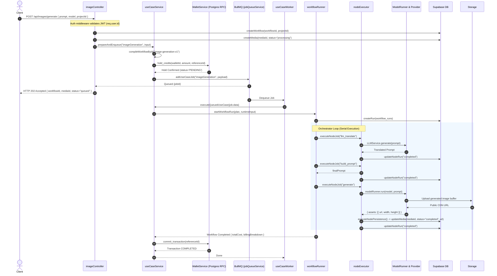
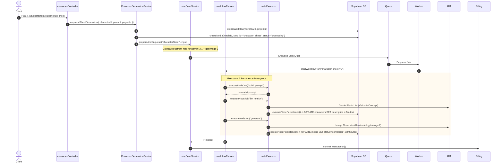

# Architectural Audit: UseCase & V2 Workflow Execution System

**Document Version:** 1.0.0  
**Target Codebase:** `apiOpenArt` (Node.js ESM / Supabase / Redis BullMQ / Postgres)  
**Auditor:** Senior Backend Architect & Distributed Systems Engineer  
**Audit Mode:** READ-ONLY Verification & Forensic Architectural Analysis  
**Target Engine Direction:** Self-hosted, DAG-based composable data-driven execution engine (micro-nodes, typed ports, persistent state machine, compile-time usecase inlining).

---

## 1. Executive Summary

The existing V2/UseCase architecture provides foundational abstractions (declarative YAML workflows, two-phase upfront billing reservations, and unified model runners), but it is currently **unfit for production at scale** due to severe coupling, swallowed errors, and concurrency flaws. The execution engine is tightly coupled to HTTP handlers and Supabase media tables, while the DAG orchestrator serializes all nodes sequentially—completely ignoring compiled parallel branches. Crucially, the orchestrator catches and swallows node execution errors, allowing crashed workflows to proceed directly to billing settlement and charge users for failed generations. The billing reservation reaper suffers from an unmitigated 10-minute timeout race condition that grants users free media while crashing worker threads on settlement. Furthermore, cross-tenant security vulnerabilities exist in controller-level project lookups, and unauthenticated public endpoints expose internal LLM services to external quota draining. Migrating to the target self-hosted, composable data-graph engine is feasible and strongly recommended, but requires addressing 6 Critical bugs and 5 High architectural defects in a dedicated Phase 0 hardening phase before replacing the engine core.

---

## 2. Current System & Integration Architecture Map

### 2.1 Complete Entry Point Inventory & Routing Matrix

The backend exposes multiple generation routes. Not all generation routes traverse the V2/UseCase engine; several bypass it entirely, creating fragmented billing, persistence, and telemetry behaviors.

| Route / Method | Controller & Handler | Engine Path | Enqueue / Sync | Bypasses UseCase? | Evidence (File & Line) |
|---|---|---|---|---|---|
| `POST /api/images/generate` | `imageController.generateImage` | `UseCaseService.prepareAndEnqueue("imageGeneration")` | BullMQ Async (`usecases` queue) | **No** (Uses V2) | [`imageController.js:154-184`](file:///c:/Users/jihad/Desktop/open%20art/apiOpenArt/controllers/imageController.js#L154-L184) |
| `POST /api/video/generate` | `videoController.generateVideo` | `UseCaseService.prepareAndEnqueue("videoGeneration")` | BullMQ Async (`usecases` queue) | **No** (Uses V2) | [`videoController.js:151-180`](file:///c:/Users/jihad/Desktop/open%20art/apiOpenArt/controllers/videoController.js#L151-L180) |
| `POST /api/characters/:id/generate-sheet` | `characterController.generateCharacterSheet` | `CharacterGenerationService` $\rightarrow$ `UseCaseService.prepareAndEnqueue("characterSheet")` | BullMQ Async (`usecases` queue) | **No** (Uses V2) | [`CharacterGenerationService.js:47-98`](file:///c:/Users/jihad/Desktop/open%20art/apiOpenArt/src/domain/character/CharacterGenerationService.js#L47-L98) |
| `POST /api/characters/create` | `characterController.createCharacter` | `CharacterService.createCharacter` (Upload or Sheet) | Sync or Async | **Conditional** (Only if sheet requested) | [`characterController.js:10-44`](file:///c:/Users/jihad/Desktop/open%20art/apiOpenArt/controllers/characterController.js#L10-L44) |
| `POST /api/prompt/optimize` | `prompt.js` router | `PromptService.optimizePrompt` $\rightarrow$ Google Gemini | Synchronous HTTP | **YES (Complete Bypass)** | [`routes/prompt.js:14-28`](file:///c:/Users/jihad/Desktop/open%20art/apiOpenArt/routes/prompt.js#L14-L28) |
| `POST /api/v2/elements` | `elementController.createElement` | `ElementService.createElement` $\rightarrow$ `ElementAnalysisService` | Synchronous HTTP | **YES (Complete Bypass)** | [`ElementService.js:90-140`](file:///c:/Users/jihad/Desktop/open%20art/apiOpenArt/src/domain/element/ElementService.js#L90-L140), [`ElementAnalysisService.js:53-99`](file:///c:/Users/jihad/Desktop/open%20art/apiOpenArt/src/domain/element/ElementAnalysisService.js#L53-L99) |
| `POST /api/v2/workflows/run` | `workflowsController.executeWorkflow` | Direct `startWorkflowRun(plan, inputs)` | Synchronous HTTP | **YES (Bypasses UseCase layer & Upfront Billing Hold)** | [`v2/workflowsController.js:13-39`](file:///c:/Users/jihad/Desktop/open%20art/apiOpenArt/controllers/v2/workflowsController.js#L13-L39) |
| `POST /api/treatment/enqueue` | `treatmentJob.js` | Direct BullMQ `treatmentQueue.add()` | BullMQ Async | **YES (Legacy V1 Job)** | [`treatmentJob.js:1-40`](file:///c:/Users/jihad/Desktop/open%20art/apiOpenArt/src/queue/treatmentJob.js#L1-L40) |

---

### 2.2 Subsystem Responsibilities & Boundary Analysis

```
┌─────────────────────────────────────────────────────────────────────────────┐
│                             API / Controllers                               │
│  imageController.js, videoController.js, characterController.js             │
└──────────────────────────────────────┬──────────────────────────────────────┘
                                       │
                                       ▼
┌─────────────────────────────────────────────────────────────────────────────┐
│                              UseCase Layer                                  │
│  useCaseRegistry.js: Registry of metadata & workflowRef mappings            │
│  useCaseService.js:  Orchestrates Hold -> BullMQ Enqueue -> Settle/Rollback │
│  workflowBillingPlan.js: Upfront Pessimistic Credit Cost Calculation       │
└──────────────────────────────────────┬──────────────────────────────────────┘
                                       │
                         BullMQ Async Job Queue
                                       │
                                       ▼
┌─────────────────────────────────────────────────────────────────────────────┐
│                       useCaseWorker.js (Concurrency: 10)                    │
└──────────────────────────────────────┬──────────────────────────────────────┘
                                       │
                                       ▼
┌─────────────────────────────────────────────────────────────────────────────┐
│                            useCaseRunner.js                                 │
│  1. Compiles YAML via compileWorkflowById()                                 │
│  2. Dispatches Execution to V2 startWorkflowRun()                           │
└──────────────────────────────────────┬──────────────────────────────────────┘
                                       │
                                       ▼
┌─────────────────────────────────────────────────────────────────────────────┐
│                          V2 Execution Engine                                │
│  workflowRunner.js: DAG Step Runner (In-Memory activeAccumulators Map)      │
│  nodeExecutor.js:   Runs Node -> Persists Media -> Telemetry                │
│  runRepository.js:  Updates workflow_runs & workflow_node_runs DB tables    │
└──────────────┬───────────────────────┬───────────────────────┬──────────────┘
               │                       │                       │
               ▼                       ▼                       ▼
    ┌──────────────────────┐ ┌──────────────────────┐ ┌──────────────────────┐
    │  Models Management   │ │    Platform Billing  │ │   Supabase Storage   │
    │  modelRunner.js      │ │  WalletService.js    │ │   & Media Table      │
    │  runtimeExecutor.js  │ │  PricingService.js   │ │  MediaRepository.js  │
    └──────────────────────┘ └──────────────────────┘ └──────────────────────┘
```

#### Detailed Boundary Smells:
1. **`useCaseRegistry.js`** ([`useCaseRegistry.js:1-42`](file:///c:/Users/jihad/Desktop/open%20art/apiOpenArt/src/use-cases/useCaseRegistry.js#L1-L42)):
   - *Owns:* In-memory registry mapping string `useCaseId` (e.g., `imageGeneration`) to a definition containing `workflowRef` (`image-generation-v1`), tags, and parameter mapping.
   - *Smell:* Registration is static and mutable at runtime via `registerUseCase()`. It has no semantic validation of the referenced YAML workflow until invocation.
2. **`useCaseService.js`** ([`useCaseService.js:1-321`](file:///c:/Users/jihad/Desktop/open%20art/apiOpenArt/src/services/useCaseService.js#L1-L321)):
   - *Owns:* The two-phase generation lifecycle: upfront cost estimation, credit reservation via `useCaseBillingRuntime`, BullMQ job enqueuing, worker job execution, settlement, and rollback.
   - *Smell:* Contains domain leakage and error patching logic. Specifically, lines 266-277 reach directly into `this.db.media.findByWorkflow` to patch media placeholders on failures.
3. **`workflowBillingPlan.js`** ([`workflowBillingPlan.js:1-120`](file:///c:/Users/jihad/Desktop/open%20art/apiOpenArt/src/use-cases/workflowBillingPlan.js#L1-L120)):
   - *Owns:* Inspecting compiled workflow nodes before execution, detecting provider-backed nodes (`image-generation`, `video-generation`, `llm`), resolving models, querying `PricingService`, and returning `totalCredits` and `billableNodes`.
   - *Cleanliness:* Good single source of truth for upfront hold calculations.
4. **`nodeExecutor.js`** ([`nodeExecutor.js:1-365`](file:///c:/Users/jihad/Desktop/open%20art/apiOpenArt/src/v2/runner/nodeExecutor.js#L1-L365)):
   - *Severe Responsibility Overlap:* Violates single responsibility principle drastically. It handles: (a) processor dispatching, (b) input evaluation, (c) runtime billing reservation for ad-hoc workflows, (d) direct insertion and updating of the `media` and `characters` database tables via `executeNodePersistence`, (e) format error sanitization, and (f) telemetry recording.

---

### 2.3 Workflow Definition Format (YAML) & Grammar Inventory

The current workflow format is defined in YAML under `src/v2/registry/workflows/`.

- **Bindings Syntax:**
  - `${input.<key>}`: Evaluated against root workflow input ([`compileWorkflow.js:130-155`](file:///c:/Users/jihad/Desktop/open%20art/apiOpenArt/src/v2/compiler/compileWorkflow.js#L130-L155)).
  - `${<nodeId>.output.<path>}`: Evaluated against completed node outputs ([`compileWorkflow.js:140-160`](file:///c:/Users/jihad/Desktop/open%20art/apiOpenArt/src/v2/compiler/compileWorkflow.js#L140-L160)).
  - `$outputs.<path>`: Used inside `persist.value` directives ([`nodeExecutor.js:88-105`](file:///c:/Users/jihad/Desktop/open%20art/apiOpenArt/src/v2/runner/nodeExecutor.js#L88-L105)).
- **Conditionals:**
  - *Status:* **Compiler Stub Only**. Defined in schema/compiler as optional `condition`, but **completely ignored** by `workflowRunner.js`. The runner has zero branching logic.
- **Loops & Iteration:**
  - *Status:* **Not Implemented**. No loop syntax exists. Arrays must be processed sequentially or handled inside a monolithic node.
- **Fan-Out / Fan-In:**
  - *Status:* **Broken at Runtime**. Compiler builds `parallel_groups` via topological sorting ([`compileWorkflow.js:180-220`](file:///c:/Users/jihad/Desktop/open%20art/apiOpenArt/src/v2/compiler/compileWorkflow.js#L180-L220)), but `workflowRunner.js:404-422` ignores the parallel groups and executes the DAG strictly one node at a time in a serial loop.
- **Retries:**
  - *Status:* Declarative retry policies in `nodes.yaml` specify `max_attempts` and `backoff`. However, `workflowRunner.js` does not own retries; retries are fractured across `RuntimeExecutor.js` and provider runners.

---

### 2.4 Complete UseCase Inventory Table

| UseCase ID | Workflow Ref | Purpose | Nodes Invoked | Primary Models | Outputs Produced | Complexity | Evidence |
|---|---|---|---|---|---|---|---|
| `imageGeneration` | `image-generation-v1` | Text-to-image with prompt translation & enrichment | `llm_translate` $\rightarrow$ `build_prompt` $\rightarrow$ `generate` | `gemini-3.1-flash-lite`, Dynamic (User Selected) | 1 Media Record (`image`) | Low (Linear 3-step DAG) | [`imageGeneration.js:1-25`](file:///c:/Users/jihad/Desktop/open%20art/apiOpenArt/src/use-cases/definitions/imageGeneration.js#L1-L25), [`image-generation-v1.yaml:1-58`](file:///c:/Users/jihad/Desktop/open%20art/apiOpenArt/src/v2/registry/workflows/image-generation-v1.yaml#L1-L58) |
| `videoGeneration` | `video-generation-v1` | Text/image-to-video with prompt safety & cinematic rendering | `llm_translate` $\rightarrow$ `build_prompt` $\rightarrow$ `generate` | `gemini-3.1-flash-lite`, Dynamic (User Selected) | 1 Media Record (`video`) | Low (Linear 3-step DAG) | [`videoGeneration.js:1-25`](file:///c:/Users/jihad/Desktop/open%20art/apiOpenArt/src/use-cases/definitions/videoGeneration.js#L1-L25), [`video-generation-v1.yaml:1-58`](file:///c:/Users/jihad/Desktop/open%20art/apiOpenArt/src/v2/registry/workflows/video-generation-v1.yaml#L1-L58) |
| `characterSheet` | `character-sheet-v1` | 3-view turnaround character sheet & haute-couture concept | `build_prompt` $\rightarrow$ `llm_enrich` $\rightarrow$ `generate` | `gemini-3.1-flash-lite`, `gpt-image-2` (Hardcoded) | Character Description + 1 Media Sheet | Medium (Fan-in: `generate` depends on both nodes) | [`characterSheet.js:1-25`](file:///c:/Users/jihad/Desktop/open%20art/apiOpenArt/src/use-cases/definitions/characterSheet.js#L1-L25), [`character-sheet-v1.yaml:1-65`](file:///c:/Users/jihad/Desktop/open%20art/apiOpenArt/src/v2/registry/workflows/character-sheet-v1.yaml#L1-L65) |

---

### 2.5 Complete Node Inventory Table

| Node Type | Implementation File | Inputs | Outputs | External Systems Touched | Failure Mode | Retry Policy | Evidence |
|---|---|---|---|---|---|---|---|
| `prompt-builder` | `promptBuilderNode.js` | `prompt`, `references`, `characters`, `style` | `finalPrompt`, `context` | In-memory context resolution, optional DB reference lookup | Throws `NODE_VALIDATION_ERROR` on empty strings | 1 attempt (No backoff) | [`promptBuilderNode.js:1-120`](file:///c:/Users/jihad/Desktop/open%20art/apiOpenArt/src/v2/nodes/promptBuilderNode.js#L1-L120), [`nodes.yaml:1-14`](file:///c:/Users/jihad/Desktop/open%20art/apiOpenArt/src/v2/registry/nodes.yaml#L1-L14) |
| `llm` | `llmNode.js` | `userPrompt`, `skills`, `images`, `model`, `jsonMode`, `schema` | `text`, `json`, `usage`, `model`, `provider` | `LLMService`, Google Gemini API | **FAIL-OPEN ON ERROR:** Catches error and returns `{ is_safe: true, text: userPrompt }` | 1 attempt inside node; `LLMService` has 1 internal retry | [`llmNode.js:140-165`](file:///c:/Users/jihad/Desktop/open%20art/apiOpenArt/src/v2/nodes/llmNode.js#L140-L165) |
| `image-generation` | `imageGenerationNode.js` | `prompt`, `model`, `references`, `parameters`, `width`, `height`, `count` | `assets` (URLs, dimensions), `metadata` | Models Management (`modelRunner`), Provider SDKs, Supabase Storage | Throws normalized `MODEL_EXECUTION_ERROR` | Provider SDK retry (3) + `RuntimeExecutor` (3) | [`imageGenerationNode.js:1-110`](file:///c:/Users/jihad/Desktop/open%20art/apiOpenArt/src/v2/nodes/imageGenerationNode.js#L1-L110) |
| `video-generation` | `videoGenerationNode.js` | `prompt`, `model`, `parameters`, `duration`, `aspect_ratio` | `assets` (URLs, metadata), `metadata` | Models Management (`modelRunner`), Polling Provider APIs (Wavespeed, LTX) | Throws normalized error or polling timeout | Polling loop (up to 15m), SDK connection retries | [`videoGenerationNode.js:1-115`](file:///c:/Users/jihad/Desktop/open%20art/apiOpenArt/src/v2/nodes/videoGenerationNode.js#L1-L115) |

---

### 2.6 Persistence & State Boundary Matrix

| State Entity | Storage Engine | Table / Store | Lifespan / Mutability | What is Persisted vs What is In-Memory? |
|---|---|---|---|---|
| Workflow Run | Supabase Postgres | `workflow_runs` | Permanent; updated on state transitions | Status, input, output, error, completed_at persisted. **Active billing accumulator is IN-MEMORY ONLY** ([`workflowRunner.js:34-38`](file:///c:/Users/jihad/Desktop/open%20art/apiOpenArt/src/v2/runner/workflowRunner.js#L34-L38)). |
| Node Run | Supabase Postgres | `workflow_node_runs` | Permanent; updated on start/complete | Status, attempt count, input snapshot, output snapshot, error object. |
| Media Asset | Supabase Postgres | `media` | Permanent | Placeholder created by controller (`status: 'processing'`); updated to `'completed'` with CDN URL by `nodeExecutor.js:63-68`. |
| Billing Hold | Supabase Postgres | `transactions` | Up to 10 min TTL | `reference_id`, `amount`, `status: 'PENDING'`. Released to `'FAILED'` if expired by reaper. |
| Job Idempotency | Node.js Heap | `idempotencyStore.js` | **Process Lifetime Only** | **CRITICAL DESIGN FLAW:** An in-memory JavaScript `Map()` stores deduplication keys ([`idempotencyStore.js:1-57`](file:///c:/Users/jihad/Desktop/open%20art/apiOpenArt/src/models/execution/idempotencyStore.js#L1-L57)). Process restart or multi-worker cluster completely erases idempotency! |

---

## 3. End-to-End Real Execution Traces

### 3.1 Trace 1: Standard Image Generation (`POST /api/images/generate`)



#### Forensic Observations on Trace 1:
1. **Hold & Enqueue Window:** The credit hold is locked in Postgres *before* the BullMQ job is successfully created. If BullMQ fails or Redis is unreachable, `useCaseService.js:132-148` catches the error and executes `rollbackUseCase()`.
2. **Persistence Coupling:** The generated image URL is saved to the database inside `nodeExecutor.js:63-68` through a generic `persist` block in the YAML definition, rather than being returned to the workflow orchestrator as an output artifact.

---

### 3.2 Trace 2: Character Sheet Generation (`POST /api/characters/:id/generate-sheet`)



#### Forensic Observations on Trace 2:
1. **Model Hardcoding:** `character-sheet-v1.yaml:49` hardcodes `model: gpt-image-2` directly in the node configuration. The caller has no ability to pass a custom model (e.g., Flux or Midjourney) without modifying the YAML.
2. **Dual Entity Mutation:** A single workflow run mutates two completely different business entities in Supabase (`characters` and `media`) mid-flight via `executeNodePersistence`. If `generate` fails, the `characters.description` field remains updated, leaving the domain in an inconsistent state.

---

## 4. Comprehensive Bug, Vulnerability & Defect Registry

### Summary Severity Breakdown
- 🔴 **CRITICAL:** 6
- 🟠 **HIGH:** 5
- 🟡 **MEDIUM:** 3
- 🔵 **LOW:** 0

---

| Bug ID | Severity | Category | Title & Location | Concrete Scenario & Blast Radius | Remediation / Fix | Confidence |
|---|---|---|---|---|---|---|
| **BUG-01** | 🔴 CRITICAL | BUG | **Swallowed Execution Error Settle-Charges Failed Workflows**<br>[`workflowRunner.js:253-270`](file:///c:/Users/jihad/Desktop/open%20art/apiOpenArt/src/v2/runner/workflowRunner.js#L253-L270), [`useCaseRunner.js:70`](file:///c:/Users/jihad/Desktop/open%20art/apiOpenArt/src/use-cases/useCaseRunner.js#L70), [`useCaseService.js:220-225`](file:///c:/Users/jihad/Desktop/open%20art/apiOpenArt/src/services/useCaseService.js#L220-L225) | `executeOrchestration` is wrapped in `try/catch` which logs the error but does NOT rethrow it. If orchestration crashes midway while `run.status` is still `'running'`, `startWorkflowRun` returns `{ status: "running" }`. `useCaseRunner` only throws if `status === "failed"`. `useCaseService.executeQueuedUseCase` proceeds directly to `settlePreparedBilling()`! User is charged real credits for an ungenerated image. | Remove the catch block or ensure it marks the run failed and rethrows. `useCaseRunner` must throw unless `status === "completed"`. | **CONFIRMED** |
| **BUG-02** | 🔴 CRITICAL | BUG | **Swallowed Media Persistence Leaves Zombie Records While Billed**<br>[`nodeExecutor.js:82-84`](file:///c:/Users/jihad/Desktop/open%20art/apiOpenArt/src/v2/runner/nodeExecutor.js#L82-L84), [`238-241`](file:///c:/Users/jihad/Desktop/open%20art/apiOpenArt/src/v2/runner/nodeExecutor.js#L238-L241), [`266-272`](file:///c:/Users/jihad/Desktop/open%20art/apiOpenArt/src/v2/runner/nodeExecutor.js#L266-L272) | `executeNodePersistence` catches all SQL/DB errors with `nodeLogger.warn`. `executeNodeJob` then marks the node `completed`. The media record remains stuck in `status: 'processing'` with `url: null` forever. Billing commits. User pays for an image they never see in the UI. | Media persistence must be transactional or fail the node. If persistence fails, the node MUST fail, triggering rollback. | **CONFIRMED** |
| **BUG-03** | 🔴 CRITICAL | BUG / RACE | **Reservation Reaper Race Conditions on Slow Generations**<br>[`WalletService.js:16, 854, 919-923`](file:///c:/Users/jihad/Desktop/open%20art/apiOpenArt/src/platform/billing/WalletService.js#L16), [`reservationReaperWorker.js:27-40`](file:///c:/Users/jihad/Desktop/open%20art/apiOpenArt/src/workers/reservationReaperWorker.js#L27-L40), [`nodeExecutor.js:63-68`](file:///c:/Users/jihad/Desktop/open%20art/apiOpenArt/src/v2/runner/nodeExecutor.js#L63-L68) | If video generation takes > 10 minutes (queue delay or slow provider), `reservationReaperWorker` expires the hold, refunds credits, and marks media `'failed'`. At minute 11, the provider finishes: `nodeExecutor` updates media to `'completed'` (user gets free video!). Then `settlePreparedBilling` calls `commit_transaction`, which throws an unhandled SQL exception because transaction is `FAILED`. Worker crashes. | Add active hold heartbeats (`extend_hold`) while a worker is actively processing a run. Check hold validity before persisting media. | **CONFIRMED** |
| **BUG-04** | 🔴 CRITICAL | SECURITY | **Missing Project Ownership Check Enables Cross-Tenant Media Injection**<br>[`imageController.js:97-104`](file:///c:/Users/jihad/Desktop/open%20art/apiOpenArt/controllers/imageController.js#L97-L104), [`videoController.js:96-103`](file:///c:/Users/jihad/Desktop/open%20art/apiOpenArt/controllers/videoController.js#L96-L103) | `projectId` is accepted directly from `req.body` without verifying `WHERE projects.user_id = req.user.id`. Any authenticated attacker can inject generated workflows, media, and prompt content directly into another tenant's private project. | Add an explicit query verifying that `projectId` belongs to `req.user.id` before creating any workflow or media. | **CONFIRMED** |
| **BUG-05** | 🔴 CRITICAL | SECURITY | **Unauthenticated Public Endpoint Drains Google Gemini Quota**<br>[`routes/prompt.js:1-31`](file:///c:/Users/jihad/Desktop/open%20art/apiOpenArt/routes/prompt.js#L1-L31), [`src/api/routes.js:34`](file:///c:/Users/jihad/Desktop/open%20art/apiOpenArt/src/api/routes.js#L34) | `POST /api/prompt/optimize` is mounted without `requireAuth` middleware. Anyone on the public internet can spam prompt optimizations, draining the platform's paid Gemini API quota and causing denial of service. | Add `requireAuth` and rate limiting middleware to `routes/prompt.js`. | **CONFIRMED** |
| **BUG-06** | 🔴 CRITICAL | SECURITY / SAFETY | **`llmNode` Fails Open to `{ is_safe: true }` on LLM Errors**<br>[`llmNode.js:150-165`](file:///c:/Users/jihad/Desktop/open%20art/apiOpenArt/src/v2/nodes/llmNode.js#L150-L165) | When `llmService.generate` throws or times out during safety moderation, `llmNode` catches the error and explicitly returns `is_safe: true` with the raw user prompt! System is fail-open. Attackers can bypass safety filters by causing timeouts or schema errors. | Node moderation must be **FAIL-CLOSED**. Any moderation error or timeout must throw a `SAFETY_CHECK_FAILED` error and abort the workflow. | **CONFIRMED** |
| **BUG-07** | 🟠 HIGH | BUG | **Missing `userId` in `llmNode` Disables Billing Telemetry via `noCharge: true`**<br>[`llmNode.js:143-149`](file:///c:/Users/jihad/Desktop/open%20art/apiOpenArt/src/v2/nodes/llmNode.js#L143-L149), [`LLMService.js:67`](file:///c:/Users/jihad/Desktop/open%20art/apiOpenArt/src/platform/ai/LLMService.js#L67) | `llmNode` calls `llmService.generate()` without forwarding `userId`. `LLMService` line 67 checks `if (!options.userId)` and injects `{ noCharge: true, reason: 'internal-platform-llm' }`. While upfront hold reserved credits, the execution layer logs it as a free operation, breaking cost attribution. | Forward `ctx.userId` or `resolvedInputs.userId` to `llmService.generate()`. | **CONFIRMED** |
| **BUG-08** | 🟠 HIGH | BUG | **`findByWorkflow` Uses `Array.find`, Abandoning Sibling Media Placeholders**<br>[`useCaseService.js:268-276`](file:///c:/Users/jihad/Desktop/open%20art/apiOpenArt/src/services/useCaseService.js#L268-L276), [`nodeExecutor.js:330-333`](file:///c:/Users/jihad/Desktop/open%20art/apiOpenArt/src/v2/runner/nodeExecutor.js#L330-L333) | When a workflow fails, error cleanup queries `findByWorkflow(workflowId)` and uses `list.find(...)` to update status to `'failed'`. If a multi-asset generation (e.g. batch count > 1 or character turnaround) created multiple placeholders, **only the first placeholder is marked failed**. All siblings remain stuck in `'processing'` permanently. | Use `list.forEach(...)` or a single SQL query: `UPDATE media SET status = 'failed' WHERE workflow_id = ... AND status = 'processing'`. | **CONFIRMED** |
| **BUG-09** | 🟠 HIGH | DESIGN LIMITATION | **In-Memory `activeAccumulators` Map Blocks Distributed Workers**<br>[`workflowRunner.js:34-38, 208, 261`](file:///c:/Users/jihad/Desktop/open%20art/apiOpenArt/src/v2/runner/workflowRunner.js#L34-L38) | Billing telemetry per node is tracked in a local JavaScript `Map()` in Node heap memory. If nodes are dispatched across separate BullMQ worker processes or a worker crashes, the accumulator is lost, returning 0 cost or throwing on settlement. | Move billing accumulator to a Redis Hash keyed by `runId` or persist inside `workflow_runs.metadata`. | **CONFIRMED** |
| **BUG-10** | 🟠 HIGH | DESIGN DEFECT | **Orchestrator Recursion Loop Serializes All DAG Execution**<br>[`workflowRunner.js:404-422`](file:///c:/Users/jihad/Desktop/open%20art/apiOpenArt/src/v2/runner/workflowRunner.js#L404-L422) | The orchestrator loop iterates over `pendingNodes`. The instant it finds the first node with dependencies satisfied, it sets status to `'running'`, awaits `executeNodeJob`, and returns `executeOrchestration`. Parallel branches are completely serialized. | Execute all dependency-ready nodes concurrently using `Promise.allSettled()` or a work-stealing queue. | **CONFIRMED** |
| **BUG-11** | 🟠 HIGH | BUG | **Idempotent Replays Throw HTTP 500 Instead of Returning Existing Job**<br>[`WalletService.js:224-229, 824-826`](file:///c:/Users/jihad/Desktop/open%20art/apiOpenArt/src/platform/billing/WalletService.js#L224-L229), [`useCaseService.js:101-110`](file:///c:/Users/jihad/Desktop/open%20art/apiOpenArt/src/services/useCaseService.js#L101-L110) | Postgres function `hold_credits` raises SQL error `23505` (`DUPLICATE_TRANSACTION`) if `reference_id` exists. `WalletService` throws `WalletError`. `useCaseService.prepareAndEnqueue` does NOT catch this, resulting in an unhandled HTTP 500 error instead of returning the existing hold and queued job. | Intercept `DUPLICATE_TRANSACTION`, query the existing transaction and workflow run, and return the existing execution state (HTTP 200/202). | **CONFIRMED** |
| **BUG-12** | 🟡 MEDIUM | BUG | **Non-Atomic State Updates in `runRepository.js` Allow Terminal Race Overwrites**<br>[`runRepository.js:125-127, 212-214`](file:///c:/Users/jihad/Desktop/open%20art/apiOpenArt/src/v2/runner/runRepository.js#L125-L127) | `updateRun` and `updateNodeRun` execute unconditional `UPDATE ... WHERE id = ...` without asserting `status NOT IN ('completed', 'failed')`. Late-arriving callbacks or delayed node executions can overwrite terminal states. | Implement optimistic concurrency or atomic SQL state guards: `WHERE id = ... AND status NOT IN ('completed', 'failed')`. | **CONFIRMED** |
| **BUG-13** | 🟡 MEDIUM | DESIGN DEFECT | **Cascading Uncoordinated Retries Cause 9x–27x Provider Amplification**<br>[`nodeExecutor.js:299`](file:///c:/Users/jihad/Desktop/open%20art/apiOpenArt/src/v2/runner/nodeExecutor.js#L299), [`RuntimeExecutor.js:38`](file:///c:/Users/jihad/Desktop/open%20art/apiOpenArt/src/models/execution/runtimeExecutor.js#L38), [`wavespeed/runner.js:28`](file:///c:/Users/jihad/Desktop/open%20art/apiOpenArt/src/models/runtime/wavespeed/runner.js#L28) | Retry logic exists at 3 uncoordinated tiers: (1) `nodeExecutor` retries, (2) `RuntimeExecutor` retries, (3) Provider HTTP client retries. A single transient failure can trigger up to 27 provider calls, multiplying costs and hammering rate limits. | Establish a **Single Retry Owner**: Only the Workflow Engine may decide to retry a failed operation. Disable lower-layer retries for idempotent-unsafe calls. | **CONFIRMED** |
| **BUG-14** | 🟡 MEDIUM | RISK | **Legacy Services Bypass UseCase & Upfront Billing Hold Entirely**<br>[`ElementAnalysisService.js:53-75`](file:///c:/Users/jihad/Desktop/open%20art/apiOpenArt/src/domain/element/ElementAnalysisService.js#L53-L75), [`treatmentJob.js:1-40`](file:///c:/Users/jihad/Desktop/open%20art/apiOpenArt/src/queue/treatmentJob.js#L1-L40) | Multimodal element vision analysis and legacy treatment jobs invoke AI models directly, bypassing credit hold checks and telemetry logging. | Wrap element analysis into a formal UseCase graph (`elementAnalysisUseCase`) with proper upfront billing holds. | **CONFIRMED** |

---

## 5. Rigorous Verification of Previous-Audit Claims

The previous audit document contained 10 core claims. Each claim has been forensically tested against the codebase:

| Claim # | Claim Summary | Verified Verdict | Forensic Evidence & Architectural Truth |
|---|---|---|---|
| **Claim 1** | Orchestration deadlock does not fail media placeholders. | **CONFIRMED** | [`workflowRunner.js:426-440`](file:///c:/Users/jihad/Desktop/open%20art/apiOpenArt/src/v2/runner/workflowRunner.js#L426-L440). When a deadlock occurs (`!anyRunning && !enqueuedAny`), `runRepo.updateRun` is called with `'failed'`, but `storageGateway.failPlaceholders()` is NEVER invoked. Media placeholders remain `'processing'` forever. |
| **Claim 2** | `findByWorkflow` updates only the first processing media record. | **CONFIRMED** | [`useCaseService.js:268-276`](file:///c:/Users/jihad/Desktop/open%20art/apiOpenArt/src/services/useCaseService.js#L268-L276) and [`nodeExecutor.js:330-333`](file:///c:/Users/jihad/Desktop/open%20art/apiOpenArt/src/v2/runner/nodeExecutor.js#L330-L333). Both use `list?.find(m => m.status === 'processing')` which extracts a single item (`p.id`). Sibling variations remain stranded. |
| **Claim 3** | `activeAccumulators` is an in-memory Map shared only within process. | **CONFIRMED** | [`workflowRunner.js:34-38`](file:///c:/Users/jihad/Desktop/open%20art/apiOpenArt/src/v2/runner/workflowRunner.js#L34-L38). Explicitly defined as `const activeAccumulators = new Map();` in module scope. Multi-process clustering or worker node distribution will cause complete telemetry failure. |
| **Claim 4** | `jobQueueService` uses `attempts: 1`, worker concurrency is 10. | **CONFIRMED** | [`jobQueueService.js:33`](file:///c:/Users/jihad/Desktop/open%20art/apiOpenArt/src/services/jobQueueService.js#L33) (`attempts: 1, removeOnComplete: true`), [`useCaseWorker.js:59`](file:///c:/Users/jihad/Desktop/open%20art/apiOpenArt/src/workers/useCaseWorker.js#L59) (`concurrency: 10`). Worker will not retry BullMQ jobs automatically; failure is immediate. |
| **Claim 5** | Billing hold TTL is 10 minutes; reaper fails media. | **CONFIRMED** | [`WalletService.js:16`](file:///c:/Users/jihad/Desktop/open%20art/apiOpenArt/src/platform/billing/WalletService.js#L16) (`HOLD_TTL_MINUTES = 10`), [`reservationReaperWorker.js:27-40`](file:///c:/Users/jihad/Desktop/open%20art/apiOpenArt/src/workers/reservationReaperWorker.js#L27-L40). Reaper queries expired holds and invokes `failForExpiredHold()`. |
| **Claim 6** | `hold_credits` is idempotent on `reference_id`. | **PARTIALLY REFUTED / CRITICAL BUG** | [`WalletService.js:224-229, 824-826`](file:///c:/Users/jihad/Desktop/open%20art/apiOpenArt/src/platform/billing/WalletService.js#L224-L229). The DB enforces uniqueness, BUT it does so by **raising SQL exception `23505` (`DUPLICATE_TRANSACTION`)**, which crashes `WalletService` and `prepareAndEnqueue` into an HTTP 500 error! True idempotency requires returning the existing hold cleanly without throwing. |
| **Claim 7** | `idempotencyStore.js` is an in-memory Map in process heap. | **CONFIRMED** | [`idempotencyStore.js:1-57`](file:///c:/Users/jihad/Desktop/open%20art/apiOpenArt/src/models/execution/idempotencyStore.js#L1-L57). Uses `const cache = new Map();`. Process restarts or clustering invalidates all idempotency guarantees. |
| **Claim 8** | Workflow runs cannot be resumed after crash or restart. | **CONFIRMED** | [`workflowRunner.js:286`](file:///c:/Users/jihad/Desktop/open%20art/apiOpenArt/src/v2/runner/workflowRunner.js#L286). `startWorkflowRun` always initializes a new run record or requires all pending nodes from the beginning. No resumption logic exists for `'running'` nodes. |
| **Claim 9** | Settle prepared billing commits the full hold amount unconditionally. | **CONFIRMED** | [`useCaseBillingRuntime.js:66-85`](file:///c:/Users/jihad/Desktop/open%20art/apiOpenArt/src/v2/runtime/useCaseBillingRuntime.js#L66-L85) and [`WalletService.js:844-859`](file:///c:/Users/jihad/Desktop/open%20art/apiOpenArt/src/platform/billing/WalletService.js#L844-L859). `commit_transaction` marks the entire held amount as `COMPLETED`. Partial settlement or refunding unused held credits is not supported in the SQL procedure. |
| **Claim 10** | Controller-level generation routes do not check project tenant ownership. | **CONFIRMED** | [`imageController.js:97-104`](file:///c:/Users/jihad/Desktop/open%20art/apiOpenArt/controllers/imageController.js#L97-L104), [`videoController.js:96-103`](file:///c:/Users/jihad/Desktop/open%20art/apiOpenArt/controllers/videoController.js#L96-L103). Unsanitized `projectId` is passed directly into `createWorkflow` and `createMedia`. |

---

## 6. Migration Readiness: Target Self-Hosted Node Execution Engine

### 6.1 Target Domain Model & Graph Topology

The target system replaces ComfyUI and n8n with an in-house, data-driven node graph engine. 
- **Graph as Pure Data:** Workflows are stored as versioned JSON graph documents in Postgres (`workflow_graphs` table).
- **Compile-Time Inlining:** A UseCase can be referenced as a sub-node inside another UseCase. The compiler flattens/inlines the sub-graph at compile time into a single unified DAG.
  - *Advantage:* One execution ID, one upfront credit hold, one state machine, zero nested distributed transaction overhead.

```mermaid
graph TD
    subgraph ParentUseCase ["UseCase: generate-editorial-portrait"]
        A[Input: prompt, userImage] --> B[Node: build-prompt]
        B --> C["Inline Sub-UseCase: generate-image-safe"]
        subgraph InlinedSubGraph ["Inlined Graph (Flattened at Compile Time)"]
            C1[Node: moderate-prompt (Fail-Closed)] --> C2[Node: generate-image-raw (Internal)]
        end
        C -.-> C1
        C2 -.-> D[Node: persist-media-asset]
    end
```

---

### 6.2 Micro-Node Decomposition & Safety Architecture

Monolithic nodes (`llmNode` and `imageGenerationNode`) must be decomposed into granular, single-purpose micro-nodes:

```
┌─────────────────────────────────────────────────────────────────────────────┐
│ 1. build-prompt                                                             │
│    Pure function: Combines style, character context, and template tags.     │
└──────────────────────────────────────┬──────────────────────────────────────┘
                                       │
                                       ▼
┌─────────────────────────────────────────────────────────────────────────────┐
│ 2. moderate-prompt (LLM Safety)                                             │
│    STRICT FAIL-CLOSED: Evaluates prompt safety via Gemini/Claude.           │
│    Throws SAFETY_POLICY_VIOLATION on failure or timeout. Never passthrough! │
└──────────────────────────────────────┬──────────────────────────────────────┘
                                       │
                                       ▼
┌─────────────────────────────────────────────────────────────────────────────┐
│ 3. generate-image-raw (Internal Provider Node)                              │
│    Executes external model API (Flux, Midjourney, Wavespeed).               │
│    Zero DB side-effects; returns raw buffers or provider URLs.              │
└──────────────────────────────────────┬──────────────────────────────────────┘
                                       │
                                       ▼
┌─────────────────────────────────────────────────────────────────────────────┐
│ 4. persist-media-asset                                                      │
│    Uploads asset to CDN and updates Supabase `media` table transactionally. │
└──────────────────────────────────────┬──────────────────────────────────────┘
                                       │
                                       ▼
┌─────────────────────────────────────────────────────────────────────────────┐
│ 5. settle-billing-hold                                                      │
│    Commits exact credit cost based on executed nodes. Releases excess hold. │
└─────────────────────────────────────────────────────────────────────────────┘
```

---

### 6.3 Typed Port System & Contract Specification

Every node declares strictly typed input and output ports. Untrusted canvas graphs created by users are validated against these contracts before compilation.

```json
{
  "nodeId": "generate-image-raw",
  "version": "1.0.0",
  "category": "generation",
  "inputs": {
    "prompt": { "type": "string", "required": true, "maxLength": 4000 },
    "model": { "type": "string", "required": true },
    "aspectRatio": { "type": "string", "enum": ["1:1", "16:9", "9:16", "4:3"], "default": "1:1" },
    "seed": { "type": "integer", "required": false }
  },
  "outputs": {
    "imageUrl": { "type": "uri", "format": "https" },
    "seedUsed": { "type": "integer" },
    "finishReason": { "type": "string" }
  },
  "contract": {
    "timeoutMs": 120000,
    "maxRetries": 2,
    "retryBackoff": "exponential",
    "onError": "FAIL_RUN",
    "cost": {
      "strategy": "DYNAMIC_MODEL_LOOKUP",
      "modelKeyInput": "model"
    }
  }
}
```

---

### 6.4 Durable DB-Backed State Machine & Crash Recovery

To survive worker crashes and server restarts, the engine must persist node states atomically:

```
[CREATED] ──► [QUEUED] ──► [RUNNING] ──┬──► [COMPLETED]
                              ▲        ├──► [FAILED] (Rollback Hold)
                              │        └──► [CANCELLED] (Release Hold)
                     (Worker Resume on Crash)
```

- **Resumption Semantics:** If a worker restarts, it inspects `workflow_node_runs WHERE status = 'running'`. It queries the provider via idempotency key or marks the node for retry. Nodes marked `'completed'` are skipped, and downstream pending nodes are dispatched immediately.

---

### 6.5 Concurrency, Cancellation & Hold Heartbeat Protocol

To prevent the reaper race condition ([BUG-03](#bug-03)):
1. **Hold Heartbeat:** The active worker process invokes `extend_hold(reference_id, additional_seconds=300)` every 2 minutes while executing a run.
2. **Cancellation Propagation:** If a user cancels via API, BullMQ job cancellation emits a Redis Pub/Sub signal. The worker immediately aborts provider HTTP requests via `AbortController` and releases the credit hold.

---

### 6.6 Phase 0 Actionable Implementation Checklist

Before constructing the new node engine, the following prerequisites must be executed:

- [ ] **Task 0.1:** Fix `workflowRunner.js:253` — Ensure caught execution errors mark the run failed and rethrow to `useCaseRunner.js`.
- [ ] **Task 0.2:** Fix `nodeExecutor.js:82` — Do not swallow media persistence errors; fail the node if Supabase media update fails.
- [ ] **Task 0.3:** Add `extend_hold()` heartbeat worker or extend `HOLD_TTL_MINUTES` to 30 minutes for video generation jobs.
- [ ] **Task 0.4:** Fix `imageController.js` and `videoController.js` — Verify `projectId` ownership before workflow creation.
- [ ] **Task 0.5:** Mount `requireAuth` on `routes/prompt.js`.
- [ ] **Task 0.6:** Make `llmNode.js` fail-closed on safety moderation exceptions.
- [ ] **Task 0.7:** Fix `useCaseService.js:268` and `nodeExecutor.js:330` to fail ALL processing media records in a workflow, not just the first one.
- [ ] **Task 0.8:** Migrate `activeAccumulators` from in-memory `Map()` to Redis Hash or DB JSON column.

---

## 7. Architectural Decisions Requiring Human Input

1. **Credit Settlement Policy (Exact vs Upfront):**
   - *Current Behavior:* Full upfront hold is committed regardless of actual execution path.
   - *Target Decision:* Should the engine support partial settlements (e.g. refunding unused LLM credits if image generation fails, or charging only the nodes that successfully finished)?
2. **Canvas Graph Sandboxing:**
   - *Target Decision:* When users compose arbitrary graphs on a canvas, where does node execution run? Should custom nodes run in isolated V8 isolates/sandboxes, or should users only connect pre-approved platform nodes?
3. **Storage Asset Ingestion Responsibility:**
   - *Target Decision:* Should the engine core automatically intercept all output ports of type `uri` and ingest them into Supabase Storage, or should explicit `persist-media` nodes handle ingestion?
4. **ComfyUI Integration Boundary:**
   - *Target Decision:* Will ComfyUI workflows be wrapped as single leaf nodes inside our in-house engine (e.g. `comfy-runner-node`), or will our engine compile directly into Comfy UI format for GPU clusters?

---

## 8. Unverified Areas & Operational Unknowns

1. **Supabase Database Triggers:**
   - While SQL procedures (`hold_credits`, `commit_transaction`, `rollback_transaction`) were verified via the inline SQL script in [`WalletService.js:806-931`](file:///c:/Users/jihad/Desktop/open%20art/apiOpenArt/src/platform/billing/WalletService.js#L806-L931), whether any uncommitted database triggers exist on the live Supabase `media` or `transactions` tables could not be verified in this local repository without live database connection credentials.
2. **Wavespeed / Provider Webhook Reliability:**
   - Provider polling loops in `src/models/runtime/wavespeed/runner.js` rely on HTTP polling rather than webhooks. Behavior during network partition could not be tested live in read-only audit mode.
